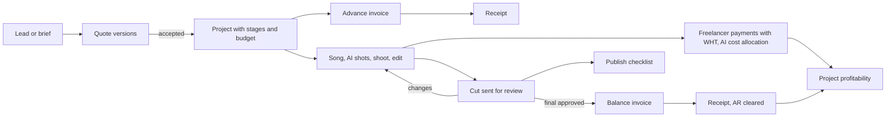
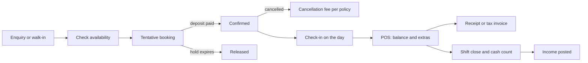
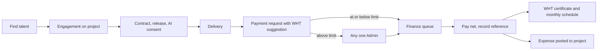
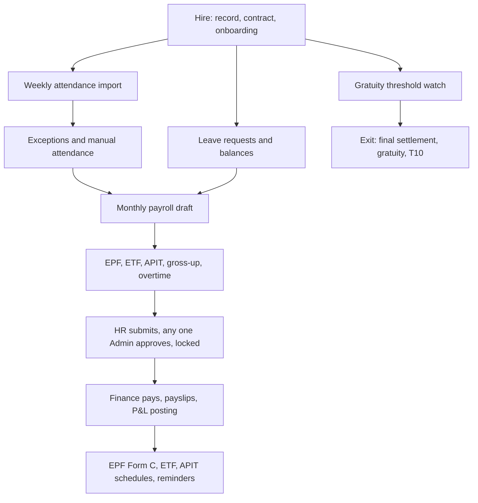

# ChordusAM: Media & Studio ERP with POS and HRIS — Business Requirements Document

**Date:** 9 November 2026 · **Version:** 0.1 (draft) · **Status:** Draft for review

**Summary.** This document states what Alliance Media Company (Private) Limited (AMPL) needs from ChordusAM now that the scope has grown from "HR, vendor payments and finance" (`docs/PLAN.md` v2.0) to a Media and Studio ERP with POS and HRIS (`docs/discovery/00-brief.md`). It keeps every requirement in PLAN.md (Appendix A maps each PLAN.md section to its new ID). It adds the selling side (clients, quotes, bookings, POS, sales invoices), the production side (projects, pipeline stages, talent, deliverables, rights, AI tool costs) and the Sri Lankan statutory items the research found missing (APIT, EPF earnings base, gratuity, TIN, statutory exports, WHT on freelancers, the 2026 VAT invoice format, VAT and SSCL thresholds, PDPA from 1 January 2027). There are 222 business requirements (`BR-<MODULE>-NNN`) in 19 modules, 84 non-functional requirements (the security, privacy and audit IDs are adopted unchanged from `docs/discovery/15-compliance-security.md`), 71 numbered business rules and 54 open questions. It also captures the finance controls in `docs/discovery/14-business-case.md` §6 and the design requirements in `docs/discovery/13-ux-design.md` (Appendix B). Requirement IDs here are the shared IDs for every other discovery document (brief section 7). The "MVP?" column shows the Product Owner's cut from `docs/discovery/21-mvp-roadmap.md` §6.1 (133 of 222: 13 in Release 0, 120 in the MVP); the BA's original proposal was 182.

---

## 1. Document control

| Item             | Value                                                                                                                                                                                                                                                                                                                                                                        |
| ---------------- | ---------------------------------------------------------------------------------------------------------------------------------------------------------------------------------------------------------------------------------------------------------------------------------------------------------------------------------------------------------------------------- |
| Document         | Business Requirements Document (BRD), `docs/discovery/10-brd.md`                                                                                                                                                                                                                                                                                                             |
| Product          | ChordusAM: Media & Studio ERP with POS and HRIS                                                                                                                                                                                                                                                                                                                              |
| Company          | Alliance Media Company (Private) Limited (AMPL), Colombo, Sri Lanka                                                                                                                                                                                                                                                                                                          |
| Version          | 0.1 (draft)                                                                                                                                                                                                                                                                                                                                                                  |
| Date             | 9 November 2026                                                                                                                                                                                                                                                                                                                                                              |
| Owner            | Thoshan Rathnayake (Fractional COO)                                                                                                                                                                                                                                                                                                                                          |
| Authors          | Discovery team (Business Analyst, with research by R1 to R4)                                                                                                                                                                                                                                                                                                                 |
| Status           | Draft for review                                                                                                                                                                                                                                                                                                                                                             |
| Reviewers        | Thoshan, Fazlur, Gurpreet (Admins); Abilasini (Operations Manager, HR); Janaka (Finance); the external accountant and lawyer for items marked "(unverified)" or "legal"                                                                                                                                                                                                      |
| Upstream sources | `docs/discovery/00-brief.md`; `docs/PLAN.md` v2.0; `docs/phase-0.md`; `docs/discovery/research/R1-media-production-erp.md` (R1); `docs/discovery/research/R2-hris-payroll-sri-lanka.md` (R2); `docs/discovery/research/R3-pos-booking-finance.md` (R3); `docs/discovery/research/R4-creative-ops-rights.md` (R4); Phase 0 code (`lib/auth/`, `supabase/migrations/`, `app/`) |
| Companion        | `docs/discovery/11-gap-analysis.md` (gap analysis built on this BRD)                                                                                                                                                                                                                                                                                                         |

**How to cite sources in this document.** "PLAN §5.3" is a section of `docs/PLAN.md`. "R2-44" and "R4-F06" are candidate requirement IDs from the research files. "R1 P4" is pattern P4 in R1 section 6. "R3 §6" is section 6 of R3. Laws are named in full the first time. Statements marked **(unverified)** come from research that could not confirm them against a primary source; they must be checked by the accountant or lawyer before a rule is coded. Under CLAUDE.md every rate, threshold and date is data edited in the UI, so a correction does not need a code change.

| Version | Date             | Change                                                                                                                                                                     |
| ------- | ---------------- | -------------------------------------------------------------------------------------------------------------------------------------------------------------------------- |
| 0.1     | 9 November 2026  | First draft for owner review                                                                                                                                               |
| 0.2     | 10 November 2026 | Review (`30-review-log.md`): "MVP?" column set to the PO's cut in `21-mvp-roadmap.md` §6 (133 BRs; NFR deferrals from 21 §6); NFR-DATA-004 reworded to integer minor units |

---

## 2. Executive summary

**The problem.** AMPL runs six business lines (music videos at 12 to 15 a month, photography, video and ads, studio and song production, social media marketing, SEO) across several brands, with 10 to 30 staff and a large freelancer pool. It runs them on spreadsheets, WhatsApp, ClickUp and a fingerprint machine export. Money, people and creative facts live in different places, so nobody can say quickly what a music video earned after freelancer and USD AI-tool costs, which studio slot is free, who approved a cut, or whether AMPL still holds the rights to a video it wants to reuse.

**What exists.** PLAN.md v2.0 already specifies HR (attendance import, leave, manual attendance, contract types, payroll preparation), Vendor Payments (requests, spending limit routing, numbered vouchers) and a Finance management ledger. Phase 0 built the foundation only: sign-in, four roles (`employee`, `hr`, `admin`, `finance`) read from `public.profiles`, a server-side access matrix, RLS on `profiles` and an append-only `audit_log`, CI and the AMPL look. No business screens or business tables exist yet.

**What this BRD adds.** Nine modules that PLAN.md does not have (CRM, PRJ, BKG, POS, SAL, TAL, AST, AI, APR), plus HR and tax items PLAN.md misses. In short:

1. **One job record from quote to cash.** A quote becomes a project with stages, budget, bookings, freelancer engagements and AI costs, and its milestone invoices. Profitability per music video is a by-product, not a spreadsheet (BR-CRM-007, BR-PRJ-006, BR-FIN-007).
2. **Studio front of house.** Bookings for rooms, people and equipment with database-enforced conflict prevention, deposits and cancellation rules; a light, service-first POS that keeps working when the internet drops; QR check-out and check-in of gear (BR-BKG-004, BR-POS-006, BR-BKG-012).
3. **Sri Lankan compliance built in.** EPF and ETF on the correct earnings base, APIT from versioned IRD tables with gross-up for net contracts, gratuity, statutory exports, 5% WHT on freelancer fees with certificates, the IRD tax invoice format in force since 1 October 2026, VAT and SSCL threshold monitoring, and PDPA duties from 1 January 2027 (BR-PAY-003 to BR-PAY-006, BR-VP-012, BR-SAL-003, BR-SAL-014, BR-ADM-010).
4. **Creative facts as records.** Deliverable versions, client approval events, revision rounds, rights, talent releases and AI-likeness consents, with a block on publishing without them (BR-AST-003, BR-AST-005, BR-AST-008, BR-TAL-006).
5. **AI tool spend attributed to projects.** USD subscriptions allocated to the month's projects so a LKR price list can be checked against USD costs (BR-AI-003).
6. **Finance controls a CFO would sign.** A balanced journal-shaped management ledger, deposits held as liabilities, revenue recognition, WIP and unbilled reporting, period locks, segregation of duties and bank-detail change control (BR-FIN-016, BR-SAL-007, BR-FIN-017, BR-FIN-018, BR-FIN-014, BR-APR-004, BR-VP-003).

**What stays out.** Statutory double-entry books (the accountant keeps them; ChordusAM exports or syncs), filing returns with the government, card-terminal integration, bank feeds, a video player, a full DAM, royalty processing at scale, recruitment and appraisals. Section 5.2 gives the reasons.

**Requirement counts by module** (detail in section 8):

| Module    | Total   | Must    | Should | Could | Won't | MVP (R0 + MVP, PO cut) |
| --------- | ------- | ------- | ------ | ----- | ----- | ---------------------- |
| CRM       | 9       | 6       | 3      | 0     | 0     | 1 (BA: 6)              |
| PRJ       | 10      | 5       | 4      | 1     | 0     | 6 (BA: 7)              |
| BKG       | 15      | 12      | 3      | 0     | 0     | 9 (BA: 13)             |
| POS       | 13      | 9       | 3      | 1     | 0     | 7 (BA: 11)             |
| SAL       | 15      | 11      | 4      | 0     | 0     | 10 (BA: 12)            |
| VP        | 18      | 16      | 2      | 0     | 0     | 15 (BA: 17)            |
| FIN       | 19      | 15      | 3      | 1     | 0     | 13 (BA: 16)            |
| HR        | 13      | 8       | 3      | 0     | 2     | 7 (BA: 9)              |
| ATT       | 13      | 10      | 2      | 1     | 0     | 10 (BA: 11)            |
| LV        | 10      | 9       | 1      | 0     | 0     | 9 (BA: 10)             |
| PAY       | 20      | 17      | 3      | 0     | 0     | 9 (BA: 20)             |
| TAL       | 11      | 7       | 3      | 1     | 0     | 6 (BA: 8)              |
| AST       | 10      | 7       | 2      | 1     | 0     | 5 (BA: 8)              |
| AI        | 7       | 3       | 3      | 0     | 1     | 3 (BA: 4)              |
| APR       | 8       | 7       | 1      | 0     | 0     | 6 (BA: 8)              |
| NOT       | 5       | 2       | 3      | 0     | 0     | 3 (BA: 3)              |
| RPT       | 10      | 7       | 3      | 0     | 0     | 6 (BA: 9)              |
| ADM       | 10      | 8       | 2      | 0     | 0     | 7 (BA: 8)              |
| INT       | 6       | 1       | 3      | 2     | 0     | 1 (BA: 2)              |
| **Total** | **222** | **160** | **51** | **8** | **3** | **133** (BA: 182)      |

**Top findings.**

- The MVP as the BA first proposed it was large (182 requirements). The Product Owner cut it by release to 133 (13 in Release 0 and 120 in the MVP) in `21-mvp-roadmap.md` §6; the "MVP?" column below now shows that cut (review `30-review-log.md` RV-01). The 49 requirements moved out, and why, are in 21 §6.2.
- Three foundations must be decided **before Phase 1 builds `employees`**: an `entity_id` and brand on business records (NFR-SCALE-001, BR-FIN-008), an extended role model (BR-ADM-002), and a generic approval engine (BR-APR-001). Retrofitting any of them later touches every table and RLS policy.
- The fastest-moving risk is tax and statutory data: almost every rate and threshold in R2 and R3 changed in the last 18 months. Holding them as effective-dated data with an accountant sign-off is a business requirement, not an engineering nicety (BR-ADM-004, NFR-COST-003).
- The CFO recommends Option E: build the core and take EPF, ETF, APIT and payslips from a local payroll SaaS (`14-business-case.md` §1.1). The payroll requirements are written as outcomes so either route can meet them; the hand-off (BR-PAY-020) is the critical requirement under Option E (OQ-42).
- PDPA Parts I and III take effect on 1 January 2027, seven weeks after this draft. A DPO, privacy notices, retention and read logging are needed whether or not anything else ships (BR-ADM-010, NFR-PRIV-001, NFR-PRIV-003, NFR-PRIV-007, NFR-PRIV-010, NFR-PRIV-011).

---

## 3. Business context and problem statement

### 3.1 The business

| Business line (brief §2)   | What is sold                                                                             | How money flows (as researched)                                                    | Main cost drivers                                                                                                             |
| -------------------------- | ---------------------------------------------------------------------------------------- | ---------------------------------------------------------------------------------- | ----------------------------------------------------------------------------------------------------------------------------- |
| Music video production     | AI-hybrid Sinhala and Tamil music videos, 12 to 15 a month, concept to published in days | Quote, advance, balance on final approval (R3 §1); some for own channels (R4 §3.5) | Freelance vocalists, musicians, lyricists, editors, AI artists; USD AI tools (Suno, Higgsfield, Kling, Runway, GPU) (R4 §4.2) |
| Photography                | Brand, product and portrait sessions in the Colombo 05 studio                            | Session packages, deposit, balance, prints (R3 §1)                                 | Studio, equipment, photographer time                                                                                          |
| Videography and ads        | Ad production, corporate video, event coverage                                           | Quote (often AICP-style budget, R1 §4.15), milestones                              | Crew, equipment hire, talent, locations                                                                                       |
| Studio and song production | Song production, dubbing, podcast recording                                              | Hourly or session hire, walk-in and booked (R3 §1)                                 | Engineer time, room                                                                                                           |
| Social media marketing     | Monthly content for brands                                                               | Retainers with deliverable quotas (R4 §6)                                          | Staff time, freelancers                                                                                                       |
| SEO and content strategy   | Monthly SEO and content                                                                  | Retainers (R4 §6)                                                                  | Staff time                                                                                                                    |

- **Brands and channels:** The Studio LK, Media Digital SG, Varnam TV, Varna TV. "SG" suggests a possible Singapore entity (brief §2). "Varnam TV" is also the name of an unrelated Colombo Tamil TV service (R4 §3.5), so the brand position needs confirming (OQ-27).
- **Scale:** 10 to 30 staff plus a freelancer pool; 25+ projects, 3 active business tracks, 2 markets, 48-hour average turnaround (brief §2).
- **People named in this BRD:** Thoshan (owner, Admin), Fazlur and Gurpreet (Admins), Abilasini (Operations Manager, HR), Janaka (Finance), Chathurika and other producers and coordinators who raise vendor payments.

### 3.2 Current tools

| Tool                          | Used for (as described in the brief and PLAN.md)                                                                    |
| ----------------------------- | ------------------------------------------------------------------------------------------------------------------- |
| Spreadsheets                  | Attendance clean-up, leave balances, payroll, income and expense records, receivables, project costs                |
| WhatsApp                      | Approvals (leave, spend), client feedback on cuts, freelancer engagement and payment confirmation, booking requests |
| ClickUp                       | Tasks for productions (stays as the task tool, PLAN §6.4)                                                           |
| Fingerprint machine export    | Weekly attendance file; brand, model and format not yet known (PLAN Q1, R2 C.1)                                     |
| Bank, cards, LankaQR, cash    | Taking and making payments, recorded by hand (R3 §5)                                                                |
| External accountant's package | Statutory books; package not yet known (R1 OQ4, R3 OQ2)                                                             |

### 3.3 Pain points

Pain points come from the brief, PLAN.md and the research. They have **not yet been validated in a workshop** with AMPL staff; the Product Designer (`docs/discovery/13-ux-design.md`) should confirm them.

| #   | Pain point                                                                                                                               | Evidence                 |
| --- | ---------------------------------------------------------------------------------------------------------------------------------------- | ------------------------ |
| P1  | Approvals happen in WhatsApp threads, so there is no reliable record of who approved what, and self-approval is not prevented            | PLAN §1, §2; R4 §1.3     |
| P2  | Attendance is cleaned by hand every week from the machine export, and payroll is rebuilt in a spreadsheet each month                     | PLAN §1, §7              |
| P3  | Statutory items (APIT, EPF base, gratuity, WHT) are not modelled, so pay and freelancer payouts may be wrong or late                     | R2 D.4; R3 §6            |
| P4  | No single job record: quote, freelancer costs, AI costs and invoices sit in different files, so per-video profit is guessed              | R1 §7.3, §7.4; PLAN §6.3 |
| P5  | USD AI subscriptions are paid centrally and never charged to the videos that used them                                                   | R4 §4.3                  |
| P6  | Studio rooms and gear have no shared calendar; double-booking and unreturned gear are found late                                         | R3 §1, §3.4              |
| P7  | Walk-in and session payments (cash, card terminal, QR) have no shift close or variance check                                             | R3 §7.1                  |
| P8  | Client approval of cuts arrives on WhatsApp; extra revision rounds are not counted or billed                                             | R4 §1.3, R4-F03          |
| P9  | Who owns each video, master and composition, and what talent consented to (including AI likeness), is not recorded                       | R4 §3.2, §4.4            |
| P10 | Receivables are chased from memory; the Operations Manager's 14-day AR KPI cannot be measured                                            | PLAN §6.1                |
| P11 | Since 1 October 2026 VAT invoices must follow a new IRD format, and SSCL registration starts at LKR 36m a year; AMPL's status is unknown | R3 §6                    |
| P12 | PDPA duties start 1 January 2027 and HR and talent data is scattered across phones and files                                             | R2 B.11; R4 §3.4         |

---

## 4. Business objectives and success metrics

Baselines are **not known** today. The first task after approval is to measure them for one month (OQ-41). Targets apply 12 months after the MVP goes live unless stated.

| #   | Objective                              | Metric (how measured)                                                                      | Baseline       | Target                                                                                                   | Main requirements                              |
| --- | -------------------------------------- | ------------------------------------------------------------------------------------------ | -------------- | -------------------------------------------------------------------------------------------------------- | ---------------------------------------------- |
| O1  | Close the books faster                 | Working days from month end to Admin-reviewed management P&L                               | To measure     | 5 working days or fewer                                                                                  | BR-FIN-002, BR-FIN-006, BR-FIN-014, BR-FIN-015 |
| O2  | Cut payroll preparation effort         | HR plus Finance hours per monthly run, from attendance cut-off to "sent to Finance"        | To measure     | 4 hours or fewer; zero spreadsheet recalculations                                                        | BR-ATT-005, BR-PAY-001, BR-PAY-009, BR-PAY-013 |
| O3  | Invoice promptly                       | Unbilled WIP days: days from booking completion or milestone approval to invoice (14 §7.2) | To measure     | 2 days or fewer                                                                                          | BR-SAL-001, BR-SAL-005, BR-AST-003, BR-FIN-018 |
| O4  | Know the margin on every job           | Share of client jobs opened after go-live with budget, actual cost and income tracked      | 0% (no system) | 100%                                                                                                     | BR-CRM-007, BR-PRJ-005, BR-PRJ-006, BR-FIN-007 |
| O5  | Charge AI spend to work                | Share of AI subscription cost allocated to projects each month                             | 0%             | 90% or more                                                                                              | BR-AI-001, BR-AI-003                           |
| O6  | Collect cash faster                    | DSO = AR ÷ trailing-90-day revenue × 90; share of AR more than 14 days overdue (14 §7.2)   | To measure     | DSO 10 days below baseline; AR over 14 days down 25%, then 50%                                           | BR-SAL-009, BR-SAL-010, BR-INT-002             |
| O7  | Control front-of-house cash            | Share of POS shifts closed with a count and signed-off variance                            | 0%             | 100%; average absolute variance under the configured tolerance                                           | BR-POS-005                                     |
| O8  | Meet statutory deadlines               | APIT, EPF, ETF and WHT remittances and certificates on time                                | To measure     | 100% on time; WHT certificate for every deduction                                                        | BR-PAY-015, BR-PAY-017, BR-VP-013              |
| O9  | Publish only cleared work              | Published deliverables without an ownership record, disclosure decision or valid consent   | Unknown        | Zero                                                                                                     | BR-AST-005, BR-AST-008, BR-TAL-006             |
| O10 | Prove the 48-hour promise              | Share of music videos with first cut sent within the package turnaround target             | Unknown        | Measured monthly; target set by owner after 3 months of data                                             | BR-PRJ-009                                     |
| O11 | Move approvals out of WhatsApp         | Share of leave, manual attendance and payment approvals decided in ChordusAM               | 0%             | 95% within 3 months of go-live                                                                           | BR-APR-007, BR-NOT-001                         |
| O12 | Keep it cheap to run                   | Monthly run cost (hosting, maintenance, email, messaging, gateway fixed fees)              | n/a            | Within the CFO plan, about LKR 200,000 a month all-in (14 §3.6, §7.2), and below the cheapest buy option | NFR-COST-001                                   |
| O13 | Take deposits and bill all studio time | Deposit coverage; booked versus billed studio hours; gear damage recovered (14 §7.2)       | To measure     | 90% or more of bookings with a deposit; 98% of used hours billed; 60% of damage cost recovered           | BR-BKG-009, BR-SAL-007, BR-BKG-014             |

---

## 5. Scope

### 5.1 In scope

All 19 modules of the shared ID scheme (brief §7):

| Code | Module                                                                           | Scope in this BRD                                                                                                    |
| ---- | -------------------------------------------------------------------------------- | -------------------------------------------------------------------------------------------------------------------- |
| CRM  | Clients, leads, quotes and estimates                                             | Client directory, leads, quotes with versions and acceptance, quote-to-project conversion, retainer agreements       |
| PRJ  | Projects, jobs and the production pipeline                                       | Projects, codes, pipeline templates and stages, budgets, budget versus actual, time logs, turnaround, call sheets    |
| BKG  | Studio, room, equipment and crew booking, and equipment check-in and check-out   | Resources, calendar, conflict prevention, pricing rules, deposits, cancellation, QR check-out and check-in, damage   |
| POS  | Point of sale, receipts, deposits, packages, vouchers and shifts                 | Light service-first POS, split tender, offline queue, shifts and cash count, packages, vouchers, refunds             |
| SAL  | Sales invoices, receipts and receivables                                         | Invoices, gapless numbering, IRD tax invoice, milestones, receipts, credit notes, AR ageing, VAT and SSCL monitoring |
| VP   | Vendor and talent payments, vouchers and withholding tax                         | All of PLAN §5, plus WHT computation and certificates, purchase orders                                               |
| FIN  | Management ledger, expenses, budgets, P&L, cash, multi-currency and multi-entity | All of PLAN §6, plus brand P&L, month close, FX source, accountant export                                            |
| HR   | Core HR                                                                          | PLAN employees and contract types, plus statutory IDs, documents, on/offboarding, letters, classification checklist  |
| ATT  | Attendance and time                                                              | All of PLAN §4.2 and §7, plus overtime, mobile check-in, device push                                                 |
| LV   | Leave                                                                            | All of PLAN §4.3 and §4.4, plus statutory floors and booking-clash warnings                                          |
| PAY  | Payroll and statutory                                                            | PLAN §10, plus pay components, APIT, gross-up, statutory outputs and calendar, gratuity, final settlement            |
| TAL  | Talent and freelancer pool                                                       | Profiles, rate cards, engagements, contracts, releases, AI-likeness consents, portal                                 |
| AST  | Deliverables, assets, rights, licences, releases and channel revenue             | Deliverables register, versions, approvals, revision rounds, rights register, publish checklist, splits, channel P&L |
| AI   | AI tool subscriptions, credits and per-project AI cost                           | Subscription register, recurring cost, pool-and-allocate, usage log, allowance tracker                               |
| APR  | Approval workflows (generic engine)                                              | Configurable chains, any-one-of-group, self-approval ban, delegation, inbox                                          |
| NOT  | Notifications                                                                    | In-app and email (PLAN §11) plus new events; optional WhatsApp utility templates                                     |
| RPT  | Dashboards and reporting                                                         | PLAN §8 dashboards plus production and studio utilisation                                                            |
| ADM  | Admin, settings, roles, multi-entity, audit                                      | Users and roles, policy settings, entities, brands, locations, audit viewer, data import, catalogue, PDPA records    |
| INT  | Integrations                                                                     | PayHere, email, accounting sync, calendar feeds, ClickUp read, review-tool webhooks                                  |

### 5.2 Out of scope (with reasons)

| Item                                                                          | Why it is out                                                                                                                                                                                                                                                                                                                                                                                                                |
| ----------------------------------------------------------------------------- | ---------------------------------------------------------------------------------------------------------------------------------------------------------------------------------------------------------------------------------------------------------------------------------------------------------------------------------------------------------------------------------------------------------------------------- |
| Statutory double-entry general ledger, financial statements, tax computations | PLAN §1 and §6: ChordusAM is a management ledger and the accountant keeps the books. R3 §4.2 found no package with strong Sri Lankan localisation, so replacing the accountant's tool adds risk with no benefit. ChordusAM exports (BR-FIN-015) and later syncs (BR-INT-001).                                                                                                                                                |
| Filing returns with the IRD, EPF or ETF Board                                 | PLAN §1. ChordusAM produces the figures and files (BR-PAY-015, BR-PAY-016, BR-VP-013); a person submits them. RAMIS e-invoice transmission is "Should" behind an outbox (BR-SAL-015) because the IRD technical spec was not obtained (R3 §6).                                                                                                                                                                                |
| Bank integrations: bank feeds, direct payment initiation, account APIs        | R3 §4.1 and §7.3 confirmed no Sri Lankan bank feeds in any surveyed package. CSV statement import is a "Could" (BR-FIN-011). Online payment gateways (PayHere) are in scope (BR-INT-002).                                                                                                                                                                                                                                    |
| Integration with card terminals                                               | R3 §2.2 and §8: in Sri Lanka card payments go through a standalone bank terminal or Genie device. ChordusAM records method, last 4 digits and approval code (BR-POS-002). This keeps ChordusAM out of PCI card-data scope.                                                                                                                                                                                                   |
| Video player, frame-accurate review and annotation                            | R4 §1.3: mature and cheap tools exist (Frame.io, Vimeo). ChordusAM links to them and owns the approval record (BR-AST-002, BR-AST-003).                                                                                                                                                                                                                                                                                      |
| Full DAM with transcoding and storage of masters                              | R4 §2: files stay in Drive, Dropbox or Frame.io; ChordusAM holds the facts (BR-AST-001).                                                                                                                                                                                                                                                                                                                                     |
| Royalty statement processing at scale, social media analytics                 | R4 §3.7 and §6: buy Curve Lite or AgencyAnalytics if needed. Statement import is a "Could" (BR-AST-010).                                                                                                                                                                                                                                                                                                                     |
| Task management                                                               | PLAN §6.4: ClickUp stays the task tool. ChordusAM stores links and may read status (BR-PRJ-001, BR-INT-005).                                                                                                                                                                                                                                                                                                                 |
| Recruitment and performance appraisals                                        | PLAN §1 put them out of v1; R2-11 and R2-12 list them as table stakes for HRIS. Recorded as "Won't for MVP" (BR-HR-012, BR-HR-013) so they are not lost.                                                                                                                                                                                                                                                                     |
| Singapore payroll (CPF, SDL, IR8A)                                            | R2 B.12 recommends an SG provider until headcount justifies it. The data model stays ready (NFR-SCALE-001).                                                                                                                                                                                                                                                                                                                  |
| Native iOS and Android apps                                                   | PLAN §1. An installable web app (PWA) covers phones and offline POS (NFR-MOB-002).                                                                                                                                                                                                                                                                                                                                           |
| Storing biometric templates                                                   | R2 B.11: templates stay on the device; ChordusAM keeps only device user ID, timestamp and verify mode (NFR-PRIV-002).                                                                                                                                                                                                                                                                                                        |
| Qualified e-signature provider                                                | R3 §8: the MVP uses click-to-accept with an audit trail. The Electronic Transactions Act No. 19 of 2006 says a contract is not denied validity only because it is electronic ([Act text](https://documents.gov.lk/view/acts/2006/5/19-2006_E.pdf), [Daily Mirror overview](https://www.dailymirror.lk/features/E-commerce-in-Sri-Lanka-A-legal-overview/185-189694)); the lawyer confirms which documents need more (OQ-26). |
| Running ChordusAM as a SaaS for other studios                                 | Brief §4: design for multi-tenant readiness (NFR-SCALE-002); AMPL's needs come first. No billing, sign-up or tenant admin is in scope.                                                                                                                                                                                                                                                                                       |
| Stripe, Square, HoneyBook and other foreign-only payment rails                | R3 §2.1 and §3.3: Square and HoneyBook exclude Sri Lanka. Third-party guides say Stripe does not onboard Sri Lankan-registered merchants ([Dodo Payments guide](https://dodopayments.com/blogs/stripe-supported-countries-alternatives), secondary; Stripe's own country list not checked).                                                                                                                                  |

### 5.3 Assumptions

| #   | Assumption                                                                                                                                                    | If wrong                                                             |
| --- | ------------------------------------------------------------------------------------------------------------------------------------------------------------- | -------------------------------------------------------------------- |
| A1  | One legal entity (AMPL, Sri Lanka) at MVP go-live; Media Digital SG may follow                                                                                | Multi-entity moves into MVP (OQ-17)                                  |
| A2  | AMPL rents studio rooms and some equipment to outside clients, so BKG and POS earn revenue                                                                    | BKG shrinks to internal scheduling; POS may drop to "Should" (OQ-15) |
| A3  | Client invoices are generated in ChordusAM, not only recorded (PLAN Q12; R1 §5 says the market generates them)                                                | SAL drops to income recording (PLAN §6.1)                            |
| A4  | The external accountant keeps the statutory books and accepts a monthly export                                                                                | Sync adapter priority changes (OQ-18)                                |
| A5  | Producers, coordinators, front-desk staff and Finance use phones for most tasks; Admins and Finance also use laptops                                          | NFR-MOB targets relax                                                |
| A6  | The fingerprint device can export a file (CSV, XLSX or `attlog.dat`) weekly                                                                                   | ATT design changes (OQ-1)                                            |
| A7  | ClickUp stays the task tool                                                                                                                                   | PRJ would need task management                                       |
| A8  | Video files stay in Google Drive, Dropbox, Frame.io or Vimeo                                                                                                  | Storage cost and DAM scope grow                                      |
| A9  | Freelancers are paid per engagement as vendors, not through payroll                                                                                           | Classification and payroll scope change (OQ-5, OQ-37)                |
| A10 | WhatsApp remains the staff and client habit; email is the default notification channel and WhatsApp is optional                                               | WhatsApp templates move to "Must"                                    |
| A11 | The current stack stays (Next.js, Supabase, Vercel), per brief §4                                                                                             | Solution Architect argues the change in `20-solution-design.md`      |
| A12 | MVP UI language is English; Sinhala and Tamil text must work in data and documents from day one                                                               | NFR-I18N priorities change                                           |
| A13 | Statutory payroll may be computed by a local payroll SaaS (CFO Option E, `14-business-case.md` §2.6), with ChordusAM preparing inputs and posting the results | Payroll engine requirements move from "provider" to "build" (OQ-42)  |

### 5.4 Constraints

| #   | Constraint                                                                                                                                                                                                                                                                                                   | Source                |
| --- | ------------------------------------------------------------------------------------------------------------------------------------------------------------------------------------------------------------------------------------------------------------------------------------------------------------ | --------------------- |
| C1  | Stack: Next.js 15, TypeScript strict, Supabase (Postgres, RLS, Auth, Storage), Vercel, Tailwind, Vitest, Playwright                                                                                                                                                                                          | Brief §3, §4; Phase 0 |
| C2  | Business rules are pure functions in `lib/rules/` with unit tests; company policy is data edited in the UI, never hardcoded                                                                                                                                                                                  | CLAUDE.md             |
| C3  | Permissions are enforced on the server (`lib/auth/guards.ts`) and by RLS; every new table enables RLS and has RLS tests; sensitive tables attach `audit_row_change()`; roles come from `public.profiles`                                                                                                     | CLAUDE.md; Phase 0    |
| C4  | Every migration has a rollback; changes to the PLAN §9 data model need the owner's approval first                                                                                                                                                                                                            | CLAUDE.md             |
| C5  | Timezone Asia/Colombo for display, UTC storage; base currency LKR, with USD and SGD                                                                                                                                                                                                                          | CLAUDE.md; brief §4   |
| C6  | Small team (10 to 30 staff) and a low running budget                                                                                                                                                                                                                                                         | Brief §4              |
| C7  | Internet can drop; POS and attendance must tolerate it                                                                                                                                                                                                                                                       | Brief §4              |
| C8  | Fixed legal dates: VAT invoice format in force from 1 October 2026 (R3 §6); SSCL threshold LKR 36m from 1 July 2026 (R3 §6); WHT scope widened from about 3 June 2026 (R2 B.3); PDPA Parts I and III from 1 January 2027 (R2 B.11); YouTube Partner Program entry bar doubles from 1 February 2027 (R4 §3.5) | Research              |
| C9  | One phase per branch, with `npm run check`, `npm run test:db` and `npm run test:e2e` at the end of each phase                                                                                                                                                                                                | CLAUDE.md             |

### 5.5 Dependencies

| #   | Dependency                                                                                                                   | Needed for             | Owner                          |
| --- | ---------------------------------------------------------------------------------------------------------------------------- | ---------------------- | ------------------------------ |
| D1  | Sample fingerprint export and device model                                                                                   | ATT                    | Thoshan, Abilasini             |
| D2  | Accountant's confirmation of APIT practice, WHT categories, VAT and SSCL status, stamp duty, retention periods               | PAY, VP, SAL, NFR-DATA | Janaka, accountant             |
| D3  | Lawyer review of contract templates, releases, AI-likeness consent, classification checklist, absence deduction rule         | TAL, AST, HR, PAY      | Thoshan, lawyer                |
| D4  | Owner approval of data-model additions to PLAN §9                                                                            | All new modules        | Thoshan                        |
| D5  | Supabase and Vercel projects; PayHere merchant account; email sending domain; WhatsApp Business Solution Provider (optional) | Go-live, INT, NOT      | Thoshan                        |
| D6  | IRD RAMIS technical specification and the full tax invoice field list (Gazettes 2481/22 and 2500/106)                        | SAL-003, SAL-014       | Accountant, Solution Architect |
| D7  | Named Data Protection Officer before 1 January 2027                                                                          | ADM-011, NFR-PRIV      | Thoshan                        |

---

## 6. Stakeholders and user roles

### 6.1 Stakeholders

| Stakeholder                                         | Interest                                                        | Involvement                               |
| --------------------------------------------------- | --------------------------------------------------------------- | ----------------------------------------- |
| Thoshan Rathnayake (owner, Admin)                   | Control, margin per job, compliance, scalability                | Approves BRD, data model and MVP scope    |
| Fazlur, Gurpreet (Admins)                           | Final approvals, overview                                       | Reviewers; daily approvers                |
| Abilasini (Operations Manager, HR)                  | Attendance, leave, payroll preparation, vendor requests, AR KPI | Key user; validates HR and VP processes   |
| Janaka (Finance)                                    | Payables, receivables, P&L, statutory remittances               | Key user; validates SAL, FIN, PAY outputs |
| Producers and coordinators (for example Chathurika) | Quotes, projects, bookings, freelancer payments, deliverables   | Key users for CRM, PRJ, TAL, AST, AI      |
| Front-desk staff / cashier                          | Walk-ins, bookings, POS, equipment hand-out                     | Key users for BKG and POS                 |
| Employees                                           | Own attendance, leave, payslips                                 | Self-service users                        |
| Freelancers and talent                              | Getting engaged and paid on time, consent respected             | External users (light portal, later)      |
| Clients, brands and labels                          | Quotes, approvals, invoices                                     | External users (portal, later)            |
| External accountant                                 | Clean exports, correct tax figures                              | Read-only user; confirms tax rules        |
| Lawyer                                              | Contracts, rights, consents, classification                     | Reviews templates and legal rules         |
| Discovery and build team                            | Clear, testable requirements                                    | Uses this BRD                             |

### 6.2 User roles

Phase 0 built four roles in the `public.app_role` enum (`employee`, `hr`, `admin`, `finance`) plus a `can_request_payments` flag on `profiles` (`docs/phase-0.md`, `lib/auth/roles.ts`). This BRD extends them. Adding enum values or a permissions table is a data-model change that needs the owner's approval (OQ-33).

| Role                       | Who                                       | Internal or external | Login                                      | Key permissions (summary)                                                                                                           | Status                                              |
| -------------------------- | ----------------------------------------- | -------------------- | ------------------------------------------ | ----------------------------------------------------------------------------------------------------------------------------------- | --------------------------------------------------- |
| Employee                   | All staff                                 | Internal             | Yes                                        | Own attendance, leave, manual attendance, payslips, own documents; time logs on assigned projects                                   | Built (Phase 0)                                     |
| HR                         | Operations Manager                        | Internal             | Yes                                        | Employees, contracts, attendance import, leave review (recommend only), payroll preparation, vendor requests and directory          | Built (Phase 0)                                     |
| Admin                      | Thoshan, Fazlur, Gurpreet                 | Internal             | Yes                                        | Final approvals (any one Admin), all dashboards, settings, roles, audit log                                                         | Built (Phase 0)                                     |
| Finance                    | Janaka                                    | Internal             | Yes                                        | Finance, SAL, payables queue, payroll runs once approved, statutory outputs; no attendance or leave detail                          | Built (Phase 0)                                     |
| Producer / project manager | Producers, coordinators                   | Internal             | Yes                                        | Clients, quotes, projects, stages, bookings for their projects, talent engagements, deliverables, AI usage, vendor payment requests | New (today an employee with `can_request_payments`) |
| Front desk / cashier       | Studio front-desk staff                   | Internal             | Yes                                        | Bookings, POS sales, shifts, equipment check-out and check-in; no cost or margin data                                               | New                                                 |
| Accountant (read-only)     | External accountant                       | External             | Yes, read-only                             | Read Finance, SAL, VP and payroll summaries and exports; no HR detail, no writes                                                    | New                                                 |
| Freelancer / talent        | Vocalists, editors, AI artists and others | External             | Optional, magic link scoped to own records | Own engagements, contracts, consents, invoice upload, payment status, WHT certificates                                              | New (Should)                                        |
| Client                     | Client contacts                           | External             | Optional, magic link or signed link        | Own quotes, review links, approve versions, invoices, receipts, retainer usage                                                      | New (Should)                                        |

Rules carried from PLAN §2: a person cannot approve their own request (BRULE-002); roles are enforced on the server and in the database, never only in the UI (CLAUDE.md).

### 6.3 RACI by key activity

R = responsible (does it), A = accountable (approves or owns the outcome), C = consulted, I = informed. EMP employee, PRD producer, CSH cashier, HR, FIN finance, ADM admin, ACC accountant, FRL freelancer, CLI client.

| Activity                                            | EMP | PRD | CSH | HR  | FIN | ADM   | ACC | FRL | CLI |
| --------------------------------------------------- | --- | --- | --- | --- | --- | ----- | --- | --- | --- |
| Create and send a quote                             |     | R   |     |     | C   | A     |     |     | I   |
| Accept a quote                                      |     | R   |     |     |     | I     |     |     | A   |
| Approve a discount above the role limit             |     | R   | R   |     | C   | A     |     |     |     |
| Run a project through its stages                    | R   | A   |     |     | I   | I     |     | R   | C   |
| Confirm a studio booking and take the deposit       |     | R   | R   |     | I   | A     |     |     | C   |
| Sell at POS and close a shift                       |     |     | R   |     | A   | I     |     |     |     |
| Check equipment out and in                          | R   | R   | R   |     | I   | A     |     | R   |     |
| Engage a freelancer (engagement, contract, consent) |     | R   |     | C   | I   | A     |     | C   |     |
| Raise a vendor or talent payment request            |     | R   |     | R   | I   | I     |     | C   |     |
| Approve a payment above the spending limit          |     |     |     |     | I   | A (R) |     |     |     |
| Pay a vendor and issue the WHT certificate          |     | I   |     | I   | R   | A     | C   | I   |     |
| Upload attendance and clear exceptions              | C   |     |     | R   | I   | A     |     |     |     |
| Decide a leave request                              | R   |     |     | C   |     | A     |     |     |     |
| Prepare the monthly payroll run                     | I   |     |     | R   | C   | A     | C   |     |     |
| Pay payroll and remit EPF, ETF and APIT             | I   |     |     | I   | R   | A     | C   |     |     |
| Record client approval of a cut                     |     | R   |     |     | I   | I     |     |     | A   |
| Record rights, releases and AI-likeness consents    |     | R   |     | C   |     | A     |     | C   | C   |
| Allocate AI subscription cost to projects           |     | C   |     |     | R   | A     |     |     |     |
| Month-end close                                     |     | C   | C   | C   | R   | A     | C   |     |     |
| Change policy settings (limits, rates, thresholds)  |     |     |     | C   | C   | A (R) | C   |     |     |
| Manage users and roles                              |     |     |     | C   |     | A (R) |     |     |     |

---

## 7. Current-state and future-state processes

The as-is steps are inferred from the brief, PLAN.md and research, and must be validated with the people who do the work. To-be steps cite the requirements that deliver them.

### 7.1 Quote-to-cash for a music video job

**As-is (inferred).**

1. A client (artist, label or brand) messages a producer on WhatsApp with a song or an idea.
2. The producer prices it from memory or a spreadsheet and sends the price on WhatsApp or as a document.
3. The client agrees on WhatsApp. The producer creates ClickUp tasks.
4. Someone asks Finance to invoice the advance; the invoice is made outside any shared system.
5. The producer books freelancers on WhatsApp, runs Suno and Higgsfield on AMPL's shared logins, and books the studio or gear informally.
6. Cuts go to the client as Drive or Vimeo links on WhatsApp. Feedback and "approved" arrive on WhatsApp.
7. Finance invoices the balance when told; receipts are matched by hand.
8. Freelancers are paid through ad hoc requests. Nobody totals the job's cost against its price.

**Pain:** no single record (P4), approvals unprovable (P8), USD AI cost unallocated (P5), receivables chased from memory (P10).

**To-be.**

1. The producer records the lead (BR-CRM-002) and builds a quote from a music-video template and the catalogue (BR-CRM-003, BR-CRM-005), with free revision rounds from the package (BRULE-040).
2. The quote PDF goes to the client (BR-CRM-008). The client accepts by link, or the producer records acceptance received on WhatsApp (BR-CRM-006).
3. One action converts the accepted quote into a project with stages, budget lines and a billing schedule (BR-CRM-007, BR-PRJ-003, BR-PRJ-005, BR-SAL-005).
4. The advance invoice is drafted, issued with a gapless number in the IRD format if VAT-registered, and sent with a PayHere link (BR-SAL-001 to BR-SAL-003, BR-INT-002).
5. The producer engages freelancers with contracts and consents (BR-TAL-003 to BR-TAL-006), books the studio and gear (BR-BKG-006) and logs AI usage (BR-AI-004).
6. Each cut is a deliverable version; the client's approval is an event with version, person, time and channel (BR-AST-002, BR-AST-003). Extra rounds are flagged billable (BR-AST-004).
7. Final approval drafts the balance invoice (BR-SAL-005). Receipts clear it and update AR ageing (BR-SAL-006, BR-SAL-009).
8. Freelancer payment requests carry WHT and post to the project (BR-VP-004, BR-VP-012, BR-VP-010). AI cost is allocated at month end (BR-AI-003).
9. Project profitability shows income against all costs (BR-PRJ-006, BR-FIN-007). The publish checklist clears the video for release (BR-AST-008).

### 7.2 Studio walk-in and booking to POS

**As-is (inferred).**

1. A customer calls, messages or walks in asking for studio time or a photo session.
2. Staff check a paper diary, a shared calendar or ask around for availability.
3. A deposit may be taken by bank transfer or cash, noted by hand.
4. On the day, the balance is paid by cash, card terminal or LankaQR. A receipt is handwritten or not given.
5. Cash is counted informally at day end, if at all. The income is added to a spreadsheet later.

**Pain:** double-booking risk and no deposit control (P6), no shift close or variance (P7), receipts may not meet the 2026 VAT invoice format (P11).

**To-be.**

1. Staff (or the customer on a public page, later) choose a resource or package; the calendar shows live availability including buffers (BR-BKG-003, BR-BKG-004, BR-BKG-011).
2. The price comes from pricing rules (BR-BKG-005). The booking is held as tentative until the deposit deadline (BR-BKG-007, BR-BKG-009, BRULE-050, BRULE-051).
3. The deposit is taken at POS or by PayHere link (BR-POS-003, BR-INT-002). The booking is confirmed. The database rejects any overlap (BR-BKG-004).
4. A reminder goes out 24 hours before (BR-NOT-002). Cancellations apply the policy fee automatically (BR-BKG-010).
5. On the day the cashier checks the customer in, adds extras and takes the balance with one or more methods (BR-POS-001, BR-POS-002). A numbered receipt or tax invoice is issued (BR-POS-004, BR-SAL-003).
6. If the connection drops, cash, terminal and static QR sales queue on the device and sync later (BR-POS-006, BR-POS-007).
7. At shift close the cashier counts the drawer; variance above tolerance needs sign-off (BR-POS-005). Sales post to income by brand, location and method (BR-POS-013).

### 7.3 Equipment rental check-out and check-in

**As-is (inferred).** (1) A client or crew member asks for gear by message. (2) Staff hand it over with no record or a note. (3) Return dates are remembered, not tracked. (4) Damage is discussed after the fact; deposits, if any, are handled in cash. (5) Gear rented in from suppliers is paid as a vendor payment without a link to the job.

**To-be.**

1. Every item and kit has a register entry and a printed QR label (BR-BKG-002, BR-BKG-012).
2. The item is booked against a project (internal cost) or a client (rental revenue) with a security deposit (BR-BKG-008, BR-BKG-009, BRULE-057).
3. At hand-out, staff scan the QR codes on a phone; the system records who, when, for which booking, and condition photos (BR-BKG-012).
4. Overdue items are flagged and a late fee is computed (BR-BKG-013, BRULE-056).
5. At return, staff scan again and record condition. Damage is charged from the deposit or added to the invoice with a reason (BR-BKG-014).
6. Items needing repair are blocked from booking and the repair goes through vendor payments (BR-BKG-015, BR-VP-004). Gear rented in is recorded with its owner vendor (BR-BKG-002) and WHT on rent is checked (BR-VP-012).

### 7.4 Freelancer engagement to payment, including 5% WHT

**As-is (inferred, PLAN §5 is the designed but unbuilt fix).** (1) The producer finds a vocalist or editor through contacts and agrees the fee on WhatsApp. (2) No written contract or release is usually kept (to confirm, OQ-30). (3) After delivery the freelancer asks for payment; the producer asks Finance or an Admin on WhatsApp. (4) Finance pays by bank transfer. WHT is not known to be deducted (OQ-11). (5) The cost is not tied to the project.

**To-be.**

1. The producer finds talent by skill, language and rate (BR-TAL-001 to BR-TAL-002) and creates an engagement on the project (BR-TAL-003).
2. The contract, performer release and, where relevant, AI-likeness consent are generated and accepted or uploaded (BR-TAL-004 to BR-TAL-006).
3. After delivery the producer raises a payment request from the engagement (BR-VP-004). The system suggests WHT from the payee's residency, service category and month-to-date total (BR-VP-012, BRULE-041).
4. At or below LKR 15,000 the request goes to Finance; above it, any one Admin approves first (BR-VP-006, BRULE-001). The requester cannot approve it (BR-APR-003).
5. A voucher or self-billed invoice PDF with a gapless number is generated (BR-VP-011).
6. Finance pays the net amount and records the reference. The WHT certificate is issued and the WHT goes on the monthly schedule (BR-VP-008, BR-VP-013).
7. The request locks and posts an expense to the project (BR-VP-010).

### 7.5 Hire to retire: attendance to leave to payroll (EPF, ETF, APIT, gratuity)

**As-is (inferred).** (1) A new hire's details are collected on paper or WhatsApp; there is no onboarding checklist. (2) Each week HR exports the fingerprint file and cleans it in a spreadsheet. (3) Leave is requested on WhatsApp and balances are kept in a sheet. (4) At month end HR builds payroll in a spreadsheet; EPF and ETF are computed by hand; whether APIT is deducted is unknown (OQ-4). (5) Payslips may not be itemised. (6) Gratuity is not tracked, although AMPL is likely at the 15-workmen threshold (R2 B.6). (7) Leavers are settled by hand.

**To-be.**

1. HR creates the employee with statutory IDs and documents, assigns a contract type from a date, and runs the onboarding checklist including the privacy notice (BR-HR-001 to BR-HR-007, BR-ADM-010). Contractors get a classification checklist (BR-HR-010).
2. Weekly, HR uploads the device file; the import maps, matches, previews and commits idempotently, then lists exceptions (BR-ATT-001 to BR-ATT-009). Staff fix gaps with manual attendance requests (BR-ATT-010).
3. Leave runs employee → HR recommendation → any one Admin, with pro-rata balances and statutory floors (BR-LV-002 to BR-LV-009).
4. At month end HR starts the run. The draft applies contract versions, absence rules, pay components, EPF and ETF on liable earnings, APIT from the tables, gross-up for net contracts and overtime (BR-PAY-001 to BR-PAY-007).
5. HR clears exceptions and the minimum-wage check, then submits; any one Admin approves; lines lock (BR-PAY-009 to BR-PAY-011).
6. Finance downloads payslips, the summary and the bank list, pays, and marks the run Paid; the run posts to the P&L (BR-PAY-012 to BR-PAY-014).
7. Finance files EPF, ETF and APIT using the generated outputs before the deadlines the system reminds about (BR-PAY-015 to BR-PAY-017).
8. The system watches the gratuity threshold and computes gratuity at exit; offboarding runs the checklist and the final settlement with T10 (BR-PAY-018 to BR-PAY-019, BR-HR-007).

### 7.6 Month-end close

**As-is (inferred).** (1) Finance gathers bank statements, receipts, WhatsApp payment confirmations and spreadsheets. (2) Income and expenses are typed into a sheet. (3) Payroll and vendor payments are added by hand. (4) USD subscriptions are converted at some rate. (5) A P&L is assembled when time allows; the accountant receives files.

**To-be.**

1. During the month, paid vendor requests, paid payroll, POS sales and receipts auto-post once each (BR-FIN-002, BR-POS-013).
2. Finance confirms recurring expense drafts, including AI subscriptions in USD at the recorded rate (BR-FIN-003, BR-FIN-005, BR-AI-002).
3. Finance reviews POS shift variances and open deposits (BR-POS-005), unpaid receivables (BR-SAL-009) and payables due (BR-VP-017).
4. Finance runs the AI pool-and-allocate (BR-AI-003) and checks project costs.
5. Finance reviews WHT and stamp duty reports and VAT and SSCL threshold status (BR-VP-013, BR-SAL-013, BR-SAL-014).
6. Finance closes the month; later changes need an Admin reopen (BR-FIN-014).
7. Finance sends the accountant export pack, or the sync runs (BR-FIN-015, BR-INT-001). Admins read the P&L, brand P&L and finance snapshot (BR-FIN-006, BR-FIN-008, BR-RPT-007).

### 7.7 AI tool spend to project cost

**As-is (inferred).** (1) Someone subscribes to Suno, Higgsfield, Kling, Runway, ClickUp or Claude on a card in USD. (2) Logins are shared. (3) The charge appears on a card statement and may be recorded as a general expense. (4) Nobody knows how many credits or downloads each video used, or how many expired unused.

**To-be.**

1. Finance registers each subscription with plan, allowance, renewal date and login holder (BR-AI-001), linked to a recurring USD expense (BR-AI-002).
2. Producers log credits, downloads and GPU hours per project from a phone (BR-AI-004, "Should").
3. The allowance tracker warns before a cap, such as Suno's 20 or 60 downloads a month (BR-AI-005).
4. At month end each subscription's LKR cost is allocated to that month's projects by the configured driver (BR-AI-003).
5. Project profitability and the utilisation report show AI cost per video and wasted credits (BR-FIN-007, BR-AI-005).
6. Deliverables record which AI tools and plans were used, as rights evidence (BR-AI-006).

---

## 8. Business requirements

**Reading the tables.** Each requirement is one testable statement. "Rationale / source" cites the research ID, PLAN.md section, law or a BA note. Priority uses MoSCoW: **Must** (needed for the MVP to replace today's tools), **Should** (high value, usually the release after MVP), **Could** (nice to have), **Won't** (not in the MVP; recorded so it is not lost). "MVP?" shows the Product Owner's release cut (`21-mvp-roadmap.md` §6.1): **Y** = MVP, **Y (R0)** = Release 0, **N (R1)**, **N (R1\*)** (payroll provider under Option E; built in R1 only if OQ-42 = build), **N (R2)** or **N (Won't)** = later. The BA first proposed 182 rows as Y (every Must and some Shoulds); 49 moved out (21 §6.2), so Priority and MVP? no longer line up for those rows. Thinner MVP forms are listed in 21 §6.3. Configurable values named in a requirement are policy data (section 12) and are never hardcoded.

### 8.1 CRM: clients, leads, quotes and estimates

| ID         | Requirement                                                                                                                                                                                                                                                                                                                          | Rationale / source                                                                | Priority | MVP?   |
| ---------- | ------------------------------------------------------------------------------------------------------------------------------------------------------------------------------------------------------------------------------------------------------------------------------------------------------------------------------------ | --------------------------------------------------------------------------------- | -------- | ------ |
| BR-CRM-001 | The system shall keep a client directory with name, type (individual or company), contacts, billing address, business registration number (BRN), TIN, VAT registration status, brand tags, notes and an active flag, and warn of a likely duplicate when a new client matches an existing one on name plus BRN, TIN, email or phone. | PLAN §6.1, §9 `clients`, §5.1 (duplicate rule); R3 §6 (buyer TIN on tax invoices) | Must     | Y      |
| BR-CRM-002 | The system shall record leads with source (WhatsApp, website, referral, walk-in, repeat), service line, estimated value, owner and stage (new, qualified, quoted, won, lost with a reason), and report win rate by source and service line.                                                                                          | R1 §5 (CRM "common"), R1 §4.2                                                     | Should   | N (R2) |
| BR-CRM-003 | The system shall let a producer build a quote from catalogue items, packages and rate-card lines (description, quantity, unit price, discount, tax code), with one or more package options and optional add-ons, totals in the quote currency, a validity date and payment terms.                                                    | R1 P1, §5; R3 §3.4 (Pixieset quotes with packages)                                | Must     | N (R1) |
| BR-CRM-004 | The system shall keep every sent quote version read-only and show which version the client accepted.                                                                                                                                                                                                                                 | R1 P1                                                                             | Must     | N (R1) |
| BR-CRM-005 | The system shall provide quote templates per service line (music video package, photo session, ad production with an AICP-style budget layout, studio hire, retainer) that Admins can edit.                                                                                                                                          | R1 §4.15, P15                                                                     | Should   | N (R2) |
| BR-CRM-006 | The system shall record quote acceptance with the accepting person's name, timestamp, channel (portal, email, or WhatsApp recorded by staff), quote version, terms version and, for online acceptance, the IP address.                                                                                                               | R3 §7.2, §8; Electronic Transactions Act No. 19 of 2006                           | Must     | N (R1) |
| BR-CRM-007 | The system shall convert an accepted quote into a project in one action, copying the client, quote lines as budget lines, the billing schedule and the revision-round allowance, and keep a link from the project to the quote.                                                                                                      | R1 P1, P2                                                                         | Must     | N (R1) |
| BR-CRM-008 | The system shall produce a branded quote PDF with the issuing entity's details and a sequential quote number per entity and year.                                                                                                                                                                                                    | PLAN §5.4 (document pattern)                                                      | Must     | N (R1) |
| BR-CRM-009 | The system shall record retainer agreements with client, monthly fee and currency, start and end dates, a quota per deliverable type (for example 12 posts, 4 reels, 1 SEO report), and rollover and overage rules held as data.                                                                                                     | R4 §6, R4-F15; R1 P11                                                             | Should   | N (R2) |

### 8.2 PRJ: projects, jobs and the production pipeline

| ID         | Requirement                                                                                                                                                                                                                                                                | Rationale / source                        | Priority | MVP?   |
| ---------- | -------------------------------------------------------------------------------------------------------------------------------------------------------------------------------------------------------------------------------------------------------------------------- | ----------------------------------------- | -------- | ------ |
| BR-PRJ-001 | The system shall keep projects with name, code, type (client job, internal, own-channel content, retainer period), client, entity, brand, service line, status, producer, start and end dates, budget, and an optional ClickUp task or list link or ID.                    | PLAN §6.4, §9 `projects`, Q13             | Must     | Y      |
| BR-PRJ-002 | The system shall assign each project a unique code from a configurable pattern per service line (for example `MV-2026-0142`).                                                                                                                                              | PLAN Q13                                  | Should   | Y      |
| BR-PRJ-003 | The system shall let Admins define pipeline templates per service line as ordered stages, seeded for music videos with: brief, lyrics and composition, song, mix and master, storyboard, AI shot generation, live shoot, edit and colour, client review, publish, revenue. | R4 §4.1, R4-F12                           | Must     | Y      |
| BR-PRJ-004 | The system shall track each project's stages with owner, due date and status (not started, in progress, waiting on client, done, skipped with a reason), and show a board of all open projects by stage.                                                                   | R4-F12; R1 P3                             | Must     | Y      |
| BR-PRJ-005 | The system shall hold budget lines per project by cost type (staff time, talent, AI tools, equipment, studio, other) and by stage.                                                                                                                                         | R1 P3; PLAN §6.3                          | Must     | Y      |
| BR-PRJ-006 | The system shall show budget against committed and actual cost per project and per stage, where actual cost comes from vendor payments, allocated AI cost (BR-AI-003), internal bookings (BR-BKG-008), logged time (BR-PRJ-008) and direct expenses.                       | R1 P3, P4; PLAN §6.3                      | Must     | Y      |
| BR-PRJ-007 | The system shall flag a project when committed plus actual cost passes a configurable share of budget, or when invoiced income is below cost to date, and list flagged projects to the producer and Finance each week.                                                     | R1 P7 (Streamtime "Pulse Check"), P4      | Should   | N (R1) |
| BR-PRJ-008 | The system shall let staff log time against a project and stage from a phone, valued at an effective-dated internal cost rate per role.                                                                                                                                    | R1 §5 (timesheets), P6                    | Should   | N (R1) |
| BR-PRJ-009 | The system shall measure turnaround per project as the time from quote acceptance to first cut sent and to final approval, against a target per package (default 48 hours, editable).                                                                                      | Brief §2 (48h average turnaround); R4-F02 | Should   | N (R1) |
| BR-PRJ-010 | The system shall produce a shoot-day call sheet (date, location, call times, crew, talent, contacts, equipment) from a project's bookings, as a PDF or a signed link.                                                                                                      | R1 P14                                    | Could    | N (R2) |

### 8.3 BKG: studio, room, equipment and crew booking, check-out and check-in

| ID         | Requirement                                                                                                                                                                                                                            | Rationale / source                                        | Priority | MVP?   |
| ---------- | -------------------------------------------------------------------------------------------------------------------------------------------------------------------------------------------------------------------------------------- | --------------------------------------------------------- | -------- | ------ |
| BR-BKG-001 | The system shall keep a register of bookable resources: rooms (photo studio, recording, dubbing, podcast), equipment items and kits, and staff roles, each with entity, location, capacity and an active flag.                         | R3 §8 (`resources`); R1 P5                                | Must     | Y      |
| BR-BKG-002 | The system shall record for each equipment item its serial number, purchase date and cost, replacement value, owner (AMPL, or rented in from a named vendor), kit membership, QR code and status (available, out, in repair, retired). | R3 §3.4, §8                                               | Must     | N (R1) |
| BR-BKG-003 | The system shall show an availability calendar by day and week, per resource and across resources, with rooms, equipment and people on linked timelines.                                                                               | R1 P5; R3 §7.2                                            | Must     | Y      |
| BR-BKG-004 | The system shall reject a booking that overlaps another booking of the same resource, including each resource's configurable set-up and clean-down buffers, and enforce this in the database, not only in the screen.                  | R3 §3.4 item 3, §7.2; CLAUDE.md (server-side enforcement) | Must     | Y      |
| BR-BKG-005 | The system shall price bookings from rules held as data: by resource, unit (hour, half day, day), time of day, day of week and client group (walk-in, agency, member, internal).                                                       | R3 §7.2 (Skedda pricing rules)                            | Must     | Y      |
| BR-BKG-006 | The system shall let one booking combine a room, people (for example an engineer or photographer) and equipment add-ons, and warn when a booked person is on approved leave or already booked.                                         | R3 §7.2; R1 P10; R2-48                                    | Must     | Y      |
| BR-BKG-007 | The system shall give bookings the statuses tentative (held until an expiry time), confirmed, checked in, completed, no-show and cancelled, and release a tentative hold automatically at expiry.                                      | R3 §3.2 (Skedda no-show release)                          | Must     | Y      |
| BR-BKG-008 | The system shall record an internal booking against a project at the internal rate as project cost, and an external booking for a client as revenue through POS or a sales invoice.                                                    | R1 P5                                                     | Must     | Y      |
| BR-BKG-009 | The system shall require a deposit on external bookings as set by policy (percentage or fixed amount per resource or package), and confirm the booking only when the deposit is paid or an Admin waives it with a reason.              | R3 §7.2 (deposit at booking, table stakes)                | Must     | Y      |
| BR-BKG-010 | The system shall apply the cancellation and no-show policy (fee by notice period) automatically and show the fee before a cancellation is confirmed.                                                                                   | R3 §3.4, §8 (Square no-show policy)                       | Must     | Y      |
| BR-BKG-011 | The system shall offer a public booking page for selected resources and packages with live availability, client details, terms acceptance and an online deposit.                                                                       | R3 §7.2 (online self-booking, table stakes)               | Should   | N (R2) |
| BR-BKG-012 | The system shall print QR labels for items and kits and check them out and in by phone-camera scan, recording who, when, against which booking or project, and condition notes and photos.                                             | R3 §3.4, §7.2 (Rentman scan-to-pack)                      | Must     | N (R1) |
| BR-BKG-013 | The system shall flag items not returned by their due time and compute a late fee per extra hour or day from policy.                                                                                                                   | R3 §7.2 (Odoo Rental late fees)                           | Should   | N (R1) |
| BR-BKG-014 | The system shall record damage at check-in and let authorised staff keep all or part of a security deposit, or add a damage charge to the client's invoice, with a reason.                                                             | R3 §3.1 (Booqable, Rentman)                               | Must     | N (R1) |
| BR-BKG-015 | The system shall keep a maintenance and inspection log per item, block booking of items marked in repair, and link repair costs to a vendor payment request.                                                                           | R3 §7.2                                                   | Should   | N (R2) |

### 8.4 POS: point of sale, receipts, deposits, packages, vouchers and shifts

| ID         | Requirement                                                                                                                                                                                                                                                                                                                                                                                | Rationale / source                               | Priority | MVP?   |
| ---------- | ------------------------------------------------------------------------------------------------------------------------------------------------------------------------------------------------------------------------------------------------------------------------------------------------------------------------------------------------------------------------------------------ | ------------------------------------------------ | -------- | ------ |
| BR-POS-001 | The system shall provide a POS screen that runs in the browser on a phone, tablet or laptop, for front-desk staff to sell services, packages, booking balances, prints and merch.                                                                                                                                                                                                          | R3 §8 (build a light, service-first POS)         | Must     | Y      |
| BR-POS-002 | The system shall accept several payment methods in one sale, including split payment: cash, card on a standalone bank terminal (last 4 digits and approval code), static LankaQR (reference), PayHere link, and bank transfer (reference).                                                                                                                                                 | R3 §5, §7.1, §8                                  | Must     | Y      |
| BR-POS-003 | The system shall take a deposit or part payment against a booking, quote or project and show the remaining balance on the booking and on the receipt.                                                                                                                                                                                                                                      | R3 §2.2, §7.1 (deposits a differentiator)        | Must     | Y      |
| BR-POS-004 | The system shall issue a numbered receipt for every sale, printable on an 80 mm thermal printer and available as PDF, email or link, using the tax invoice format of BR-SAL-003 when the entity is VAT-registered.                                                                                                                                                                         | R3 §6, §7.1                                      | Must     | Y      |
| BR-POS-005 | The system shall open and close shifts per cashier and till, with opening float, cash counted by denomination at close, expected versus counted variance with a reason, a Z report, the cashier shown on every receipt and Z report, sign-off by Finance or an Admin when the variance exceeds the configured tolerance, and no shift close while offline sales are still waiting to sync. | R3 §7.1; 13 §8.1 (UR-4, UR-11); 14 §6.3 (CFO-14) | Must     | Y      |
| BR-POS-006 | The system shall keep recording cash, bank-terminal card and static LankaQR sales while offline, store them on the device, and sync each sale exactly once when the connection returns.                                                                                                                                                                                                    | R3 §2.2 item 2; brief §4 (internet can drop)     | Must     | N (R1) |
| BR-POS-007 | The system shall block, while offline, every action that changes a shared balance: applying a deposit, redeeming a voucher or package, refunds, and creating credit clients.                                                                                                                                                                                                               | R3 §2.2 item 2                                   | Must     | N (R1) |
| BR-POS-008 | The system shall sell packages as priced bundles of resources and services (for example 2 hours of studio, an engineer and 10 edits) and track remaining units when a package is used over several visits.                                                                                                                                                                                 | R3 §7.1                                          | Should   | N (R1) |
| BR-POS-009 | The system shall issue and redeem gift vouchers with a unique code, a value or a service, an expiry date, and a report of outstanding voucher liability.                                                                                                                                                                                                                                   | R3 §7.1                                          | Could    | N (R2) |
| BR-POS-010 | The system shall allow refunds and voids only with a reason and only by roles that policy permits, and record them as reversing entries without deleting the sale.                                                                                                                                                                                                                         | PLAN §9 key constraints (reversing entries)      | Must     | Y      |
| BR-POS-011 | The system shall allow discounts up to a per-role limit set in policy and require a manager override with a reason above it.                                                                                                                                                                                                                                                               | R3 §7.1; BA (cash-control practice)              | Should   | N (R1) |
| BR-POS-012 | The system shall track stock of retail items (prints, merch): goods received, sales, stock counts and a reorder-level warning.                                                                                                                                                                                                                                                             | R3 §7.1                                          | Should   | N (R2) |
| BR-POS-013 | The system shall post each POS sale and payment to the ledger as income by category, brand, entity, location, booking or project and payment method, exactly once.                                                                                                                                                                                                                         | PLAN §6.1, §9 key constraints                    | Must     | Y      |

### 8.5 SAL: sales invoices, receipts and receivables

| ID         | Requirement                                                                                                                                                                                                                                                                                                                             | Rationale / source                                                              | Priority | MVP?   |
| ---------- | --------------------------------------------------------------------------------------------------------------------------------------------------------------------------------------------------------------------------------------------------------------------------------------------------------------------------------------- | ------------------------------------------------------------------------------- | -------- | ------ |
| BR-SAL-001 | The system shall generate client invoices as branded PDFs from an accepted quote, a billing milestone, a booking, a retainer period or manual lines, showing the issuing entity's details.                                                                                                                                              | PLAN §6.1, Q12; R1 §5 (the market generates invoices)                           | Must     | Y      |
| BR-SAL-002 | The system shall number invoices, credit notes and receipts from gapless sequences per entity, document type and year, assign the number only at issue inside a database transaction, and never let a number be edited or reused.                                                                                                       | PLAN §5.4, §9 (`doc_sequences`)                                                 | Must     | Y      |
| BR-SAL-003 | The system shall produce VAT tax invoices in the IRD format in force from 1 October 2026, showing at least the supplier's TIN, the buyer's TIN, name and address when the buyer is VAT-registered, and line-level VAT, with the required field list held as configuration.                                                              | R3 §6 (Gazettes 2481/22, 2500/106)                                              | Must     | Y      |
| BR-SAL-004 | The system shall apply a tax code to each invoice line from effective-dated tax-rate data (VAT standard 18%, zero-rated, exempt, out of scope) and treat SSCL as a configurable tax component.                                                                                                                                          | R3 §6                                                                           | Must     | Y      |
| BR-SAL-005 | The system shall hold a billing schedule per project (for example 50% advance and 50% on final approval) and create each milestone invoice as a draft when its trigger occurs: a date, a completed stage, or a client approval event (BR-AST-003).                                                                                      | R3 §1; R4 §1.3, R4-F02                                                          | Must     | Y      |
| BR-SAL-006 | The system shall record receipts against invoices with date, amount, method, reference and payer, supporting part payment, allocation across several invoices, and overpayment held as client credit.                                                                                                                                   | PLAN §6.1, §15                                                                  | Must     | Y      |
| BR-SAL-007 | The system shall hold client deposits and advances, and gear security deposits, as liabilities in a deposit register until earned, refunded, forfeited (posted to income on a no-show per policy) or netted against damage charges, and reconcile the register to PayHere settlements.                                                  | 14 §6.3 (CFO-12); R3 §7.2                                                       | Must     | Y      |
| BR-SAL-008 | The system shall correct or cancel an issued invoice only through a credit note, and shall not allow an issued invoice to be edited or deleted.                                                                                                                                                                                         | PLAN §9 key constraints                                                         | Must     | Y      |
| BR-SAL-009 | The system shall show receivables ageing (current, 1 to 14, 15 to 30, 31 to 60, over 60 days) per client, project, brand and entity, and flag invoices more than 14 days overdue for escalation.                                                                                                                                        | PLAN §6.1 (Operations Manager AR KPI)                                           | Must     | Y      |
| BR-SAL-010 | The system shall send payment reminders before and after the due date on a configurable schedule, by email and optionally WhatsApp.                                                                                                                                                                                                     | PLAN §11; R4-F13                                                                | Should   | N (R1) |
| BR-SAL-011 | The system shall issue invoices in LKR, USD or SGD, store the amount, currency, rate used and LKR equivalent, and record the FX gain or loss when a receipt arrives at a different rate.                                                                                                                                                | PLAN §3, §9, §15                                                                | Must     | Y      |
| BR-SAL-012 | The system shall draft retainer invoices each period from the retainer agreement (BR-CRM-009), including overage items and rollover per policy.                                                                                                                                                                                         | R4 §6, R4-F15                                                                   | Should   | N (R2) |
| BR-SAL-013 | The system shall flag stamp duty on receipts at or above the configured threshold (LKR 25 on receipts above LKR 25,000 per R3, unverified for 2026) and produce a monthly stamp duty report.                                                                                                                                            | R3 §6; Stamp Duty (Special Provisions) Act No. 12 of 2006                       | Should   | N (R1) |
| BR-SAL-014 | The system shall monitor VAT and SSCL registration thresholds per entity, using rolling 12-month and quarterly taxable turnover split by activity (services, retail), against configured values (VAT LKR 60m a year or 15m a quarter; SSCL LKR 36m a year or 9m a quarter from 1 July 2026), and alert Finance at a configurable share. | R3 §6 (VAT (Amendment) Act No. 14 of 2026; SSCL (Amendment) Act No. 10 of 2026) | Must     | N (R1) |
| BR-SAL-015 | The system shall queue VAT invoice data in an e-invoice outbox (idempotent, retried, audited) ready for transmission to RAMIS once the IRD technical specification is available.                                                                                                                                                        | R3 §6 (IRD notice SEC/PN/VAT/2026-03)                                           | Should   | N (R2) |

### 8.6 VP: vendor and talent payments, vouchers and withholding tax

| ID        | Requirement                                                                                                                                                                                                                                                                                                                                                                                      | Rationale / source                                                  | Priority | MVP?   |
| --------- | ------------------------------------------------------------------------------------------------------------------------------------------------------------------------------------------------------------------------------------------------------------------------------------------------------------------------------------------------------------------------------------------------ | ------------------------------------------------------------------- | -------- | ------ |
| BR-VP-001 | The system shall keep a vendor directory with name, type (individual or company), service category (vocalist, musician, videographer, editor, AI artist, equipment hire, studio, software, other), contacts, NIC, passport or BRN, TIN, residency status, bank details (encrypted, shown only to Finance and Admins), preferred payment method, notes, files and an active flag.                 | PLAN §5.1; R2-45                                                    | Must     | Y      |
| BR-VP-002 | The system shall detect a duplicate vendor (name plus NIC or BRN, or the same bank account), warn when a vendor's bank account or NIC matches the requester or any employee, and warn of a duplicate bill when the same vendor invoice number, or the same vendor, amount and date window, is entered twice.                                                                                     | PLAN §5.1, §15; 14 §6.6 (CFO-31); 15 §6.4 (SoD matrix)              | Must     | Y      |
| BR-VP-003 | The system shall treat a change to a vendor's or employee's bank details as a separate request that needs dual approval and a call-back to the number on file, notify the old contact, and block payments to the new account for a configurable cool-off period (default 72 hours).                                                                                                              | 15 NFR-SEC-025; 14 §6.6 (CFO-31)                                    | Must     | Y      |
| BR-VP-004 | The system shall capture a payment request with vendor, project, optional ClickUp link, service description, service category, fee amount and currency, optional breakdown lines, tax and WHT lines, due date, payment method, attachments (vendor bill, agreement, WhatsApp screenshot) and notes for Finance, and record the requester and date automatically.                                 | PLAN §5.2                                                           | Must     | Y      |
| BR-VP-005 | The system shall let only users whose role or permission allows it raise payment requests, and show requesters only their own requests and never other vendors' bank details.                                                                                                                                                                                                                    | PLAN §2, §12; Phase 0 `can_request_payments`                        | Must     | Y      |
| BR-VP-006 | The system shall route a submitted request straight to Finance when its total is at or below the spending limit, and to any one Admin first when it is above the limit.                                                                                                                                                                                                                          | PLAN §5.3                                                           | Must     | Y      |
| BR-VP-007 | The system shall give payment requests the statuses draft, submitted, awaiting_admin, approved, rejected, returned, paid and cancelled, and let Finance return a request with a comment.                                                                                                                                                                                                         | PLAN §5.3                                                           | Must     | Y      |
| BR-VP-008 | The system shall record partial payments (for example advance and balance) against a request, each with date, amount, method and reference.                                                                                                                                                                                                                                                      | PLAN §5.3, §15                                                      | Must     | Y      |
| BR-VP-009 | The system shall hold advance payments to vendors as prepayments until the service is delivered and clear them against the final bill.                                                                                                                                                                                                                                                           | 14 §6.3 (CFO-13); PLAN §5.3                                         | Must     | N (R1) |
| BR-VP-010 | The system shall lock a request once it is fully paid and post one expense entry tagged to its project and category automatically, never twice.                                                                                                                                                                                                                                                  | PLAN §5.3, §9                                                       | Must     | Y      |
| BR-VP-011 | The system shall generate on submission a PDF payment voucher or self-billed invoice (style chosen per vendor) with a gapless number such as `AMPL-PV-2026-0001`, company and vendor details, project, service, fee and tax lines, total, terms, requester, approver and status, regenerate it with version history if edited before payment, and allow the vendor's own invoice to be attached. | PLAN §5.4                                                           | Must     | Y      |
| BR-VP-012 | The system shall suggest the WHT on each payment request from rule data (payee residency and type, service category in scope, and the payee's month-to-date total): 5% on the full amount for listed services to resident individuals once the monthly aggregate exceeds LKR 100,000, 14% for non-residents, and 10% on rent above LKR 100,000 a month; Finance may override with a reason.      | R2 B.3, R2-44; R3 §6; Inland Revenue (Amendment) Act No. 11 of 2026 | Must     | Y      |
| BR-VP-013 | The system shall issue a WHT certificate to the payee, free of charge, for each deduction, and produce a monthly WHT schedule for remittance to the IRD.                                                                                                                                                                                                                                         | R2-44; R3 §6                                                        | Must     | Y      |
| BR-VP-014 | The system shall flag possible splitting when several requests to the same vendor and project within a configurable number of days together exceed the spending limit, and route the latest one to an Admin.                                                                                                                                                                                     | PLAN §15                                                            | Should   | Y      |
| BR-VP-015 | The system shall record, for a foreign-currency request, the rate at request and the rate on the payment date, and post the difference as an FX gain or loss.                                                                                                                                                                                                                                    | PLAN §15                                                            | Must     | N (R1) |
| BR-VP-016 | The system shall cancel a request that is already Paid only through a reversing entry with a reason, never by deletion.                                                                                                                                                                                                                                                                          | PLAN §15                                                            | Must     | Y      |
| BR-VP-017 | The system shall provide a requester view (my requests), a Finance payables queue (to pay this week, overdue, paid; filters by vendor, project, status and due date) and an Admin view of all requests with spend by vendor and by project.                                                                                                                                                      | PLAN §5.5                                                           | Must     | Y      |
| BR-VP-018 | The system shall let a producer raise a purchase order (commitment) to a vendor or freelancer against a project budget line, count it as committed cost, and convert it into a payment request.                                                                                                                                                                                                  | R1 §5 (POs "common"), P1                                            | Should   | N (R2) |

### 8.7 FIN: management ledger, expenses, budgets, P&L, cash, multi-currency and multi-entity

| ID         | Requirement                                                                                                                                                                                                                                                                                                                                                                                                                                                                          | Rationale / source                                                 | Priority | MVP?   |
| ---------- | ------------------------------------------------------------------------------------------------------------------------------------------------------------------------------------------------------------------------------------------------------------------------------------------------------------------------------------------------------------------------------------------------------------------------------------------------------------------------------------ | ------------------------------------------------------------------ | -------- | ------ |
| BR-FIN-001 | The system shall record expense entries with date, amount, currency, rate, category, vendor, project, brand, payment method, receipt upload, notes, foreign VAT charged and status (recorded, paid).                                                                                                                                                                                                                                                                                 | PLAN §6.2; R3 §6 (VAT on non-resident digital services)            | Must     | Y      |
| BR-FIN-002 | The system shall auto-post ledger entries from paid payroll runs, paid vendor payments, POS sales and invoice receipts, each linked to its source, unique per source, and not editable at the source after posting.                                                                                                                                                                                                                                                                  | PLAN §6.2, §9                                                      | Must     | Y      |
| BR-FIN-003 | The system shall let Finance keep recurring expense templates (monthly or annual) that create a draft entry on schedule for Finance to confirm.                                                                                                                                                                                                                                                                                                                                      | PLAN §6.2                                                          | Must     | Y      |
| BR-FIN-004 | The system shall keep expense and income categories with optional parents, editable by Admins, seeded with the PLAN.md expense starter set and the income types studio rentals, event bookings, production fees, grants and credits, channel revenue and other.                                                                                                                                                                                                                      | PLAN §6.1, §6.2; R4 §3.5                                           | Must     | Y      |
| BR-FIN-005 | The system shall store on every money record the amount, currency, rate used and LKR equivalent, defaulting the rate from an effective-dated rate table (currency, date, rate, source with CBSL as default, entered or imported) that Finance can override with a reason, and for foreign-currency card charges record the LKR actually debited by the bank and the implied rate, with any bank mark-up shown as a fee.                                                              | PLAN §3; R1 §7.2; 14 §6.2 (CFO-07, CFO-08)                         | Must     | Y      |
| BR-FIN-006 | The system shall produce a P&L by month, quarter, year or custom range, with drill-down from any line to its entries and comparison with the previous period.                                                                                                                                                                                                                                                                                                                        | PLAN §6.3                                                          | Must     | Y      |
| BR-FIN-007 | The system shall report project profitability (income less talent, AI tools, bookings, staff time and other costs) per project, client, service line, brand and music video or track, with margin against the accepted quote and AI cost per video in USD and LKR.                                                                                                                                                                                                                   | PLAN §6.3; 14 §6.4 (CFO-19)                                        | Must     | Y      |
| BR-FIN-008 | The system shall tag every income and expense entry with an entity and a brand or channel (for example The Studio LK, Media Digital SG, Varnam TV, Varna TV, AMPL core) and report P&L by brand and by YouTube channel, including tax withheld at source on channel revenue.                                                                                                                                                                                                         | R1 §7.8; R4 §3.5, R4-F11; 14 §6.1 (CFO-02)                         | Must     | Y (R0) |
| BR-FIN-009 | The system shall show a cash view of money in, money out, payables due, receivables due and a simple 30-day forecast.                                                                                                                                                                                                                                                                                                                                                                | PLAN §6.3                                                          | Must     | N (R1) |
| BR-FIN-010 | The system shall keep money accounts (bank accounts, POS tills and petty-cash imprest floats per custodian) with balances and transfers, and record petty-cash vouchers with receipt photos, top-ups that reconcile to the float, count variances and limits held in policy, keeping POS drawers separate from petty cash.                                                                                                                                                           | PLAN Q11; 14 §6.3 (CFO-14)                                         | Should   | N (R1) |
| BR-FIN-011 | The system shall import bank statement CSV files and suggest matches to recorded receipts and payments by amount, date and reference.                                                                                                                                                                                                                                                                                                                                                | R3 §7.3 (no Sri Lankan bank feeds found); 14 §6.1 (CFO-04)         | Should   | N (R2) |
| BR-FIN-012 | The system shall hold an annual budget by category, project and brand phased monthly, and a separate rolling forecast version updated monthly, and report actual against both.                                                                                                                                                                                                                                                                                                       | PLAN §6.3 (later phase); 14 §6.4 (CFO-16)                          | Should   | N (R2) |
| BR-FIN-013 | The system shall make corrections only by reversing entries with a reason, and keep payments and receipts append-only.                                                                                                                                                                                                                                                                                                                                                               | PLAN §9 key constraints                                            | Must     | Y      |
| BR-FIN-014 | The system shall let Finance soft-close a month after a close checklist passes (bank reconciled, PayHere settlements matched, deposit register reconciled, POS shifts closed, AI allocation run, payroll journal imported, WHT schedule produced) and hard-lock it after the accountant export, after which no entry dated in it can be added or changed unless an Admin reopens it with an audited reason; changes to a locked period post as reversing entries in the open period. | Section 7.6 of this BRD; 14 §6.6 (CFO-30, CFO-33)                  | Must     | Y      |
| BR-FIN-015 | The system shall export the P&L, ledger, receivables ageing and payables ageing to XLSX and PDF, and a monthly accountant journal batch in the package's import format, mapped through an effective-dated chart-of-accounts and tax-code mapping per entity, after a pre-flight check (all categories mapped, journal balanced, period locked) that blocks the export on failure.                                                                                                    | PLAN §6.3; R3 §4.2, §8; R1 P12; 14 §6.1 (CFO-02, CFO-03)           | Must     | Y      |
| BR-FIN-016 | The system shall store every ledger posting, manual or automatic, as balanced journal lines (account, debit, credit, entity, project, brand, tax code, currency, rate, LKR amount) and reject any posting that does not balance.                                                                                                                                                                                                                                                     | 14 §6.1 (CFO-01); PLAN §6 (management ledger, not statutory books) | Must     | Y      |
| BR-FIN-017 | The system shall recognise revenue for management reporting by a policy set per contract type (retainers monthly over the service period or by quota delivered; milestone projects on client approval or stage completion) and report deferred revenue (billed, not earned) and unbilled revenue (earned, not billed).                                                                                                                                                               | 14 §6.3 (CFO-10); R4-F02                                           | Must     | N (R1) |
| BR-FIN-018 | The system shall report work in progress and unbilled items by age (project costs not yet invoiced, completed bookings and approved milestones without an invoice), alert Finance when a completed booking has no invoice after 48 hours, and list month-end accruals for the accountant.                                                                                                                                                                                            | 14 §6.3 (CFO-11)                                                   | Must     | Y      |
| BR-FIN-019 | The system shall record intercompany recharges between entities on both sides with a shared reference, require intercompany balances to net to zero before close, produce a consolidated management P&L in LKR at the period's average rate, and optionally revalue open foreign-currency balances at month end.                                                                                                                                                                     | 14 §6.2 (CFO-06, CFO-09)                                           | Could    | N (R2) |

### 8.8 HR: core HR, contracts, documents, onboarding and offboarding

| ID        | Requirement                                                                                                                                                                                                                                                                                                                                                                                        | Rationale / source                   | Priority | MVP?      |
| --------- | -------------------------------------------------------------------------------------------------------------------------------------------------------------------------------------------------------------------------------------------------------------------------------------------------------------------------------------------------------------------------------------------------- | ------------------------------------ | -------- | --------- |
| BR-HR-001 | The system shall keep employee records with code, name, contact details, address, designation, department, manager, entity, start and end dates, status, device user ID and a link to the login profile, with change history.                                                                                                                                                                      | PLAN §9 `employees`; R2-01           | Must     | Y         |
| BR-HR-002 | The system shall hold statutory identifiers: EPF member number, TIN, NIC (encrypted) and bank account (encrypted) on each employee, and EPF and ETF registration numbers and TIN on each entity.                                                                                                                                                                                                   | R2-23; R2 B.1, B.2                   | Must     | Y         |
| BR-HR-003 | The system shall keep contract types as reusable templates with schedule, location, probation, leave, pay, statutory, flags and governing statute settings, stored as validated data edited in the UI and seeded with the three PLAN.md starter types.                                                                                                                                             | PLAN §4.1; R2 B.8                    | Must     | Y         |
| BR-HR-004 | The system shall assign a contract type to an employee with effective dates, base amount, net or gross basis, overrides, probation end, term end and extension status, keeping every version so a change applies from a date without overwriting history.                                                                                                                                          | PLAN §4.1, §9 `employee_contracts`   | Must     | Y         |
| BR-HR-005 | The system shall keep a holiday calendar seeded with Sri Lankan public, Poya, bank and mercantile holidays for the year, editable, with a gazette reference, and recalculate affected attendance, leave and draft payroll when a holiday is added, moved or removed.                                                                                                                               | PLAN §13 Phase 1; R2 B.9, R2-31      | Must     | Y         |
| BR-HR-006 | The system shall store documents per employee (contract, NIC copy, certificates, letters) in private storage with a kind, an expiry date and a reminder before expiry.                                                                                                                                                                                                                             | R2-07                                | Must     | N (R1)    |
| BR-HR-007 | The system shall run onboarding and offboarding checklists from templates (accounts, equipment issued and returned through BR-BKG-012, NDA, EPF registration, privacy notice acknowledgement, access removal, final settlement, clearance), each item with an owner and a due date.                                                                                                                | R2-08                                | Should   | N (R1)    |
| BR-HR-008 | The system shall generate letters from templates (offer, confirmation after probation, service letter, salary certificate) as PDFs.                                                                                                                                                                                                                                                                | R2-09                                | Should   | N (R1)    |
| BR-HR-009 | The system shall alert HR and Admins 60 and 30 days before a probation end or contract term end, and record the outcome (confirm, extend, end).                                                                                                                                                                                                                                                    | PLAN §8, §11; R2-11                  | Must     | Y         |
| BR-HR-010 | The system shall keep a classification checklist per contractor or retainer worker (control, integration, equipment, exclusivity, duration) with Admin sign-off, date and adviser name; warn when a contractor has fixed office days, fingerprint attendance or more than a configurable number of consecutive months; and show a warning on any payroll line paid without a signed-off checklist. | R2 B.10, R2-43; PLAN §10             | Must     | Y         |
| BR-HR-011 | The system shall let an employee request a change to their own contact or bank details, applied only after HR approval.                                                                                                                                                                                                                                                                            | R2-06                                | Should   | N (R1)    |
| BR-HR-012 | The system shall provide a light probation and periodic review form (rating, comments, outcome).                                                                                                                                                                                                                                                                                                   | R2-11                                | Won't    | N (Won't) |
| BR-HR-013 | The system shall provide light recruitment (job post, applicants, interview notes, offer).                                                                                                                                                                                                                                                                                                         | R2-12; PLAN §1 (out of scope for v1) | Won't    | N (Won't) |

### 8.9 ATT: attendance and time

| ID         | Requirement                                                                                                                                                                                                                                                                                         | Rationale / source  | Priority | MVP?   |
| ---------- | --------------------------------------------------------------------------------------------------------------------------------------------------------------------------------------------------------------------------------------------------------------------------------------------------- | ------------------- | -------- | ------ |
| BR-ATT-001 | The system shall let HR upload device exports in CSV, XLSX and headerless tab-separated `attlog.dat` formats, and keep each file in private storage with a checksum.                                                                                                                                | PLAN §7; R2 C.2     | Must     | Y      |
| BR-ATT-002 | The system shall map file columns through reusable import profiles with date and time formats and a status-code mapping, or an option to use the first and last punch of the day.                                                                                                                   | PLAN §7; R2 C.2     | Must     | Y      |
| BR-ATT-003 | The system shall match device user IDs to employees with effective dates, so a reassigned ID maps to the right person, and block the commit until every unmatched ID is resolved.                                                                                                                   | PLAN §7, §15        | Must     | Y      |
| BR-ATT-004 | The system shall show a preview before saving with row count, date range, unmatched IDs, duplicates and odd rows (single punch in a day, implausible hours, future dates).                                                                                                                          | PLAN §7             | Must     | Y      |
| BR-ATT-005 | The system shall commit idempotently: keep raw punches unedited with the raw line and device serial, unique on employee, timestamp and source, so re-uploading the same or an overlapping file creates no duplicates.                                                                               | PLAN §7, §9; R2 C.3 | Must     | Y      |
| BR-ATT-006 | The system shall list each upload as a batch (who, when, summary) and let an Admin roll a batch back.                                                                                                                                                                                               | PLAN §7             | Must     | Y      |
| BR-ATT-007 | The system shall derive one daily record per employee and date (first in, last out, minutes worked, and a status of present, late, half_day, absent, on_leave, public_holiday, weekend, remote, manual_pending or manual_approved), handling single punches, multiple punches and overnight shifts. | PLAN §4.2, §15      | Must     | Y      |
| BR-ATT-008 | The system shall change a daily record only through an approved leave, an approved manual attendance request or an Admin correction with a reason, and never overwrite approved leave or manual days on re-import.                                                                                  | PLAN §4.2, §15      | Must     | Y      |
| BR-ATT-009 | The system shall produce a weekly exceptions list (missing punch, absent without leave, late arrival, hybrid weeks below the required office days) for HR to chase; the hybrid check is a flag, not a deduction, unless policy says otherwise.                                                      | PLAN §4.2, §7       | Must     | Y      |
| BR-ATT-010 | The system shall let an employee submit a manual attendance request (date, in time, out time, reason, note) that any one Admin decides and HR can comment on; block it when the date has approved leave; and keep both records, flagged, when a device punch exists.                                | PLAN §4.4, §15      | Must     | Y      |
| BR-ATT-011 | The system shall compute overtime hours from attendance against the contract schedule for overtime-eligible contracts, and require approval before they reach payroll.                                                                                                                              | R2-26               | Should   | N (R1) |
| BR-ATT-012 | The system shall allow mobile check-in for location shoots by GPS or a studio QR code, recorded with source "mobile" and shown as weaker evidence than a device punch.                                                                                                                              | R2 C.3              | Should   | N (R2) |
| BR-ATT-013 | The system shall receive punches pushed by the device over the ZKTeco ADMS protocol (or the Hikvision equivalent), authenticated by device serial and a shared secret, using the same idempotency key as file import.                                                                               | R2 C.3              | Could    | N (R2) |

### 8.10 LV: leave

| ID        | Requirement                                                                                                                                                                                                                                                                               | Rationale / source                                                                                     | Priority | MVP?   |
| --------- | ----------------------------------------------------------------------------------------------------------------------------------------------------------------------------------------------------------------------------------------------------------------------------------------- | ------------------------------------------------------------------------------------------------------ | -------- | ------ |
| BR-LV-001 | The system shall keep configurable leave types (paid flag, documents required, active), including statutory maternity leave, and require a supporting document upload for types marked "documents required".                                                                              | PLAN §4.3, §9 `leave_requests.attachment_path`; R2 B.5                                                 | Must     | Y      |
| BR-LV-002 | The system shall accrue leave pro rata each month from the employee's start date as ledger entries, and compute the balance as of any date with a pure function rather than storing one mutable number.                                                                                   | PLAN §4.3, §9                                                                                          | Must     | Y      |
| BR-LV-003 | The system shall block paid leave types during probation when the contract type says so.                                                                                                                                                                                                  | PLAN §4.3                                                                                              | Must     | Y      |
| BR-LV-004 | The system shall accept full-day, half-day and date-range requests and not count weekends or holidays inside a range.                                                                                                                                                                     | PLAN §4.3                                                                                              | Must     | Y      |
| BR-LV-005 | The system shall route a leave request from the employee to HR (recommend approve, recommend reject, or return with a comment) and then to any one Admin for the final decision, and let an Admin decide directly when HR has not acted within a configurable number of days (default 2). | PLAN §4.4                                                                                              | Must     | Y      |
| BR-LV-006 | The system shall warn when a request overlaps an existing request, when more than a configurable number of people in a team are off on the same day, or when the person is on a confirmed shoot or studio booking.                                                                        | PLAN §4.3; R1 P10                                                                                      | Must     | Y      |
| BR-LV-007 | The system shall let an employee cancel their own pending request, and require an Admin to cancel an approved one, reversing the ledger entries.                                                                                                                                          | PLAN §2, §15                                                                                           | Must     | Y      |
| BR-LV-008 | The system shall apply carry-forward rules per leave type and contract type (none, capped days, expiry date).                                                                                                                                                                             | PLAN §4.1, Q3                                                                                          | Should   | N (R1) |
| BR-LV-009 | The system shall warn when a contract type gives less than the statutory floors held in settings (14 days annual, 7 days casual, 84 working days maternity for a live birth, 42 otherwise).                                                                                               | R2-27, B.4, B.5; Shop and Office Employees Act No. 19 of 1954; Maternity Benefits Ordinance as amended | Must     | Y      |
| BR-LV-010 | The system shall show a team calendar of who is off (approved leave and holidays) for planning shoots and bookings.                                                                                                                                                                       | PLAN §8                                                                                                | Must     | Y      |

### 8.11 PAY: payroll, statutory and payslips

**Build or buy.** The CFO recommends Option E: ChordusAM prepares payroll inputs and a local payroll SaaS computes EPF, ETF and APIT and issues payslips (`docs/discovery/14-business-case.md` §1.1, §2.6). The requirements below are stated as outcomes either way. Under Option E, BR-PAY-003 to BR-PAY-006, BR-PAY-012 and BR-PAY-015 to BR-PAY-016 are met by the provider and accepted by test against its output, and BR-PAY-020 (the hand-off) becomes the critical requirement. The owner decides (OQ-42).

| ID         | Requirement                                                                                                                                                                                                                                                                                                                                                                                                                                                  | Rationale / source                                                          | Priority | MVP?     |
| ---------- | ------------------------------------------------------------------------------------------------------------------------------------------------------------------------------------------------------------------------------------------------------------------------------------------------------------------------------------------------------------------------------------------------------------------------------------------------------------ | --------------------------------------------------------------------------- | -------- | -------- |
| BR-PAY-001 | The system shall build a draft monthly payroll for each employee from attendance, approved leave and the contract version active on each day, handling mid-month changes and paying part months pro rata by calendar days.                                                                                                                                                                                                                                   | PLAN §4.4, §10 steps 1–3, 7                                                 | Must     | Y        |
| BR-PAY-002 | The system shall apply the contract's absence rule and unpaid-leave deduction and show on the line exactly how each figure was reached.                                                                                                                                                                                                                                                                                                                      | PLAN §10 step 4                                                             | Must     | Y        |
| BR-PAY-003 | The system shall hold pay components (basic, allowances, overtime, bonus, commission, reimbursement), each with "EPF/ETF-liable" and "APIT-liable" flags editable by Admins.                                                                                                                                                                                                                                                                                 | R2-20, B.1 (EPF "total earnings")                                           | Must     | N (R1\*) |
| BR-PAY-004 | The system shall compute EPF (8% employee, 12% employer) and ETF (3% employer) on liable earnings when the contract's statutory flag is on, with rates held as effective-dated settings.                                                                                                                                                                                                                                                                     | R2-21; PLAN §10 step 5; EPF Act No. 15 of 1958; ETF Act No. 46 of 1980      | Must     | Y        |
| BR-PAY-005 | The system shall compute APIT from versioned IRD tables (Table 01 for regular monthly pay, and the bonus and lump-sum tables), in a pure function whose tests reproduce the IRD's published worked examples.                                                                                                                                                                                                                                                 | R2-22, B.2; Inland Revenue Act No. 24 of 2017 as amended                    | Must     | N (R1\*) |
| BR-PAY-006 | The system shall gross up net-pay contracts so the agreed net is paid, and show the employer-borne APIT on the line and payslip.                                                                                                                                                                                                                                                                                                                             | R2 B.2                                                                      | Must     | N (R1\*) |
| BR-PAY-007 | The system shall pay approved overtime at a configurable multiplier (default 1.5) for overtime-eligible contracts, warn when overtime exceeds 12 hours in a week, and pay holiday work at the configured rate or grant a lieu day.                                                                                                                                                                                                                           | R2-26, B.4                                                                  | Should   | N (R1)   |
| BR-PAY-008 | The system shall let HR add a manual adjustment to a line only with a reason, and write it to the audit log.                                                                                                                                                                                                                                                                                                                                                 | PLAN §10 step 6                                                             | Must     | Y        |
| BR-PAY-009 | The system shall list exceptions that must be cleared or acknowledged before HR can submit: missing contract, missing EPF number or TIN where required, negative net pay, unapproved overtime and unresolved attendance exceptions.                                                                                                                                                                                                                          | PLAN §4.4; R2-23                                                            | Must     | Y        |
| BR-PAY-010 | The system shall warn when an employee's full-month pay is below the national minimum wage held in settings (LKR 30,000 a month or LKR 1,200 a day from 1 January 2026).                                                                                                                                                                                                                                                                                     | R2-28, B.7; National Minimum Wage of Workers (Amendment) Act No. 11 of 2025 | Must     | N (R1\*) |
| BR-PAY-011 | The system shall move a run from HR submission to approval by any one Admin, then to Finance, who marks it Paid with a date and reference, and lock all lines once it is approved.                                                                                                                                                                                                                                                                           | PLAN §4.4                                                                   | Must     | Y        |
| BR-PAY-012 | The system shall produce a payslip PDF per employee showing period, entity, EPF number, earnings by component, EPF 8%, APIT, other deductions with reasons, net pay, and employer EPF and ETF for information, and show employees their own payslips in self-service.                                                                                                                                                                                        | R2-25; PLAN §4.4                                                            | Must     | N (R1\*) |
| BR-PAY-013 | The system shall produce a run summary (XLSX and PDF) and a bank transfer list for Finance.                                                                                                                                                                                                                                                                                                                                                                  | PLAN §4.4, Q5                                                               | Must     | N (R1\*) |
| BR-PAY-014 | The system shall, when a run is marked Paid, post one Payroll expense entry per run with lines linked, including employer EPF and ETF as separate cost lines.                                                                                                                                                                                                                                                                                                | PLAN §10 step 8                                                             | Must     | Y        |
| BR-PAY-015 | The system shall produce monthly statutory outputs (EPF Form C or e-Form C data, ETF monthly return data, APIT monthly schedule) whose totals match the paid run.                                                                                                                                                                                                                                                                                            | R2-24, B.1, B.2                                                             | Must     | N (R1\*) |
| BR-PAY-016 | The system shall produce the half-yearly ETF Form II data, the APIT annual statement with each employee's TIN, and a T10 certificate per employee.                                                                                                                                                                                                                                                                                                           | R2-24, B.1, B.2                                                             | Should   | N (R1\*) |
| BR-PAY-017 | The system shall remind Finance and HR of statutory deadlines held in settings: APIT by the 15th of the next month, EPF and ETF by month end (to confirm), ETF Form II by 31 August and 28 February, and the APIT annual statement and T10 by 30 April.                                                                                                                                                                                                      | R2-32                                                                       | Must     | Y        |
| BR-PAY-018 | The system shall count workmen against the gratuity threshold (15 on any day in the preceding 12 months) and alert Admins, accrue a monthly gratuity provision per eligible employee to the P&L once the threshold applies, and compute the gratuity due at exit (half a month's last salary per completed year after 5 years' service) with its 30-day due date.                                                                                            | R2-29, B.6; 14 §6.5 (CFO-26); Payment of Gratuity Act No. 12 of 1983        | Must     | N (R1)   |
| BR-PAY-019 | The system shall compute a final settlement at exit (pro-rata salary, leave pay per policy, gratuity, deductions and APIT) and produce the T10.                                                                                                                                                                                                                                                                                                              | R2-30                                                                       | Should   | N (R1)   |
| BR-PAY-020 | The system shall, when a payroll provider computes the statutory run, export the month's payroll inputs (days worked, leave, overtime, adjustments, contract changes) in the provider's import format, import the provider's results and journal (gross, EPF 8% and 12%, ETF 3%, APIT, deductions, net) mapped to the chart of accounts, reconcile headcount and gross pay, and add the statutory liabilities with their due dates to the payables calendar. | 14 §1.1, §2.6 (Option E), §6.5 (CFO-26); R2 D.5 (hybrid)                    | Must     | Y        |

### 8.12 TAL: talent and freelancer pool, rate cards, contracts and consents

| ID         | Requirement                                                                                                                                                                                                                                                                                                     | Rationale / source                                                | Priority | MVP?   |
| ---------- | --------------------------------------------------------------------------------------------------------------------------------------------------------------------------------------------------------------------------------------------------------------------------------------------------------------- | ----------------------------------------------------------------- | -------- | ------ |
| BR-TAL-001 | The system shall keep a talent profile linked to one payee (vendor) record, with roles and skills tags (vocal range, instrument, editing suite, AI tools), languages (Sinhala, Tamil, English), portfolio links, location and notes, searchable and filterable by role, skill, language, rate range and rating. | R2-40                                                             | Must     | Y      |
| BR-TAL-002 | The system shall keep effective-dated rate cards per talent type and per person (per song, per day, per deliverable) that pre-fill engagements and quote cost lines.                                                                                                                                            | R1 P6                                                             | Should   | N (R1) |
| BR-TAL-003 | The system shall record an engagement per project with role, deliverables, agreed fee and currency, dates and status, linked to the project and to its payment requests.                                                                                                                                        | R2-41                                                             | Must     | Y      |
| BR-TAL-004 | The system shall generate contracts from lawyer-approved templates (freelance services agreement, IP assignment or work-for-hire, performer release, likeness and AI-voice consent, NDA) for an engagement, and record click-acceptance or an uploaded signed copy.                                             | R2-42; R4 §3.2                                                    | Must     | N (R1) |
| BR-TAL-005 | The system shall keep talent release records with purpose, media, territory, term and how to withdraw, linked to the talent and to the deliverables that use them.                                                                                                                                              | R4 §3.4, R4-F06                                                   | Must     | Y      |
| BR-TAL-006 | The system shall keep an AI-likeness consent per person with scope (face, voice or both), the projects covered or "any AMPL project", term, pay and withdrawal date.                                                                                                                                            | R4 §4.4, R4-F06                                                   | Must     | Y      |
| BR-TAL-007 | The system shall record withdrawal of a release or consent, flag every deliverable and open engagement that relies on it, and notify the producer.                                                                                                                                                              | R4 §3.4; Personal Data Protection Act No. 9 of 2022               | Must     | Y      |
| BR-TAL-008 | The system shall record a minor flag and date of birth for talent, require guardian identity and guardian consent before a minor is engaged, and block any AI-likeness use of a minor without guardian consent and Admin approval.                                                                              | 15 NFR-PRIV-006 (PDPA: data about children is a special category) | Must     | Y      |
| BR-TAL-009 | The system shall record ratings and notes after each engagement, visible only to producers and Admins.                                                                                                                                                                                                          | R2-46                                                             | Could    | N (R2) |
| BR-TAL-010 | The system shall make talent availability bookable as a resource on a project, sharing the calendar with studio bookings (BR-BKG-006).                                                                                                                                                                          | R2-48                                                             | Should   | N (R2) |
| BR-TAL-011 | The system shall offer freelancers a portal to view their engagements, sign contracts, upload invoices, see payment status and download WHT certificates.                                                                                                                                                       | R2-47; R1 P13                                                     | Should   | N (R2) |

### 8.13 AST: deliverables, assets, rights, licences, releases and channel revenue

| ID         | Requirement                                                                                                                                                                                                                                                                                                                          | Rationale / source                                           | Priority | MVP?   |
| ---------- | ------------------------------------------------------------------------------------------------------------------------------------------------------------------------------------------------------------------------------------------------------------------------------------------------------------------------------------ | ------------------------------------------------------------ | -------- | ------ |
| BR-AST-001 | The system shall keep a deliverables register per project with type (music video, ad, photo set, song master, stems, thumbnail, reel), title, language, client, brand or channel, output specification and a link to the file in Drive, Dropbox, Frame.io or Vimeo.                                                                  | R4 §2.2, R4-F01                                              | Must     | Y      |
| BR-AST-002 | The system shall keep versions under each deliverable with number, link, time sent to the client, status (in review, needs changes, approved) and an optional checksum.                                                                                                                                                              | R4 §1.2, R4-F01                                              | Must     | N (R1) |
| BR-AST-003 | The system shall record client approval events append-only, with version, approver's typed name, time, channel (portal or signed link, email, or WhatsApp recorded by staff), IP address where online, and a note, using per-contact action links (and a one-time code where policy requires) as set in NFR-SEC-012, and audit them. | R4 §1.3, R4-F02; 15 NFR-SEC-012, NFR-AUD-008; 13 §8.1 (UR-7) | Must     | N (R1) |
| BR-AST-004 | The system shall count revision rounds per deliverable against the free rounds in its package, flag extra rounds as billable and offer them as invoice lines.                                                                                                                                                                        | R4-F03                                                       | Must     | Y      |
| BR-AST-005 | The system shall keep a rights record per deliverable: video owner, master owner, composition owners, licence scope (media, territory, start and end), exclusivity, whether Content ID is allowed, and a link to the signed agreement.                                                                                               | R4 §3.2, R4-F04                                              | Must     | Y      |
| BR-AST-006 | The system shall refuse to mark a deliverable as published to an own channel, or as Content ID enabled, while its ownership fields are blank.                                                                                                                                                                                        | R4 §3.2                                                      | Should   | Y      |
| BR-AST-007 | The system shall alert the producer a configurable lead time before a usage-rights end date and record the action taken (renew, take down, notify client).                                                                                                                                                                           | R4-F05                                                       | Must     | N (R1) |
| BR-AST-008 | The system shall hold a publish checklist (AI-disclosure decision, Content ID eligibility, distributor AI declaration, platform, video ID, ISRC or UPC where relevant, publish date) and refuse "published" status while the deliverable uses a likeness without a valid consent (BR-TAL-006).                                       | R4-F08, R4 §3.6, §4.4                                        | Must     | Y      |
| BR-AST-009 | The system shall keep split sheets per song or video (parties and percentages) and reject a split that does not total exactly 100%.                                                                                                                                                                                                  | R4-F07                                                       | Should   | N (R2) |
| BR-AST-010 | The system shall import revenue statements (YouTube, distributor, ACPOSL) from CSV into lines per video or song, and compute amounts due to split parties as draft payment requests.                                                                                                                                                 | R4-F07                                                       | Could    | N (R2) |

### 8.14 AI: AI tool subscriptions, credits and per-project AI cost

| ID        | Requirement                                                                                                                                                                                                                                                                                                                                                                        | Rationale / source                        | Priority | MVP?      |
| --------- | ---------------------------------------------------------------------------------------------------------------------------------------------------------------------------------------------------------------------------------------------------------------------------------------------------------------------------------------------------------------------------------- | ----------------------------------------- | -------- | --------- |
| BR-AI-001 | The system shall keep a register of AI tool subscriptions with vendor, plan tier, currency, price, billing cycle, renewal date, credit or download allowance per period, login holder and the date of the terms accepted.                                                                                                                                                          | R4 §4.2, R4-F10                           | Must     | Y         |
| BR-AI-002 | The system shall link each subscription to a recurring expense template (BR-FIN-003) so that each renewal creates a USD expense draft with its rate.                                                                                                                                                                                                                               | PLAN §6.2; R4 §4.3                        | Must     | Y         |
| BR-AI-003 | The system shall, each month, allocate each subscription's actual LKR cost across that month's projects by its configured driver (equal per active project, by video minutes, by logged credits, or producer estimate), post the value of unused credits to an "AI capacity unused" line instead of to projects, and allow the allocation to be re-run until the period is locked. | R4 §4.3 level 1, R4-F09; 14 §6.4 (CFO-17) | Must     | Y         |
| BR-AI-004 | The system shall let producers log credits, downloads and GPU hours per project from a phone, valued at the effective cost per unit (subscription cost divided by allowance).                                                                                                                                                                                                      | R4 §4.3 level 2                           | Should   | N (R1)    |
| BR-AI-005 | The system shall show each tool's usage against its allowance (for example Suno's 20 or 60 downloads a month), credits left and days to reset, alert at a configured threshold, and report monthly utilisation per tool (amount paid, used, wasted credits, cost per video).                                                                                                       | R4-F10, R4 §4.2                           | Should   | N (R1)    |
| BR-AI-006 | The system shall record for each deliverable the AI tools and plan tiers used, and warn producers before they use a tool flagged as training on uploads for client material.                                                                                                                                                                                                       | R4 §8                                     | Should   | N (R1)    |
| BR-AI-007 | The system shall import usage from AI vendors' APIs where the vendor provides one.                                                                                                                                                                                                                                                                                                 | R4 §4.3 level 3                           | Won't    | N (Won't) |

### 8.15 APR: approval workflows (generic engine)

| ID         | Requirement                                                                                                                                                                                                                                                                                                                                                                                                                 | Rationale / source                                 | Priority | MVP?   |
| ---------- | --------------------------------------------------------------------------------------------------------------------------------------------------------------------------------------------------------------------------------------------------------------------------------------------------------------------------------------------------------------------------------------------------------------------------- | -------------------------------------------------- | -------- | ------ |
| BR-APR-001 | The system shall run approvals through one engine with chains configured per document type (leave, manual attendance, payment request, payroll run, quote discount, refund, deposit waiver, shift variance, bank-detail change, role grant), each with steps, approver roles or groups, amount bands and entity held as data.                                                                                               | PLAN §4.4, §5.3; brief §7; 14 §6.6 (CFO-28)        | Must     | Y (R0) |
| BR-APR-002 | The system shall support "any one of a group" approval (for example any one Admin), make the first decision final, and stop a second approver from re-deciding it.                                                                                                                                                                                                                                                          | PLAN §2; PLAN §13 Phase 3                          | Must     | Y (R0) |
| BR-APR-003 | The system shall prevent a person from approving or recommending, at any step, a request they raised or that concerns them, enforce this in the database, and route the step to another eligible approver.                                                                                                                                                                                                                  | PLAN §2, §14, §15                                  | Must     | Y (R0) |
| BR-APR-004 | The system shall enforce segregation of duties in the database: the requester, the approver and the person who marks a payment or payroll run Paid must be different people; an Admin's own payroll line is approved by a different Admin; a POS refund or void is approved by a supervisor who is not the cashier on that sale; and whoever changed a vendor's bank details cannot pay that vendor in the cool-off period. | 15 §6.4 (SoD matrix); 14 §6.6 (CFO-27); 13 §8.3 Q5 | Must     | Y (R0) |
| BR-APR-005 | The system shall apply time-outs per step, letting the next level decide directly or escalating after a configurable number of days (default 2 for the HR step of leave).                                                                                                                                                                                                                                                   | PLAN §4.4                                          | Must     | N (R1) |
| BR-APR-006 | The system shall let an approver delegate to another named eligible user for a date range, and record the delegation on each decision made under it.                                                                                                                                                                                                                                                                        | PLAN §15                                           | Should   | N (R1) |
| BR-APR-007 | The system shall give each user an approvals inbox where they can approve, reject or return in one tap on a phone (including from a notification link after sign-in), with reject and return requiring a comment, money approvals showing a confirm step that repeats the amount and payee, and a short undo window.                                                                                                        | PLAN §8; 13 DP-4, §8.1 (UR-2)                      | Must     | Y      |
| BR-APR-008 | The system shall store every decision with actor, time, step, comment and the before and after state in the audit log.                                                                                                                                                                                                                                                                                                      | PLAN §12                                           | Must     | Y (R0) |

### 8.16 NOT: notifications

| ID         | Requirement                                                                                                                                                                                                                                                                             | Rationale / source             | Priority | MVP?   |
| ---------- | --------------------------------------------------------------------------------------------------------------------------------------------------------------------------------------------------------------------------------------------------------------------------------------- | ------------------------------ | -------- | ------ |
| BR-NOT-001 | The system shall send in-app and email notifications for every event listed in PLAN §11.                                                                                                                                                                                                | PLAN §11                       | Must     | Y      |
| BR-NOT-002 | The system shall notify the new-module events: booking confirmed, reminder 24 hours before, deposit due, equipment overdue, cut ready for review, client approval received, rights expiring, consent withdrawn, AI allowance near its cap, tax threshold near, and statutory deadlines. | R2-32; R3 §6; R4-F05, F10, F13 | Should   | Y      |
| BR-NOT-003 | The system shall offer WhatsApp as an optional channel using pre-approved utility templates only, sent only to people who opted in, with the opt-in time stored.                                                                                                                        | R4 §5.1, R4-F13                | Should   | N (R2) |
| BR-NOT-004 | The system shall let users choose channels per event, except events marked mandatory, and keep a delivery log (sent, failed) with retry.                                                                                                                                                | BA                             | Should   | N (R2) |
| BR-NOT-005 | The system shall keep salary, NIC, bank and other sensitive values out of notification text and link to the record, which opens only after sign-in.                                                                                                                                     | PLAN §12                       | Must     | Y (R0) |

### 8.17 RPT: dashboards and reporting

| ID         | Requirement                                                                                                                                                                                           | Rationale / source | Priority | MVP?   |
| ---------- | ----------------------------------------------------------------------------------------------------------------------------------------------------------------------------------------------------- | ------------------ | -------- | ------ |
| BR-RPT-001 | The system shall give Admin, HR, Finance, Producer, Cashier and Employee users their own home dashboard.                                                                                              | PLAN §8            | Must     | Y      |
| BR-RPT-002 | The system shall show a "today" strip with who is in, on leave, absent and late, pending approvals, today's bookings and equipment due back.                                                          | PLAN §8            | Must     | Y      |
| BR-RPT-003 | The system shall show an attendance calendar of people by days, coloured by status, with week and month views, filters (team, contract type, status) and drill-down to punches and the audit trail.   | PLAN §8            | Must     | Y      |
| BR-RPT-004 | The system shall show a payroll panel with the current month's status, total, exceptions and the last 12 months.                                                                                      | PLAN §8            | Must     | N (R1) |
| BR-RPT-005 | The system shall show leave balances by employee and leave type with the projected balance at year end.                                                                                               | PLAN §8            | Must     | Y      |
| BR-RPT-006 | The system shall show HR insights: lateness and absence trends, hybrid compliance, probation and contract end dates in the next 60 days, and headcount against the gratuity threshold.                | PLAN §8; R2-29     | Should   | N (R1) |
| BR-RPT-007 | The system shall show a finance snapshot to Admins and Finance: income and expenses this month, P&L to date, cash in and out, receivables overdue, payables due this week and top projects by profit. | PLAN §8            | Must     | Y      |
| BR-RPT-008 | The system shall show a production dashboard: projects by stage, turnaround against target, revision rounds, margin per video and projects over budget.                                               | R4-F12; R1 P3, P7  | Should   | N (R1) |
| BR-RPT-009 | The system shall report studio and equipment utilisation: booked against available hours per room and item, revenue per room, and no-show and cancellation rates.                                     | R1 P5; R3 §7.2     | Should   | N (R2) |
| BR-RPT-010 | The system shall export every report and list to XLSX and PDF.                                                                                                                                        | PLAN §8            | Must     | Y      |

### 8.18 ADM: admin, settings, roles, multi-entity and audit

| ID         | Requirement                                                                                                                                                                                                                                                                                                                                          | Rationale / source                                                | Priority | MVP?   |
| ---------- | ---------------------------------------------------------------------------------------------------------------------------------------------------------------------------------------------------------------------------------------------------------------------------------------------------------------------------------------------------- | ----------------------------------------------------------------- | -------- | ------ |
| BR-ADM-001 | The system shall let Admins create accounts (no self sign-up), set each user's role and permissions, and deactivate users with immediate loss of access, with roles always read from the database, no one able to grant a role or permission to themselves, and a second Admin's approval required to grant Admin, Finance or salary-viewing rights. | Phase 0; PLAN §2; CLAUDE.md; 15 §6.4 (SoD), NFR-SEC-004           | Must     | Y (R0) |
| BR-ADM-002 | The system shall extend the access model with entity-scoped role and permission grants (for example producer, front desk, POS supervisor, accountant read-only, salary viewer, DPO) with validity dates, enforced by the server-side access matrix and RLS.                                                                                          | Section 6.2 of this BRD; 15 NFR-SEC-004, §7.2 G-05; 13 §8.3 Q4    | Must     | Y (R0) |
| BR-ADM-003 | The system shall support external principals (freelancer, client) whose access is limited to their own records by server guards and RLS.                                                                                                                                                                                                             | R2-47; R4 §5.2                                                    | Should   | N (R2) |
| BR-ADM-004 | The system shall provide a settings screen for every policy value (spending limit, approval thresholds, deposit rules, cancellation tiers, late fees, revision rounds, discount limits, tax rates and thresholds, statutory rates and tables, minimum wage, retention periods), each effective-dated, with every change audited.                     | CLAUDE.md; R3 §6 ("rule of thumb")                                | Must     | Y (R0) |
| BR-ADM-005 | The system shall hold entity settings (legal name, BRN, TIN, VAT and SSCL registration status and numbers, EPF and ETF registration numbers, address, base currency, logo, document-number prefixes) and let Admins set up brands (profit centres) and locations.                                                                                    | R2-23; R3 §6, §7.1; R1 §7.8                                       | Must     | Y (R0) |
| BR-ADM-006 | The system shall support more than one entity, with users granted access per entity and every screen and report filtered by the selected entity.                                                                                                                                                                                                     | R2-34; R3 §4.2                                                    | Should   | N (R2) |
| BR-ADM-007 | The system shall give Admins an audit log viewer with filters for actor, entity, record, action and date, and export.                                                                                                                                                                                                                                | PLAN §13 Phase 9                                                  | Must     | N (R1) |
| BR-ADM-008 | The system shall import opening data (employees, contracts, vendors, clients, assets, opening leave balances, open invoices) from XLSX with a validation preview before commit.                                                                                                                                                                      | BA (go-live need)                                                 | Must     | Y      |
| BR-ADM-009 | The system shall keep a catalogue of services, packages, retail products and rate cards with prices and tax codes, used by quotes, bookings and POS.                                                                                                                                                                                                 | R3 §7.1; R1 P6                                                    | Must     | Y      |
| BR-ADM-010 | The system shall record the Data Protection Officer's contact, publish versioned privacy notices to staff, freelancers, clients and POS and booking customers, and track each person's acknowledgement per version.                                                                                                                                  | R2 B.11, R2-33; 15 NFR-PRIV-003, NFR-PRIV-010; PDPA No. 9 of 2022 | Must     | Y (R0) |

### 8.19 INT: integrations

| ID         | Requirement                                                                                                                                                                                                                                                                    | Rationale / source       | Priority | MVP?   |
| ---------- | ------------------------------------------------------------------------------------------------------------------------------------------------------------------------------------------------------------------------------------------------------------------------------ | ------------------------ | -------- | ------ |
| BR-INT-001 | The system shall sync with the accountant's package (Xero or QuickBooks Online first) by pushing approved invoices, receipts, paid bills and payroll journals with tracking categories and tax codes, and store the external ID of each pushed record.                         | R3 §4.2, §8; R1 P12      | Should   | N (R2) |
| BR-INT-002 | The system shall integrate PayHere behind a payment-provider interface for deposit and invoice payment links, verify each server notification's checksum and process it once, use preapproval and charging for balances and damage charges, and issue refunds through the API. | R3 §5, §8                | Should   | N (R1) |
| BR-INT-003 | The system shall send transactional email through a provider (for example Resend) from a sending domain set up with SPF and DKIM.                                                                                                                                              | PLAN §3, §11             | Must     | Y (R0) |
| BR-INT-004 | The system shall publish bookings and approved leave as calendar (ICS) feeds per user and per resource.                                                                                                                                                                        | Brief §7 (INT: calendar) | Should   | N (R2) |
| BR-INT-005 | The system shall read the status of linked ClickUp tasks through the ClickUp API and show it on the project, read-only.                                                                                                                                                        | PLAN §6.4; brief §7      | Could    | N (R2) |
| BR-INT-006 | The system shall import comment and status events from Frame.io or Vimeo webhooks into deliverable versions.                                                                                                                                                                   | R4-F16, R4 §1.3          | Could    | N (R2) |

---

## 9. Non-functional requirements

### 9.1 Security, privacy and audit (adopted from `15-compliance-security.md`)

The SEC lead numbered these controls in `docs/discovery/15-compliance-security.md` section 6 before this BRD existed. The BRD **adopts those IDs unchanged** so the two documents never disagree. The full wording, threat references and phase gates are in that file; the short titles below are for traceability. Priority maps SEC's M (mandatory) to Must, S to Should and A (advisory) to Could. "Gate" is SEC's gate (G0 before any real personal data, G1 PDPA by 31 December 2026, G2 to G6 by module, section 8.1 of that file).

| ID           | Short title (see 15 §6.1 for the full control)                                                            | Priority | MVP?      | Gate        |
| ------------ | --------------------------------------------------------------------------------------------------------- | -------- | --------- | ----------- |
| NFR-SEC-001  | TOTP MFA for Admin, Finance, HR and DPO, enforced in RLS (`aal`) and guards                               | Must     | Y         | G0          |
| NFR-SEC-002  | Staff sign-in by magic link and domain-restricted Google; password sign-in off in production              | Must     | Y         | G0          |
| NFR-SEC-003  | Session and link lifetimes; sign-out on deactivation or role change                                       | Should   | Y         | P1          |
| NFR-SEC-004  | Entity-scoped roles and permissions (`user_entity_roles`), dual-approved grants                           | Must     | Y         | G0          |
| NFR-SEC-005  | RLS on every table, default deny, DB-enforced no self-approval, RLS tests per role and entity             | Must     | Y         | Every phase |
| NFR-SEC-006  | Field-level encryption of Restricted identifiers and bank data, blind index, masked display               | Must     | Y         | P1, P5      |
| NFR-SEC-007  | Key management: escrow, rotation, re-encryption                                                           | Must     | Y         | P1          |
| NFR-SEC-008  | Secrets: server-only env module that fails closed, scanning, register, rotation                           | Must     | Y         | G0          |
| NFR-SEC-009  | Private storage per tier, RLS on objects, short signed URLs, upload validation                            | Must     | Y         | P1          |
| NFR-SEC-010  | Security headers (CSP, HSTS, frame-ancestors, Referrer-Policy, Permissions-Policy)                        | Must     | Y         | G0          |
| NFR-SEC-011  | External portals as separate principal types with membership-scoped RLS                                   | Must     | N         | G6          |
| NFR-SEC-012  | Action tokens for client approvals and confirmations; OTP for billing-triggering approvals                | Must     | N (R1)    | G6          |
| NFR-SEC-013  | Payments out of PCI scope (PayHere redirect, signature and amount checks, no card fields)                 | Must     | Y         | G6          |
| NFR-SEC-014  | POS device registration, PIN, auto-lock, encrypted offline queue, remote revoke                           | Must     | N (R1)    | G6          |
| NFR-SEC-015  | Staff phone PWA caches no Restricted data                                                                 | Should   | Y         | P2          |
| NFR-SEC-016  | Backups: daily now, PITR before payroll and POS, independent encrypted copy, restore drill                | Must     | Y         | G0, G4      |
| NFR-SEC-017  | Rate limits and CAPTCHA on sign-in, token pages, public booking, webhooks                                 | Should   | Y         | G6          |
| NFR-SEC-018  | CI supply-chain hardening (permissions, pinned actions, dependency audit, branch protection)              | Should   | Y         | G0          |
| NFR-SEC-019  | Production access: at most two Supabase owners with MFA; seed and destructive scripts refuse production   | Must     | Y         | G0          |
| NFR-SEC-020  | Separate production, staging and preview projects; hosting region Singapore                               | Must     | Y         | G0          |
| NFR-SEC-021  | ADMS device push authenticated by serial and secret (later)                                               | Should   | N         | Later       |
| NFR-SEC-022  | Inbound webhooks verified, replay-protected, audited as system actors                                     | Must     | Y         | G6          |
| NFR-SEC-023  | Light external penetration test before real money flows through POS or PayHere                            | Could    | N         | Before POS  |
| NFR-SEC-024  | Incident response runbook linked to breach assessment                                                     | Must     | Y         | G1          |
| NFR-SEC-025  | Bank-detail change control: dual approval, call-back, 72-hour cool-off (see BR-VP-003)                    | Must     | Y         | G3, G4      |
| NFR-PRIV-001 | Record of processing activities (ROPA) kept as data                                                       | Must     | Y         | G1          |
| NFR-PRIV-002 | Minimisation: no biometric templates or device photos; NIC only where needed                              | Must     | Y         | P1, P2      |
| NFR-PRIV-003 | Versioned privacy notices with acknowledgement per person (see BR-ADM-010)                                | Must     | Y         | G1          |
| NFR-PRIV-004 | Consent records with purpose, version, evidence and immediate withdrawal                                  | Must     | Y         | P1, G6      |
| NFR-PRIV-005 | Talent releases and AI-likeness consents with a publish gate (see BR-TAL-005 to BR-TAL-007, BR-AST-008)   | Must     | Y         | G6          |
| NFR-PRIV-006 | Minors: guardian consent, special-category tier, no AI likeness without guardian consent (see BR-TAL-008) | Must     | Y         | G6          |
| NFR-PRIV-007 | Retention schedule as policy data, legal hold, expiry job, deletion log                                   | Must     | Y         | P1, P9      |
| NFR-PRIV-008 | Erasure and anonymisation path including files, exports and backups                                       | Must     | N (R1)    | P9          |
| NFR-PRIV-009 | Data subject request workflow (access, correction, erasure, withdrawal, objection)                        | Should   | N         | P9          |
| NFR-PRIV-010 | DPO named, notified and published                                                                         | Must     | Y         | G1          |
| NFR-PRIV-011 | Breach procedure and breach log (72-hour target where feasible)                                           | Must     | Y         | G1          |
| NFR-PRIV-012 | DPIAs for attendance, AI likeness, client portal, cross-border hosting                                    | Must     | N (R1/R2) | G1, G6      |
| NFR-PRIV-013 | Cross-border transfer file: sub-processors, DPAs, transfer assessment                                     | Must     | Y         | G0          |
| NFR-PRIV-014 | Processor management: DPA before data, yearly review                                                      | Must     | Y         | G0          |
| NFR-PRIV-015 | Privacy by default in outputs: masked identifiers on PDFs, no Restricted values in notifications          | Must     | Y         | P5, P7      |
| NFR-PRIV-016 | AI tool data rule: no personal data or unreleased client assets in tools that train on inputs             | Must     | Y         | G6          |
| NFR-PRIV-017 | Employee monitoring transparency; attendance flags are for review, not automatic sanctions                | Should   | Y         | P2          |
| NFR-AUD-001  | `audit_row_change()` on every sensitive table, with redaction of Restricted columns                       | Must     | Y         | G0          |
| NFR-AUD-002  | Read-access logging for reveals, downloads and exports of Restricted data                                 | Must     | Y         | P1          |
| NFR-AUD-003  | Audit schema extension (actor type and role, entity, request, IP, user agent, reason, source)             | Must     | Y         | G0          |
| NFR-AUD-004  | Tamper evidence: hash chain and daily off-platform anchor                                                 | Should   | Y         | P1          |
| NFR-AUD-005  | System actors (jobs, webhooks, devices, scripts) audited                                                  | Must     | Y         | P2, G6      |
| NFR-AUD-006  | Audit retention 7 years by default, monthly partitions, dual-approved deletion                            | Should   | Y         | P1, P9      |
| NFR-AUD-007  | Audit viewer for Admins and DPO, viewing logged (see BR-ADM-007)                                          | Should   | Y         | P9          |
| NFR-AUD-008  | Approval, acceptance and consent evidence as append-only events with version hash                         | Must     | Y         | P3, G6      |
| NFR-AUD-009  | High-risk event alerts                                                                                    | Must     | Y         | P1          |
| NFR-AUD-010  | Quarterly access review recorded                                                                          | Should   | Y         | P1          |
| NFR-AUD-011  | Reproducible statutory outputs: rule versions stored per run; issued PDFs hashed and immutable            | Must     | Y         | P5, P7      |
| NFR-AUD-012  | Gapless document numbering with voids recorded, never deleted (see BR-SAL-002, BR-VP-011)                 | Must     | Y         | P5, G6      |

### 9.2 Other non-functional requirements

| ID            | Requirement                                                                                                                                                                                                                                     | Rationale / source                                                | Priority | MVP?   |
| ------------- | ----------------------------------------------------------------------------------------------------------------------------------------------------------------------------------------------------------------------------------------------- | ----------------------------------------------------------------- | -------- | ------ |
| NFR-PERF-001  | List, form and dashboard pages shall become interactive within 2.5 seconds at the 75th percentile on a mid-range Android phone in Chrome over 4G.                                                                                               | Brief §4 (mobile-first); 13 DP-1                                  | Must     | Y      |
| NFR-PERF-002  | A repeat walk-in POS sale shall take 5 taps or fewer and under 60 seconds from "sell" to receipt, and each add-item and cash-payment step shall respond within 1 second online or offline.                                                      | 13 DP-2, §8.2                                                     | Must     | Y      |
| NFR-PERF-003  | A 12-month P&L with drill-down and a month attendance grid for 30 people shall each render within 5 seconds.                                                                                                                                    | PLAN §6.3, §8                                                     | Should   | Y      |
| NFR-PERF-004  | An attendance file of 10,000 punch rows shall reach the preview screen within 30 seconds.                                                                                                                                                       | PLAN §7                                                           | Should   | Y      |
| NFR-AVAIL-001 | The core application shall be available 99.5% of each month between 07:00 and 22:00 Colombo time, excluding maintenance announced 24 hours ahead.                                                                                               | Brief §4; BA                                                      | Should   | Y      |
| NFR-AVAIL-002 | Each POS device shall work offline for at least 8 hours or 500 queued sales, using client-generated sale IDs and device-reserved receipt-number blocks, and sync each sale exactly once.                                                        | R3 §2.2; 13 §8.1 (UR-4); 15 NFR-SEC-014; BRULE-022                | Must     | N (R1) |
| NFR-AVAIL-003 | Recovery shall meet the objectives in 15 §4.8 and NFR-SEC-016: RPO 24 hours and RTO 1 business day in Phases 1 to 6; point-in-time recovery and RTO 8 business hours before payroll and POS go live; a restore drill every quarter.             | PLAN §12; 15 §4.8                                                 | Must     | Y      |
| NFR-AVAIL-004 | During an outage a staff phone shall show the user's own schedule and bookings from the last sync, read-only, with a visible offline state, and shall never silently drop an entry.                                                             | 13 DP-7                                                           | Should   | N      |
| NFR-MOB-001   | Every employee, producer, cashier and approver task shall be usable at 360 px width without horizontal scrolling, and calendars shall default to an agenda view on phones.                                                                      | 13 DP-1, §8.1 (UR-12); Phase 0 Pixel 7 tests                      | Must     | Y      |
| NFR-MOB-002   | The application shall be installable as a PWA and use the camera (QR scan, receipt and condition photos) only on the pages that need it.                                                                                                        | PLAN §1 (no native app); R3 §8; 15 NFR-SEC-010                    | Must     | Y      |
| NFR-MOB-003   | Touch targets shall be at least 24 × 24 CSS px and 44 px where possible, with the primary action within thumb reach on phones.                                                                                                                  | 13 DP-1, DP-6 (WCAG 2.5.8)                                        | Must     | Y      |
| NFR-A11Y-001  | All MVP screens shall meet WCAG 2.2 AA, with zero axe critical or serious issues, and a TalkBack user shall be able to complete a leave request and a client review.                                                                            | PLAN §13 Phase 9; 13 DP-6, §8.2                                   | Must     | Y      |
| NFR-A11Y-002  | Text shall have contrast of at least 4.5:1 and control borders and focus at least 3:1 on every surface, using the semantic tokens and solid "Workbench" surfaces in 13 §1.2 and §1.3, with a light mode available for data screens.             | 13 §1.2, §1.3 (current muted, rose, green and border tokens fail) | Must     | Y      |
| NFR-A11Y-003  | Status shall never be shown by colour alone; every status chip carries a text label.                                                                                                                                                            | 13 §1.3 (brand green fails on ink)                                | Must     | Y      |
| NFR-I18N-001  | All user-facing strings in new modules shall come from a message catalogue; English ships in the MVP.                                                                                                                                           | 13 DP-5, §7.4                                                     | Must     | Y      |
| NFR-I18N-002  | Sinhala and Tamil Unicode text shall work in data entry, search, sorting, PDFs (with embedded fonts) and printed receipts.                                                                                                                      | 13 §7.3; R3 §7.1; brief §2 (Sinhala and Tamil content)            | Must     | Y      |
| NFR-I18N-003  | Users shall be able to choose Sinhala, Tamil or English per user, and per portal or message link, without a code change once translations are reviewed.                                                                                         | 13 DP-5, §8.1 (UR-6)                                              | Should   | N      |
| NFR-I18N-004  | One formatting module shall format dates, times (display Asia/Colombo, store UTC), numbers (including lakh grouping where the locale uses it) and currencies (LKR, USD, SGD with the code shown), with unit tests per locale.                   | CLAUDE.md; 13 §7.2, §8.1 (UR-9)                                   | Must     | Y      |
| NFR-SCALE-001 | Every business record shall carry an `entity_id` from day one, with per-entity document sequences, tax profile, statutory rule set, base currency and chart-of-accounts mapping.                                                                | R2-34; R3 §4.2; 14 §6.2 (CFO-05); 15 NFR-SEC-004                  | Must     | Y      |
| NFR-SCALE-002 | No AMPL-specific identity (name, TIN, logo, prefixes, policy) shall be hardcoded, and the Solution Architect shall document the tenant boundary so a tenant key can be added later without rewriting RLS.                                       | Brief §4 (SaaS option); 12 §7                                     | Should   | Y      |
| NFR-SCALE-003 | Bookings, POS tills, assets and stock shall carry a `location_id` so a second studio can be added without redesign.                                                                                                                             | R3 §7.1                                                           | Must     | Y      |
| NFR-SCALE-004 | The system shall handle 50 employees, 500 talent records, 300 projects and 2,000 deliverables a year, 20,000 POS sales a year, 250,000 punches a year and 5 years of history without redesign.                                                  | Brief §2 (BA sizing, about 2× today)                              | Should   | Y      |
| NFR-SCALE-005 | Payment provider, accounting sync, e-invoice outbox, messaging, attendance source and payroll provider shall each sit behind an interface so a provider or country can be added without changing module logic.                                  | R3 §8; 14 §2.6                                                    | Must     | Y      |
| NFR-COST-001  | Monthly run cost shall stay within the CFO's plan (about LKR 200,000 a month all-in, 14 §3.6 and §7.2) and below the cheapest buy option.                                                                                                       | 14 §3.6, §7.2; R1 §7.9; R2 A.3                                    | Must     | Y      |
| NFR-COST-002  | Freelancer, client and accountant logins shall add no per-seat licence cost.                                                                                                                                                                    | R1 P13                                                            | Must     | Y      |
| NFR-COST-003  | Finance or the accountant shall be able to apply a statutory or tax rate, table or threshold change as effective-dated data in under 1 hour, with no deployment.                                                                                | R2 A.3 (statutory upkeep); R3 §6 (rule of thumb)                  | Must     | Y      |
| NFR-DATA-001  | Retention periods shall be policy data per record type and entity, defaulting to the draft values in 15 §8.3 until the accountant and lawyer confirm them, and enforced through NFR-PRIV-007 and NFR-PRIV-008.                                  | R2 B.10, B.11; 15 §8.3                                            | Must     | Y      |
| NFR-DATA-002  | The system shall validate Sri Lankan identifiers on entry: NIC (old format 9 digits plus V or X, new format 12 digits), TIN (9 digits), and phone numbers in international format.                                                              | R3 §6 (TIN 9 digits); BA                                          | Must     | Y      |
| NFR-DATA-003  | Admins shall be able to export all of an entity's data in open formats (CSV or JSON) for portability or exit.                                                                                                                                   | BA; 12 §7 (SaaS trust)                                            | Should   | Y      |
| NFR-DATA-004  | Money amounts shall be stored as exact integer minor units (`bigint`) with a currency code, never floating point, with rounding rules per currency held as data (ADR-15 in `20-solution-design.md`; measured in `22a-foundation-spike.md` §3c). | BA (finance accuracy)                                             | Must     | Y      |

---

## 10. Data requirements

### 10.1 Key entities

Tier is the data classification in `15-compliance-security.md` §3.1 (Public, Internal, Confidential, Restricted, Restricted-Special). "Status" says whether the table exists (Phase 0), is in PLAN §9, or is a new candidate. **Every new candidate needs the owner's approval before it is built** (CLAUDE.md; OQ-34). The Solution Architect proposes the schema in `docs/discovery/20-solution-design.md`.

| Domain                  | Key entities                                                                                                                              | Status                                                | Data owner (steward)         | Highest tier                          | Retention default (15 §8.3)               |
| ----------------------- | ----------------------------------------------------------------------------------------------------------------------------------------- | ----------------------------------------------------- | ---------------------------- | ------------------------------------- | ----------------------------------------- |
| Identity and access     | `profiles`, `audit_log`; role and permission grants per entity                                                                            | Built (Phase 0); grants new                           | Admins                       | Restricted                            | Audit 7 years                             |
| Organisation            | `entities`, brands, locations, settings and policy values (effective-dated)                                                               | New                                                   | Admins                       | Internal                              | Life of entity                            |
| HR                      | `employees`, `contract_types`, `employee_contracts`, `holidays`, employee documents, checklists, classification checklists                | PLAN §9; documents and checklists new                 | HR (Abilasini)               | Restricted                            | Employment end + 7 years                  |
| Attendance              | `attendance_imports`, `import_profiles`, `raw_punches`, `attendance_days`, `manual_attendance_requests`, overtime                         | PLAN §9; overtime new                                 | HR                           | Confidential                          | Raw punches 2 years; days with payroll    |
| Leave                   | `leave_types`, `leave_balances_ledger`, `leave_requests`, medical attachments                                                             | PLAN §9                                               | HR                           | Restricted-Special (medical)          | Medical: leave year + 6 months            |
| Payroll                 | `payroll_runs`, `payroll_lines`, pay components, statutory rate tables, APIT tables, gratuity, provider hand-off files                    | PLAN §9; components, tables, gratuity new             | HR prepares; Finance owns    | Restricted                            | Employment end + 7 years                  |
| Talent                  | talent profiles, rate cards, engagements, contracts, releases, AI-likeness consents, guardian consents                                    | New                                                   | Producers; Admin approves    | Restricted-Special (likeness, minors) | While used + 6 years                      |
| Vendors and payments    | `vendors`, `payment_requests`, lines, payments, attachments, WHT certificates, bank-change requests, purchase orders                      | PLAN §9; WHT, bank change, POs new                    | Finance                      | Restricted                            | Last payment + 5 years (tax)              |
| Clients and CRM         | `clients`, leads, quotes and versions, acceptances, retainer agreements                                                                   | `clients` PLAN §9; rest new                           | Producers                    | Confidential                          | Contract end + 7 years (acceptances)      |
| Projects                | `projects`, pipeline templates, stages, budget lines, time logs                                                                           | `projects` PLAN §9; rest new                          | Producers                    | Confidential                          | Tax-record period                         |
| Bookings and equipment  | resources, bookings, booking items, price rules, packages, assets, asset movements, maintenance                                           | New                                                   | Front desk; Admin            | Internal                              | Tax-record period                         |
| POS                     | shifts, sales, sale lines, payments, devices, vouchers, stock                                                                             | New                                                   | Finance                      | Confidential                          | As tax records; walk-in contact 24 months |
| Sales                   | invoices, credit notes, receipts, billing schedules, deposit register, e-invoice outbox                                                   | `income_entries`, `income_receipts` PLAN §9; rest new | Finance                      | Confidential                          | 5 years after year of assessment          |
| Finance ledger          | journal lines, `expense_entries`, `expense_categories`, `recurring_expenses`, `budgets`, money accounts, rates, CoA mapping, period locks | PLAN §9; journal, rates, CoA, locks new               | Finance (Janaka)             | Confidential                          | 5 years after year of assessment          |
| Tax                     | tax codes and rates, thresholds, WHT rules, stamp duty flags (all effective-dated)                                                        | New                                                   | Finance with accountant      | Internal                              | Life of rule + tax-record period          |
| AI tools                | subscriptions, allowances, usage logs, allocations                                                                                        | New                                                   | Finance; producers log usage | Confidential                          | Tax-record period                         |
| Deliverables and rights | deliverables, versions, approval events, revision rounds, rights records, publish checklists, split sheets                                | New                                                   | Producers                    | Confidential                          | Approvals: contract end + 7 years         |
| Approvals               | approval chains, steps, decisions, delegations                                                                                            | New (generic engine)                                  | Admins                       | Confidential                          | With the source record                    |
| Notifications           | `notifications`, preferences, WhatsApp opt-ins, delivery log                                                                              | PLAN §9; opt-ins and log new                          | Admins                       | Internal                              | Opt-in while active + 2 years             |
| Privacy                 | ROPA, privacy notices and acknowledgements, consents, DSR log, breach log, DPIAs                                                          | New                                                   | DPO                          | Confidential                          | Per 15 §8.3                               |

### 10.2 Data ownership and master-data rules

1. **One record per real-world thing.** A freelancer is one payee record with a talent profile, not separate "vendor" and "talent" rows (BR-TAL-001). A client is one record across quotes, bookings, POS and invoices (BR-CRM-001).
2. **The steward in 10.1 approves structural changes** to their domain's master data (categories, contract types, pipeline templates, price rules). Changes are effective-dated and audited (BR-ADM-004, NFR-AUD-001).
3. **Money is never edited after posting.** Corrections are reversing entries or credit notes (BR-FIN-013, BR-SAL-008, BR-POS-010, BR-VP-016).
4. **Raw inputs are kept as received** (punch files, provider payroll files, revenue statements) with a checksum, so derived figures can be recomputed (BR-ATT-005, NFR-AUD-011).
5. **Rule versions are stored with results.** Each payroll run, WHT deduction and tax invoice records which rate or table version produced it (NFR-AUD-011).
6. **Files stay where they are cheapest.** Video files and masters live in Drive, Dropbox, Frame.io or Vimeo; ChordusAM keeps links, versions and facts (BR-AST-001). HR documents, vouchers and payslips live in ChordusAM private storage (NFR-SEC-009).
7. **Entity is mandatory** on every business record (NFR-SCALE-001), and location on every studio-side record (NFR-SCALE-003).

### 10.3 Migration (opening data)

At go-live, Admins import employees and contracts, vendors and talent, clients, assets, opening leave balances and open invoices from XLSX with a validation preview (BR-ADM-008). Historic transactions stay in the old spreadsheets and the accountant's books; ChordusAM starts from opening balances on the go-live date.

---

## 11. Reporting requirements

| Role                   | Home dashboard and key reports                                                                                                                                                                                                | Requirements                                                                                                                                 |
| ---------------------- | ----------------------------------------------------------------------------------------------------------------------------------------------------------------------------------------------------------------------------- | -------------------------------------------------------------------------------------------------------------------------------------------- |
| Owner and Admins       | Today strip; approvals inbox; finance snapshot; P&L and brand and channel P&L; project profitability; production dashboard; HR insights; studio utilisation; KPI view (below)                                                 | BR-RPT-001, BR-RPT-002, BR-RPT-006, BR-RPT-007, BR-RPT-008, BR-RPT-009, BR-FIN-006, BR-FIN-007, BR-FIN-008, BR-APR-007                       |
| Finance                | Payables queue; receivables ageing; cash view; deposit register; WIP and unbilled; WHT schedule; stamp duty report; VAT and SSCL threshold monitor; close checklist; accountant export; payroll summary and statutory outputs | BR-VP-017, BR-SAL-009, BR-SAL-007, BR-FIN-009, BR-FIN-018, BR-VP-013, BR-SAL-013, BR-SAL-014, BR-FIN-014, BR-FIN-015, BR-PAY-013, BR-PAY-015 |
| HR                     | Attendance calendar; weekly exceptions; leave balances and team calendar; payroll panel; probation and contract end dates; gratuity headcount; document expiries                                                              | BR-RPT-003, BR-RPT-004, BR-RPT-005, BR-RPT-006, BR-ATT-009, BR-LV-010, BR-HR-006, BR-HR-009, BR-PAY-018                                      |
| Producer               | My projects by stage; budget against actual per project and stage; turnaround; revision rounds; talent engagements; rights expiring; AI allowance                                                                             | BR-PRJ-004, BR-PRJ-006, BR-PRJ-009, BR-AST-004, BR-AST-007, BR-AI-005, BR-RPT-008                                                            |
| Front desk / cashier   | Today's bookings; equipment due out and back; open shift and Z report; deposits due                                                                                                                                           | BR-RPT-002, BR-BKG-003, BR-BKG-013, BR-POS-005                                                                                               |
| Employee               | My month calendar; my balances; my requests; my payslips                                                                                                                                                                      | PLAN §8; BR-LV-002, BR-PAY-012                                                                                                               |
| Accountant (read-only) | P&L, ledger, ageing, journal export, WHT and statutory summaries                                                                                                                                                              | BR-FIN-015, BR-VP-013, BR-PAY-015                                                                                                            |
| Freelancer (portal)    | My engagements, payment status, WHT certificates                                                                                                                                                                              | BR-TAL-011                                                                                                                                   |
| Client (portal)        | My quotes, review links, invoices and receipts, retainer usage                                                                                                                                                                | BR-ADM-003, BR-AST-003, BR-SAL-001                                                                                                           |

**Statutory and compliance outputs** (files a person submits; ChordusAM does not file): EPF Form C / e-Form C data, ETF monthly and Form II data, APIT monthly schedule and annual statement, T10 certificates, WHT certificates and monthly schedule, stamp duty report, VAT invoice data and RAMIS outbox (BR-PAY-015, BR-PAY-016, BR-VP-013, BR-SAL-013, BR-SAL-015).

**KPI view for the owner and CFO** (definitions in `14-business-case.md` §7.2 and section 4 above): DSO; AR over 14 days; unbilled WIP days; booked versus billed studio hours; deposit coverage and no-show rate; gear damage recovery; gross margin by track and video; quote accuracy; AI cost per video and credit utilisation; payroll and freelancer cost as a share of revenue; statutory on-time rate; month-end close days; adoption. Built from BR-RPT-007, BR-RPT-008, BR-FIN-007 and BR-FIN-018; Should, after the MVP's first three months of data.

Every report and list exports to XLSX and PDF (BR-RPT-010). Exports of Restricted data are logged (NFR-AUD-002) and watermarked (NFR-PRIV-015).

---

## 12. Business rules catalogue

Rules are implemented as pure functions in `lib/rules/` with unit tests (CLAUDE.md). **Configurable = Y** means the value is policy data edited in the UI (BR-ADM-004), effective-dated and audited. Values marked "(proposed)" are BA or CFO suggestions for the owner to set; values marked "(unverified)" come from research and need the accountant or lawyer.

| ID        | Rule                                                                                                                                                             | Default value                                                                                 | Configurable | Source                                   | Applies to                        |
| --------- | ---------------------------------------------------------------------------------------------------------------------------------------------------------------- | --------------------------------------------------------------------------------------------- | ------------ | ---------------------------------------- | --------------------------------- |
| BRULE-001 | Payment requests above the spending limit need any one Admin's approval before Finance; at or below go straight to Finance                                       | LKR 15,000                                                                                    | Y            | PLAN §5.3; Ops Manager contract cl. 7.10 | BR-VP-006                         |
| BRULE-002 | No one approves or recommends their own request, or one about themselves, at any step                                                                            | Fixed                                                                                         | N            | PLAN §2, §14                             | BR-APR-003                        |
| BRULE-003 | Final approvals of leave, manual attendance, payroll and above-limit payments need any one Admin                                                                 | 1 Admin                                                                                       | Y            | PLAN §2, §4.4                            | BR-APR-002                        |
| BRULE-004 | A second Admin also approves payments above a higher band, and every bank-detail change                                                                          | LKR 250,000 (proposed)                                                                        | Y            | 14 §6.6 (CFO-28)                         | BR-APR-001, BR-VP-003             |
| BRULE-005 | HR may only recommend on leave; the decision is an Admin's                                                                                                       | Fixed by chain                                                                                | Y            | PLAN §4.4                                | BR-LV-005                         |
| BRULE-006 | An Admin may decide leave directly when HR has not acted                                                                                                         | 2 days                                                                                        | Y            | PLAN §4.4                                | BR-LV-005, BR-APR-005             |
| BRULE-007 | Requester, approver and payer of a payment or payroll run are three different people; the payer is never the approver                                            | Fixed                                                                                         | N            | 15 §6.4; 14 CFO-27                       | BR-APR-004                        |
| BRULE-008 | An Admin's own payroll line is approved by a different Admin                                                                                                     | Fixed                                                                                         | N            | 15 §6.4; 13 §8.3 Q5                      | BR-APR-004, BR-PAY-011            |
| BRULE-009 | First decision on an "any one of a group" step is final                                                                                                          | Fixed                                                                                         | N            | PLAN §13 Phase 3                         | BR-APR-002                        |
| BRULE-010 | Delegation is time-boxed and named; the owner reviews delegated approvals                                                                                        | Within 5 working days (proposed)                                                              | Y            | PLAN §15; 15 §6.4                        | BR-APR-006                        |
| BRULE-011 | Manual attendance is blocked on a date with approved leave                                                                                                       | Fixed                                                                                         | N            | PLAN §4.4                                | BR-ATT-010                        |
| BRULE-012 | Re-import never overwrites approved leave, approved manual attendance or Admin corrections                                                                       | Fixed                                                                                         | N            | PLAN §15                                 | BR-ATT-008                        |
| BRULE-013 | Raw punches are immutable and unique on employee, timestamp and source                                                                                           | Fixed                                                                                         | N            | PLAN §9                                  | BR-ATT-005                        |
| BRULE-014 | A late arrival is a first punch after start time plus grace minutes                                                                                              | Per contract (example 15 min)                                                                 | Y            | PLAN §4.1                                | BR-ATT-007                        |
| BRULE-015 | Hybrid office-day shortfall is a flag, not a deduction                                                                                                           | Flag only                                                                                     | Y            | PLAN §4.2; 15 NFR-PRIV-017               | BR-ATT-009                        |
| BRULE-016 | Paid leave is blocked during probation where the contract says so                                                                                                | Per contract                                                                                  | Y            | PLAN §4.3                                | BR-LV-003                         |
| BRULE-017 | Weekends and holidays inside a leave range are not counted                                                                                                       | Per contract schedule                                                                         | Y            | PLAN §4.3                                | BR-LV-004                         |
| BRULE-018 | Leave balance is the sum of ledger entries as of a date                                                                                                          | Fixed                                                                                         | N            | PLAN §9                                  | BR-LV-002                         |
| BRULE-019 | Contract types giving less than statutory leave floors raise a warning                                                                                           | 14 annual, 7 casual, 84 maternity (42 non-live birth) working days                            | Y            | R2 B.4, B.5 (annual start unverified)    | BR-LV-009                         |
| BRULE-020 | Absence deduction per unapproved absent day follows the contract                                                                                                 | Example LKR 4,000 a day (legality to confirm)                                                 | Y            | PLAN §4.1; R2 B.4                        | BR-PAY-002                        |
| BRULE-021 | Part months are paid pro rata by calendar days                                                                                                                   | Calendar days                                                                                 | Y            | PLAN §10 step 7                          | BR-PAY-001                        |
| BRULE-022 | Offline POS receipts use a block of numbers reserved per device; unused numbers are voided with a reason at shift close so the sequence has no unexplained gap   | Block of 50 (proposed)                                                                        | Y            | R3 §2.2; 15 NFR-AUD-012                  | BR-POS-004, NFR-AVAIL-002         |
| BRULE-023 | EPF (employee 8%, employer 12%) and ETF (employer 3%) apply to EPF-liable earnings only                                                                          | 8% / 12% / 3%                                                                                 | Y            | R2 B.1                                   | BR-PAY-003, BR-PAY-004            |
| BRULE-024 | APIT follows the IRD table in force for the month; net contracts are grossed up                                                                                  | Y/A 2025/26 tables (2026/27 unverified)                                                       | Y            | R2 B.2                                   | BR-PAY-005, BR-PAY-006            |
| BRULE-025 | Minimum wage check on full-month pay                                                                                                                             | LKR 30,000 a month / LKR 1,200 a day                                                          | Y            | R2 B.7                                   | BR-PAY-010                        |
| BRULE-026 | Overtime is paid at a multiplier with a weekly cap warning; holiday work at a holiday rate or a lieu day                                                         | 1.5×; 12 h a week; double or lieu (unverified)                                                | Y            | R2 B.4                                   | BR-PAY-007, BR-ATT-011            |
| BRULE-027 | Gratuity applies once the employer has the threshold of workmen; payable after the qualifying service, at half a month per completed year, within the due period | 15 workmen; 5 years; ½ month; 30 days (unverified)                                            | Y            | R2 B.6                                   | BR-PAY-018                        |
| BRULE-028 | Payroll lines lock when an Admin approves the run                                                                                                                | Fixed                                                                                         | N            | PLAN §9                                  | BR-PAY-011                        |
| BRULE-029 | Statutory deadlines                                                                                                                                              | APIT 15th; EPF and ETF month end; ETF Form II 31 Aug and 28 Feb; APIT annual and T10 30 April | Y            | R2 B.1, B.2                              | BR-PAY-017                        |
| BRULE-030 | A contractor with fixed office days, fingerprint attendance or more than N consecutive months needs a signed-off classification checklist                        | N = 6 months (proposed)                                                                       | Y            | R2 B.10                                  | BR-HR-010                         |
| BRULE-031 | Probation and contract end alerts                                                                                                                                | 60 and 30 days before                                                                         | Y            | PLAN §8                                  | BR-HR-009                         |
| BRULE-032 | Document numbers are gapless per entity, document type and year, assigned at issue, never edited; voids are kept                                                 | Prefix per entity (example `AMPL-PV-2026-0001`)                                               | Prefix Y     | PLAN §5.4                                | BR-SAL-002, BR-VP-011, BR-POS-004 |
| BRULE-033 | Each source document posts to the ledger once only                                                                                                               | Fixed                                                                                         | N            | PLAN §9                                  | BR-FIN-002, BR-VP-010, BR-POS-013 |
| BRULE-034 | Money records are corrected only by reversing entries or credit notes, with a reason                                                                             | Fixed                                                                                         | N            | PLAN §9                                  | BR-FIN-013, BR-SAL-008, BR-VP-016 |
| BRULE-035 | Every ledger posting balances (debits equal credits)                                                                                                             | Fixed                                                                                         | N            | 14 CFO-01                                | BR-FIN-016                        |
| BRULE-036 | A soft-closed month accepts no new entries; a hard-locked month needs an Admin reopen with a reason                                                              | Soft close after checklist; hard lock after export                                            | Timing Y     | 14 CFO-30                                | BR-FIN-014                        |
| BRULE-037 | Receivables more than N days overdue are escalated to Finance and the Operations Manager                                                                         | 14 days                                                                                       | Y            | PLAN §6.1                                | BR-SAL-009                        |
| BRULE-038 | Exchange rate defaults to the CBSL rate for the transaction date; overrides need a reason                                                                        | CBSL daily rate                                                                               | Y            | R1 §7.2; 14 CFO-07                       | BR-FIN-005                        |
| BRULE-039 | Revenue recognition policy per contract type                                                                                                                     | Retainers monthly; milestones on client approval (proposed)                                   | Y            | 14 CFO-10                                | BR-FIN-017                        |
| BRULE-040 | Free revision rounds per package; extra rounds are billable                                                                                                      | 2 rounds (proposed)                                                                           | Y            | R4 §1.3, R4-F03                          | BR-AST-004                        |
| BRULE-041 | WHT on service fees to resident individuals in listed categories, on the full amount, once a payee's monthly aggregate exceeds the threshold                     | 5%; LKR 100,000                                                                               | Y            | R2 B.3; R3 §6                            | BR-VP-012                         |
| BRULE-042 | WHT on service fees to non-residents                                                                                                                             | 14% (unverified)                                                                              | Y            | R2 B.3; R3 §6                            | BR-VP-012                         |
| BRULE-043 | WHT on rent paid to resident persons above the monthly threshold                                                                                                 | 10%; LKR 100,000 (unverified)                                                                 | Y            | R3 §6                                    | BR-VP-012                         |
| BRULE-044 | A WHT certificate is issued free of charge for every deduction                                                                                                   | Fixed                                                                                         | N            | R3 §6                                    | BR-VP-013                         |
| BRULE-045 | VAT standard rate and registration threshold                                                                                                                     | 18%; LKR 60m a year or 15m a quarter                                                          | Y            | R3 §6                                    | BR-SAL-004, BR-SAL-014            |
| BRULE-046 | SSCL rate on liable turnover and registration threshold, liable share by activity                                                                                | 2.5%; LKR 36m a year or 9m a quarter; services share unverified                               | Y            | R3 §6                                    | BR-SAL-004, BR-SAL-014            |
| BRULE-047 | Threshold alert at a share of the registration threshold                                                                                                         | 80% (proposed)                                                                                | Y            | BA                                       | BR-SAL-014                        |
| BRULE-048 | Tax invoice fields required when the entity is VAT-registered                                                                                                    | Gazette 2481/22 field list (to confirm)                                                       | Y            | R3 §6                                    | BR-SAL-003, BR-POS-004            |
| BRULE-049 | Stamp duty flag on receipts above the threshold                                                                                                                  | LKR 25 above LKR 25,000 (unverified for 2026)                                                 | Y            | R3 §6                                    | BR-SAL-013                        |
| BRULE-050 | Booking deposit required for external bookings                                                                                                                   | 50% of booking value (proposed)                                                               | Y            | R3 §7.2                                  | BR-BKG-009                        |
| BRULE-051 | A tentative booking is released if the deposit is not paid in time                                                                                               | 24 hours (proposed)                                                                           | Y            | R3 §3.2                                  | BR-BKG-007, BR-BKG-009            |
| BRULE-052 | Cancellation and no-show fees by notice period                                                                                                                   | 72 h+ deposit transferable; 24 to 72 h deposit kept; under 24 h or no-show 100% (proposed)    | Y            | R3 §3.4                                  | BR-BKG-010                        |
| BRULE-053 | A forfeited deposit becomes income on no-show or late cancellation                                                                                               | Per BRULE-052                                                                                 | Y            | 14 CFO-12                                | BR-SAL-007                        |
| BRULE-054 | Set-up and clean-down buffer between bookings of a resource                                                                                                      | 15 min rooms; 30 min photo studio (proposed)                                                  | Y            | R3 §7.2                                  | BR-BKG-004                        |
| BRULE-055 | No two bookings of a resource overlap, buffers included (enforced in the database)                                                                               | Fixed                                                                                         | N            | R3 §3.4                                  | BR-BKG-004                        |
| BRULE-056 | Late equipment return fee per extra hour or day after a grace period                                                                                             | Grace 30 min (proposed); fee per item                                                         | Y            | R3 §7.2                                  | BR-BKG-013                        |
| BRULE-057 | Security deposits are kept in part or whole only for recorded damage with a reason                                                                               | Amount per item or kit                                                                        | Amount Y     | R3 §3.1                                  | BR-BKG-014                        |
| BRULE-058 | POS shift variance above tolerance needs Finance or Admin sign-off; a shift cannot close while offline sales are unsynced                                        | LKR 500 (proposed)                                                                            | Y            | R3 §7.1; 13 UR-4                         | BR-POS-005                        |
| BRULE-059 | Discounts above a per-role limit need a supervisor override with a reason                                                                                        | Cashier 5%, producer 10% (proposed)                                                           | Y            | BA                                       | BR-POS-011, BR-CRM-003            |
| BRULE-060 | Refunds and voids need a permitted role and a reason; the approving supervisor is not the cashier                                                                | Supervisor role                                                                               | Roles Y      | 15 §6.4                                  | BR-POS-010, BR-APR-004            |
| BRULE-061 | Repeated requests to the same vendor and project within N days whose total exceeds the limit are flagged and routed to an Admin                                  | 7 days (proposed)                                                                             | Y            | PLAN §15                                 | BR-VP-014                         |
| BRULE-062 | Payments to a changed bank account wait for a cool-off period                                                                                                    | 72 hours                                                                                      | Y            | 15 NFR-SEC-025                           | BR-VP-003                         |
| BRULE-063 | A deliverable cannot be published without a disclosure decision and valid consents for every likeness used, or Content ID enabled without ownership fields       | Fixed                                                                                         | N            | R4 §3.2, §4.4                            | BR-AST-006, BR-AST-008            |
| BRULE-064 | Rights expiry alert lead time                                                                                                                                    | 30 days (proposed)                                                                            | Y            | R4-F05                                   | BR-AST-007                        |
| BRULE-065 | No AI likeness of a minor without guardian consent and Admin approval                                                                                            | Fixed                                                                                         | N            | 15 NFR-PRIV-006                          | BR-TAL-008                        |
| BRULE-066 | AI subscription cost allocation driver; unused credits go to "AI capacity unused"                                                                                | Equal per active project (proposed)                                                           | Y            | R4 §4.3; 14 CFO-17                       | BR-AI-003                         |
| BRULE-067 | Quote validity                                                                                                                                                   | 14 days (proposed)                                                                            | Y            | BA                                       | BR-CRM-003                        |
| BRULE-068 | Default milestone billing for music videos                                                                                                                       | 50% advance, 50% on final approval (proposed)                                                 | Y            | R3 §1                                    | BR-SAL-005                        |
| BRULE-069 | Turnaround target per package                                                                                                                                    | 48 hours to first cut                                                                         | Y            | Brief §2                                 | BR-PRJ-009                        |
| BRULE-070 | Requesters see only their own requests; bank details only Finance and Admins                                                                                     | Fixed                                                                                         | N            | PLAN §12                                 | BR-VP-005                         |
| BRULE-071 | Notifications never contain salary, NIC, bank or other Restricted values                                                                                         | Fixed                                                                                         | N            | PLAN §12; 15 NFR-PRIV-015                | BR-NOT-005                        |

---

## 13. Risks, issues and open questions

### 13.1 Risks

| #     | Risk                                                                                             | Likelihood | Impact | Mitigation                                                                                                               | Owner              |
| ----- | ------------------------------------------------------------------------------------------------ | ---------- | ------ | ------------------------------------------------------------------------------------------------------------------------ | ------------------ |
| RK-1  | Scope is too big for a small, lean team; the MVP slips and staff stay on spreadsheets            | High       | High   | PO cuts MVP by release using priorities (`21-mvp-roadmap.md`); money flows first (14 §1.1); gate funding                 | PO, Thoshan        |
| RK-2  | Statutory or tax rules are coded wrongly or go stale (APIT tables, WHT scope, SSCL)              | Medium     | High   | Rules as effective-dated data (NFR-COST-003); accountant sign-off; tests from IRD examples; Option E for payroll (OQ-42) | Janaka, accountant |
| RK-3  | PDPA duties start 1 January 2027 before the system is ready                                      | High       | High   | Treat SEC gate G1 as a non-software project first (DPO, ROPA, notices, retention, breach procedure)                      | DPO, Thoshan       |
| RK-4  | Contractors treated as employees by a court (EPF and ETF arrears plus surcharges up to 50%)      | Medium     | High   | Classification checklist (BR-HR-010); lawyer review (OQ-37)                                                              | Thoshan, lawyer    |
| RK-5  | Vendor payment fraud (changed bank details, fake vendors, split requests)                        | Medium     | High   | BR-VP-002, BR-VP-003, BR-VP-014, BR-APR-004, NFR-SEC-025                                                                 | Finance            |
| RK-6  | Offline POS sales duplicated, lost or numbered with gaps                                         | Medium     | Medium | Client IDs, device number blocks, no close until synced (BR-POS-005, BRULE-022)                                          | SA, QA             |
| RK-7  | Data-model approval delays block Phase 1                                                         | Medium     | High   | Ask for the foundation additions first (entity, permissions, audit columns; OQ-34)                                       | Thoshan            |
| RK-8  | Adoption: staff keep approving on WhatsApp                                                       | High       | Medium | One-tap inbox, WhatsApp notifications later, owner insists on in-app approvals (O11); launch plan in 12 §6.2             | Thoshan            |
| RK-9  | AI likeness or rights disputes after publication                                                 | Medium     | High   | Consent records and publish gate (BR-TAL-006, BR-AST-008); lawyer-approved templates (OQ-26)                             | Producers          |
| RK-10 | AI tool terms and prices change (Suno download caps, credit expiry, price rises)                 | High       | Medium | Allowance tracker and allocation (BR-AI-003, BR-AI-005); quarterly price review                                          | Finance            |
| RK-11 | YouTube demonetisation (inauthentic content policy; Partner Program bar doubles 1 February 2027) | Medium     | Medium | Publish checklist records human input and disclosure; owner applies for new channels before 31 January 2027              | Thoshan            |
| RK-12 | Cross-border hosting challenged under amended PDPA s.26                                          | Low        | High   | Singapore region, DPAs, transfer assessment (NFR-SEC-020, NFR-PRIV-013; OQ-35)                                           | DPO                |
| RK-13 | Building payroll duplicates a cheap local SaaS and owns the statutory upkeep                     | Medium     | Medium | Option E hand-off (BR-PAY-020); decide in OQ-42                                                                          | Thoshan, CFO       |
| RK-14 | Brand clash over "Varnam TV"                                                                     | Low        | Medium | Owner confirms trademark position (OQ-27)                                                                                | Thoshan            |

### 13.2 Issues (known today)

| #    | Issue                                                                                                                                                             | Action                                                      |
| ---- | ----------------------------------------------------------------------------------------------------------------------------------------------------------------- | ----------------------------------------------------------- |
| IS-1 | PLAN.md section 1 puts POS, booking, CRM, production and rights out of scope; the owner's new ask puts them in. PLAN.md v2.0 needs a v3.0 that points to this BRD | Owner approves this BRD; SA and PO update PLAN.md           |
| IS-2 | Phase 0 has one role per user plus a boolean permission; the BRD needs entity-scoped permissions (BR-ADM-002). SEC lists this as gap G-05                         | Decide before Phase 1 (OQ-33, OQ-34)                        |
| IS-3 | Phase 0 audit trigger copies whole rows; it must redact Restricted columns before `employees` and `vendors` exist (15 G-01, NFR-AUD-001)                          | Fix before Phase 1                                          |
| IS-4 | Phase 0 password sign-in is offered in every environment; NFR-SEC-002 turns it off in production                                                                  | Fix before Phase 1                                          |
| IS-5 | PLAN.md places `projects` and `clients` in Phase 5, but bookings, POS, talent, deliverables and AI allocation all need them                                       | PO moves projects and clients earlier (`21-mvp-roadmap.md`) |
| IS-6 | R1 says "native WhatsApp: 0", but PMM found Odoo has an official WhatsApp app (12 §5.3)                                                                           | REV corrects R1; gap analysis uses the corrected view       |

### 13.3 Open questions (consolidated and de-duplicated)

Sources: PLAN §16 (Q1 to Q13), R1 §9, R2 "Open questions", R3 §10, R4 §9, `12-benchmark-usp.md` §8, `13-ux-design.md` §8.3, `14-business-case.md` §8, `15-compliance-security.md` §8.2 and §8.4. Requirement IDs are the ones each question blocks.

| #     | Question                                                                                                                                                                                         | Sources                                               | Owner              | Blocks                                                                                         |
| ----- | ------------------------------------------------------------------------------------------------------------------------------------------------------------------------------------------------ | ----------------------------------------------------- | ------------------ | ---------------------------------------------------------------------------------------------- |
| OQ-1  | Can we have a sample fingerprint export, the device brand and model, whether it supports ADMS push, and confirmation its admin passwords are changed?                                            | PLAN Q1; R2 Q1; 15 §8.4 Q10                           | Thoshan, Abilasini | BR-ATT-001 to BR-ATT-005, BR-ATT-013                                                           |
| OQ-2  | Which employees are on which contract type, and what are each type's rules (office days, leave, pay basis)?                                                                                      | PLAN Q2                                               | Thoshan, Abilasini | BR-HR-003, BR-HR-004, BR-PAY-001                                                               |
| OQ-3  | Which leave types are needed, and is there carry forward?                                                                                                                                        | PLAN Q3                                               | Thoshan            | BR-LV-001, BR-LV-008                                                                           |
| OQ-4  | Is each salary net or gross; who is on EPF and ETF; is APIT deducted today (and is it now mandatory for all employees); how are net contracts grossed up?                                        | PLAN Q4; R2 Q3, B.2; 14 §8 Q5                         | Accountant         | BR-PAY-003 to BR-PAY-006                                                                       |
| OQ-5  | Headcount by status today (employees, retainer contractors, per-job freelancers), and how many freelancers are paid more than LKR 100,000 in a month?                                            | R2 Q2; 14 §8 Q1                                       | Thoshan, Abilasini | BR-PAY-018, BR-HR-010, BR-VP-012                                                               |
| OQ-6  | What does Finance need from payroll (summary, per person, bank file), which bank and statement format does AMPL use, and is there a bulk payment file format?                                    | PLAN Q5; 14 §8 Q8                                     | Janaka             | BR-PAY-013, BR-FIN-011                                                                         |
| OQ-7  | Is the absence deduction (for example LKR 4,000 a day) the same for everyone, and is it lawful under the Shop and Office Employees Act?                                                          | PLAN Q6; R2 Q8, B.4                                   | Thoshan, lawyer    | BR-PAY-002, BRULE-020                                                                          |
| OQ-8  | Sign-in: magic link plus Google Workspace for staff, with password sign-in off in production? Does AMPL use Google Workspace?                                                                    | PLAN Q7; 15 §8.4 Q6                                   | Thoshan            | BR-ADM-001, NFR-SEC-002                                                                        |
| OQ-9  | Who may see salaries besides Admins and Finance, and may HR see Admins' salaries?                                                                                                                | PLAN Q8; 15 §8.4 Q5                                   | Thoshan            | BR-ADM-002, BR-PAY-012, NFR-SEC-004                                                            |
| OQ-10 | Who may raise vendor payment requests, and is LKR 15,000 the right Admin limit?                                                                                                                  | PLAN Q9                                               | Thoshan            | BR-VP-005, BR-VP-006, BRULE-001                                                                |
| OQ-11 | Voucher or self-billed invoice per vendor; has WHT been withheld on freelancer fees since June 2026; which of AMPL's talent categories are in scope; who issues certificates and in what format? | PLAN Q10; R2 Q4; R3 Q3; 15 §8.2 item 8                | Accountant, Janaka | BR-VP-011 to BR-VP-013                                                                         |
| OQ-12 | Which income types and expense categories are needed on day one, and should bank and petty-cash balances be tracked?                                                                             | PLAN Q11                                              | Janaka             | BR-FIN-004, BR-FIN-010                                                                         |
| OQ-13 | Confirm client invoices are generated in ChordusAM (BRD assumption A3), not only recorded                                                                                                        | PLAN Q12                                              | Thoshan, Janaka    | BR-SAL-001 to BR-SAL-008                                                                       |
| OQ-14 | How should projects be named, and linked to ClickUp by URL or ID?                                                                                                                                | PLAN Q13                                              | Thoshan, producers | BR-PRJ-001, BR-PRJ-002                                                                         |
| OQ-15 | How much studio and gear time is sold to outside clients, how many items are rented out, who runs the front desk today and on what device?                                                       | R1 Q1; R3 Q4; 12 §8 Q2, Q3; 13 §8.3 Q1, Q2; 14 §8 Q10 | Thoshan            | All BKG and POS requirements                                                                   |
| OQ-16 | How many freelancers would use a login, and how many are paid without one?                                                                                                                       | R1 Q2                                                 | Thoshan, producers | BR-TAL-011, BR-ADM-003                                                                         |
| OQ-17 | Does Media Digital SG exist and trade; does it bill AMPL or clients; are any staff, talent or recharges shared?                                                                                  | R1 Q3; R2 Q5; R3 Q6; 14 §8 Q6; 15 §8.4 Q2             | Thoshan            | BR-ADM-006, BR-FIN-019, NFR-SCALE-001                                                          |
| OQ-18 | Which accounting package does the accountant use; will they take a journal export or an API sync; can we have the chart of accounts?                                                             | R1 Q4; R3 Q2; 12 §8 Q4; 14 §8 Q4                      | Janaka, accountant | BR-FIN-015, BR-INT-001                                                                         |
| OQ-19 | Are social media and SEO retainers sold by hours, by number of posts, or both?                                                                                                                   | R1 Q5; R4 Q6                                          | Thoshan            | BR-CRM-009, BR-SAL-012                                                                         |
| OQ-20 | Is AMPL registered for VAT and SSCL today, and has it passed the LKR 36m SSCL threshold?                                                                                                         | R3 Q1; 14 §8 Q5                                       | Accountant         | BR-SAL-003, BR-SAL-004, BR-SAL-014, BR-POS-004                                                 |
| OQ-21 | Which bank acquires AMPL's card terminal and LankaQR; is there a PayHere or WEBXPAY merchant account; will PayHere supply its PCI AOC?                                                           | R3 Q5; 15 §8.4 Q7                                     | Janaka             | BR-POS-002, BR-INT-002, NFR-SEC-013                                                            |
| OQ-22 | Does the accountant apply stamp duty on receipts above LKR 25,000 and on equipment hire agreements?                                                                                              | R3 Q7                                                 | Accountant         | BR-SAL-013                                                                                     |
| OQ-23 | Close the tax research gaps: the RAMIS API specification, the full tax invoice field list (Gazettes 2481/22, 2500/106), the SSCL services share, Genie fees                                      | R3 Q8                                                 | Accountant, SA     | BR-SAL-003, BR-SAL-015, BRULE-046                                                              |
| OQ-24 | What retention periods do the accountant and lawyer want per record type (15 §8.3 drafts)?                                                                                                       | R2 Q6; 15 §8.2 item 4                                 | Accountant, lawyer | NFR-DATA-001, NFR-PRIV-007                                                                     |
| OQ-25 | Who is AMPL's Data Protection Officer from 1 January 2027?                                                                                                                                       | R2 Q7; 15 §8.4 Q1                                     | Thoshan            | BR-ADM-010, NFR-PRIV-010                                                                       |
| OQ-26 | Who owns the video, master and composition under today's commission agreements (examples please), and is click-to-accept enough for IP assignments, releases and moral-rights waivers?           | R4 Q1; 15 §8.2 item 6                                 | Thoshan, lawyer    | BR-AST-005, BR-AST-006, BR-TAL-004, BR-CRM-006                                                 |
| OQ-27 | What are Varnam TV and Varna TV (owned channels, partners, broadcast slots); are they in the YouTube Partner Program; is the name clash a trademark risk?                                        | R4 Q2, §3.5                                           | Thoshan            | BR-FIN-008                                                                                     |
| OQ-28 | Which distributor does AMPL use for songs, and has it accepted AI-assisted tracks?                                                                                                               | R4 Q3                                                 | Producers          | BR-AST-008                                                                                     |
| OQ-29 | Which AI plans are held, who holds the logins, and what is the monthly USD spend on AI tools and GPU?                                                                                            | R4 Q4; 14 §8 Q9                                       | Thoshan            | BR-AI-001, BR-AI-003                                                                           |
| OQ-30 | Do vocalists and actors sign releases today; has anyone consented to AI use of their face or voice; do shoots involve under-16s?                                                                 | R4 Q5; 15 §8.4 Q8                                     | Producers, Thoshan | BR-TAL-005, BR-TAL-006, BR-TAL-008                                                             |
| OQ-31 | Will clients use a portal, or must approvals keep arriving on WhatsApp; which review player (Frame.io, Vimeo, Drive) is used today?                                                              | R4 Q7; 13 §8.3 Q12                                    | Thoshan, producers | BR-AST-003, BR-ADM-003, BR-INT-006                                                             |
| OQ-32 | Close the vendor verification gaps (blocked vendor sites; farmerswife and Odoo LKR prices; Humanised entry tier; Odoo WhatsApp on Standard; WhatsApp BSP fees)                                   | R1 Q6; 12 §8 Q8, Q9; 14 §8 Q15                        | CFO, PMM           | `11-gap-analysis.md` lens C; NFR-COST-001                                                      |
| OQ-33 | Approve the extended access model: entity-scoped roles and permissions (producer, front desk, POS supervisor, accountant, salary viewer, DPO) and portal identities                              | BA; 13 §8.3 Q4; 15 §8.4 Q4                            | Thoshan            | BR-ADM-002, BR-ADM-003                                                                         |
| OQ-34 | Approve the data-model additions to PLAN §9 (section 10.1), starting with the foundation: entities, permissions, audit columns, compensation table                                               | CLAUDE.md; 15 §8.4 Q4                                 | Thoshan            | All new-module requirements                                                                    |
| OQ-35 | Approve hosting in Singapore and confirm the cross-border transfer basis and whether tax records need a local copy                                                                               | R2 B.11; 15 §8.4 Q3, §8.2 items 1 and 2               | Thoshan, lawyer    | NFR-SEC-020, NFR-PRIV-013                                                                      |
| OQ-36 | Set the booking and front-desk policy values: deposit share, hold expiry, cancellation tiers, late fees, buffers, revision rounds, discount limits, shift tolerance                              | BA                                                    | Thoshan            | BR-BKG-004, BR-BKG-007, BR-BKG-009, BR-BKG-010, BR-BKG-013, BR-AST-004, BR-POS-005, BR-POS-011 |
| OQ-37 | Is the current "Part-time Contractor" template (fixed office days, fingerprint attendance, absence deductions) legally an employment, and what should the classification checklist say?          | R2 B.10; 15 §8.2 item 10                              | Lawyer             | BR-HR-010                                                                                      |
| OQ-38 | Is holiday work paid at double or 1.5 times, and when does the full 14-day annual leave start?                                                                                                   | R2 B.4 (unverified)                                   | Lawyer             | BR-PAY-007, BR-LV-009                                                                          |
| OQ-39 | What is the lawful basis for hybrid office-day checks and GPS check-in, and are punch logs or portrait photos "biometric data"?                                                                  | 15 §8.2 items 3 and 7                                 | Lawyer, DPO        | BR-ATT-009, BR-ATT-012                                                                         |
| OQ-40 | Do Consumer Affairs receipt directions apply to service sales such as studio time?                                                                                                               | 15 §8.2 item 9                                        | Lawyer             | BR-POS-004                                                                                     |
| OQ-41 | Can we measure the section 4 baselines (a two-week time and leakage study), and what are revenue band and mix by track for the last 12 months?                                                   | BA; 12 §8 Q6; 14 §8 Q2, Q3                            | Thoshan, Janaka    | Section 4 targets                                                                              |
| OQ-42 | Keep statutory payroll in ChordusAM or hand it to a local payroll SaaS (Option E); does that SaaS offer an API or CSV import and export?                                                         | R2 D.5; 12 §8 Q5; 14 §1.1, §8 Q13                     | Thoshan, CFO       | BR-PAY-003 to BR-PAY-006, BR-PAY-012, BR-PAY-015, BR-PAY-016, BR-PAY-020                       |
| OQ-43 | Should a second Admin approve payments above a higher band (proposed LKR 250,000) and every bank-detail change?                                                                                  | 14 CFO-28                                             | Thoshan            | BR-APR-001, BRULE-004                                                                          |
| OQ-44 | Does AMPL report under full SLFRS or SLFRS for SMEs, and does the accountant want deferred and unbilled revenue at month end?                                                                    | 14 §8 Q7                                              | Accountant         | BR-FIN-017, BR-FIN-018                                                                         |
| OQ-45 | What penalty and interest rates apply to late APIT and WHT under the Inland Revenue Act as amended in 2026?                                                                                      | 14 §8 Q14                                             | Accountant         | BR-PAY-017, BR-VP-013                                                                          |
| OQ-46 | Which staff, freelancers and clients would use Sinhala or Tamil screens; is "English staff UI, trilingual portals and messages" the right MVP split?                                             | 12 §8 Q7; 13 §8.3 Q3                                  | Thoshan            | NFR-I18N-003                                                                                   |
| OQ-47 | Is tap, confirm and undo enough for money approvals on a phone, and should client "final cut approved" also need a one-time code?                                                                | 13 §8.3 Q6, Q7; 15 NFR-SEC-012                        | Thoshan, SEC       | BR-APR-007, BR-AST-003                                                                         |
| OQ-48 | May POS and data screens default to the light "Workbench" mode although the website brand is dark?                                                                                               | 13 §8.3 Q8                                            | Thoshan            | NFR-A11Y-002                                                                                   |
| OQ-49 | Which receipt printer (80 mm or 58 mm, model) will the front desk use?                                                                                                                           | 13 §8.3 Q1                                            | Thoshan            | BR-POS-004                                                                                     |
| OQ-50 | One WhatsApp sender for all brands, or one per brand?                                                                                                                                            | 13 §8.3 Q11                                           | Thoshan            | BR-NOT-003                                                                                     |
| OQ-51 | Is there budget for point-in-time recovery from Phase 7 and a light penetration test before POS go-live?                                                                                         | 15 §8.4 Q9                                            | Thoshan, CFO       | NFR-SEC-016, NFR-SEC-023, NFR-AVAIL-003                                                        |
| OQ-52 | Which delivery model and budget ceiling, and how much is the SaaS option worth (would 3 studios sign letters of intent)?                                                                         | 12 §8 Q1; 14 §8 Q11, Q12                              | Thoshan            | Roadmap scope; NFR-SCALE-002                                                                   |
| OQ-53 | Custom accessible calendar grid or a licensed calendar library?                                                                                                                                  | 13 §8.3 Q10                                           | SA, CFO            | BR-BKG-003, BR-LV-010                                                                          |
| OQ-54 | Do staff prefer "M" or "Mn" for millions, and 12-hour or 24-hour time?                                                                                                                           | 13 §8.3 Q9                                            | Thoshan            | NFR-I18N-004                                                                                   |

---

## 14. Glossary

| Term                      | Meaning                                                                                                                         |
| ------------------------- | ------------------------------------------------------------------------------------------------------------------------------- |
| AAL                       | Authenticator assurance level: whether a session signed in with one factor or with MFA                                          |
| ACPOSL                    | Association of Creators and Publishers of Sri Lanka, the collective society for public performance of musical works (R4 §3.3)   |
| ADMS                      | ZKTeco's push protocol: the attendance device sends punches to a server over HTTP(S)                                            |
| AICP                      | Association of Independent Commercial Producers; its budget template is the industry norm for ad production estimates           |
| AOC                       | Attestation of Compliance, a PCI DSS document a payment provider gives its merchants                                            |
| APIT                      | Advance Personal Income Tax, Sri Lanka's PAYE: monthly tax an employer deducts from pay using IRD tables                        |
| AR / AP                   | Accounts receivable (money clients owe AMPL) / accounts payable (money AMPL owes)                                               |
| BRN                       | Business registration number                                                                                                    |
| BSP                       | Business Solution Provider, a Meta partner that sends WhatsApp Business messages                                                |
| CBSL                      | Central Bank of Sri Lanka, source of the default exchange rate                                                                  |
| CoA                       | Chart of accounts, the accountant's list of ledger accounts                                                                     |
| Content ID                | YouTube's system that matches uploads against reference files and lets the rights owner claim them                              |
| Deliverable               | Anything AMPL hands to a client or publishes: a music video, ad, photo set, song master, thumbnail or reel                      |
| Deposit register          | The list of client deposits and security deposits held as liabilities until earned, refunded or forfeited                       |
| DPA                       | Data Protection Authority of Sri Lanka; also "data processing agreement" with a vendor (the meaning is clear from context)      |
| DPIA                      | Data protection impact assessment                                                                                               |
| DPO                       | Data Protection Officer, required under the PDPA                                                                                |
| DSO                       | Days sales outstanding: how many days of sales are still unpaid                                                                 |
| Engagement                | One freelancer's job on one project: role, deliverables, fee and dates                                                          |
| Entity                    | A legal company (AMPL now; possibly Media Digital SG later)                                                                     |
| Brand                     | A trading name or channel used as a profit centre (The Studio LK, Varnam TV and others)                                         |
| EPF / ETF                 | Employees' Provident Fund (8% employee, 12% employer) / Employees' Trust Fund (3% employer)                                     |
| Form C / Form II          | EPF monthly return / ETF half-yearly return                                                                                     |
| Gapless numbering         | Document numbers that run 1, 2, 3 with no gaps; any void is kept and shown                                                      |
| Gratuity                  | A lump sum due under the Payment of Gratuity Act to workers with 5 or more years' service, at employers with 15 or more workmen |
| Gross-up                  | Working out the gross pay and tax so that an agreed net amount is paid                                                          |
| IRD                       | Inland Revenue Department of Sri Lanka                                                                                          |
| ISRC / UPC                | International Standard Recording Code (one master) / Universal Product Code (one release)                                       |
| LankaQR                   | CBSL's national QR payment standard                                                                                             |
| Management ledger         | ChordusAM's own books for decisions (P&L, project margin). Not the statutory books, which the accountant keeps                  |
| MDR                       | Merchant discount rate, the fee a merchant pays on a card or QR payment                                                         |
| MoSCoW                    | Prioritisation: Must, Should, Could, Won't (for now)                                                                            |
| MVP                       | Minimum viable product: the first release that replaces today's tools for the in-scope processes                                |
| Option E                  | The CFO's recommended hybrid: build the ChordusAM core and take statutory payroll from a local payroll SaaS (14 §2.6)           |
| PayHere                   | Sri Lankan online payment gateway with checkout, preapproval, charging and refund APIs                                          |
| PCI DSS                   | Payment card industry data security standard; ChordusAM stays out of its scope by never handling card numbers                   |
| PDPA                      | Personal Data Protection Act No. 9 of 2022 (amended by Act No. 22 of 2025); Parts I and III in force from 1 January 2027        |
| PITR                      | Point-in-time recovery of the database                                                                                          |
| Pool and allocate         | Splitting a shared cost (such as an AI subscription) across projects by a driver                                                |
| PWA                       | Progressive web app: a website that can be installed on a phone and work partly offline                                         |
| RACI                      | Responsible, accountable, consulted, informed                                                                                   |
| RAMIS                     | The IRD's online tax system, which is gaining an e-invoice API                                                                  |
| RLS                       | Row Level Security in Postgres: the database decides which rows each user may see or change                                     |
| ROPA                      | Record of processing activities                                                                                                 |
| RPO / RTO                 | Recovery point objective (how much data may be lost) / recovery time objective (how long recovery may take)                     |
| Self-billed invoice       | An invoice AMPL issues on a vendor's behalf, with their agreement                                                               |
| Split sheet               | The agreed percentage shares of a song or video's revenue between the parties                                                   |
| SoD                       | Segregation of duties: different people request, approve and pay                                                                |
| SSCL                      | Social Security Contribution Levy, 2.5% on liable turnover above the registration threshold                                     |
| T10                       | The certificate of employment income and APIT that an employer gives each employee                                              |
| TIN                       | Taxpayer identification number (9 digits)                                                                                       |
| VAT                       | Value added tax, 18% standard rate in Sri Lanka                                                                                 |
| Voucher (payment voucher) | AMPL's internal numbered record of a payment to a vendor                                                                        |
| WHT                       | Withholding tax: tax the payer deducts at source and pays to the IRD for the payee                                              |
| WIP                       | Work in progress: cost spent on jobs that have not yet been invoiced                                                            |
| Workman                   | A worker counted for the gratuity threshold (a legal definition; see OQ-37)                                                     |
| Z report                  | The end-of-shift POS summary of sales by method                                                                                 |

---

## Appendix A. Traceability: PLAN.md v2.0 to this BRD

Every PLAN.md section is carried over. Nothing is dropped.

| PLAN.md section                        | Covered by                                                                                                                                                                 |
| -------------------------------------- | -------------------------------------------------------------------------------------------------------------------------------------------------------------------------- |
| §1 Purpose, modules and core flows 1–8 | Section 5.1; BR-ATT-001 to BR-ATT-010, BR-LV-005, BR-HR-003, BR-HR-004, BR-PAY-011, BR-VP-004 to BR-VP-011, BR-FIN-001 to BR-FIN-009, BR-RPT-001, BR-RPT-007               |
| §1 Out of scope for v1                 | Section 5.2 (kept, with POS, booking, CRM and production now in scope)                                                                                                     |
| §2 Users, roles and rules              | Section 6.2; BR-ADM-001, BR-ADM-002, BR-VP-005, BR-APR-003; BRULE-002                                                                                                      |
| §3 Stack, timezone, currency, brand    | Constraints C1, C5; BR-FIN-005, BR-INT-003; NFR-I18N-004                                                                                                                   |
| §4.1 Contract types                    | BR-HR-003, BR-HR-004                                                                                                                                                       |
| §4.2 Attendance model                  | BR-ATT-007 to BR-ATT-009                                                                                                                                                   |
| §4.3 Leave model                       | BR-LV-001 to BR-LV-006                                                                                                                                                     |
| §4.4 Approval workflows                | BR-LV-005, BR-ATT-010, BR-PAY-011, BR-APR-001 to BR-APR-005                                                                                                                |
| §5.1 Vendor directory                  | BR-VP-001, BR-VP-002                                                                                                                                                       |
| §5.2 Payment request form              | BR-VP-004                                                                                                                                                                  |
| §5.3 Workflow and spending limit       | BR-VP-006 to BR-VP-010; BRULE-001                                                                                                                                          |
| §5.4 Voucher and self-billed invoice   | BR-VP-011; BRULE-032                                                                                                                                                       |
| §5.5 Views                             | BR-VP-017                                                                                                                                                                  |
| §6.1 Income, clients, AR               | BR-CRM-001, BR-SAL-001, BR-SAL-006, BR-SAL-009, BR-FIN-004                                                                                                                 |
| §6.2 Expenses, auto-posting, recurring | BR-FIN-001 to BR-FIN-004                                                                                                                                                   |
| §6.3 Reports and budgets               | BR-FIN-006, BR-FIN-007, BR-FIN-009, BR-FIN-012, BR-FIN-015, BR-RPT-010                                                                                                     |
| §6.4 Projects (light), ClickUp link    | BR-PRJ-001                                                                                                                                                                 |
| §7 Fingerprint import                  | BR-ATT-001 to BR-ATT-006, BR-ATT-009                                                                                                                                       |
| §8 Dashboards                          | BR-RPT-001 to BR-RPT-007, BR-RPT-010, BR-LV-010, BR-APR-007                                                                                                                |
| §9 Data model and key constraints      | Section 10; BR-SAL-002, BR-FIN-002, BR-FIN-013, BR-ATT-005, BR-LV-002, BR-PAY-011                                                                                          |
| §10 Payroll rules 1–8                  | BR-PAY-001, BR-PAY-002, BR-PAY-004, BR-PAY-008, BR-PAY-014; contractor warning BR-HR-010                                                                                   |
| §11 Notifications                      | BR-NOT-001                                                                                                                                                                 |
| §12 Security, privacy, audit           | Section 9.1 (NFR-SEC, NFR-PRIV, NFR-AUD); BR-NOT-005                                                                                                                       |
| §13 Build phases                       | `11-gap-analysis.md` lens B; `21-mvp-roadmap.md`                                                                                                                           |
| §14 Acceptance checklist               | Each item maps to the requirements above; QA uses them in `23-test-strategy.md`                                                                                            |
| §15 Edge cases                         | BR-ATT-003, BR-ATT-007, BR-ATT-008, BR-ATT-010, BR-HR-005, BR-LV-004, BR-LV-007, BR-APR-003, BR-APR-006, BR-VP-002, BR-VP-008, BR-VP-014, BR-VP-015, BR-VP-016, BR-SAL-006 |
| §16 Open questions 1–13                | OQ-1 to OQ-14 in section 13.3                                                                                                                                              |

## Appendix B. Traceability: other discovery documents to this BRD

| Source item                                                  | Covered by                                                                                                                                                                                                                                                                     |
| ------------------------------------------------------------ | ------------------------------------------------------------------------------------------------------------------------------------------------------------------------------------------------------------------------------------------------------------------------------ |
| 14 CFO-01 journal-shaped ledger                              | BR-FIN-016; BRULE-035                                                                                                                                                                                                                                                          |
| 14 CFO-02, CFO-03 CoA mapping, export then sync              | BR-FIN-015, BR-FIN-008, BR-INT-001                                                                                                                                                                                                                                             |
| 14 CFO-04 bank statement import                              | BR-FIN-011                                                                                                                                                                                                                                                                     |
| 14 CFO-05 entities                                           | NFR-SCALE-001, BR-ADM-005, BR-ADM-006                                                                                                                                                                                                                                          |
| 14 CFO-06, CFO-09 intercompany, FX gain and loss             | BR-FIN-019, BR-SAL-011, BR-VP-015                                                                                                                                                                                                                                              |
| 14 CFO-07, CFO-08 rates table, actual rate on settlement     | BR-FIN-005; BRULE-038                                                                                                                                                                                                                                                          |
| 14 CFO-10 revenue recognition                                | BR-FIN-017; BRULE-039                                                                                                                                                                                                                                                          |
| 14 CFO-11 WIP and unbilled                                   | BR-FIN-018                                                                                                                                                                                                                                                                     |
| 14 CFO-12 deposits as liabilities                            | BR-SAL-007; BRULE-053                                                                                                                                                                                                                                                          |
| 14 CFO-13 vendor advances                                    | BR-VP-009                                                                                                                                                                                                                                                                      |
| 14 CFO-14 petty cash, shift close, Z report                  | BR-FIN-010, BR-POS-005                                                                                                                                                                                                                                                         |
| 14 CFO-15 vouchers as liabilities                            | BR-POS-009                                                                                                                                                                                                                                                                     |
| 14 CFO-16 budgets and forecasts                              | BR-FIN-012, BR-PRJ-005                                                                                                                                                                                                                                                         |
| 14 CFO-17 AI allocation and unused credits                   | BR-AI-003; BRULE-066                                                                                                                                                                                                                                                           |
| 14 CFO-18 staff cost to projects                             | BR-PRJ-008                                                                                                                                                                                                                                                                     |
| 14 CFO-19 profitability views                                | BR-FIN-007, BR-FIN-008                                                                                                                                                                                                                                                         |
| 14 CFO-20, CFO-21 tax codes, invoice format, thresholds      | BR-SAL-003, BR-SAL-004, BR-SAL-014, BR-POS-004                                                                                                                                                                                                                                 |
| 14 CFO-22 WHT                                                | BR-VP-012, BR-VP-013; BRULE-041 to BRULE-044                                                                                                                                                                                                                                   |
| 14 CFO-23 foreign VAT on digital services                    | BR-FIN-001                                                                                                                                                                                                                                                                     |
| 14 CFO-24, CFO-25 stamp duty, RAMIS outbox                   | BR-SAL-013, BR-SAL-015                                                                                                                                                                                                                                                         |
| 14 CFO-26 payroll journal (Option E), gratuity provision     | BR-PAY-020, BR-PAY-017, BR-PAY-018                                                                                                                                                                                                                                             |
| 14 CFO-27 segregation of duties                              | BR-APR-004, BR-APR-003; BRULE-007                                                                                                                                                                                                                                              |
| 14 CFO-28 approval limit matrix                              | BR-APR-001; BRULE-004; OQ-43                                                                                                                                                                                                                                                   |
| 14 CFO-29 gapless numbering                                  | BR-SAL-002, BR-VP-011, NFR-AUD-012                                                                                                                                                                                                                                             |
| 14 CFO-30, CFO-33 period lock and close checklist            | BR-FIN-014; BRULE-036                                                                                                                                                                                                                                                          |
| 14 CFO-31 master-data controls                               | BR-VP-002, BR-VP-003                                                                                                                                                                                                                                                           |
| 14 CFO-32 audit                                              | NFR-AUD-001, NFR-AUD-002                                                                                                                                                                                                                                                       |
| 14 §7.2 KPIs                                                 | Section 4; section 11 KPI view                                                                                                                                                                                                                                                 |
| 15 §6.1 to §6.3 NFR-SEC, NFR-PRIV, NFR-AUD                   | Section 9.1 (IDs adopted unchanged)                                                                                                                                                                                                                                            |
| 15 §6.4 SoD matrix                                           | BR-APR-004, BR-ADM-001, BR-VP-003; BRULE-007, BRULE-008, BRULE-060                                                                                                                                                                                                             |
| 15 §7.2 Phase 0 gaps G-01 to G-08                            | Issues IS-2 to IS-4; `11-gap-analysis.md` lens B                                                                                                                                                                                                                               |
| 15 §8.3 retention defaults                                   | NFR-DATA-001; section 10.1                                                                                                                                                                                                                                                     |
| 13 DP-1 to DP-10 design principles                           | NFR-MOB-001, NFR-PERF-002, BR-RPT-001, BR-APR-007, NFR-I18N-001 to NFR-I18N-003, NFR-A11Y-001, BR-POS-006, NFR-A11Y-002, BR-PAY-002, NFR-SEC-005                                                                                                                               |
| 13 §1.3 contrast audit                                       | NFR-A11Y-002, NFR-A11Y-003                                                                                                                                                                                                                                                     |
| 13 J-01 to J-10 journeys                                     | Section 7 processes; J-01 and J-10 BR-POS-001 to BR-POS-006; J-02 BR-BKG-006 to BR-BKG-009; J-03 BR-CRM-007, BR-SAL-005; J-04 BR-TAL-003, BR-VP-012; J-05 BR-AST-003; J-06 BR-ATT-001 to BR-ATT-009; J-07 BR-PAY-001 to BR-PAY-011; J-08 BR-RPT-001; J-09 BR-LV-004, BR-LV-005 |
| 13 §8.1 usability risks UR-2, UR-4, UR-7, UR-9, UR-11, UR-12 | BR-APR-007, BR-POS-005, BR-AST-003, NFR-I18N-004, BR-POS-005, NFR-MOB-001                                                                                                                                                                                                      |
| 13 §8.2 usability targets                                    | NFR-PERF-002, NFR-A11Y-001; section 4 metrics                                                                                                                                                                                                                                  |
| 12 USP 1 (freelancer pay with WHT)                           | BR-TAL-001, BR-TAL-003, BR-VP-004, BR-VP-012, BR-VP-013, BR-VP-010                                                                                                                                                                                                             |
| 12 USP 2 (margin per video incl. AI)                         | BR-PRJ-006, BR-AI-003, BR-AI-005, BR-FIN-007                                                                                                                                                                                                                                   |
| 12 USP 3 (approved, cleared, safe to publish)                | BR-AST-003, BR-AST-005, BR-AST-008, BR-TAL-006                                                                                                                                                                                                                                 |
| 12 USP 4 (Sri Lankan tax built in)                           | BR-SAL-003, BR-SAL-014, BR-VP-012, BR-PAY-004, BR-PAY-005, NFR-COST-003                                                                                                                                                                                                        |
| 12 USP 5 (one booking, one bill)                             | BR-BKG-004, BR-BKG-006, BR-BKG-012, BR-POS-005, BR-INT-002                                                                                                                                                                                                                     |
