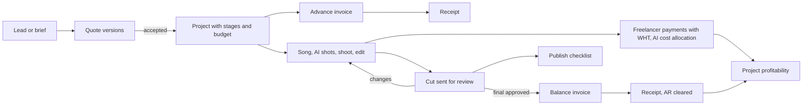
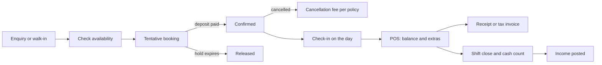
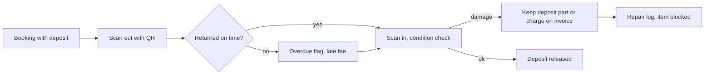
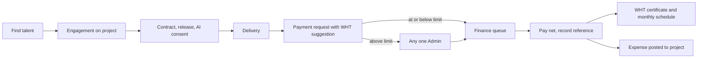
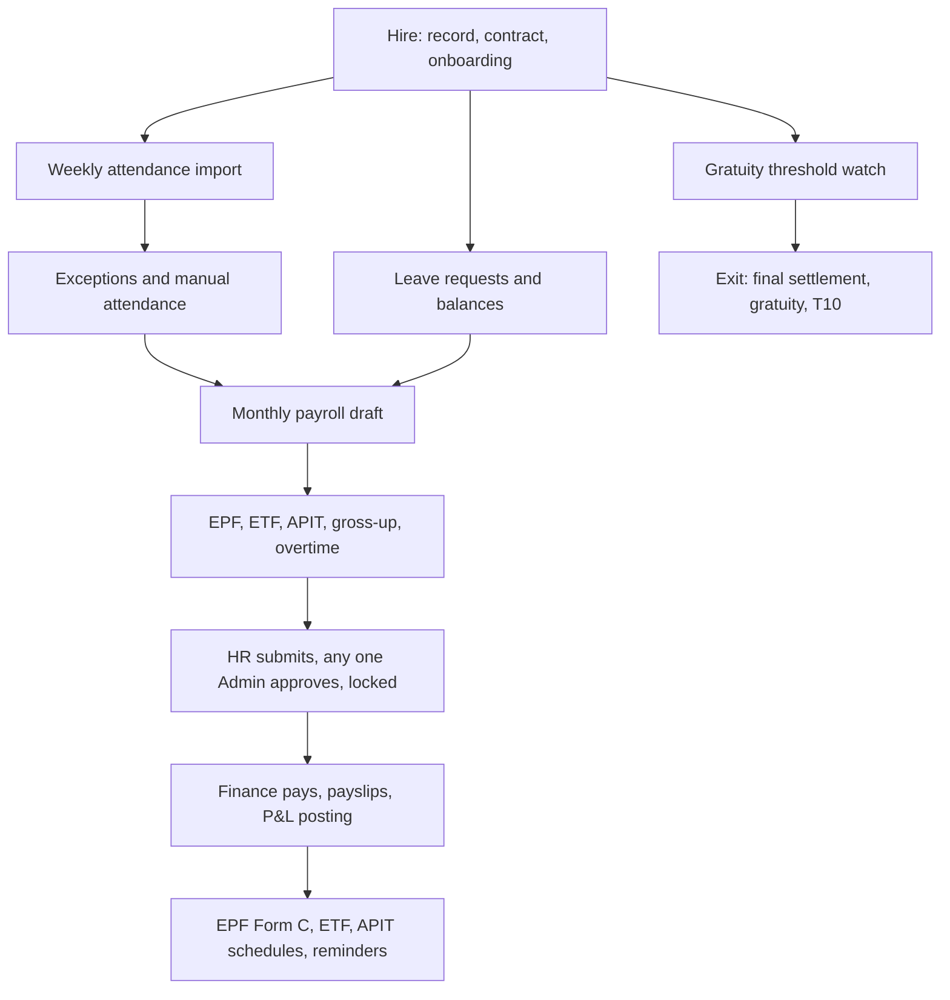

# ChordusAM: Media & Studio ERP with POS and HRIS — Business Requirements Document

**Date:** 9 November 2026 · **Version:** 0.1 (draft) · **Status:** Draft for review

**Summary.** This document states what Alliance Media Company (Private) Limited (AMPL) needs from ChordusAM now that the scope has grown from "HR, vendor payments and finance" (`docs/PLAN.md` v2.0) to a Media and Studio ERP with POS and HRIS (`docs/discovery/00-brief.md`). It keeps every requirement in PLAN.md (Appendix A maps each PLAN.md section to its new ID). It adds the selling side (clients, quotes, bookings, POS, sales invoices), the production side (projects, pipeline stages, talent, deliverables, rights, AI tool costs) and the Sri Lankan statutory items the research found missing (APIT, EPF earnings base, gratuity, TIN, statutory exports, WHT on freelancers, the 2026 VAT invoice format, VAT and SSCL thresholds, PDPA from 1 January 2027). There are 221 business requirements (`BR-<MODULE>-NNN`) in 19 modules, 44 non-functional requirements, 56 numbered business rules and 41 open questions. Requirement IDs here are the shared IDs for every other discovery document (brief section 7). The "MVP?" column is the BA's proposal; the Product Owner confirms MVP scope in `docs/discovery/21-mvp-roadmap.md`.

---

## 1. Document control

| Item             | Value                                                                                                                                                                                                                                                                                                                                                                        |
| ---------------- | ---------------------------------------------------------------------------------------------------------------------------------------------------------------------------------------------------------------------------------------------------------------------------------------------------------------------------------------------------------------------------- |
| Document         | Business Requirements Document (BRD), `docs/discovery/10-brd.md`                                                                                                                                                                                                                                                                                                             |
| Product          | ChordusAM: Media & Studio ERP with POS and HRIS                                                                                                                                                                                                                                                                                                                              |
| Company          | Alliance Media Company (Private) Limited (AMPL), Colombo, Sri Lanka                                                                                                                                                                                                                                                                                                          |
| Version          | 0.1 (draft)                                                                                                                                                                                                                                                                                                                                                                  |
| Date             | 9 November 2026                                                                                                                                                                                                                                                                                                                                                              |
| Owner            | Thoshan Rathnayake (Fractional COO)                                                                                                                                                                                                                                                                                                                                          |
| Authors          | Discovery team (Business Analyst, with research by R1 to R4)                                                                                                                                                                                                                                                                                                                 |
| Status           | Draft for review                                                                                                                                                                                                                                                                                                                                                             |
| Reviewers        | Thoshan, Fazlur, Gurpreet (Admins); Abilasini (Operations Manager, HR); Janaka (Finance); the external accountant and lawyer for items marked "(unverified)" or "legal"                                                                                                                                                                                                      |
| Upstream sources | `docs/discovery/00-brief.md`; `docs/PLAN.md` v2.0; `docs/phase-0.md`; `docs/discovery/research/R1-media-production-erp.md` (R1); `docs/discovery/research/R2-hris-payroll-sri-lanka.md` (R2); `docs/discovery/research/R3-pos-booking-finance.md` (R3); `docs/discovery/research/R4-creative-ops-rights.md` (R4); Phase 0 code (`lib/auth/`, `supabase/migrations/`, `app/`) |
| Companion        | `docs/discovery/11-gap-analysis.md` (gap analysis built on this BRD)                                                                                                                                                                                                                                                                                                         |

**How to cite sources in this document.** "PLAN §5.3" is a section of `docs/PLAN.md`. "R2-44" and "R4-F06" are candidate requirement IDs from the research files. "R1 P4" is pattern P4 in R1 section 6. "R3 §6" is section 6 of R3. Laws are named in full the first time. Statements marked **(unverified)** come from research that could not confirm them against a primary source; they must be checked by the accountant or lawyer before a rule is coded. Under CLAUDE.md every rate, threshold and date is data edited in the UI, so a correction does not need a code change.

| Version | Date            | Change                       |
| ------- | --------------- | ---------------------------- |
| 0.1     | 9 November 2026 | First draft for owner review |

---

## 2. Executive summary

**The problem.** AMPL runs six business lines (music videos at 12 to 15 a month, photography, video and ads, studio and song production, social media marketing, SEO) across several brands, with 10 to 30 staff and a large freelancer pool. It runs them on spreadsheets, WhatsApp, ClickUp and a fingerprint machine export. Money, people and creative facts live in different places, so nobody can say quickly what a music video earned after freelancer and USD AI-tool costs, which studio slot is free, who approved a cut, or whether AMPL still holds the rights to a video it wants to reuse.

**What exists.** PLAN.md v2.0 already specifies HR (attendance import, leave, manual attendance, contract types, payroll preparation), Vendor Payments (requests, spending limit routing, numbered vouchers) and a Finance management ledger. Phase 0 built the foundation only: sign-in, four roles (`employee`, `hr`, `admin`, `finance`) read from `public.profiles`, a server-side access matrix, RLS on `profiles` and an append-only `audit_log`, CI and the AMPL look. No business screens or business tables exist yet.

**What this BRD adds.** Nine modules that PLAN.md does not have (CRM, PRJ, BKG, POS, SAL, TAL, AST, AI, APR), plus HR and tax items PLAN.md misses. In short:

1. **One job record from quote to cash.** A quote becomes a project with stages, budget, bookings, freelancer engagements and AI costs, and its milestone invoices. Profitability per music video is a by-product, not a spreadsheet (BR-CRM-008, BR-PRJ-006, BR-FIN-008).
2. **Studio front of house.** Bookings for rooms, people and equipment with database-enforced conflict prevention, deposits and cancellation rules; a light, service-first POS that keeps working when the internet drops; QR check-out and check-in of gear (BR-BKG-004, BR-POS-006, BR-BKG-012).
3. **Sri Lankan compliance built in.** EPF and ETF on the correct earnings base, APIT from versioned IRD tables with gross-up for net contracts, gratuity, statutory exports, 5% WHT on freelancer fees with certificates, the IRD tax invoice format in force since 1 October 2026, VAT and SSCL threshold monitoring, and PDPA duties from 1 January 2027 (BR-PAY-003 to BR-PAY-006, BR-VP-010, BR-SAL-003, BR-SAL-013, BR-ADM-011).
4. **Creative facts as records.** Deliverable versions, client approval events, revision rounds, rights, talent releases and AI-likeness consents, with a block on publishing without them (BR-AST-003, BR-AST-005, BR-AST-008, BR-TAL-007).
5. **AI tool spend attributed to projects.** USD subscriptions allocated to the month's projects so a LKR price list can be checked against USD costs (BR-AI-003).

**What stays out.** Statutory double-entry books (the accountant keeps them; ChordusAM exports or syncs), filing returns with the government, card-terminal integration, bank feeds, a video player, a full DAM, royalty processing at scale, recruitment and appraisals. Section 5.2 gives the reasons.

**Requirement counts by module** (detail in section 8):

| Module    | Total   | Must    | Should | Could | Won't | Proposed for MVP |
| --------- | ------- | ------- | ------ | ----- | ----- | ---------------- |
| CRM       | 10      | 6       | 4      | 0     | 0     | 7                |
| PRJ       | 10      | 5       | 4      | 1     | 0     | 7                |
| BKG       | 15      | 11      | 3      | 0     | 0     | 12               |
| POS       | 13      | 9       | 3      | 1     | 0     | 11               |
| SAL       | 14      | 9       | 5      | 0     | 0     | 10               |
| VP        | 17      | 14      | 3      | 0     | 0     | 16               |
| FIN       | 16      | 11      | 3      | 1     | 0     | 12               |
| HR        | 13      | 7       | 3      | 0     | 2     | 8                |
| ATT       | 13      | 10      | 2      | 1     | 0     | 11               |
| LV        | 11      | 10      | 1      | 0     | 0     | 11               |
| PAY       | 20      | 15      | 5      | 0     | 0     | 19               |
| TAL       | 11      | 6       | 4      | 1     | 0     | 8                |
| AST       | 11      | 6       | 3      | 1     | 0     | 7                |
| AI        | 8       | 3       | 4      | 0     | 1     | 4                |
| APR       | 7       | 6       | 1      | 0     | 0     | 7                |
| NOT       | 5       | 2       | 3      | 0     | 0     | 3                |
| RPT       | 10      | 7       | 3      | 0     | 0     | 9                |
| ADM       | 11      | 9       | 2      | 0     | 0     | 9                |
| INT       | 6       | 1       | 2      | 2     | 0     | 2                |
| **Total** | **221** | **147** | **58** | **8** | **3** | **173**          |

**Top findings.**

- The MVP as proposed is large (173 requirements). It is roughly PLAN.md phases 1 to 9 plus a minimal studio and production layer. The PO should cut by release, not by module, using the priority column.
- Three foundations must be decided **before Phase 1 builds `employees`**: an `entity_id` and brand on business records (NFR-SCALE-001, BR-FIN-009), an extended role model (BR-ADM-002), and a generic approval engine (BR-APR-001). Retrofitting any of them later touches every table and RLS policy.
- The fastest-moving risk is tax and statutory data: almost every rate and threshold in R2 and R3 changed in the last 18 months. Holding them as effective-dated data with an accountant sign-off is a business requirement, not an engineering nicety (BR-ADM-004, NFR-COST-003).
- PDPA Parts I and III take effect on 1 January 2027, seven weeks after this draft. A DPO, privacy notices, retention and read logging are needed whether or not anything else ships (BR-ADM-011, NFR-PRIV-001 to NFR-PRIV-007).

---

## 3. Business context and problem statement

### 3.1 The business

| Business line (brief §2)   | What is sold                                                                             | How money flows (as researched)                                                    | Main cost drivers                                                                                                             |
| -------------------------- | ---------------------------------------------------------------------------------------- | ---------------------------------------------------------------------------------- | ----------------------------------------------------------------------------------------------------------------------------- |
| Music video production     | AI-hybrid Sinhala and Tamil music videos, 12 to 15 a month, concept to published in days | Quote, advance, balance on final approval (R3 §1); some for own channels (R4 §3.5) | Freelance vocalists, musicians, lyricists, editors, AI artists; USD AI tools (Suno, Higgsfield, Kling, Runway, GPU) (R4 §4.2) |
| Photography                | Brand, product and portrait sessions in the Colombo 05 studio                            | Session packages, deposit, balance, prints (R3 §1)                                 | Studio, equipment, photographer time                                                                                          |
| Videography and ads        | Ad production, corporate video, event coverage                                           | Quote (often AICP-style budget, R1 §4.15), milestones                              | Crew, equipment hire, talent, locations                                                                                       |
| Studio and song production | Song production, dubbing, podcast recording                                              | Hourly or session hire, walk-in and booked (R3 §1)                                 | Engineer time, room                                                                                                           |
| Social media marketing     | Monthly content for brands                                                               | Retainers with deliverable quotas (R4 §6)                                          | Staff time, freelancers                                                                                                       |
| SEO and content strategy   | Monthly SEO and content                                                                  | Retainers (R4 §6)                                                                  | Staff time                                                                                                                    |

- **Brands and channels:** The Studio LK, Media Digital SG, Varnam TV, Varna TV. "SG" suggests a possible Singapore entity (brief §2). "Varnam TV" is also the name of an unrelated Colombo Tamil TV service (R4 §3.5), so the brand position needs confirming (OQ-27).
- **Scale:** 10 to 30 staff plus a freelancer pool; 25+ projects, 3 active business tracks, 2 markets, 48-hour average turnaround (brief §2).
- **People named in this BRD:** Thoshan (owner, Admin), Fazlur and Gurpreet (Admins), Abilasini (Operations Manager, HR), Janaka (Finance), Chathurika and other producers and coordinators who raise vendor payments.

### 3.2 Current tools

| Tool                          | Used for (as described in the brief and PLAN.md)                                                                    |
| ----------------------------- | ------------------------------------------------------------------------------------------------------------------- |
| Spreadsheets                  | Attendance clean-up, leave balances, payroll, income and expense records, receivables, project costs                |
| WhatsApp                      | Approvals (leave, spend), client feedback on cuts, freelancer engagement and payment confirmation, booking requests |
| ClickUp                       | Tasks for productions (stays as the task tool, PLAN §6.4)                                                           |
| Fingerprint machine export    | Weekly attendance file; brand, model and format not yet known (PLAN Q1, R2 C.1)                                     |
| Bank, cards, LankaQR, cash    | Taking and making payments, recorded by hand (R3 §5)                                                                |
| External accountant's package | Statutory books; package not yet known (R1 OQ4, R3 OQ2)                                                             |

### 3.3 Pain points

Pain points come from the brief, PLAN.md and the research. They have **not yet been validated in a workshop** with AMPL staff; the Product Designer (`docs/discovery/13-ux-design.md`) should confirm them.

| #   | Pain point                                                                                                                               | Evidence                 |
| --- | ---------------------------------------------------------------------------------------------------------------------------------------- | ------------------------ |
| P1  | Approvals happen in WhatsApp threads, so there is no reliable record of who approved what, and self-approval is not prevented            | PLAN §1, §2; R4 §1.3     |
| P2  | Attendance is cleaned by hand every week from the machine export, and payroll is rebuilt in a spreadsheet each month                     | PLAN §1, §7              |
| P3  | Statutory items (APIT, EPF base, gratuity, WHT) are not modelled, so pay and freelancer payouts may be wrong or late                     | R2 D.4; R3 §6            |
| P4  | No single job record: quote, freelancer costs, AI costs and invoices sit in different files, so per-video profit is guessed              | R1 §7.3, §7.4; PLAN §6.3 |
| P5  | USD AI subscriptions are paid centrally and never charged to the videos that used them                                                   | R4 §4.3                  |
| P6  | Studio rooms and gear have no shared calendar; double-booking and unreturned gear are found late                                         | R3 §1, §3.4              |
| P7  | Walk-in and session payments (cash, card terminal, QR) have no shift close or variance check                                             | R3 §7.1                  |
| P8  | Client approval of cuts arrives on WhatsApp; extra revision rounds are not counted or billed                                             | R4 §1.3, R4-F03          |
| P9  | Who owns each video, master and composition, and what talent consented to (including AI likeness), is not recorded                       | R4 §3.2, §4.4            |
| P10 | Receivables are chased from memory; the Operations Manager's 14-day AR KPI cannot be measured                                            | PLAN §6.1                |
| P11 | Since 1 October 2026 VAT invoices must follow a new IRD format, and SSCL registration starts at LKR 36m a year; AMPL's status is unknown | R3 §6                    |
| P12 | PDPA duties start 1 January 2027 and HR and talent data is scattered across phones and files                                             | R2 B.11; R4 §3.4         |

---

## 4. Business objectives and success metrics

Baselines are **not known** today. The first task after approval is to measure them for one month (OQ-41). Targets apply 12 months after the MVP goes live unless stated.

| #   | Objective                      | Metric (how measured)                                                                    | Baseline       | Target                                                                                                               | Main requirements                              |
| --- | ------------------------------ | ---------------------------------------------------------------------------------------- | -------------- | -------------------------------------------------------------------------------------------------------------------- | ---------------------------------------------- |
| O1  | Close the books faster         | Working days from month end to Admin-reviewed management P&L                             | To measure     | 5 working days or fewer                                                                                              | BR-FIN-002, BR-FIN-007, BR-FIN-015, BR-FIN-016 |
| O2  | Cut payroll preparation effort | HR plus Finance hours per monthly run, from attendance cut-off to "sent to Finance"      | To measure     | 4 hours or fewer; zero spreadsheet recalculations                                                                    | BR-ATT-005, BR-PAY-001, BR-PAY-009, BR-PAY-013 |
| O3  | Invoice promptly               | Time from session end or final client approval to invoice issued                         | To measure     | Same working day for 95% of jobs                                                                                     | BR-SAL-001, BR-SAL-005, BR-AST-003             |
| O4  | Know the margin on every job   | Share of client jobs opened after go-live with budget, actual cost and income tracked    | 0% (no system) | 100%                                                                                                                 | BR-CRM-008, BR-PRJ-005, BR-PRJ-006, BR-FIN-008 |
| O5  | Charge AI spend to work        | Share of AI subscription cost allocated to projects each month                           | 0%             | 90% or more                                                                                                          | BR-AI-001, BR-AI-003                           |
| O6  | Collect cash faster            | Days sales outstanding (DSO) = receivables ÷ credit sales × days in period               | To measure     | 25% below baseline; every invoice over 14 days overdue escalated                                                     | BR-SAL-008, BR-SAL-009, BR-INT-002             |
| O7  | Control front-of-house cash    | Share of POS shifts closed with a count and signed-off variance                          | 0%             | 100%; average absolute variance under the configured tolerance                                                       | BR-POS-005                                     |
| O8  | Meet statutory deadlines       | APIT, EPF, ETF and WHT remittances and certificates on time                              | To measure     | 100% on time; WHT certificate for every deduction                                                                    | BR-PAY-015, BR-PAY-017, BR-VP-011              |
| O9  | Publish only cleared work      | Published deliverables without an ownership record, disclosure decision or valid consent | Unknown        | Zero                                                                                                                 | BR-AST-005, BR-AST-008, BR-TAL-007             |
| O10 | Prove the 48-hour promise      | Share of music videos with first cut sent within the package turnaround target           | Unknown        | Measured monthly; target set by owner after 3 months of data                                                         | BR-PRJ-009                                     |
| O11 | Move approvals out of WhatsApp | Share of leave, manual attendance and payment approvals decided in ChordusAM             | 0%             | 95% within 3 months of go-live                                                                                       | BR-APR-006, BR-NOT-001                         |
| O12 | Keep it cheap to run           | Monthly run cost (hosting, email, messaging, gateway fixed fees)                         | n/a            | Below the CFO's ceiling in `docs/discovery/14-business-case.md`, and below the cheapest buy option (R1 §7.9, R2 A.3) | NFR-COST-001                                   |

---

## 5. Scope

### 5.1 In scope

All 19 modules of the shared ID scheme (brief §7):

| Code | Module                                                                           | Scope in this BRD                                                                                                    |
| ---- | -------------------------------------------------------------------------------- | -------------------------------------------------------------------------------------------------------------------- |
| CRM  | Clients, leads, quotes and estimates                                             | Client directory, leads, quotes with versions and acceptance, quote-to-project conversion, retainer agreements       |
| PRJ  | Projects, jobs and the production pipeline                                       | Projects, codes, pipeline templates and stages, budgets, budget versus actual, time logs, turnaround, call sheets    |
| BKG  | Studio, room, equipment and crew booking, and equipment check-in and check-out   | Resources, calendar, conflict prevention, pricing rules, deposits, cancellation, QR check-out and check-in, damage   |
| POS  | Point of sale, receipts, deposits, packages, vouchers and shifts                 | Light service-first POS, split tender, offline queue, shifts and cash count, packages, vouchers, refunds             |
| SAL  | Sales invoices, receipts and receivables                                         | Invoices, gapless numbering, IRD tax invoice, milestones, receipts, credit notes, AR ageing, VAT and SSCL monitoring |
| VP   | Vendor and talent payments, vouchers and withholding tax                         | All of PLAN §5, plus WHT computation and certificates, purchase orders                                               |
| FIN  | Management ledger, expenses, budgets, P&L, cash, multi-currency and multi-entity | All of PLAN §6, plus brand P&L, month close, FX source, accountant export                                            |
| HR   | Core HR                                                                          | PLAN employees and contract types, plus statutory IDs, documents, on/offboarding, letters, classification checklist  |
| ATT  | Attendance and time                                                              | All of PLAN §4.2 and §7, plus overtime, mobile check-in, device push                                                 |
| LV   | Leave                                                                            | All of PLAN §4.3 and §4.4, plus statutory floors and booking-clash warnings                                          |
| PAY  | Payroll and statutory                                                            | PLAN §10, plus pay components, APIT, gross-up, statutory outputs and calendar, gratuity, final settlement            |
| TAL  | Talent and freelancer pool                                                       | Profiles, rate cards, engagements, contracts, releases, AI-likeness consents, portal                                 |
| AST  | Deliverables, assets, rights, licences, releases and channel revenue             | Deliverables register, versions, approvals, revision rounds, rights register, publish checklist, splits, channel P&L |
| AI   | AI tool subscriptions, credits and per-project AI cost                           | Subscription register, recurring cost, pool-and-allocate, usage log, allowance tracker                               |
| APR  | Approval workflows (generic engine)                                              | Configurable chains, any-one-of-group, self-approval ban, delegation, inbox                                          |
| NOT  | Notifications                                                                    | In-app and email (PLAN §11) plus new events; optional WhatsApp utility templates                                     |
| RPT  | Dashboards and reporting                                                         | PLAN §8 dashboards plus production and studio utilisation                                                            |
| ADM  | Admin, settings, roles, multi-entity, audit                                      | Users and roles, policy settings, entities, brands, locations, audit viewer, data import, catalogue, PDPA records    |
| INT  | Integrations                                                                     | PayHere, email, accounting sync, calendar feeds, ClickUp read, review-tool webhooks                                  |

### 5.2 Out of scope (with reasons)

| Item                                                                          | Why it is out                                                                                                                                                                                                                                                                                                                                                                                                                |
| ----------------------------------------------------------------------------- | ---------------------------------------------------------------------------------------------------------------------------------------------------------------------------------------------------------------------------------------------------------------------------------------------------------------------------------------------------------------------------------------------------------------------------- |
| Statutory double-entry general ledger, financial statements, tax computations | PLAN §1 and §6: ChordusAM is a management ledger and the accountant keeps the books. R3 §4.2 found no package with strong Sri Lankan localisation, so replacing the accountant's tool adds risk with no benefit. ChordusAM exports (BR-FIN-016) and later syncs (BR-INT-001).                                                                                                                                                |
| Filing returns with the IRD, EPF or ETF Board                                 | PLAN §1. ChordusAM produces the figures and files (BR-PAY-015, BR-PAY-016, BR-VP-011); a person submits them. RAMIS e-invoice transmission is "Should" behind an outbox (BR-SAL-014) because the IRD technical spec was not obtained (R3 §6).                                                                                                                                                                                |
| Bank integrations: bank feeds, direct payment initiation, account APIs        | R3 §4.1 and §7.3 confirmed no Sri Lankan bank feeds in any surveyed package. CSV statement import is a "Could" (BR-FIN-012). Online payment gateways (PayHere) are in scope (BR-INT-002).                                                                                                                                                                                                                                    |
| Integration with card terminals                                               | R3 §2.2 and §8: in Sri Lanka card payments go through a standalone bank terminal or Genie device. ChordusAM records method, last 4 digits and approval code (BR-POS-002). This keeps ChordusAM out of PCI card-data scope.                                                                                                                                                                                                   |
| Video player, frame-accurate review and annotation                            | R4 §1.3: mature and cheap tools exist (Frame.io, Vimeo). ChordusAM links to them and owns the approval record (BR-AST-002, BR-AST-003).                                                                                                                                                                                                                                                                                      |
| Full DAM with transcoding and storage of masters                              | R4 §2: files stay in Drive, Dropbox or Frame.io; ChordusAM holds the facts (BR-AST-001).                                                                                                                                                                                                                                                                                                                                     |
| Royalty statement processing at scale, social media analytics                 | R4 §3.7 and §6: buy Curve Lite or AgencyAnalytics if needed. Statement import is a "Could" (BR-AST-010).                                                                                                                                                                                                                                                                                                                     |
| Task management                                                               | PLAN §6.4: ClickUp stays the task tool. ChordusAM stores links and may read status (BR-PRJ-001, BR-INT-005).                                                                                                                                                                                                                                                                                                                 |
| Recruitment and performance appraisals                                        | PLAN §1 put them out of v1; R2-11 and R2-12 list them as table stakes for HRIS. Recorded as "Won't for MVP" (BR-HR-012, BR-HR-013) so they are not lost.                                                                                                                                                                                                                                                                     |
| Singapore payroll (CPF, SDL, IR8A)                                            | R2 B.12 recommends an SG provider until headcount justifies it. The data model stays ready (NFR-SCALE-001).                                                                                                                                                                                                                                                                                                                  |
| Native iOS and Android apps                                                   | PLAN §1. An installable web app (PWA) covers phones and offline POS (NFR-MOB-002).                                                                                                                                                                                                                                                                                                                                           |
| Storing biometric templates                                                   | R2 B.11: templates stay on the device; ChordusAM keeps only device user ID, timestamp and verify mode (NFR-PRIV-002).                                                                                                                                                                                                                                                                                                        |
| Qualified e-signature provider                                                | R3 §8: the MVP uses click-to-accept with an audit trail. The Electronic Transactions Act No. 19 of 2006 says a contract is not denied validity only because it is electronic ([Act text](https://documents.gov.lk/view/acts/2006/5/19-2006_E.pdf), [Daily Mirror overview](https://www.dailymirror.lk/features/E-commerce-in-Sri-Lanka-A-legal-overview/185-189694)); the lawyer confirms which documents need more (OQ-26). |
| Running ChordusAM as a SaaS for other studios                                 | Brief §4: design for multi-tenant readiness (NFR-SCALE-002); AMPL's needs come first. No billing, sign-up or tenant admin is in scope.                                                                                                                                                                                                                                                                                       |
| Stripe, Square, HoneyBook and other foreign-only payment rails                | R3 §2.1 and §3.3: Square and HoneyBook exclude Sri Lanka. Third-party guides say Stripe does not onboard Sri Lankan-registered merchants ([Dodo Payments guide](https://dodopayments.com/blogs/stripe-supported-countries-alternatives), secondary; Stripe's own country list not checked).                                                                                                                                  |

### 5.3 Assumptions

| #   | Assumption                                                                                                           | If wrong                                                             |
| --- | -------------------------------------------------------------------------------------------------------------------- | -------------------------------------------------------------------- |
| A1  | One legal entity (AMPL, Sri Lanka) at MVP go-live; Media Digital SG may follow                                       | Multi-entity moves into MVP (OQ-17)                                  |
| A2  | AMPL rents studio rooms and some equipment to outside clients, so BKG and POS earn revenue                           | BKG shrinks to internal scheduling; POS may drop to "Should" (OQ-15) |
| A3  | Client invoices are generated in ChordusAM, not only recorded (PLAN Q12; R1 §5 says the market generates them)       | SAL drops to income recording (PLAN §6.1)                            |
| A4  | The external accountant keeps the statutory books and accepts a monthly export                                       | Sync adapter priority changes (OQ-18)                                |
| A5  | Producers, coordinators, front-desk staff and Finance use phones for most tasks; Admins and Finance also use laptops | NFR-MOB targets relax                                                |
| A6  | The fingerprint device can export a file (CSV, XLSX or `attlog.dat`) weekly                                          | ATT design changes (OQ-1)                                            |
| A7  | ClickUp stays the task tool                                                                                          | PRJ would need task management                                       |
| A8  | Video files stay in Google Drive, Dropbox, Frame.io or Vimeo                                                         | Storage cost and DAM scope grow                                      |
| A9  | Freelancers are paid per engagement as vendors, not through payroll                                                  | Classification and payroll scope change (OQ-5, OQ-37)                |
| A10 | WhatsApp remains the staff and client habit; email is the default notification channel and WhatsApp is optional      | WhatsApp templates move to "Must"                                    |
| A11 | The current stack stays (Next.js, Supabase, Vercel), per brief §4                                                    | Solution Architect argues the change in `20-solution-design.md`      |
| A12 | MVP UI language is English; Sinhala and Tamil text must work in data and documents from day one                      | NFR-I18N priorities change                                           |

### 5.4 Constraints

| #   | Constraint                                                                                                                                                                                                                                                                                                   | Source                |
| --- | ------------------------------------------------------------------------------------------------------------------------------------------------------------------------------------------------------------------------------------------------------------------------------------------------------------ | --------------------- |
| C1  | Stack: Next.js 15, TypeScript strict, Supabase (Postgres, RLS, Auth, Storage), Vercel, Tailwind, Vitest, Playwright                                                                                                                                                                                          | Brief §3, §4; Phase 0 |
| C2  | Business rules are pure functions in `lib/rules/` with unit tests; company policy is data edited in the UI, never hardcoded                                                                                                                                                                                  | CLAUDE.md             |
| C3  | Permissions are enforced on the server (`lib/auth/guards.ts`) and by RLS; every new table enables RLS and has RLS tests; sensitive tables attach `audit_row_change()`; roles come from `public.profiles`                                                                                                     | CLAUDE.md; Phase 0    |
| C4  | Every migration has a rollback; changes to the PLAN §9 data model need the owner's approval first                                                                                                                                                                                                            | CLAUDE.md             |
| C5  | Timezone Asia/Colombo for display, UTC storage; base currency LKR, with USD and SGD                                                                                                                                                                                                                          | CLAUDE.md; brief §4   |
| C6  | Small team (10 to 30 staff) and a low running budget                                                                                                                                                                                                                                                         | Brief §4              |
| C7  | Internet can drop; POS and attendance must tolerate it                                                                                                                                                                                                                                                       | Brief §4              |
| C8  | Fixed legal dates: VAT invoice format in force from 1 October 2026 (R3 §6); SSCL threshold LKR 36m from 1 July 2026 (R3 §6); WHT scope widened from about 3 June 2026 (R2 B.3); PDPA Parts I and III from 1 January 2027 (R2 B.11); YouTube Partner Program entry bar doubles from 1 February 2027 (R4 §3.5) | Research              |
| C9  | One phase per branch, with `npm run check`, `npm run test:db` and `npm run test:e2e` at the end of each phase                                                                                                                                                                                                | CLAUDE.md             |

### 5.5 Dependencies

| #   | Dependency                                                                                                                   | Needed for             | Owner                          |
| --- | ---------------------------------------------------------------------------------------------------------------------------- | ---------------------- | ------------------------------ |
| D1  | Sample fingerprint export and device model                                                                                   | ATT                    | Thoshan, Abilasini             |
| D2  | Accountant's confirmation of APIT practice, WHT categories, VAT and SSCL status, stamp duty, retention periods               | PAY, VP, SAL, NFR-DATA | Janaka, accountant             |
| D3  | Lawyer review of contract templates, releases, AI-likeness consent, classification checklist, absence deduction rule         | TAL, AST, HR, PAY      | Thoshan, lawyer                |
| D4  | Owner approval of data-model additions to PLAN §9                                                                            | All new modules        | Thoshan                        |
| D5  | Supabase and Vercel projects; PayHere merchant account; email sending domain; WhatsApp Business Solution Provider (optional) | Go-live, INT, NOT      | Thoshan                        |
| D6  | IRD RAMIS technical specification and the full tax invoice field list (Gazettes 2481/22 and 2500/106)                        | SAL-003, SAL-014       | Accountant, Solution Architect |
| D7  | Named Data Protection Officer before 1 January 2027                                                                          | ADM-011, NFR-PRIV      | Thoshan                        |

---

## 6. Stakeholders and user roles

### 6.1 Stakeholders

| Stakeholder                                         | Interest                                                        | Involvement                               |
| --------------------------------------------------- | --------------------------------------------------------------- | ----------------------------------------- |
| Thoshan Rathnayake (owner, Admin)                   | Control, margin per job, compliance, scalability                | Approves BRD, data model and MVP scope    |
| Fazlur, Gurpreet (Admins)                           | Final approvals, overview                                       | Reviewers; daily approvers                |
| Abilasini (Operations Manager, HR)                  | Attendance, leave, payroll preparation, vendor requests, AR KPI | Key user; validates HR and VP processes   |
| Janaka (Finance)                                    | Payables, receivables, P&L, statutory remittances               | Key user; validates SAL, FIN, PAY outputs |
| Producers and coordinators (for example Chathurika) | Quotes, projects, bookings, freelancer payments, deliverables   | Key users for CRM, PRJ, TAL, AST, AI      |
| Front-desk staff / cashier                          | Walk-ins, bookings, POS, equipment hand-out                     | Key users for BKG and POS                 |
| Employees                                           | Own attendance, leave, payslips                                 | Self-service users                        |
| Freelancers and talent                              | Getting engaged and paid on time, consent respected             | External users (light portal, later)      |
| Clients, brands and labels                          | Quotes, approvals, invoices                                     | External users (portal, later)            |
| External accountant                                 | Clean exports, correct tax figures                              | Read-only user; confirms tax rules        |
| Lawyer                                              | Contracts, rights, consents, classification                     | Reviews templates and legal rules         |
| Discovery and build team                            | Clear, testable requirements                                    | Uses this BRD                             |

### 6.2 User roles

Phase 0 built four roles in the `public.app_role` enum (`employee`, `hr`, `admin`, `finance`) plus a `can_request_payments` flag on `profiles` (`docs/phase-0.md`, `lib/auth/roles.ts`). This BRD extends them. Adding enum values or a permissions table is a data-model change that needs the owner's approval (OQ-33).

| Role                       | Who                                       | Internal or external | Login                                      | Key permissions (summary)                                                                                                           | Status                                              |
| -------------------------- | ----------------------------------------- | -------------------- | ------------------------------------------ | ----------------------------------------------------------------------------------------------------------------------------------- | --------------------------------------------------- |
| Employee                   | All staff                                 | Internal             | Yes                                        | Own attendance, leave, manual attendance, payslips, own documents; time logs on assigned projects                                   | Built (Phase 0)                                     |
| HR                         | Operations Manager                        | Internal             | Yes                                        | Employees, contracts, attendance import, leave review (recommend only), payroll preparation, vendor requests and directory          | Built (Phase 0)                                     |
| Admin                      | Thoshan, Fazlur, Gurpreet                 | Internal             | Yes                                        | Final approvals (any one Admin), all dashboards, settings, roles, audit log                                                         | Built (Phase 0)                                     |
| Finance                    | Janaka                                    | Internal             | Yes                                        | Finance, SAL, payables queue, payroll runs once approved, statutory outputs; no attendance or leave detail                          | Built (Phase 0)                                     |
| Producer / project manager | Producers, coordinators                   | Internal             | Yes                                        | Clients, quotes, projects, stages, bookings for their projects, talent engagements, deliverables, AI usage, vendor payment requests | New (today an employee with `can_request_payments`) |
| Front desk / cashier       | Studio front-desk staff                   | Internal             | Yes                                        | Bookings, POS sales, shifts, equipment check-out and check-in; no cost or margin data                                               | New                                                 |
| Accountant (read-only)     | External accountant                       | External             | Yes, read-only                             | Read Finance, SAL, VP and payroll summaries and exports; no HR detail, no writes                                                    | New                                                 |
| Freelancer / talent        | Vocalists, editors, AI artists and others | External             | Optional, magic link scoped to own records | Own engagements, contracts, consents, invoice upload, payment status, WHT certificates                                              | New (Should)                                        |
| Client                     | Client contacts                           | External             | Optional, magic link or signed link        | Own quotes, review links, approve versions, invoices, receipts, retainer usage                                                      | New (Should)                                        |

Rules carried from PLAN §2: a person cannot approve their own request (BRULE-002); roles are enforced on the server and in the database, never only in the UI (CLAUDE.md).

### 6.3 RACI by key activity

R = responsible (does it), A = accountable (approves or owns the outcome), C = consulted, I = informed. EMP employee, PRD producer, CSH cashier, HR, FIN finance, ADM admin, ACC accountant, FRL freelancer, CLI client.

| Activity                                            | EMP | PRD | CSH | HR  | FIN | ADM   | ACC | FRL | CLI |
| --------------------------------------------------- | --- | --- | --- | --- | --- | ----- | --- | --- | --- |
| Create and send a quote                             |     | R   |     |     | C   | A     |     |     | I   |
| Accept a quote                                      |     | R   |     |     |     | I     |     |     | A   |
| Approve a discount above the role limit             |     | R   | R   |     | C   | A     |     |     |     |
| Run a project through its stages                    | R   | A   |     |     | I   | I     |     | R   | C   |
| Confirm a studio booking and take the deposit       |     | R   | R   |     | I   | A     |     |     | C   |
| Sell at POS and close a shift                       |     |     | R   |     | A   | I     |     |     |     |
| Check equipment out and in                          | R   | R   | R   |     | I   | A     |     | R   |     |
| Engage a freelancer (engagement, contract, consent) |     | R   |     | C   | I   | A     |     | C   |     |
| Raise a vendor or talent payment request            |     | R   |     | R   | I   | I     |     | C   |     |
| Approve a payment above the spending limit          |     |     |     |     | I   | A (R) |     |     |     |
| Pay a vendor and issue the WHT certificate          |     | I   |     | I   | R   | A     | C   | I   |     |
| Upload attendance and clear exceptions              | C   |     |     | R   | I   | A     |     |     |     |
| Decide a leave request                              | R   |     |     | C   |     | A     |     |     |     |
| Prepare the monthly payroll run                     | I   |     |     | R   | C   | A     | C   |     |     |
| Pay payroll and remit EPF, ETF and APIT             | I   |     |     | I   | R   | A     | C   |     |     |
| Record client approval of a cut                     |     | R   |     |     | I   | I     |     |     | A   |
| Record rights, releases and AI-likeness consents    |     | R   |     | C   |     | A     |     | C   | C   |
| Allocate AI subscription cost to projects           |     | C   |     |     | R   | A     |     |     |     |
| Month-end close                                     |     | C   | C   | C   | R   | A     | C   |     |     |
| Change policy settings (limits, rates, thresholds)  |     |     |     | C   | C   | A (R) | C   |     |     |
| Manage users and roles                              |     |     |     | C   |     | A (R) |     |     |     |

---

## 7. Current-state and future-state processes

The as-is steps are inferred from the brief, PLAN.md and research, and must be validated with the people who do the work. To-be steps cite the requirements that deliver them.

### 7.1 Quote-to-cash for a music video job

**As-is (inferred).**

1. A client (artist, label or brand) messages a producer on WhatsApp with a song or an idea.
2. The producer prices it from memory or a spreadsheet and sends the price on WhatsApp or as a document.
3. The client agrees on WhatsApp. The producer creates ClickUp tasks.
4. Someone asks Finance to invoice the advance; the invoice is made outside any shared system.
5. The producer books freelancers on WhatsApp, runs Suno and Higgsfield on AMPL's shared logins, and books the studio or gear informally.
6. Cuts go to the client as Drive or Vimeo links on WhatsApp. Feedback and "approved" arrive on WhatsApp.
7. Finance invoices the balance when told; receipts are matched by hand.
8. Freelancers are paid through ad hoc requests. Nobody totals the job's cost against its price.

**Pain:** no single record (P4), approvals unprovable (P8), USD AI cost unallocated (P5), receivables chased from memory (P10).

**To-be.**

1. The producer records the lead (BR-CRM-003) and builds a quote from a music-video template and the catalogue (BR-CRM-004, BR-CRM-006), with free revision rounds from the package (BRULE-040).
2. The quote PDF goes to the client (BR-CRM-009). The client accepts by link, or the producer records acceptance received on WhatsApp (BR-CRM-007).
3. One action converts the accepted quote into a project with stages, budget lines and a billing schedule (BR-CRM-008, BR-PRJ-003, BR-PRJ-005, BR-SAL-005).
4. The advance invoice is drafted, issued with a gapless number in the IRD format if VAT-registered, and sent with a PayHere link (BR-SAL-001 to BR-SAL-003, BR-INT-002).
5. The producer engages freelancers with contracts and consents (BR-TAL-004 to BR-TAL-007), books the studio and gear (BR-BKG-006) and logs AI usage (BR-AI-004).
6. Each cut is a deliverable version; the client's approval is an event with version, person, time and channel (BR-AST-002, BR-AST-003). Extra rounds are flagged billable (BR-AST-004).
7. Final approval drafts the balance invoice (BR-SAL-005). Receipts clear it and update AR ageing (BR-SAL-006, BR-SAL-008).
8. Freelancer payment requests carry WHT and post to the project (BR-VP-003, BR-VP-010, BR-VP-008). AI cost is allocated at month end (BR-AI-003).
9. Project profitability shows income against all costs (BR-PRJ-006, BR-FIN-008). The publish checklist clears the video for release (BR-AST-008).

### 7.2 Studio walk-in and booking to POS

**As-is (inferred).**

1. A customer calls, messages or walks in asking for studio time or a photo session.
2. Staff check a paper diary, a shared calendar or ask around for availability.
3. A deposit may be taken by bank transfer or cash, noted by hand.
4. On the day, the balance is paid by cash, card terminal or LankaQR. A receipt is handwritten or not given.
5. Cash is counted informally at day end, if at all. The income is added to a spreadsheet later.

**Pain:** double-booking risk and no deposit control (P6), no shift close or variance (P7), receipts may not meet the 2026 VAT invoice format (P11).

**To-be.**

1. Staff (or the customer on a public page, later) choose a resource or package; the calendar shows live availability including buffers (BR-BKG-003, BR-BKG-004, BR-BKG-011).
2. The price comes from pricing rules (BR-BKG-005). The booking is held as tentative until the deposit deadline (BR-BKG-007, BR-BKG-009, BRULE-034).
3. The deposit is taken at POS or by PayHere link (BR-POS-003, BR-INT-002). The booking is confirmed. The database rejects any overlap (BR-BKG-004).
4. A reminder goes out 24 hours before (BR-NOT-002). Cancellations apply the policy fee automatically (BR-BKG-010).
5. On the day the cashier checks the customer in, adds extras and takes the balance with one or more methods (BR-POS-001, BR-POS-002). A numbered receipt or tax invoice is issued (BR-POS-004, BR-SAL-003).
6. If the connection drops, cash, terminal and static QR sales queue on the device and sync later (BR-POS-006, BR-POS-007).
7. At shift close the cashier counts the drawer; variance above tolerance needs sign-off (BR-POS-005). Sales post to income by brand, location and method (BR-POS-013).

### 7.3 Equipment rental check-out and check-in

**As-is (inferred).** (1) A client or crew member asks for gear by message. (2) Staff hand it over with no record or a note. (3) Return dates are remembered, not tracked. (4) Damage is discussed after the fact; deposits, if any, are handled in cash. (5) Gear rented in from suppliers is paid as a vendor payment without a link to the job.

**To-be.**

1. Every item and kit has a register entry and a printed QR label (BR-BKG-002, BR-BKG-012).
2. The item is booked against a project (internal cost) or a client (rental revenue) with a security deposit (BR-BKG-008, BR-BKG-009, BRULE-039).
3. At hand-out, staff scan the QR codes on a phone; the system records who, when, for which booking, and condition photos (BR-BKG-012).
4. Overdue items are flagged and a late fee is computed (BR-BKG-013, BRULE-038).
5. At return, staff scan again and record condition. Damage is charged from the deposit or added to the invoice with a reason (BR-BKG-014).
6. Items needing repair are blocked from booking and the repair goes through vendor payments (BR-BKG-015, BR-VP-003). Gear rented in is recorded with its owner vendor (BR-BKG-002) and WHT on rent is checked (BR-VP-010).

### 7.4 Freelancer engagement to payment, including 5% WHT

**As-is (inferred, PLAN §5 is the designed but unbuilt fix).** (1) The producer finds a vocalist or editor through contacts and agrees the fee on WhatsApp. (2) No written contract or release is usually kept (to confirm, OQ-30). (3) After delivery the freelancer asks for payment; the producer asks Finance or an Admin on WhatsApp. (4) Finance pays by bank transfer. WHT is not known to be deducted (OQ-11). (5) The cost is not tied to the project.

**To-be.**

1. The producer finds talent by skill, language and rate (BR-TAL-001 to BR-TAL-003) and creates an engagement on the project (BR-TAL-004).
2. The contract, performer release and, where relevant, AI-likeness consent are generated and accepted or uploaded (BR-TAL-005 to BR-TAL-007).
3. After delivery the producer raises a payment request from the engagement (BR-VP-003). The system suggests WHT from the payee's residency, service category and month-to-date total (BR-VP-010, BRULE-027).
4. At or below LKR 15,000 the request goes to Finance; above it, any one Admin approves first (BR-VP-005, BRULE-001). The requester cannot approve it (BR-APR-003).
5. A voucher or self-billed invoice PDF with a gapless number is generated (BR-VP-009).
6. Finance pays the net amount and records the reference. The WHT certificate is issued and the WHT goes on the monthly schedule (BR-VP-007, BR-VP-011).
7. The request locks and posts an expense to the project (BR-VP-008).

### 7.5 Hire to retire: attendance to leave to payroll (EPF, ETF, APIT, gratuity)

**As-is (inferred).** (1) A new hire's details are collected on paper or WhatsApp; there is no onboarding checklist. (2) Each week HR exports the fingerprint file and cleans it in a spreadsheet. (3) Leave is requested on WhatsApp and balances are kept in a sheet. (4) At month end HR builds payroll in a spreadsheet; EPF and ETF are computed by hand; whether APIT is deducted is unknown (OQ-4). (5) Payslips may not be itemised. (6) Gratuity is not tracked, although AMPL is likely at the 15-workmen threshold (R2 B.6). (7) Leavers are settled by hand.

**To-be.**

1. HR creates the employee with statutory IDs and documents, assigns a contract type from a date, and runs the onboarding checklist including the privacy notice (BR-HR-001 to BR-HR-007, BR-ADM-011). Contractors get a classification checklist (BR-HR-010).
2. Weekly, HR uploads the device file; the import maps, matches, previews and commits idempotently, then lists exceptions (BR-ATT-001 to BR-ATT-009). Staff fix gaps with manual attendance requests (BR-ATT-010).
3. Leave runs employee → HR recommendation → any one Admin, with pro-rata balances and statutory floors (BR-LV-002 to BR-LV-009).
4. At month end HR starts the run. The draft applies contract versions, absence rules, pay components, EPF and ETF on liable earnings, APIT from the tables, gross-up for net contracts and overtime (BR-PAY-001 to BR-PAY-007).
5. HR clears exceptions and the minimum-wage check, then submits; any one Admin approves; lines lock (BR-PAY-009 to BR-PAY-011).
6. Finance downloads payslips, the summary and the bank list, pays, and marks the run Paid; the run posts to the P&L (BR-PAY-012 to BR-PAY-014).
7. Finance files EPF, ETF and APIT using the generated outputs before the deadlines the system reminds about (BR-PAY-015 to BR-PAY-017).
8. The system watches the gratuity threshold and computes gratuity at exit; offboarding runs the checklist and the final settlement with T10 (BR-PAY-018 to BR-PAY-020, BR-HR-007).

### 7.6 Month-end close

**As-is (inferred).** (1) Finance gathers bank statements, receipts, WhatsApp payment confirmations and spreadsheets. (2) Income and expenses are typed into a sheet. (3) Payroll and vendor payments are added by hand. (4) USD subscriptions are converted at some rate. (5) A P&L is assembled when time allows; the accountant receives files.

**To-be.**

1. During the month, paid vendor requests, paid payroll, POS sales and receipts auto-post once each (BR-FIN-002, BR-POS-013).
2. Finance confirms recurring expense drafts, including AI subscriptions in USD at the recorded rate (BR-FIN-003, BR-FIN-006, BR-AI-002).
3. Finance reviews POS shift variances and open deposits (BR-POS-005), unpaid receivables (BR-SAL-008) and payables due (BR-VP-016).
4. Finance runs the AI pool-and-allocate (BR-AI-003) and checks project costs.
5. Finance reviews WHT and stamp duty reports and VAT and SSCL threshold status (BR-VP-011, BR-SAL-012, BR-SAL-013).
6. Finance closes the month; later changes need an Admin reopen (BR-FIN-015).
7. Finance sends the accountant export pack, or the sync runs (BR-FIN-016, BR-INT-001). Admins read the P&L, brand P&L and finance snapshot (BR-FIN-007, BR-FIN-009, BR-RPT-007).

### 7.7 AI tool spend to project cost

**As-is (inferred).** (1) Someone subscribes to Suno, Higgsfield, Kling, Runway, ClickUp or Claude on a card in USD. (2) Logins are shared. (3) The charge appears on a card statement and may be recorded as a general expense. (4) Nobody knows how many credits or downloads each video used, or how many expired unused.

**To-be.**

1. Finance registers each subscription with plan, allowance, renewal date and login holder (BR-AI-001), linked to a recurring USD expense (BR-AI-002).
2. Producers log credits, downloads and GPU hours per project from a phone (BR-AI-004, "Should").
3. The allowance tracker warns before a cap, such as Suno's 20 or 60 downloads a month (BR-AI-005).
4. At month end each subscription's LKR cost is allocated to that month's projects by the configured driver (BR-AI-003).
5. Project profitability and the utilisation report show AI cost per video and wasted credits (BR-FIN-008, BR-AI-006).
6. Deliverables record which AI tools and plans were used, as rights evidence (BR-AI-007).
