# 20: Solution design for ChordusAM (Media & Studio ERP with POS and HRIS)

**Date:** 9 November 2026 · **Author:** Solution Architect (discovery team) · **Status:** Draft for review

**Upstream read:** `docs/discovery/00-brief.md`, `docs/PLAN.md` (sections 1 to 16, especially 3, 4 and 9), `docs/phase-0.md`, `supabase/migrations/20261105000000_phase0_foundation.sql`, `supabase/rollbacks/20261105000000_phase0_foundation.down.sql`, `lib/auth/*.ts`, `lib/audit.ts`, `lib/env.ts`, `lib/supabase/server.ts`, `middleware.ts`, `app/` tree, `docs/discovery/10-brd.md` (sections 1 to 7), `12-benchmark-usp.md`, `13-ux-design.md`, `14-business-case.md`, `15-compliance-security.md`, and research R1 to R4 in `docs/discovery/research/`.

**Summary.** ChordusAM should stay on Next.js, Supabase and Vercel and grow as a **modular monolith**: one Next.js app, one Postgres database, and 19 modules that act as bounded contexts with clear table ownership, published events and a small shared kernel (parties, money, numbering, documents, approvals, audit, attachments). Three foundations must be in the schema **before Phase 1 creates `employees`**, because retrofitting them touches every table and every RLS policy: a `tenant_id` and `entity_id` on every business row (one tenant and one entity at go-live), a permission model scoped per entity that replaces the single `profiles.role` column for authorisation, and a generic approval engine that replaces the bespoke leave, attendance, payment and payroll approval code PLAN.md would otherwise need. Money is stored as integer minor units with a currency and an FX snapshot, and every financial event posts balanced lines to a journal-shaped **management ledger**. The accountant's package stays the books of record, fed first by an export and later by an API sync. Integrations and notifications run through a **transactional outbox** on Postgres queues (pgmq), driven by `pg_cron`, with idempotent workers in Next.js route handlers. The POS is a PWA with a narrow, encrypted offline queue rather than a full sync engine. Payroll is designed with a **provider port**, so the CFO's recommended hybrid (a local payroll SaaS for EPF, ETF and APIT, `14-business-case.md` §1.1) and an in-house engine use the same tables. Everything runs in Singapore (Supabase `ap-southeast-1`, Vercel `sin1`). The biggest technical unknowns are RLS-preserving transactions from serverless functions, Sinhala and Tamil shaping in PDFs, thermal printing from a PWA, and the ZKTeco ADMS push on Vercel. Each has a spike in section 11. All new tables are **proposals**: under CLAUDE.md the owner approves changes to PLAN.md section 9 first (BRD dependency D4, OQ-33 for the access model, OQ-34 for the data model).

> **How to read IDs.** `BR-*`, `NFR-*`, `BRULE-*` and `OQ-*` are the BA's IDs from `docs/discovery/10-brd.md` sections 8, 9, 12 and 13 (the BRD adopted the `NFR-SEC-*`, `NFR-PRIV-*` and `NFR-AUD-*` controls from `docs/discovery/15-compliance-security.md` §6 under the same numbers). `CFO-nn` is from `14-business-case.md` §6, `R4-Fnn` from R4 §7, `R1 Pn` from R1 §6, `J-nn` and `S-nn` from `13-ux-design.md`, `G-nn` from `15-compliance-security.md` §7. ADRs, spikes and risks in this document are `ADR-nn`, `SPK-nn` and `TR-nn`.

> **Method and limits.** Technical facts were checked by web search on 9 November 2026 and are linked inline. Where a source is a third party or the official page could not be read in full, the text says "(unverified)". Volumes in section 9 are estimates from the brief and the research, not measurements.

## Contents

1. [Summary and key architecture decisions](#1-summary-and-key-architecture-decisions)
2. [Context diagram](#2-context-diagram)
3. [Containers, modules and the shared kernel](#3-containers-modules-and-the-shared-kernel)
4. [Domain model](#4-domain-model)
5. [Key flows](#5-key-flows)
6. [Generic approval engine](#6-generic-approval-engine)
7. [Security architecture](#7-security-architecture)
8. [Integration design](#8-integration-design)
9. [Scalability and performance](#9-scalability-and-performance)
10. [Evolution path](#10-evolution-path)
11. [Technical risks and spikes](#11-technical-risks-and-spikes)
12. [Traceability](#12-traceability)

---

## 1. Summary and key architecture decisions

### 1.1 The design in ten lines

1. **Keep the stack.** Next.js 15 (App Router, TypeScript strict) on Vercel, Supabase Postgres with RLS, Auth and Storage. Phase 0 stays as the foundation.
2. **One app, one database, 19 modules.** Each module owns its tables, writes only its own tables, and talks to other modules through module functions (synchronous, same transaction) or events (asynchronous).
3. **Tenant and entity on every row from day one.** One tenant (AMPL) and one entity (AMPL Sri Lanka) at go-live. Media Digital SG is a second entity, not a second database.
4. **Permissions per entity**, assigned through permission sets. `profiles.role` stays as the "primary role" for navigation only.
5. **One approval engine** with policies as data: limits, any-one-of-group, recommend-only steps, no self-approval, delegation and SLA escalation.
6. **One management ledger, journal-shaped.** Every invoice, receipt, POS sale, deposit, vendor payment, payroll run and AI allocation posts balanced lines once. The accountant's package is the books of record.
7. **Transactional outbox** on pgmq for notifications, integrations and read models. Workers are idempotent.
8. **POS offline by design, but narrow:** cached catalogue, encrypted queue of sales, server authority on sync. No general sync engine.
9. **Documents are immutable records:** a PDF is rendered once from a data snapshot, hashed and stored. Re-issue creates a new version.
10. **Singapore region** for database, functions and messaging, with field-level encryption for Restricted data (`15-compliance-security.md` §4.3, §4.11).

### 1.2 Architecture decision records

| ADR    | Decision                                                                       | Options considered                                                                                                                                                                                                                                   | Choice                                                                                                                                                                                                                                                                                                   | Rationale                                                                                                                                                                                                                                                                                                                                                                                                                                                                                                                                                                          | Consequences                                                                                                                                                                                                                                                                                                                                                                                                                                                                                                                                |
| ------ | ------------------------------------------------------------------------------ | ---------------------------------------------------------------------------------------------------------------------------------------------------------------------------------------------------------------------------------------------------- | -------------------------------------------------------------------------------------------------------------------------------------------------------------------------------------------------------------------------------------------------------------------------------------------------------- | ---------------------------------------------------------------------------------------------------------------------------------------------------------------------------------------------------------------------------------------------------------------------------------------------------------------------------------------------------------------------------------------------------------------------------------------------------------------------------------------------------------------------------------------------------------------------------------- | ------------------------------------------------------------------------------------------------------------------------------------------------------------------------------------------------------------------------------------------------------------------------------------------------------------------------------------------------------------------------------------------------------------------------------------------------------------------------------------------------------------------------------------------- |
| ADR-01 | Platform                                                                       | (a) Keep Next.js + Supabase + Vercel. (b) Rebase on Odoo or ERPNext/Frappe. (c) Separate API service (NestJS or similar) plus SPA. (d) Rails/Laravel                                                                                                 | **(a) Keep**                                                                                                                                                                                                                                                                                             | Phase 0 already delivers auth, RLS, an append-only audit log, CI and the brand (`docs/phase-0.md`). Postgres gives what this domain needs natively: exclusion constraints for no double booking, exact numerics, `pg_cron` and pgmq queues ([Supabase Cron](https://supabase.com/docs/guides/cron), [Supabase Queues](https://supabase.com/docs/guides/queues)). The run cost is about USD 262 a month (`14-business-case.md` §3.6). Odoo was costed by the CFO as option C and fits AMPL worse (fit 55/100). A separate API adds a second deployable with no benefit at this size | One language (TypeScript) for UI, rules and workers. Serverless limits apply (function duration, cold starts), so long work is chunked into queue jobs. Lock-in is moderate: the data is plain Postgres and can move to any Postgres host; Auth and Storage would need replacing                                                                                                                                                                                                                                                            |
| ADR-02 | System shape                                                                   | (a) Modular monolith. (b) Microservices per module. (c) Unstructured monolith                                                                                                                                                                        | **(a) Modular monolith**: one Next.js app, one Postgres database, modules in `modules/<code>/` with enforced import boundaries                                                                                                                                                                           | 10 to 30 users and one small team. Most flows cross modules inside one transaction (a POS sale touches POS, BKG, SAL and FIN), which services would turn into distributed sagas. Boundaries in code keep the option of extracting a module later                                                                                                                                                                                                                                                                                                                                   | ESLint boundary rules and a table-ownership register are needed, or the monolith will tangle. Cross-module writes go through the owning module's functions, never direct table writes                                                                                                                                                                                                                                                                                                                                                       |
| ADR-03 | Tenancy and entities                                                           | (a) Row-level `tenant_id` + `entity_id` with RLS (pooled). (b) Schema per tenant. (c) Database (Supabase project) per tenant. (d) `entity_id` only                                                                                                   | **(a) Pooled, row-level**, `tenant_id` on every table and `entity_id` on every business row, from the first Phase 1 migration. Keep (c) as a "silo" option for a large SaaS customer later                                                                                                               | Multi-entity (AMPL and Media Digital SG) is a stated need (brief §4, NFR-SCALE-001, CFO-05). SaaS readiness is a credible option (NFR-SCALE-002). Adding `tenant_id` later means rewriting every policy and index (`15-compliance-security.md` §4.2). Schema-per-tenant fights Supabase's Data API and migrations                                                                                                                                                                                                                                                                  | Every RLS policy has a tenant check, and every composite index starts with `tenant_id`. Foreign keys between tenant data are **composite** (`tenant_id`, `x_id`), because Postgres checks foreign keys without applying RLS (see section 7.3). Small storage overhead                                                                                                                                                                                                                                                                       |
| ADR-04 | Authorisation model                                                            | (a) Keep one `app_role` per user. (b) Roles per entity plus permission sets. (c) Full ABAC policy engine                                                                                                                                             | **(b)**: `permission_sets` (role templates) granted per entity in `user_entity_roles`, flattened into `user_effective_permissions` for fast RLS checks                                                                                                                                                   | Phase 0's single role plus `can_request_payments` cannot express producer, front desk, accountant read-only, DPO, salary viewer or SG staff (`15-compliance-security.md` G-05; BR-ADM-002)                                                                                                                                                                                                                                                                                                                                                                                         | `has_role()` is kept and reimplemented on top, so Phase 0 policies and tests still pass. Grants need dual approval (section 6). Navigation still keys off `profiles.role`                                                                                                                                                                                                                                                                                                                                                                   |
| ADR-05 | Transactional writes under RLS                                                 | (a) supabase-js and PostgREST only, with plpgsql RPCs for multi-row commands. (b) Server-side Postgres transactions with the caller's JWT claims and the `authenticated` role set per transaction. (c) Service role plus app-level checks            | **(a) for reads and simple writes, (b) for commands** that write several rows or run TypeScript rules inside a transaction (payroll, POS sync, posting). Never (c) for user requests                                                                                                                     | Business rules are TypeScript pure functions (CLAUDE.md), so payroll lines, WHT and allocations are computed in Node and must be written atomically. Supabase documents the pattern: each query runs in a short transaction that sets `request.jwt.claims` and `set local role authenticated` ([Supabase server middleware](https://supabase.com/docs/reference/server/middleware-withpostgresclient)). The service role bypasses RLS, which breaks the "RLS is the last line" rule                                                                                                | A `withUserTx(user, fn)` helper and a dedicated login role with no `BYPASSRLS` ([GuardLayer](https://www.guardlayer.io/blog/orm-bypasses-supabase-rls), secondary). Connections go through Supavisor transaction mode, so no prepared statements. Behaviour under transaction pooling is a spike (SPK-01)                                                                                                                                                                                                                                   |
| ADR-06 | Events, integrations and notifications                                         | (a) Transactional outbox: append-only `domain_events` plus pgmq queues, written in the same transaction. (b) Supabase database webhooks (`pg_net`, fire and forget). (c) External queue (Inngest, QStash, Trigger.dev)                               | **(a)**. A trigger on `domain_events` fans each event out to pgmq queues by subscription. `pg_cron` calls worker routes every minute; workers read with a visibility timeout, process idempotently, then archive                                                                                         | pgmq gives durable queues with exactly-once delivery inside a visibility window, managed in SQL ([Supabase Queues](https://supabase.com/docs/guides/queues)). Sending inside the business transaction means an event exists only if the change committed. No extra vendor or bill. (b) loses events when the target is down                                                                                                                                                                                                                                                        | Latency is up to about a minute for async work, which is fine for email, WhatsApp and sync. Workers must be idempotent (inbox table keyed on consumer and event ID). The DB test harness must also reset the `pgmq`, `cron` and `internal` schemas (SPK-14)                                                                                                                                                                                                                                                                                 |
| ADR-07 | Books of record                                                                | (a) Management ledger in ChordusAM, statutory books in the accountant's package, export then sync. (b) Full double-entry GL in ChordusAM as the books of record. (c) No ledger: push every document to the package                                   | **(a)**, with the ledger **journal-shaped** (balanced lines with account, entity, project, brand, tax code, currency, rate, base amount) as CFO-01 asks                                                                                                                                                  | PLAN.md §1 and §6 and the BRD (§5.2) keep statutory books with the accountant. R3 §4.2 found no package with strong Sri Lankan localisation, so replacing it adds risk. A journal shape lets P&L drill-down, sync and audit read one structure, and auto-posts cannot unbalance it                                                                                                                                                                                                                                                                                                 | Posting rules (category to account mapping) are data per entity (CFO-02). The ledger is not a tax return source. The sync adapter waits until the accountant names the package (OQ-18, A4)                                                                                                                                                                                                                                                                                                                                                  |
| ADR-08 | Offline POS                                                                    | (a) Narrow custom offline: cached catalogue, encrypted IndexedDB command queue, idempotent sync endpoint. (b) PowerSync (SQLite in the browser, Supabase connector). (c) ElectricSQL (read-path sync; writes through your API). (d) RxDB replication | **(a)** for the MVP. Revisit (b) if offline scope grows to the booking calendar or mobile attendance                                                                                                                                                                                                     | The offline need is small and append-only: new sales on one device, no shared record edited by two people. Refunds, vouchers and deposits are blocked offline (R3 §2.2, `15-compliance-security.md` §4.7). (b) is a further service from about USD 49 a month on its Pro tier (third-party listing, unverified). (c) is a read-path engine, so writes still need our own endpoint ([Electric docs](https://electric.ax/docs/sync/))                                                                                                                                                | We own about 1 to 2 weeks of queue, sync and conflict code. It must meet NFR-AVAIL-002 (8 hours or 500 queued sales offline, each synced exactly once). Offline walk-ins that clash with a booking are flagged, not blocked (J-01). Offline receipt numbers come from device-reserved blocks (BRULE-022, ADR-15)                                                                                                                                                                                                                            |
| ADR-09 | Document generation (receipts, invoices, vouchers, payslips, WHT certificates) | (a) `@react-pdf/renderer` in a Node route (PLAN §3). (b) HTML to PDF with headless Chromium in a function. (c) A hosted renderer (Gotenberg container, DocRaptor)                                                                                    | **(a) by default, (b) as the fallback**, behind one `renderDocument(template, version, data)` port. Decided by SPK-02 on Sinhala and Tamil shaping                                                                                                                                                       | Most documents are English, and react-pdf is already in the plan. Sinhala and Tamil need complex-script shaping. No source confirmed that react-pdf shapes them correctly (search found only that its textkit does script itemisation). Chromium shapes them with HarfBuzz, at the cost of a heavier function                                                                                                                                                                                                                                                                      | Every document row stores template version, data snapshot, SHA-256 and the storage path, and is never re-rendered in place (NFR-AUD-011). Thermal receipts are rendered as a 1-bit raster in the browser (`13-ux-design.md` §6.3), not as PDF                                                                                                                                                                                                                                                                                               |
| ADR-10 | File storage                                                                   | (a) Supabase Storage, private buckets per data tier. (b) S3 or R2 directly. (c) Google Drive as the store                                                                                                                                            | **(a)** for ChordusAM's own files (vouchers, payslips, receipts, uploads, consent scans). **Media masters stay in Drive, Frame.io or Vimeo** as links (BR-AST-001, A8)                                                                                                                                   | RLS on `storage.objects` reuses the same permission helpers. Supabase Pro includes 100 GB of file storage ([Supabase pricing](https://supabase.com/pricing)), far above AMPL's estimated 4 GB a year (section 9). Video would break the cost model                                                                                                                                                                                                                                                                                                                                 | Paths are `<tenant>/<entity>/<module>/<record>/<uuid>.<ext>`, never names or NICs. Signed URLs are issued server-side after a guard check (5 minutes for Restricted). Storage backups are copied off-site separately (`15-compliance-security.md` §4.8)                                                                                                                                                                                                                                                                                     |
| ADR-11 | Background jobs and scheduling                                                 | (a) `pg_cron` as the one scheduler, calling SQL functions or Next.js worker routes via `pg_net`. (b) Vercel Cron. (c) Supabase Edge Functions (Deno) as workers                                                                                      | **(a)**, with **Next.js route handlers (Node runtime, `sin1`) as workers** so rules in `lib/rules/` run in one runtime. A Vercel Cron "heartbeat" every 5 minutes as a fallback that drains queues if `pg_net` stalls                                                                                    | One place to see every schedule, versioned in migrations. `pg_cron` can call SQL, database functions, Edge Functions or HTTP endpoints ([Supabase Cron](https://supabase.com/docs/guides/cron)). Vercel Pro allows up to 100 cron jobs per project at a one-minute minimum ([Vercel cron usage](https://vercel.com/docs/cron-jobs/usage-and-pricing)), enough for the fallback. Edge Functions would add Deno as a second runtime for the same rules                                                                                                                               | Worker routes are protected by a shared secret header plus an allow-list, and run under a system actor (NFR-AUD-005). Long jobs (payroll for 30 people, a monthly allocation) fit in one invocation; bigger ones are chunked                                                                                                                                                                                                                                                                                                                |
| ADR-12 | Search                                                                         | (a) Postgres full-text search plus `pg_trgm` over a `search_documents` projection. (b) External search (Algolia, Typesense, Meilisearch)                                                                                                             | **(a)**                                                                                                                                                                                                                                                                                                  | Global search (`13-ux-design.md` §3.1, Ctrl+K) over people, clients, jobs, bookings, invoices and vouchers is at most tens of thousands of rows for AMPL. Postgres has no Sinhala or Tamil stemmer, so names use the `simple` configuration plus trigram similarity, which also handles mixed scripts                                                                                                                                                                                                                                                                              | The projection carries `tenant_id`, `entity_id` and the permission needed to see each row, so RLS filters results. It is maintained by the outbox. External search is a v2 option above about a million rows                                                                                                                                                                                                                                                                                                                                |
| ADR-13 | Internationalisation                                                           | (a) `next-intl` with ICU messages, formats in one `lib/format`, multilingual data only where customers see it. (b) Translate all data fields                                                                                                         | **(a)**. English staff UI in the MVP. Portals, client links, WhatsApp templates and receipts in English, Sinhala and Tamil (`13-ux-design.md` §7.4, OQ-46). Meets NFR-I18N-001 to NFR-I18N-004                                                                                                           | A12 in the BRD. Formats must not follow locale defaults, because `ta-LK` uses lakh grouping (`13-ux-design.md` §7.2). Store UTC, display Asia/Colombo (CLAUDE.md); each entity carries its own timezone and base currency for SG later                                                                                                                                                                                                                                                                                                                                             | Customer-facing names (catalogue items, packages, notification templates, legal text) are `jsonb` keyed by language with English required. Names of people are stored as typed, in any script. Collation is ICU for sorting                                                                                                                                                                                                                                                                                                                 |
| ADR-14 | Data residency and region                                                      | (a) Singapore. (b) Mumbai. (c) Vercel's default (Washington DC)                                                                                                                                                                                      | **(a) Singapore**: Supabase `ap-southeast-1`, Vercel functions in `sin1`, WhatsApp BSP with local storage in Singapore where offered                                                                                                                                                                     | `15-compliance-security.md` §4.11: one region serves the LK entity and a future SG entity. Vercel's `sin1` maps to AWS `ap-southeast-1` and is set with the `regions` key in `vercel.json` ([Vercel regions](https://vercel.com/docs/regions)). Today no region is set (G-04)                                                                                                                                                                                                                                                                                                      | The region is fixed per Supabase project, so it must be chosen before the production project exists. Sri Lankan personal data still leaves Sri Lanka, so the transfer file (NFR-PRIV-013) is needed                                                                                                                                                                                                                                                                                                                                         |
| ADR-15 | Money, FX and numbering                                                        | (a) `numeric` columns. (b) `bigint` minor units plus currency code. (c) Floats                                                                                                                                                                       | **(b)**: every amount is `bigint` minor units with `char(3)` currency; base-currency amounts stored beside them with the `fx_rate_id` and rate used. Gapless numbering per tenant, entity, document type and fiscal year in one `numbering` service, with **per-device series** for offline POS receipts | PostgREST returns numbers as JSON numbers, so `numeric` arrives in JavaScript as a float. Integers are exact up to 2^53, which is far above any AMPL amount. LKR, USD and SGD all use 2 decimals. PLAN §9 already stores `fx_rate` and `amount_lkr`; this makes that rule general (CFO-07, CFO-08)                                                                                                                                                                                                                                                                                 | A change to PLAN §9 column types (`amount` becomes `amount_minor`): owner approval (OQ-34). It meets the intent of NFR-DATA-004 (exact, never floating point, rounding rules per currency as data), but NFR-DATA-004 says "decimal type", so the BA should reword it to "exact type" or the team uses `numeric(18,2)` and always reads it as text. A TypeScript `Money` type in `lib/kernel/money` with explicit rounding rules as data. Whether an offline device series is acceptable for IRD receipts is an accountant question (SPK-12) |
| ADR-16 | Parties                                                                        | (a) Separate `clients`, `vendors`, talent and contacts tables (PLAN §9). (b) One `parties` table with roles, keeping PLAN's tables as role extensions                                                                                                | **(b)**: `parties` (person or organisation) plus 1-to-1 role tables `clients`, `vendors`, `talent_profiles`; `employees.party_id` links staff who also freelance                                                                                                                                         | BRD §10.2 rule 1: one record per real-world thing (BR-TAL-001, BR-CRM-001). A vocalist can be a client (buys studio time), a vendor (paid for a session) and a talent (consents and rate card). WHT aggregates per payee across all requests (CFO-22), and duplicate detection on NIC or bank account (PLAN §5.1) must work across roles                                                                                                                                                                                                                                           | PLAN's `clients` and `vendors` names survive, so PLAN phase 5 and 6 work is unchanged in shape. Bank details move to a separate Restricted `party_bank_accounts` table (`15-compliance-security.md` §3.3)                                                                                                                                                                                                                                                                                                                                   |
| ADR-17 | Payroll provider                                                               | (a) In-house engine only (PLAN §10). (b) External payroll SaaS only. (c) A provider port with both behind one interface                                                                                                                              | **(c)**: `payroll_runs.provider = 'internal' \| 'external'`. Internal computes lines in `lib/rules/pay`. External exports inputs (days, unpaid leave, adjustments) and imports the provider's journal and payslips                                                                                       | The CFO recommends Option E (a local payroll SaaS keeps EPF, ETF and APIT tables, `14-business-case.md` §2.6), while PLAN.md and R2 D.5 describe payroll preparation in ChordusAM. The port lets AMPL start either way and switch after one tax year without a schema change (BR-PAY-020, OQ-42, NFR-SCALE-005)                                                                                                                                                                                                                                                                    | Two code paths to test. Payroll lines and the journal posting are identical in both modes, so FIN, RPT and project cost do not care. Monthly reconciliation of headcount and gross pay in external mode (CFO-33)                                                                                                                                                                                                                                                                                                                            |
| ADR-18 | Approvals                                                                      | (a) Bespoke status machines per module (PLAN §4.4, §5.3). (b) Generic engine with policies as data                                                                                                                                                   | **(b)**, section 6                                                                                                                                                                                                                                                                                       | BR-APR-001 and the BRD's "three foundations" finding. At least nine approval types exist (leave, manual attendance, payment, payroll, discount, POS refund, bank-detail change, role grant, period reopen), each needing no self-approval, delegation and an audit trail                                                                                                                                                                                                                                                                                                           | Modules keep their own status columns; the engine owns who may decide and when. One inbox (S-02)                                                                                                                                                                                                                                                                                                                                                                                                                                            |

### 1.3 Decisions deliberately left open

| Item                                                          | Why open                                                       | Decided by                                        |
| ------------------------------------------------------------- | -------------------------------------------------------------- | ------------------------------------------------- |
| Accounting package and its import format                      | The accountant's package is not known (OQ-18, BRD A4)          | Janaka and the accountant; adapter built after    |
| Payroll provider mode at go-live                              | Owner decision on Option E (`14-business-case.md` §1.1, OQ-42) | Owner, Gate 1                                     |
| SQL builder for server transactions                           | Kysely or Drizzle both work with `withUserTx`                  | Tech Lead in `docs/discovery/22-delivery-plan.md` |
| PDF engine for Sinhala and Tamil                              | Shaping support unverified                                     | SPK-02                                            |
| Whether billing-triggering client approvals need an email OTP | Policy choice (`15-compliance-security.md` §4.6, J-05, OQ-47)  | Owner with SEC; the engine supports both          |
| Receipt printer model and width                               | Drives the raster receipt layout (OQ-49)                       | Owner; SPK-03                                     |

---

## 2. Context diagram

People and systems around ChordusAM. Solid arrows are in the MVP; dashed arrows are later phases.

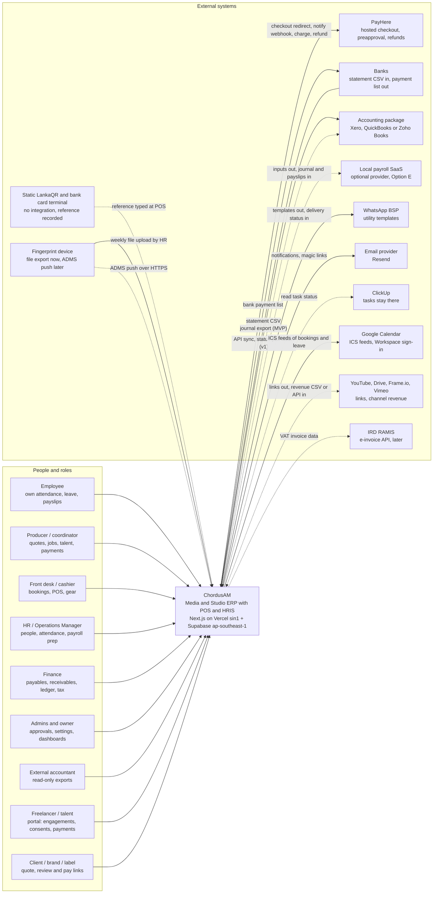

**Trust boundaries.** Staff sign in with magic link or domain-restricted Google and TOTP for privileged roles (NFR-SEC-001, NFR-SEC-002). Talent sign in through an invited portal account. Clients use single-purpose action tokens (`/q/`, `/r/`, `/pay/`) with no account (NFR-SEC-012). Machines (PayHere, BSP, ADMS device, workers) are system actors with signed or secret-authenticated requests (NFR-SEC-022, NFR-AUD-005).

---

## 3. Containers, modules and the shared kernel

### 3.1 Container view

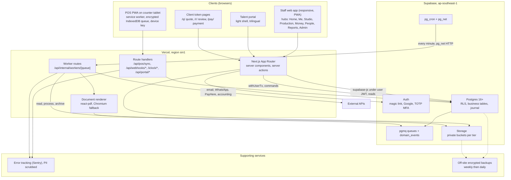

**Runtime rules.**

1. **User requests run as the user.** Pages, server actions and portal routes use the user's JWT. Reads go through supabase-js (RLS applies). Commands use `withUserTx`, which opens a transaction on a non-bypass login role, sets `request.jwt.claims` and `set local role authenticated`, runs the module command, and commits (ADR-05).
2. **Machines run as named system actors.** Webhooks and workers use a server-only key and call `security definer` functions that check the actor and write `write_system_audit()` (NFR-AUD-005). They never act "as a user" unless the job carries the user ID that asked for it (for example "render my payslip"), in which case they use `withUserTx` with that user's claims.
3. **Every mutation entry point** (server action, route handler, worker) goes through one `command()` wrapper: Zod validation, `guardApi`/permission check with entity and AAL, request ID and reason into `set_config('chordus.*')` for the audit trigger (NFR-AUD-003), the transaction, and an idempotency key where the caller can retry (POS sync, webhooks, portal submissions).
4. **Region pinning:** `vercel.json` sets `regions: ["sin1"]` (G-04).

### 3.2 Code layout

```text
app/                         routes only; thin, call modules
  (staff)/home, me, studio, production, money, people, reports, admin
  (portal)/portal/...
  (token)/q/[token], r/[token], pay/[token]
  api/pos/sync, api/webhooks/payhere, api/webhooks/whatsapp, iclock/cdata, iclock/getrequest
  api/internal/workers/[queue]
modules/<code>/              one folder per bounded context (crm, prj, bkg, pos, sal, vp, fin, hr, att, lv, pay, tal, ast, ai, apr, not, rpt, adm, int)
  commands.ts                public write API (the only way other modules change this module's data)
  queries.ts                 public read API
  events.ts                  event types this module publishes (Zod schemas, versioned)
  consumers.ts               handlers for events it subscribes to
  posting.ts                 journal lines it produces (calls fin.post)
  ui/                        module components
lib/rules/<code>/            pure business rules (CLAUDE.md), unit tested: accrueLeave, computePayroll, computeWht, priceBooking, allocateAiCost, routeApproval
lib/kernel/                  shared kernel: money, fx, numbering, documents, parties, approvals, audit, attachments, outbox, tenancy
lib/auth/                    Phase 0 guards, extended with permission + entity + AAL
supabase/migrations/         one migration per change, each with a rollback (CLAUDE.md)
```

Import rules (ESLint): `app/` may import `modules/*/commands|queries` and `lib/*`. A module may import another module's `commands`, `queries` and `events` only, never its tables or `ui/`. `lib/rules` imports nothing from `modules` or Supabase.

### 3.3 Modules as bounded contexts

"Owns" means only this module's code writes the table. Event names follow `<module>.<aggregate>.<past-tense verb>`, version 1 unless stated. "Depends on" lists synchronous calls (same transaction); event subscriptions are in the "Consumes" column.

| Module                            | Responsibility                                                                                                                                                                           | Owns (main tables)                                                                                                                                                                                                                                | Publishes                                                                                                                                                       | Consumes                                                                     | Depends on (sync)                 |
| --------------------------------- | ---------------------------------------------------------------------------------------------------------------------------------------------------------------------------------------- | ------------------------------------------------------------------------------------------------------------------------------------------------------------------------------------------------------------------------------------------------- | --------------------------------------------------------------------------------------------------------------------------------------------------------------- | ---------------------------------------------------------------------------- | --------------------------------- |
| **CRM** Clients and quotes        | Leads, client records, contacts, quotes with versions, acceptance, retainers, quote-to-order conversion                                                                                  | `clients` (role table on `parties`), `client_contacts`, `leads`, `quotes`, `quote_versions`, `quote_lines`, `orders`, `retainer_agreements`                                                                                                       | `crm.quote.sent`, `crm.quote.accepted`, `crm.order.created`, `crm.retainer.period_started`                                                                      | `apr.request.decided` (discounts)                                            | kernel, PRJ (create project), APR |
| **PRJ** Projects and pipeline     | Projects and jobs, codes, pipeline templates and stages, budget lines, time logs, turnaround, call sheets                                                                                | `projects` (extends PLAN), `project_stages`, `pipeline_templates`, `pipeline_template_stages`, `budget_versions`, `budget_lines`, `time_logs`, `call_sheets`                                                                                      | `prj.project.created`, `prj.stage.completed`, `prj.project.closed`, `prj.budget.exceeded`                                                                       | `crm.order.created`, `ast.version.approved`, `fin.posting.created` (actuals) | kernel                            |
| **BKG** Booking and gear          | Resources (rooms, gear, crew), availability, conflict prevention, pricing rules, holds, deposits policy, check-out and check-in, damage, maintenance                                     | `resources`, `resource_kits`, `price_rules`, `bookings`, `booking_resources`, `booking_policies`, `asset_movements`, `asset_condition_reports`, `maintenance_orders`                                                                              | `bkg.booking.held`, `bkg.booking.confirmed`, `bkg.booking.released`, `bkg.booking.cancelled`, `bkg.booking.completed`, `bkg.asset.overdue`, `bkg.asset.damaged` | `sal.payment.received` (deposit), `lv.leave.approved` (crew availability)    | kernel, SAL (deposit), PRJ        |
| **POS** Point of sale             | Catalogue sale, split tender, receipts, shifts, cash counts, packages, vouchers, refunds, offline queue                                                                                  | `pos_devices`, `pos_shifts`, `pos_sales`, `pos_sale_lines`, `cash_counts`, `vouchers`, `packages`, `package_items`                                                                                                                                | `pos.sale.completed`, `pos.sale.refunded`, `pos.shift.closed`, `pos.sync.gap_detected`                                                                          | `apr.request.decided` (refund, void, variance)                               | kernel, SAL (payments), BKG, FIN  |
| **SAL** Sales and receivables     | Invoices, IRD tax invoice format, milestones, payments in, allocations, credit notes, deposits register, AR ageing, VAT and SSCL monitor                                                 | `sales_invoices`, `sales_invoice_lines`, `billing_milestones`, `credit_notes`, `payments`, `payment_allocations`, `deposits`, `income_entries` (PLAN, kept for other income)                                                                      | `sal.invoice.issued`, `sal.payment.received`, `sal.deposit.applied`, `sal.deposit.forfeited`, `sal.invoice.overdue`                                             | `ast.version.approved` (balance invoice draft), `int.payhere.notified`       | kernel, FIN                       |
| **VP** Vendor and talent payments | Payment requests, lines, attachments, WHT computation, vouchers and self-billed invoices, payables queue, payments out, WHT certificates and schedules                                   | `vendors` (role table), `payment_requests`, `payment_request_lines`, `payment_attachments`, `wht_ledger`, `wht_certificates`, `purchase_orders`                                                                                                   | `vp.request.submitted`, `vp.request.approved`, `vp.request.paid`, `vp.wht.certificate_issued`                                                                   | `apr.request.decided`, `tal.engagement.delivered`                            | kernel, FIN, APR, TAL             |
| **FIN** Management ledger         | Chart of accounts and mapping, journal, posting rules, expenses, recurring expenses, periods and close, FX rates, tax codes and rates, budgets, bank statement import, accountant export | `accounts`, `account_mappings`, `journals`, `journal_lines`, `fiscal_periods`, `fx_rates`, `tax_codes`, `tax_rates`, `expense_entries` (PLAN), `expense_categories` (PLAN), `recurring_expenses` (PLAN), `budgets` (PLAN), `bank_statement_lines` | `fin.posting.created`, `fin.period.closed`, `fin.period.reopened`, `fin.export.generated`                                                                       | none (FIN is called, it does not call)                                       | kernel                            |
| **HR** Core HR                    | Employees, contracts and contract types, compensation, statutory IDs, documents, on- and offboarding, classification checklist                                                           | `employees` (PLAN), `contract_types` (PLAN), `employee_contracts` (PLAN), `employee_compensation`, `employee_identifiers`, `employee_documents`, `checklists`, `checklist_items`, `holidays` (PLAN)                                               | `hr.employee.hired`, `hr.contract.changed`, `hr.employee.exited`, `hr.probation.ending`                                                                         | `apr.request.decided` (bank-detail change)                                   | kernel                            |
| **ATT** Attendance                | Device and file import, punches, daily records, exceptions, manual attendance, mobile check-in, overtime                                                                                 | `attendance_imports` (PLAN), `import_profiles` (PLAN), `raw_punches` (PLAN), `attendance_days` (PLAN), `manual_attendance_requests` (PLAN), `attendance_devices`                                                                                  | `att.import.committed`, `att.day.recalculated`, `att.exception.raised`                                                                                          | `lv.leave.approved`, `apr.request.decided`                                   | HR                                |
| **LV** Leave                      | Leave types, accrual ledger, requests, balances, statutory floors, clash warnings                                                                                                        | `leave_types` (PLAN), `leave_balances_ledger` (PLAN), `leave_requests` (PLAN)                                                                                                                                                                     | `lv.leave.submitted`, `lv.leave.approved`, `lv.leave.cancelled`                                                                                                 | `apr.request.decided`, `hr.contract.changed`                                 | HR, APR                           |
| **PAY** Payroll                   | Pay runs (internal or external provider), components, EPF, ETF, APIT, gross-up, gratuity, payslips, statutory outputs and calendar                                                       | `payroll_runs` (PLAN), `payroll_lines` (PLAN), `payroll_line_items`, `pay_components`, `statutory_tables`, `statutory_table_rows`, `gratuity_accruals`, `statutory_filings`                                                                       | `pay.run.submitted`, `pay.run.approved`, `pay.run.paid`, `pay.filing.due`                                                                                       | `apr.request.decided`, `att.day.recalculated`, `lv.leave.approved`           | HR, ATT, LV, FIN, APR             |
| **TAL** Talent                    | Talent profiles, skills and languages, rate cards, engagements, contracts, releases, AI-likeness consents, classification                                                                | `talent_profiles` (role table), `talent_skills`, `rate_cards`, `rate_card_items`, `engagements`, `contracts`, `consents`, `consent_scopes`                                                                                                        | `tal.engagement.offered`, `tal.engagement.accepted`, `tal.engagement.delivered`, `tal.consent.granted`, `tal.consent.withdrawn`                                 | none                                                                         | kernel                            |
| **AST** Deliverables and rights   | Deliverables register, versions, client approval events, revision rounds, rights and splits, publish checklist, channels and revenue imports                                             | `deliverables`, `deliverable_versions`, `client_approval_events`, `rights_records`, `rights_splits`, `deliverable_consents`, `publish_checklists`, `channels`, `channel_revenue_lines`                                                            | `ast.version.sent`, `ast.version.approved`, `ast.changes.requested`, `ast.revision.billable`, `ast.deliverable.published`, `ast.rights.expiring`                | `tal.consent.withdrawn`                                                      | TAL, PRJ                          |
| **AI** AI tool costs              | Subscriptions, allowances, usage log, month-end pool-and-allocate, utilisation                                                                                                           | `ai_subscriptions`, `ai_subscription_periods`, `ai_usage_logs`, `ai_allocation_runs`, `ai_allocation_lines`                                                                                                                                       | `ai.allowance.low`, `ai.allocation.posted`                                                                                                                      | `fin.posting.created` (subscription expense)                                 | FIN, PRJ                          |
| **APR** Approvals                 | Policies, routing, tasks, actions, delegations, SLA escalation                                                                                                                           | `approval_policies`, `approval_policy_steps`, `approval_requests`, `approval_tasks`, `approval_actions`, `delegations`                                                                                                                            | `apr.request.created`, `apr.task.assigned`, `apr.task.escalated`, `apr.request.decided`                                                                         | none                                                                         | kernel (subject adapters)         |
| **NOT** Notifications             | In-app inbox, email, WhatsApp, templates per language, opt-ins, delivery status                                                                                                          | `notifications` (PLAN), `notification_templates`, `notification_deliveries`, `channel_optins`                                                                                                                                                     | `not.delivery.failed`                                                                                                                                           | almost every event (by subscription table)                                   | kernel                            |
| **RPT** Reports                   | Dashboards, materialised views, exports                                                                                                                                                  | `rpt_*` materialised views, `report_exports`                                                                                                                                                                                                      | none                                                                                                                                                            | `fin.posting.created`, `fin.period.closed` (refresh)                         | read-only on others' views        |
| **ADM** Admin                     | Tenants, entities, brands, locations, users and grants, policy settings, catalogue, audit viewer, PDPA records (ROPA, notices, retention, DSRs)                                          | `tenants`, `entities`, `brands`, `locations`, `permission_sets`, `user_entity_roles`, `policy_settings`, `ropa_entries`, `privacy_notices`, `notice_acknowledgements`, `retention_rules`, `data_subject_requests`                                 | `adm.grant.changed`, `adm.policy.changed`                                                                                                                       | `apr.request.decided` (grants)                                               | kernel                            |
| **INT** Integrations              | Connections, inbound webhooks, sync links, provider adapters (PayHere, accounting, HRIS, ADMS, BSP, ClickUp, Calendar, YouTube, RAMIS)                                                   | `integration_connections`, `inbound_webhook_events`, `sync_links`, `export_batches`, `einvoice_submissions`                                                                                                                                       | `int.payhere.notified`, `int.sync.failed`, `int.device.punches_received`                                                                                        | `sal.invoice.issued`, `fin.export.generated`, `vp.request.paid`, and others  | kernel                            |

### 3.4 Shared kernel

The shared kernel is the small set of tables and functions every module uses. It changes rarely and has the strictest review.

| Kernel part                  | Tables                                                                                                                                       | Contract                                                                                                                                                                                                                                                                                                                                                                                                                                                                                                             |
| ---------------------------- | -------------------------------------------------------------------------------------------------------------------------------------------- | -------------------------------------------------------------------------------------------------------------------------------------------------------------------------------------------------------------------------------------------------------------------------------------------------------------------------------------------------------------------------------------------------------------------------------------------------------------------------------------------------------------------- |
| **Tenancy and organisation** | `tenants`, `entities`, `brands`, `locations`                                                                                                 | `app.current_tenant_id()` (from the caller's membership, never from user metadata), entity base currency, timezone, tax profile, fiscal year start. Brands (The Studio LK, Varnam TV, Varna TV) are profit-centre dimensions, not legal entities (BR-FIN-008). Locations are mandatory on studio-side records (NFR-SCALE-003)                                                                                                                                                                                        |
| **Parties and people**       | `parties`, `party_contacts`, `party_identifiers` (Restricted, encrypted, blind index), `party_bank_accounts` (Restricted), `party_addresses` | One record per real person or organisation. Role tables (`clients`, `vendors`, `talent_profiles`) and `employees.party_id` hang off it. Duplicate detection runs on blind indexes of NIC, BRN and bank account (CFO-31)                                                                                                                                                                                                                                                                                              |
| **Money and FX**             | `currencies`, `fx_rates` (owned by FIN, read by all)                                                                                         | `Money = { amountMinor: bigint, currency }`. Every money row stores document amount and currency, base amount, `fx_rate_id` and the rate itself (snapshot). Rounding mode is policy data. Realised FX on settlement is computed by FIN (CFO-09)                                                                                                                                                                                                                                                                      |
| **Numbering**                | `doc_sequences` (PLAN, extended), `doc_sequence_blocks` (offline device ranges)                                                              | Numbers are assigned **at issue time by a `BEFORE INSERT OR UPDATE` trigger** when a document's status becomes `issued`, as late in the transaction as possible; `next_number(entity, doc_type, date)` is row-locked and gapless, is not executable by `authenticated` and is not in an exposed schema, and several types are locked in a fixed order (22a §3b: 0 gaps, 0 duplicates under 20 connections). Voids are recorded, never deleted (NFR-AUD-012, CFO-29). Format is data, for example `AMPL-PV-2026-0001` |
| **Documents**                | `documents` (PLAN, extended)                                                                                                                 | `issue_document(kind, subject, template_version, data_snapshot)` stores the snapshot, renders asynchronously, then stores path, SHA-256 and page count. Status `pending → rendered → superseded`. Downloads write `access_log` for Restricted kinds                                                                                                                                                                                                                                                                  |
| **Attachments**              | `attachments`                                                                                                                                | Generic link from any record to a Storage object: bucket, path, MIME, size, SHA-256, tier, uploaded by. Replaces per-module attachment path columns over time (PLAN's `payment_attachments` becomes a view)                                                                                                                                                                                                                                                                                                          |
| **Approvals**                | APR tables (section 6)                                                                                                                       | `request_approval(subject_type, subject_id, context)`; subjects implement an adapter                                                                                                                                                                                                                                                                                                                                                                                                                                 |
| **Audit**                    | `audit_log` (Phase 0, extended), `access_log`                                                                                                | Row triggers with per-table redaction lists, request context from `set_config`, system actors, read logging (section 7.6)                                                                                                                                                                                                                                                                                                                                                                                            |
| **Outbox**                   | `internal.domain_events`, pgmq queues, `internal.event_subscriptions`, `internal.consumer_inbox`                                             | `emit(type, aggregate, payload)` inside the transaction. Payload is validated by the event's Zod schema and must not contain Restricted values (`15-compliance-security.md` §3.3, notifications row)                                                                                                                                                                                                                                                                                                                 |
| **Policy settings**          | `policy_settings`                                                                                                                            | Effective-dated, typed (Zod schema per key), per tenant and entity: spending limit, revision rounds, deposit percentage, hold hours, tolerance, WHT thresholds. Company policy is data (CLAUDE.md, BR-ADM-004)                                                                                                                                                                                                                                                                                                       |

**Event envelope** (all events):

```ts
interface DomainEvent<T> {
  id: string; // uuid, also the idempotency key for consumers
  type: string; // e.g. "vp.request.paid"
  version: number; // schema version of payload
  tenantId: string;
  entityId: string | null;
  aggregateType: string; // e.g. "payment_request"
  aggregateId: string;
  occurredAt: string; // UTC ISO
  actor: {
    type: "user" | "system" | "webhook" | "job" | "device" | "portal" | "token";
    id: string | null;
  };
  correlationId: string; // request ID that started the chain
  causationId: string | null; // event that caused this one
  payload: T; // IDs and non-Restricted facts only
}
```

**Posting is synchronous, everything else is asynchronous.** When a source document changes money state (invoice issued, payment received, request paid, run paid, shift closed, allocation run), the source module calls `fin.post(source_type, source_id, lines)` in the **same transaction**. FIN checks balance, period state and mapping, and inserts the journal with `unique (tenant_id, source_type, source_id, posting_kind)`, so a document can never post twice (PLAN §9 key constraints). Notifications, search, reports and external sync react to events afterwards. Rationale: the ledger must never disagree with the documents at month end; a notification can be a minute late.

---

## 4. Domain model

### 4.1 Conventions for every table

| Rule              | Detail                                                                                                                                                                                                                                                                                                                                                                                                                 |
| ----------------- | ---------------------------------------------------------------------------------------------------------------------------------------------------------------------------------------------------------------------------------------------------------------------------------------------------------------------------------------------------------------------------------------------------------------------- |
| Keys              | `id uuid primary key default gen_random_uuid()` (as Phase 0). Human codes (`MV-0412`, `AMPL-INV-2026-0042`) are separate columns with their own unique index                                                                                                                                                                                                                                                           |
| Tenancy           | `tenant_id uuid not null` on **every** table, defaulting to `app.current_tenant_id()` and immutable (trigger). `entity_id uuid not null` on every business row (money, people, documents, bookings, projects). Reference data shared across entities (skills, currencies) has `entity_id null`. Studio-side rows (resources, bookings, POS devices and shifts, assets, stock) also carry `location_id` (NFR-SCALE-003) |
| Foreign keys      | Composite when they cross aggregates: `foreign key (tenant_id, project_id) references projects (tenant_id, id)`, backed by `unique (tenant_id, id)` on the parent                                                                                                                                                                                                                                                      |
| Money             | `<name>_minor bigint` + `currency char(3)`; base amounts `<name>_base_minor bigint` + `fx_rate_id` + `fx_rate numeric(20,10)`. Never floats                                                                                                                                                                                                                                                                            |
| Time              | `timestamptz` in UTC. Calendar dates (`work_date`, `entry_date`) as `date` interpreted in the entity's timezone. Ranges as `tstzrange` with `[)` bounds                                                                                                                                                                                                                                                                |
| Lifecycle         | `created_at`, `updated_at`, `created_by`; soft delete (`deleted_at`) only on master data. Money and approval facts are never deleted: corrections are reversals (PLAN §9)                                                                                                                                                                                                                                              |
| Versioned history | Effective-dated rows (`valid_from`, `valid_to`, exclusion constraint against overlap) for contracts, compensation, rates, tax tables, policies, rate cards                                                                                                                                                                                                                                                             |
| Security          | RLS enabled, default deny. Sensitive tables attach `audit_row_change()` with their redaction list (NFR-AUD-001). Restricted columns live in their own tables (section 7)                                                                                                                                                                                                                                               |
| Enums             | Postgres enums only for stable sets (status machines). Business categories (service categories, leave types, tax codes) are tables, so they are editable data                                                                                                                                                                                                                                                          |

### 4.2 Kernel, organisation and access

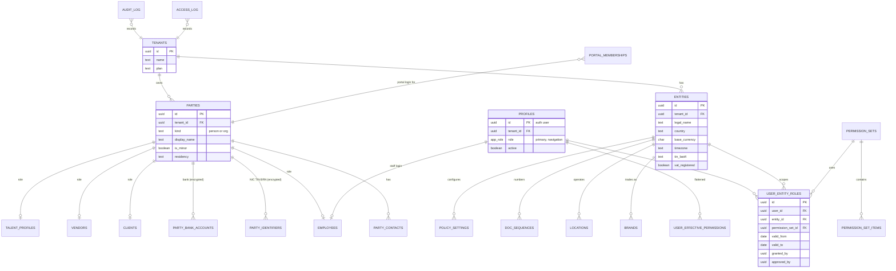

### 4.3 Quote to cash (CRM, PRJ, SAL) with rate cards

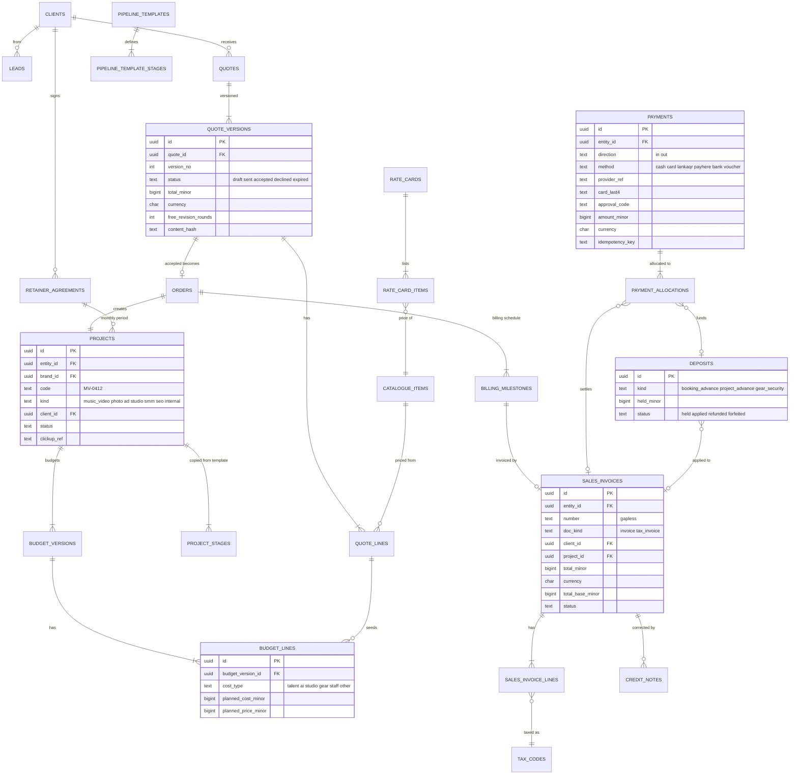

**Quote → order → invoice.** `orders` is the accepted, frozen commercial commitment (the accepted quote version's lines, billing schedule and terms). It exists so that quote edits after acceptance never change what was sold, and so retainers and walk-in POS sales without a quote still have one consistent "what was sold" record. A project can have several orders (change orders).

### 4.4 Studio front of house (BKG, POS)

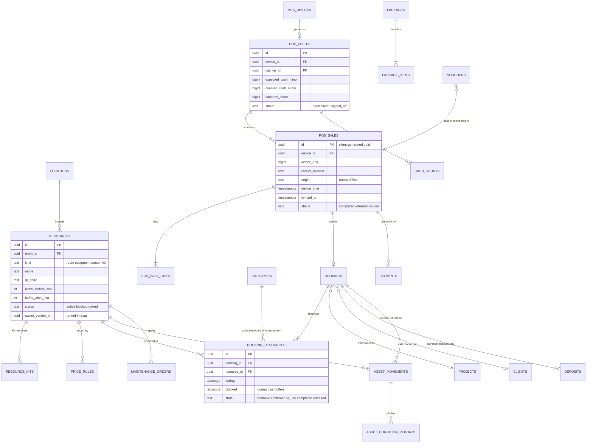

**No double booking in the database** (BR-BKG-004, BRULE-054, BRULE-055). `booking_resources` has

```sql
exclude using gist (tenant_id with =, resource_id with =, blocked with &&)
  where (state in ('tentative', 'confirmed', 'in_use'))
```

using `btree_gist`, so two live holds on one resource cannot overlap, buffers included. A violation raises SQLSTATE `23P01`, which the booking command turns into "Lighting kit A is booked 15:00–17:00; next free kit: B" (J-02). Half-open `[)` ranges let back-to-back bookings touch. This is the standard Postgres pattern ([Supabase on range columns](https://supabase.com/blog/range-columns), [DEV example](https://dev.to/ripazocom/preventing-double-bookings-with-postgresql-exclusion-constraints-5efn)). Crew are resources of kind `person` linked to an employee; approved leave inserts a `blocked` row for that person so leave blocks crew availability (R1 P10). Offline walk-ins that sync into a clash are stored with `state = 'conflict'` (outside the constraint) and raise an alert, as J-01 asks.

### 4.5 Management ledger, tax and FX (FIN)

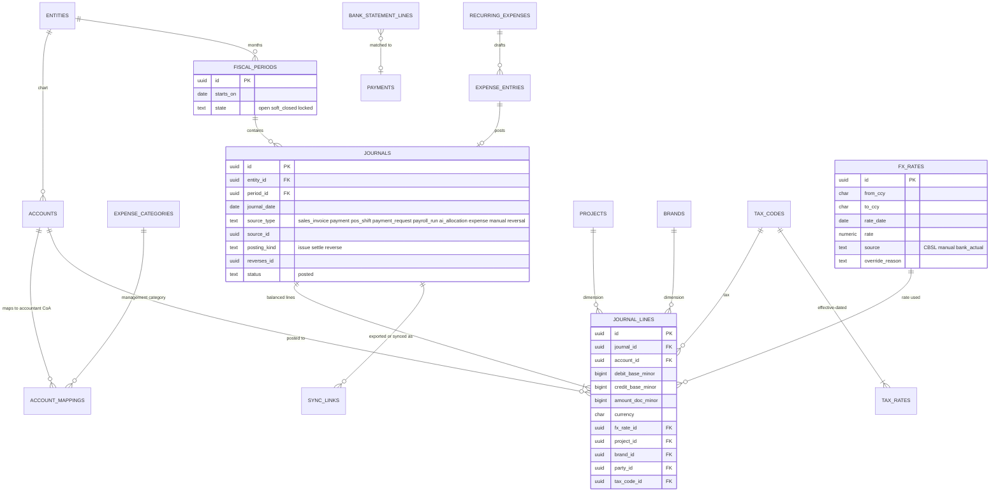

**Ledger invariants** (enforced by a deferred constraint trigger per journal): sum of debits equals sum of credits in base currency; the period is `open` (or `soft_closed` and the actor has `fin.period.post_soft_closed`); every line's account is mapped for export (CFO-02, an unmapped category blocks export, not posting); a journal is never updated after insert, only reversed (CFO-30).

**Starter posting rules** (accounts are data; names are illustrative):

| Event                                 | Debit                                                                   | Credit                                                                  |
| ------------------------------------- | ----------------------------------------------------------------------- | ----------------------------------------------------------------------- |
| Booking deposit received (PayHere)    | PayHere clearing                                                        | Customer deposits (liability) (CFO-12)                                  |
| Deposit applied to invoice            | Customer deposits                                                       | Accounts receivable                                                     |
| Deposit forfeited on no-show          | Customer deposits                                                       | Forfeited deposit income                                                |
| Gear security deposit held / released | Cash or clearing / Gear security deposits                               | Gear security deposits / Cash or clearing                               |
| POS shift closed                      | Cash drawer, PayHere clearing, Card terminal clearing, LankaQR clearing | Revenue by brand and activity, VAT payable (if registered)              |
| Shift variance                        | Cash over/short (either side)                                           | Cash drawer                                                             |
| Sales invoice issued                  | Accounts receivable                                                     | Revenue (or deferred revenue per policy, CFO-10), VAT payable           |
| Receipt                               | Bank or clearing                                                        | Accounts receivable                                                     |
| PayHere settlement                    | Bank, Gateway fees                                                      | PayHere clearing                                                        |
| Vendor or talent payment approved     | Expense by category, tagged to project                                  | Accounts payable                                                        |
| Vendor payment with 5% WHT paid       | Accounts payable (gross)                                                | Bank (net), WHT payable                                                 |
| Vendor advance paid                   | Vendor prepayments                                                      | Bank (CFO-13)                                                           |
| Payroll run approved (accrual)        | Salaries (gross), EPF employer 12%, ETF 3%                              | EPF payable (8% + 12%), ETF payable, APIT payable, Net salaries payable |
| Payroll paid                          | Net salaries payable                                                    | Bank                                                                    |
| Gratuity provision (monthly)          | Gratuity expense                                                        | Gratuity provision                                                      |
| AI allocation run                     | Project AI cost (per project); AI capacity unused                       | AI tools pool (the subscription expense)                                |
| Realised FX on settlement             | FX loss (or AP/AR difference)                                           | FX gain (or AP/AR difference) (CFO-09)                                  |

EPF and ETF percentages, APIT tables and WHT thresholds come from effective-dated rows in `statutory_tables` and `tax_rates`, never from code (BR-ADM-004, NFR-COST-003). Each run and each payment stores the table versions it used (NFR-AUD-011).

### 4.6 People (HR, ATT, LV, PAY), extending PLAN §9

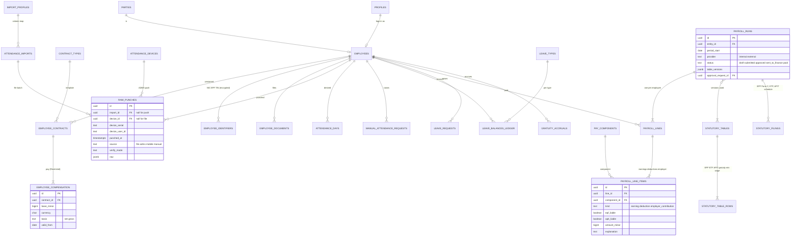

**What changes against PLAN §9 here:** pay amounts move from `employee_contracts.base_amount` to `employee_compensation`, so HR lists never load salaries (`15-compliance-security.md` §3.3). `employees.nic` moves to `employee_identifiers` (encrypted plus blind index). `raw_punches` gains `device_serial`, `device_id` and `verify_mode`, and its unique key becomes `(tenant_id, employee_id, punched_at, source)` as PLAN §9 already says, so ADMS push needs no schema change later (R2 C.3). `payroll_lines.deductions/additions jsonb` become typed `payroll_line_items`, because EPF liability and APIT depend on each component (BR-PAY-003). PLAN's `leave_balances_ledger` stays exactly as designed.

### 4.7 Talent, payments, deliverables and AI (TAL, VP, AST, AI)

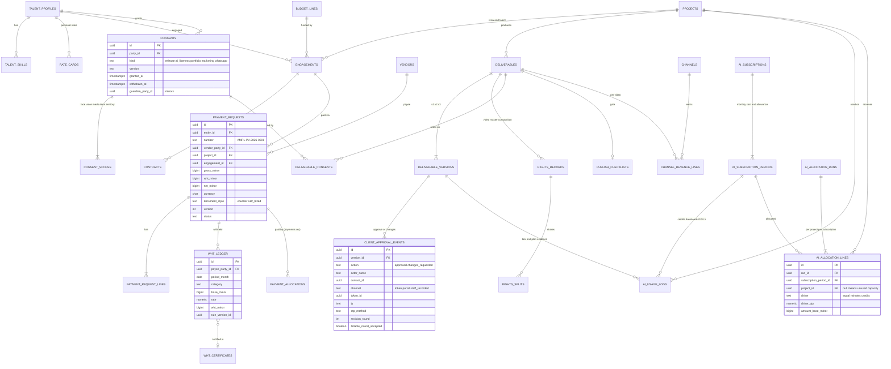

**WHT is a ledger, not a field.** PLAN §9 has `payment_requests.tax_amount`. That cannot answer "has this payee passed LKR 100,000 this month across all requests?" (CFO-22, BR-VP-012, BRULE-041). `wht_ledger` keeps one row per withholding with the rule version, so `computeWht()` in `lib/rules/vp` can take the month-to-date base for the payee and return the WHT line with its explanation (J-04 step 7), and the monthly schedule and certificates are plain queries (BR-VP-013, BRULE-044).

### 4.8 How this extends PLAN.md section 9 and Phase 0

Nothing in Phase 0 is dropped. Each PLAN §9 table keeps its name and purpose; most gain the tenancy columns and some move sensitive columns into a sibling table.

| PLAN §9 / Phase 0 object                                                                                | Treatment               | Change (proposal, needs owner approval under CLAUDE.md)                                                                                                                                                                                                                                                                          |
| ------------------------------------------------------------------------------------------------------- | ----------------------- | -------------------------------------------------------------------------------------------------------------------------------------------------------------------------------------------------------------------------------------------------------------------------------------------------------------------------------- |
| `app_role` enum (Phase 0)                                                                               | **Kept**                | Stays as the primary role for navigation. New roles (producer, front desk, accountant, DPO) are permission sets, not enum values, so no enum migration is needed                                                                                                                                                                 |
| `profiles` (Phase 0)                                                                                    | **Extended**            | Add `tenant_id`, `primary_entity_id`. `can_request_payments` stays, mirrored into the permission `vp.request.create` during migration, then deprecated. `handle_new_user()` creates a staff profile only for an invited staff email (from an `internal.invitations` row an Admin wrote), so portal users never become `employee` |
| `has_role()`, `current_app_role()`                                                                      | **Kept, reimplemented** | Return the same answers, computed from `user_entity_roles` for the primary entity, so Phase 0 policies and the 18 RLS tests keep passing; a sync trigger on `profiles` keeps the primary grant equal to `profiles.role` (22a §3a: 18/18 pass)                                                                                    |
| `audit_log` (Phase 0)                                                                                   | **Extended**            | Add `tenant_id`, `entity_id`, `actor_type`, `actor_role`, `request_id`, `ip`, `user_agent`, `reason`, `source`, `prev_hash`, `row_hash`; monthly partitions. `audit_row_change()` takes a redaction list via trigger arguments (G-01, NFR-AUD-001, NFR-AUD-003, NFR-AUD-004)                                                     |
| `write_audit()` (Phase 0)                                                                               | **Kept, constrained**   | Validates `p_action` against an allow-list; rows tagged `source = 'app'` (G-11). New `write_system_audit()` for service actors (G-06)                                                                                                                                                                                            |
| `employees`                                                                                             | Extended                | `party_id`, `entity_id`, `tenant_id`; `nic` moves to `employee_identifiers`; `profile_id` foreign key **without cascade** (G-17)                                                                                                                                                                                                 |
| `contract_types`, `employee_contracts`                                                                  | Extended                | Tenancy columns; amounts move to `employee_compensation`                                                                                                                                                                                                                                                                         |
| `holidays`                                                                                              | Extended                | `entity_id` (SG holidays differ), `gazette_ref`                                                                                                                                                                                                                                                                                  |
| `leave_types`, `leave_balances_ledger`, `leave_requests`                                                | Extended                | Tenancy columns. Approval fields (`hr_reviewer_id`, `decided_by` …) are kept as denormalised copies written by the approval adapter, so PLAN's queries still work; the engine is the source of truth                                                                                                                             |
| `attendance_imports`, `import_profiles`, `raw_punches`, `attendance_days`, `manual_attendance_requests` | Extended                | `raw_punches` gains `device_id`, `device_serial`, `verify_mode`; `attendance_devices` is new                                                                                                                                                                                                                                     |
| `payroll_runs`, `payroll_lines`                                                                         | Extended                | `provider`, `table_versions`, `approval_request_id`; `payroll_line_items` replaces the `deductions/additions jsonb`                                                                                                                                                                                                              |
| `documents`                                                                                             | Extended                | `template_version`, `data_snapshot`, `sha256`, `status`, `supersedes_id`, `tier`                                                                                                                                                                                                                                                 |
| `notifications`                                                                                         | Extended                | `notification_deliveries` per channel; templates and opt-ins are new                                                                                                                                                                                                                                                             |
| `clients`                                                                                               | **Reframed**            | Becomes a role table on `parties` (`party_id` primary key). Columns `name`, `contact`, `address`, `brn` move to `parties`, `party_contacts`, `party_addresses`, `party_identifiers`; a `clients_v` view keeps PLAN's shape                                                                                                       |
| `vendors`                                                                                               | **Reframed**            | Same as clients. `bank_details` moves to `party_bank_accounts` (encrypted, blind index, dual-controlled changes, NFR-SEC-025)                                                                                                                                                                                                    |
| `projects`                                                                                              | Extended                | `entity_id`, `brand_id`, `code`, `kind`, `pipeline_template_id`, `order_id`; `budget_amount` replaced by `budget_versions` (PLAN keeps a total; a view supplies it)                                                                                                                                                              |
| `payment_requests`, `payment_request_lines`                                                             | Extended                | `engagement_id`, `budget_line_id`, `gross/wht/net` minor amounts, `entity_id`; `tax_amount` becomes the sum of `wht_ledger` rows                                                                                                                                                                                                 |
| `payment_request_payments`, `income_receipts`                                                           | **Generalised**         | Realised as `payments` (direction in or out) plus `payment_allocations`, with views named as in PLAN. One money-movement table is needed for POS split tender, PayHere, deposits, refunds and bank matching                                                                                                                      |
| `payment_attachments`                                                                                   | Generalised             | View over kernel `attachments`                                                                                                                                                                                                                                                                                                   |
| `doc_sequences`                                                                                         | Extended                | `tenant_id`, `entity_id`, `doc_type`, `fiscal_year`, `format`; `doc_sequence_blocks` for offline device series                                                                                                                                                                                                                   |
| `expense_categories`, `expense_entries`, `recurring_expenses`, `budgets`                                | Extended                | Tenancy columns, minor-unit amounts, `foreign_vat_minor` (CFO-23); each posted expense writes a journal                                                                                                                                                                                                                          |
| `income_entries`                                                                                        | Kept, narrowed          | For income without a sales invoice (grants, channel revenue, other). Client invoices are `sales_invoices`                                                                                                                                                                                                                        |

### 4.9 New tables by module

| Module                     | New tables                                                                                                                                                                                                                                                                                                                                                                                                                                                                                                                                                                                     |
| -------------------------- | ---------------------------------------------------------------------------------------------------------------------------------------------------------------------------------------------------------------------------------------------------------------------------------------------------------------------------------------------------------------------------------------------------------------------------------------------------------------------------------------------------------------------------------------------------------------------------------------------- |
| Kernel and ADM             | `tenants`, `entities`, `brands`, `locations`, `parties`, `party_contacts`, `party_addresses`, `party_identifiers`, `party_bank_accounts`, `bank_detail_change_requests`, `permissions`, `permission_sets`, `permission_set_items`, `user_entity_roles`, `user_permission_overrides`, `user_effective_permissions`, `portal_memberships`, `policy_settings`, `attachments`, `access_log`, `doc_sequence_blocks`, `currencies`, `ropa_entries`, `privacy_notices`, `notice_acknowledgements`, `retention_rules`, `legal_holds`, `data_subject_requests`, `action_tokens`, `internal.invitations` |
| Outbox (schema `internal`) | `domain_events` (partitioned by month), `event_subscriptions`, `consumer_inbox`, `job_runs`; pgmq queues `q_notifications`, `q_integrations`, `q_documents`, `q_projections`, `q_accounting`                                                                                                                                                                                                                                                                                                                                                                                                   |
| CRM                        | `client_contacts`, `leads`, `quotes`, `quote_versions`, `quote_lines`, `catalogue_items`, `orders`, `retainer_agreements`                                                                                                                                                                                                                                                                                                                                                                                                                                                                      |
| PRJ                        | `pipeline_templates`, `pipeline_template_stages`, `project_stages`, `budget_versions`, `budget_lines`, `time_logs`, `call_sheets`, `call_sheet_people`                                                                                                                                                                                                                                                                                                                                                                                                                                         |
| BKG                        | `resources`, `resource_kits`, `price_rules`, `booking_policies`, `bookings`, `booking_resources`, `asset_movements`, `asset_condition_reports`, `maintenance_orders`                                                                                                                                                                                                                                                                                                                                                                                                                           |
| POS                        | `pos_devices`, `pos_shifts`, `pos_sales`, `pos_sale_lines`, `cash_counts`, `packages`, `package_items`, `vouchers`                                                                                                                                                                                                                                                                                                                                                                                                                                                                             |
| SAL                        | `sales_invoices`, `sales_invoice_lines`, `billing_milestones`, `credit_notes`, `payments`, `payment_allocations`, `deposits`                                                                                                                                                                                                                                                                                                                                                                                                                                                                   |
| VP                         | `wht_ledger`, `wht_certificates`, `purchase_orders`                                                                                                                                                                                                                                                                                                                                                                                                                                                                                                                                            |
| FIN                        | `accounts`, `account_mappings`, `fiscal_periods`, `journals`, `journal_lines`, `fx_rates`, `tax_codes`, `tax_rates`, `bank_statement_imports`, `bank_statement_lines`, `close_checklists`                                                                                                                                                                                                                                                                                                                                                                                                      |
| HR                         | `employee_compensation`, `employee_identifiers`, `employee_documents`, `checklists`, `checklist_items`, `classification_checklists`                                                                                                                                                                                                                                                                                                                                                                                                                                                            |
| ATT                        | `attendance_devices`                                                                                                                                                                                                                                                                                                                                                                                                                                                                                                                                                                           |
| PAY                        | `payroll_line_items`, `pay_components`, `statutory_tables`, `statutory_table_rows`, `gratuity_accruals`, `statutory_filings`, `payroll_provider_exchanges`                                                                                                                                                                                                                                                                                                                                                                                                                                     |
| TAL                        | `talent_profiles`, `talent_skills`, `rate_cards`, `rate_card_items`, `engagements`, `contracts`, `consents`, `consent_scopes`                                                                                                                                                                                                                                                                                                                                                                                                                                                                  |
| AST                        | `deliverables`, `deliverable_versions`, `client_approval_events`, `rights_records`, `rights_splits`, `deliverable_consents`, `publish_checklists`, `channels`, `channel_revenue_lines`                                                                                                                                                                                                                                                                                                                                                                                                         |
| AI                         | `ai_subscriptions`, `ai_subscription_periods`, `ai_usage_logs`, `ai_allocation_runs`, `ai_allocation_lines`                                                                                                                                                                                                                                                                                                                                                                                                                                                                                    |
| APR                        | `approval_policies`, `approval_policy_steps`, `approval_requests`, `approval_tasks`, `approval_actions`, `delegations`                                                                                                                                                                                                                                                                                                                                                                                                                                                                         |
| NOT                        | `notification_templates`, `notification_deliveries`, `channel_optins`                                                                                                                                                                                                                                                                                                                                                                                                                                                                                                                          |
| INT                        | `integration_connections`, `inbound_webhook_events`, `sync_links`, `export_batches`, `einvoice_submissions`                                                                                                                                                                                                                                                                                                                                                                                                                                                                                    |
| RPT                        | materialised views `rpt_pnl_monthly`, `rpt_project_profitability`, `rpt_ar_ageing`, `rpt_studio_utilisation`, `rpt_ai_cost_per_project`, plus `report_exports`                                                                                                                                                                                                                                                                                                                                                                                                                                 |

About 120 new tables. Only a fraction ship in the MVP; the PO decides which in `docs/discovery/21-mvp-roadmap.md`. The **kernel and ADM row ships first** (section 10).

---

## 5. Key flows

Each flow names the module commands, the transaction boundary, and what happens when something fails. `tx` means one Postgres transaction under `withUserTx` (or a system actor for webhooks and workers).

### 5.1 POS sale with LankaQR or PayHere, offline queue and reconciliation

Relates to J-01, J-10, BR-POS-001 to BR-POS-007, BR-POS-010, BR-POS-013, BRULE-022, BRULE-058, NFR-AVAIL-002, NFR-SEC-013, NFR-SEC-014.

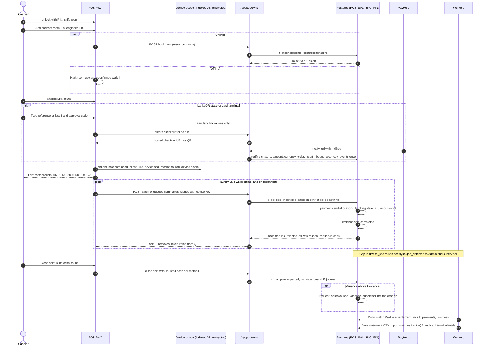

**Design points.**

1. **Server is the authority.** The device sends commands (`sale.create`), not table rows. The sync endpoint re-prices lines from the catalogue version the device had, and rejects a line if that version is unknown. The sale keeps both `device_time` and `synced_at`.
2. **Idempotency.** The sale's primary key is the client-generated UUID; a resend is a no-op. Payment rows carry `idempotency_key = device_id + device_seq + tender_no`.
3. **Offline limits as policy data:** cash, LankaQR reference and terminal approval codes only; refunds, vouchers, deposits and PayHere are blocked offline (BR-POS-007); at least 8 hours or 500 sales offline (NFR-AVAIL-002) up to a policy maximum (for example 72 hours) and a maximum offline sale value (`15-compliance-security.md` §4.7). A shift cannot close while offline sales are unsynced (BRULE-058).
4. **Receipt numbers offline.** Each registered device holds blocks of numbers from `doc_sequence_blocks` (BRULE-022 proposes blocks of 50; the device keeps enough in reserve for 500 offline sales, NFR-AVAIL-002, and tops up when online). Unused numbers are voided with a reason at shift close, so the sequence has no unexplained gap, and a voided sale keeps its number. Whether IRD accepts a device series on receipts and tax invoices is SPK-12; the fallback is a provisional slip offline and the official receipt sent by WhatsApp or email after sync.
5. **Reconciliation.** Each tender posts to a clearing account per method. PayHere settlements, the card terminal's daily batch and bank statement lines clear them (CFO-04, CFO-33). Uncleared items older than N days show on the close checklist.

### 5.2 Booking with deposit, session, POS balance and invoice

Relates to J-02, BR-BKG-003 to BR-BKG-014, BR-POS-003, BR-SAL-001, BR-SAL-007, BR-INT-002, CFO-12, BRULE-050 to BRULE-057.

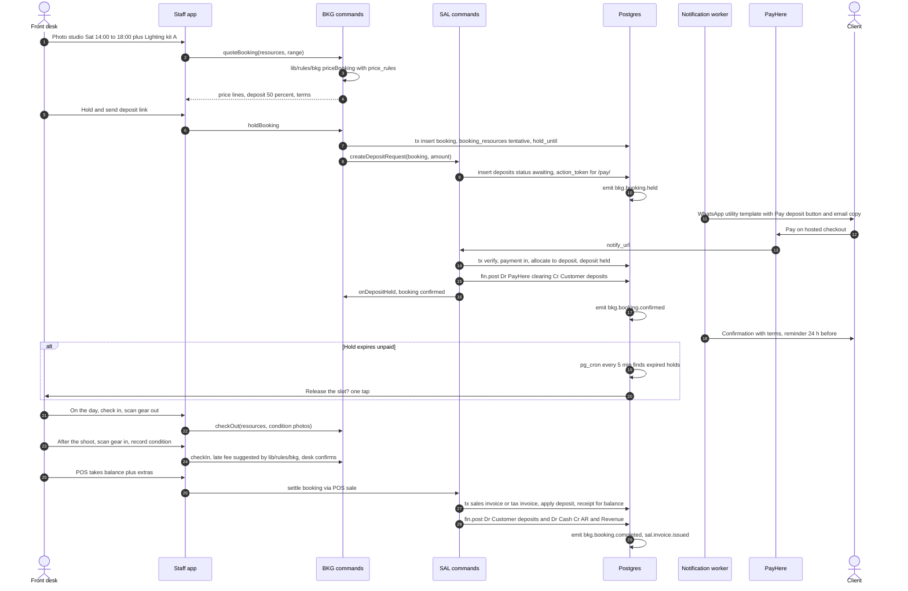

**Failure handling.** A PayHere notify for a booking already released becomes a held credit on the client, and the desk is asked to rebook or refund (J-02 failure path). A cancellation applies the policy fee by `lib/rules/bkg/cancellationFee()` and forfeits or refunds the deposit through SAL; a refund goes through APR when above the cashier's limit and then the PayHere Refund API (R3 §8). A damage charge is netted against the gear security deposit or added to the invoice, never auto-charged (J-02 step 10).

### 5.3 Job: quote, approval, production stages, client approval link, invoice

Relates to J-03, J-05, BR-CRM-003 to BR-CRM-008, BR-PRJ-003 to BR-PRJ-006, BR-AST-002 to BR-AST-005, BR-AST-008, BR-SAL-005, BRULE-040, BRULE-063, BRULE-068, R1 P1, R4-F02, R4-F03.

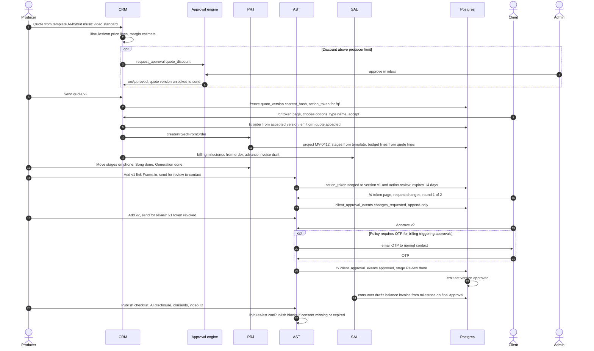

**Notes.** The quote token, review token and pay token are rows in `action_tokens`: 128 random bits, stored as a hash, scoped to one object, one version and one action, expiring, single use, revoked when a newer version is sent (NFR-SEC-012). Round 3 shows "outside your package, costs LKR X" and needs a tick, which records `billable_round_accepted` and emits `ast.revision.billable` for SAL to add a line (BR-AST-004). The balance invoice is drafted, not issued: Finance confirms it (J-03 step 11).

### 5.4 Freelancer payment with 5% WHT and voucher

Relates to J-04, BR-TAL-003, BR-TAL-004, BR-VP-004 to BR-VP-007, BR-VP-010 to BR-VP-014, BR-APR-003, BR-APR-004, BRULE-001, BRULE-007, BRULE-041, BRULE-044, BRULE-061, BRULE-062, CFO-22, USP 1.

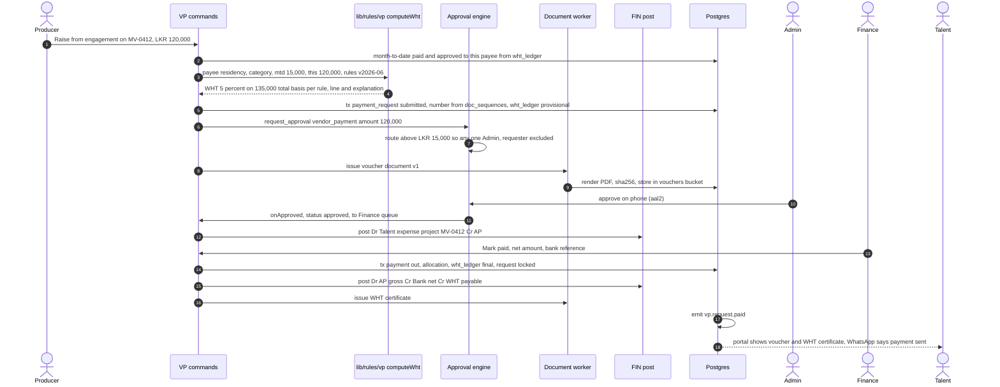

**WHT computation rule (data, not code).** The rule row holds residency, service categories in scope, monthly aggregate threshold (LKR 100,000), rate (5%) and whether withholding applies to the full amount once over the threshold (R3 §6 says it does). When a payee crosses the threshold mid-month, earlier requests in the month already paid without WHT produce a **catch-up line** on the crossing request, shown to Finance with the explanation. Whether catch-up or prospective-only treatment is correct is an accountant question (BRD D2); the rule function supports both by a policy flag. Non-resident (14%) and rent (10%) rates are unverified (CFO-22) and stay data.

**Controls.** Split detection: the router sums requests to the same payee and project within a policy window, and routes on the aggregate if the sum crosses the limit (PLAN §15). A bank-detail change in the last 72 hours blocks "Mark paid" (NFR-SEC-025). Requester ≠ approver ≠ payer is enforced in the database (section 6.4).

### 5.5 Payroll run, approval, Finance, ledger posting and statutory exports

Relates to J-07, BR-PAY-001 to BR-PAY-017, BR-PAY-020, BRULE-008, BRULE-023, BRULE-024, BRULE-028, ADR-17, CFO-26.

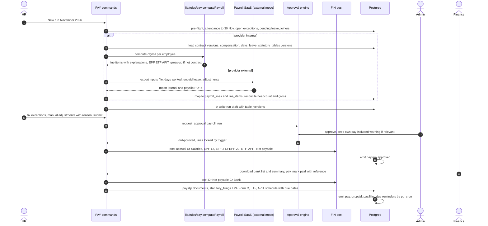

**Rules.** Lines lock on approval (`before update` trigger rejects changes unless the run is reopened through APR with a reason). Finance sees runs only in `approved`, `sent_to_finance` or `paid` (PLAN §12, state-based RLS). Payslip notifications carry no amounts (`13-ux-design.md` §7.5). The warning that contractor vs employee classification is a legal decision (PLAN §10) stays in the UI and in tests.

### 5.6 Fingerprint attendance: file import now, ADMS push later

Relates to J-06, BR-ATT-001 to BR-ATT-010, BR-ATT-013, BRULE-012, BRULE-013, NFR-PRIV-002, NFR-SEC-021, NFR-PERF-004, R2 C.2 and C.3.

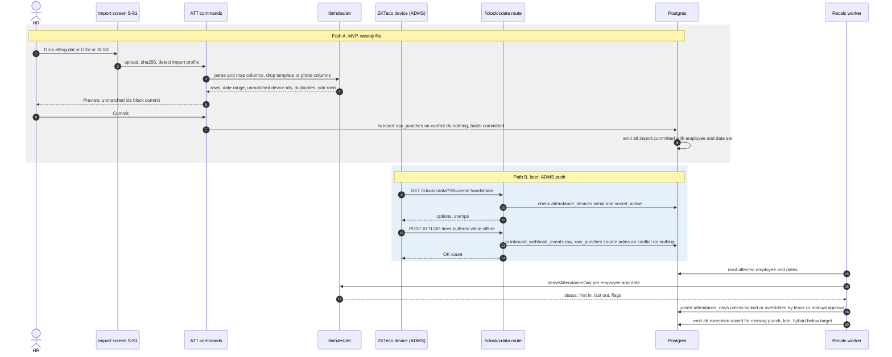

**Notes.** Both paths write the same `raw_punches` rows with the same unique key, so re-imports and overlapping pushes never duplicate (PLAN §7). Approved leave and manual attendance are never overwritten by a re-import (PLAN §15). Each committed batch can be rolled back by an Admin (deletes only that batch's punches, recalculates, audited). The ADMS route accepts the device's protocol paths and authenticates by serial plus a shared secret; some firmware only speaks plain HTTP on port 80 (R2 C.3), which Vercel may redirect to HTTPS, so SPK-05 tests the real device and, if needed, adds a tiny HTTP relay.

### 5.7 AI credit allocation at month end

Relates to BR-AI-001 to BR-AI-006, BRULE-066, CFO-17, R4-F09, R4-F10, USP 2.

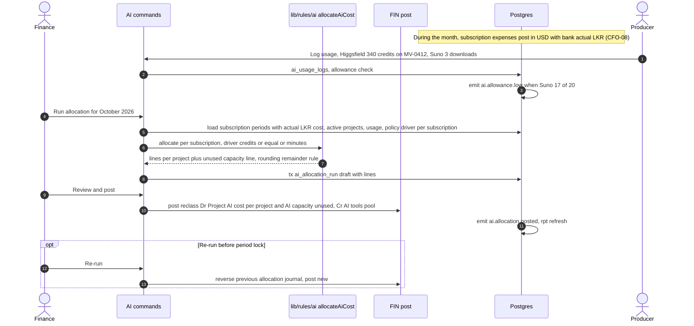

**Rule details.** `allocateAiCost(periodCost, driver, usage, projects)` is pure. With the credits driver, each project gets `cost × credits_used / credits_bought`, and the rest goes to "AI capacity unused", so waste stays visible and is not hidden inside projects (CFO-17). Remainders from rounding go to the largest line, so lines always sum exactly to the cost. Allocation is re-runnable until the period locks; each re-run reverses the last one (CFO-30).

---

## 6. Generic approval engine

Replaces the bespoke approval status code that PLAN §4.4, §5.3 and §13 phases 3 to 7 would otherwise build four times. Relates to BR-APR-001 to BR-APR-008, BRULE-001 to BRULE-010, CFO-27, CFO-28, NFR-AUD-008.

### 6.1 Concepts

| Concept        | Meaning                                                                                                                                                                                                                                           |
| -------------- | ------------------------------------------------------------------------------------------------------------------------------------------------------------------------------------------------------------------------------------------------- |
| **Subject**    | The thing being approved: a leave request, manual attendance request, payment request, payroll run, quote discount, POS refund or variance, bank-detail change, role grant, period reopen, budget overrun. Each subject type registers an adapter |
| **Policy**     | Data that says, for a subject type in an entity, which steps apply under which conditions. Versioned and effective-dated. Edited in `/admin/approvals`                                                                                            |
| **Step**       | One stage of a route: who may act (approver rule), how many must agree (quorum), whether the step can only recommend, its SLA and escalation                                                                                                      |
| **Request**    | One run of a policy for one subject version. Stores the policy version and a hash of the subject snapshot                                                                                                                                         |
| **Task**       | A step instance with the resolved candidate approvers (snapshot at creation, refreshed on delegation)                                                                                                                                             |
| **Action**     | Append-only fact: recommend, approve, reject, return, comment, delegate, escalate, withdraw. Records actor, on-behalf-of, AAL, IP and user agent                                                                                                  |
| **Delegation** | A user's authority given to another user for a date range and subject types, itself approved by an Admin                                                                                                                                          |

### 6.2 Tables

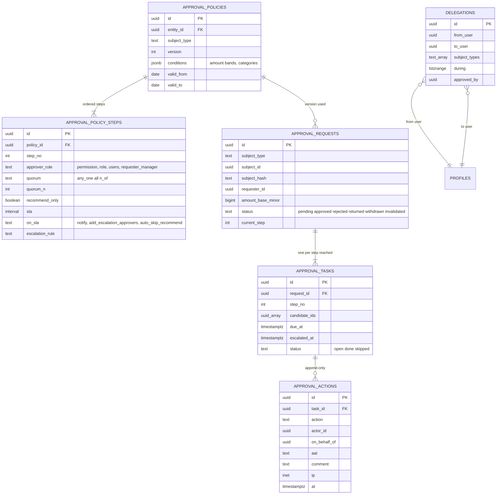

### 6.3 Engine logic (pure functions in `lib/rules/apr`)

```ts
routeApproval(policy, subject): Step[]                         // which steps apply (e.g. skip Admin step at or below the spending limit)
resolveCandidates(step, ctx): UserId[]                         // permission in entity, minus requester, minus requester's delegates acting for the requester
canAct(user, task, request, delegations, now): Allowed | Denied // with a reason string for the UI
applyAction(state, action): { state, effects: Effect[] }       // effects: advance step, finish, notify, call subject adapter
escalate(task, now, policy): Effect[]                          // SLA breach handling
```

The database layer wraps these: `approval.submit(subject_type, subject_id)`, `approval.act(task_id, action, comment)`, run under `withUserTx`. The **subject adapter** (`modules/<code>/approval-adapter.ts`) supplies `snapshot()` (the facts the approver sees, hashed), `onDecided(outcome)` (called **inside the same transaction** so the subject's status and the decision commit together) and `isStillValid()` (for example, a leave request is invalid if an approved manual attendance now covers the day).

### 6.4 Guarantees enforced in the database, not only in the UI

| Guarantee                                            | How                                                                                                                                                                                                                                                                                                                                                                                                                                                                                                                                                         |
| ---------------------------------------------------- | ----------------------------------------------------------------------------------------------------------------------------------------------------------------------------------------------------------------------------------------------------------------------------------------------------------------------------------------------------------------------------------------------------------------------------------------------------------------------------------------------------------------------------------------------------------- |
| No self-approval (BRULE-002)                         | `before insert` trigger on `approval_actions`: `actor_id <> request.requester_id` and `coalesce(on_behalf_of, actor_id) <> requester_id`. A delegate cannot approve a request raised by the person they act for                                                                                                                                                                                                                                                                                                                                             |
| Any one of a group decides once (BRULE-009)          | **Decision slots** (changed after `22a-foundation-spike.md` §3d, which found a partial unique index cannot express 2-of-n steps such as the LKR 250,000 rule): approvals take `decision_slot` 1 to `quorum_n`, a reject takes slot 0, with `unique (task_id, decision_slot)` and `unique (task_id, coalesce(on_behalf_of, actor_id))` for one decision per person. A submit with fewer eligible approvers than the quorum is refused and escalated. The second Admin's click fails cleanly ("Already approved by Fazlur at 10:42") (PLAN Phase 3 done-when) |
| Recommend-only steps (BRULE-005)                     | HR's leave step is `recommend_only`; an `approve` action on it is rejected by the trigger                                                                                                                                                                                                                                                                                                                                                                                                                                                                   |
| Not about yourself (BRULE-002, BRULE-008)            | The subject adapter returns `involved_user_ids` (for example every employee in a payroll run). The engine removes them from candidates; when every candidate is involved (all Admins are in the payroll run), it creates one scoped task per approver for the lines about them, decided by a different Admin, and the request completes only when the main and scoped tasks are done                                                                                                                                                                        |
| Requester ≠ approver ≠ payer (BR-APR-004, BRULE-007) | Payer check in VP's "mark paid" command and an RLS `with check` on `payments` for direction `out`: payer is not the requester and not the final approver when policy says so (CFO-27, `15-compliance-security.md` §6.4)                                                                                                                                                                                                                                                                                                                                     |
| Decision matches what was seen                       | The action stores `subject_hash`; if the subject changed after submission the request becomes `invalidated` and is resubmitted (PLAN §15: request edited after Finance has seen it)                                                                                                                                                                                                                                                                                                                                                                         |
| Strong authentication                                | Restrictive policy: approve and reject need `aal2` for permission sets that require MFA (NFR-SEC-001)                                                                                                                                                                                                                                                                                                                                                                                                                                                       |
| Evidence                                             | Actions are append-only (no update or delete, like `audit_log`) and also audited (NFR-AUD-008)                                                                                                                                                                                                                                                                                                                                                                                                                                                              |

### 6.5 SLA and escalation

`pg_cron` runs `approval.sweep()` every 15 minutes. For each open task past `due_at`, it applies the step's `on_sla`: notify the candidates again; add escalation approvers (for example, all Admins); or, for a recommend-only step, let the next step decide directly. That last option is PLAN §4.4's rule: Admins can decide a leave request if HR has not acted within a configurable number of days (default 2). If every candidate is away (PLAN §15, "all three Admins away"), the sweep uses active delegations; if none exist, it alerts the owner.

### 6.6 Starter policies (all values are policy data)

| Subject type                             | Steps                                                                                                                                    | Source                                       |
| ---------------------------------------- | ---------------------------------------------------------------------------------------------------------------------------------------- | -------------------------------------------- |
| `leave_request`                          | 1 HR recommend-only (SLA 2 days, then skip) → 2 any one Admin                                                                            | PLAN §4.4, BRULE-005, BRULE-006              |
| `manual_attendance`                      | 1 any one Admin (HR may comment)                                                                                                         | PLAN §4.4                                    |
| `vendor_payment`                         | At or below LKR 15,000: none (straight to Finance). Above: any one Admin. Suggested: above LKR 250,000 two Admins (owner decides, OQ-43) | PLAN §5.3, BRULE-001, BRULE-004, CFO-28      |
| `payroll_run`                            | 1 any one Admin (HR submits; Finance receives after), plus a scoped task per approving Admin's own line, decided by a different Admin    | PLAN §4.4, BRULE-003, BRULE-008              |
| `quote_discount`                         | Above the producer's discount limit: any one Admin                                                                                       | BRD §6.3 RACI, BRULE-059                     |
| `pos_refund`, `pos_void`, `pos_variance` | Supervisor (`pos_supervisor`), not the cashier                                                                                           | BRULE-058, BRULE-060                         |
| `bank_detail_change`                     | Two different people (Finance plus Admin), call-back recorded, 72-hour cool-off before payment                                           | BR-VP-003, NFR-SEC-025, BRULE-004, BRULE-062 |
| `role_grant`                             | A second Admin                                                                                                                           | `15-compliance-security.md` §6.4             |
| `period_reopen`                          | Any one Admin with reason                                                                                                                | CFO-30, BRULE-036                            |
| `delegation`                             | Any one Admin other than the delegator                                                                                                   | PLAN §15, BRULE-010                          |

---

## 7. Security architecture

This section turns the requirements in `15-compliance-security.md` §4 and §6 into concrete design. It does not repeat the threat model.

### 7.1 From Phase 0's four roles to permissions per entity

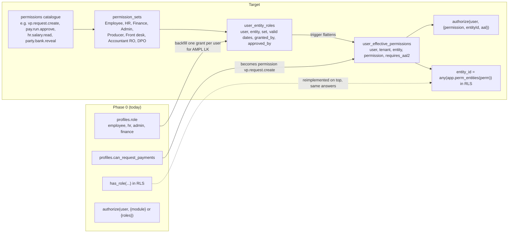

**Steps (each a reversible migration with RLS tests):**

1. Create `tenants`, `entities` and seed one tenant and the AMPL Sri Lanka entity. Add `tenant_id` and `primary_entity_id` to `profiles`.
2. Create the permission catalogue (seeded from code: `lib/auth/permissions.ts` is the single source, as `roles.ts` is today), the four Phase 0 sets plus Producer, Front desk, Accountant (read-only), DPO, and toggles such as `salary_viewer`, `vendor_bank_editor`, `payment_releaser`, `pos_cashier`, `pos_supervisor` (`15-compliance-security.md` §4.2).
3. Backfill `user_entity_roles` from `profiles.role`; mirror `can_request_payments`.
4. Reimplement `has_role()` over the new tables. Phase 0's tests must pass unchanged. `current_app_role()` reads the user's primary grant, and a trigger on `profiles` rewrites that grant whenever `profiles.role` or `primary_entity_id` changes, so Phase 0 code and tests that still write `profiles.role` keep working; `profiles.role` stays writable only by Admins (spike, `22a-foundation-spike.md` §3a). The tenant helper `app.current_tenant_id()` must not filter on `active` (tenant scope is not a privilege); `has_perm()`, `perm_entities()` and `current_app_role()` do.
5. Extend `SessionUser` with `permissions` (per entity) and `aal`; extend `Requirement` to `{ permission, entityId?, aal? }`; keep `{ module }` as sugar that maps to a module's read permission. `MODULES` keeps driving navigation.
6. Grants go through APR (`role_grant`, second Admin) and are time-boxed (`valid_to`). A quarterly access review lists all grants (NFR-AUD-010).

`user_effective_permissions` is a plain table maintained by triggers on grants, sets and overrides, with an index on `(user_id, entity_id, permission)`. It makes the RLS check one index lookup, and a stale grant expires through a nightly `pg_cron` job that removes rows past `valid_to`.

### 7.2 Where tenant and permissions come from (not from the JWT)

CLAUDE.md says roles come from `public.profiles`, never from auth metadata. Supabase also offers a custom access token hook that writes server-side claims into the JWT. Claims in a token stay valid until it expires, so a revoked permission would still work for up to the token lifetime. **Decision:** the MVP reads permissions from `user_effective_permissions` inside `security definer` helpers, wrapped in `(select …)` so Postgres evaluates them once per statement, not per row, as Supabase's RLS guidance recommends ([Supabase RLS performance](https://supabase.com/docs/guides/troubleshooting/rls-performance-and-best-practices-Z5Jjwv)). Only `aal` and `sub` are read from the JWT. A token-hook design can be revisited for SaaS scale, with short token lifetimes.

### 7.3 RLS patterns

**Updated after the foundation spike (`22a-foundation-spike.md` §3f; review RV-03).** The first draft of pattern 2 used `(select app.has_perm(entity_id, …))`. Because the helper takes a row column, Postgres runs it once per row, not once per statement: the spike measured 159 ms for a list and 1,494 ms for a count at 200k rows, against 7 ms and 28 ms for the entity-array form below. Policies therefore compare `entity_id` with an array computed once per statement by `app.perm_entities(perm)`. `app.has_perm(entity, perm)` stays for single-row checks inside functions and RPCs, never in a policy. A CI check fails any policy that passes a row column to a helper, and an RLS timing smoke test (count over 200k seeded rows under 100 ms) catches regressions (22a §4).

```sql
-- 1. Tenant isolation: restrictive, on every table. Combined with AND to every permissive policy.
create policy t_isolation on public.<table> as restrictive for all to authenticated
  using (tenant_id = (select app.current_tenant_id()))
  with check (tenant_id = (select app.current_tenant_id()));

-- 2. Permission in the row's entity: entity-array form, evaluated once per statement (22a §3f).
--    Note the cast: `= any ((select f()))` without `::uuid[]` is parsed as the subquery form and fails.
create policy vp_requests_finance on public.payment_requests for select to authenticated
  using (entity_id = any ((select app.perm_entities('vp.request.read_all'))::uuid[]));

-- 3. Own rows (requester, employee, payee).
create policy vp_requests_own on public.payment_requests for select to authenticated
  using (requested_by = (select auth.uid()));

-- 4. State-based visibility (PLAN §12: Finance sees approved runs only).
create policy pay_runs_finance on public.payroll_runs for select to authenticated
  using (entity_id = any ((select app.perm_entities('pay.run.read_approved'))::uuid[])
         and status in ('approved', 'sent_to_finance', 'paid'));

-- 5. MFA for Restricted tables: restrictive policy on the aal claim.
create policy comp_aal2 on public.employee_compensation as restrictive for select to authenticated
  using (((select auth.jwt()) ->> 'aal') = 'aal2');

-- 6. Portal principals: membership, never staff permissions.
create policy eng_portal on public.engagements for select to authenticated
  using (talent_party_id in (select party_id from app.my_portal_parties()));
```

Further rules:

- **Composite foreign keys for tenant safety.** Postgres runs foreign-key checks without RLS, so a crafted insert could link to another tenant's row whose UUID it knows. `(tenant_id, x_id) → (tenant_id, id)` makes such a link impossible, at the cost of one extra column per reference (ADR-03).
- **Column protection.** RLS is row-level. Restricted columns (salary, NIC, bank account, PayHere tokens, medical reason) live in their own tables with stricter policies. A "reveal" goes through a `security definer` RPC that checks the permission and AAL, writes `access_log`, and returns the decrypted value through the server only (`15-compliance-security.md` §4.2).
- **Index every policy column** (`tenant_id`, `entity_id`, owner columns), because RLS adds a filter but not an index (same Supabase guidance).
- **Tests per table:** per role and operation (allow and deny), `aal1` versus `aal2` for Restricted tables, cross-entity (an SG user cannot see LK rows) and cross-tenant (a second seeded tenant sees nothing) (NFR-SEC-005, CLAUDE.md).

### 7.4 Field encryption

As specified in `15-compliance-security.md` §4.3, implemented in the kernel:

| Item       | Design                                                                                                                                                                                                                         |
| ---------- | ------------------------------------------------------------------------------------------------------------------------------------------------------------------------------------------------------------------------------ |
| Module     | `lib/crypto/fields.ts` (`server-only`): `encryptField(value, keyVersion)`, `decryptField(cipher)`, `blindIndex(value, kind)`. AES-256-GCM, random 96-bit nonce, `v1:<nonce>:<ct>:<tag>`                                        |
| Columns    | Each Restricted identifier table has `value_cipher text`, `value_bidx text` (HMAC-SHA256 of the normalised value), `value_last4 text`, `key_version int`                                                                       |
| Keys       | `CHORDUS_FIELD_KEY_V<n>` and `CHORDUS_INDEX_KEY_V<n>` as server-only environment variables per environment (CLAUDE.md: configuration from environment only); a validated `lib/env.server.ts` fails closed in production (G-14) |
| Rotation   | A re-encryption job on the `q_projections` queue rewrites rows in batches; `key_version` shows progress                                                                                                                        |
| SaaS later | Per-tenant data keys wrapped by the master key (envelope), so one tenant's data can be crypto-shredded without touching others                                                                                                 |

### 7.5 Portal access and action tokens

| Principal              | Sign-in                                                            | Scope                                                                                      | Routes                |
| ---------------------- | ------------------------------------------------------------------ | ------------------------------------------------------------------------------------------ | --------------------- |
| Staff                  | Magic link or Google (domain-restricted), TOTP for privileged sets | Permissions per entity                                                                     | `(staff)` hubs        |
| Talent (portal)        | Invited magic link or WhatsApp one-time code                       | `portal_memberships` → own party: engagements, contracts, consents, payments, certificates | `/portal/*`           |
| Client (portal, later) | Invited magic link                                                 | Memberships → client party: projects, reviews, invoices                                    | `/client/*`           |
| Client (token, MVP)    | None                                                               | One `action_tokens` row: object, version, action, expiry, single use; optional email OTP   | `/q/`, `/r/`, `/pay/` |

Portal and token routes have their own guards (`requirePortal`, `requireToken`) and return 404 for staff routes, as Phase 0 does for modules. Token pages send `Referrer-Policy: no-referrer` and are rate-limited (NFR-SEC-010, NFR-SEC-017). A token is hashed with SHA-256 before storage; the plain token exists only in the link.

### 7.6 Audit and read logging

| Layer           | Design                                                                                                                                                                                                                                        |
| --------------- | --------------------------------------------------------------------------------------------------------------------------------------------------------------------------------------------------------------------------------------------- |
| Request context | The `command()` wrapper calls `set_config('chordus.request_id' / 'chordus.reason' / 'chordus.actor_type' …, true)` at the start of each transaction. `audit_row_change()` reads them                                                          |
| Redaction       | `create trigger … execute function public.audit_row_change('bank_account', 'nic')`: listed columns are stored as `{"changed": true, "h": "<hmac>"}`. A test asserts that redacted values never appear in `audit_log` (G-01)                   |
| Read logging    | `access_log` (append-only, monthly partitions): `read.reveal`, `read.download`, `read.export` with field name, row ID, reason, row count and file hash (NFR-AUD-002). Written by the reveal RPC, the signed-URL issuer and the export service |
| Tamper evidence | `prev_hash`, `row_hash` on `audit_log`, a daily anchor of the latest hash sent off-platform, and a "verify chain" action (NFR-AUD-004)                                                                                                        |
| Volume          | Monthly partitions on `audit_log`, `access_log` and `internal.domain_events`. Old partitions detach and archive to the off-site store after the retention period (NFR-AUD-006)                                                                |

### 7.7 Other controls placed in the architecture

POS device registration with a non-extractable WebCrypto key and PIN unlock (NFR-SEC-014); no card-number fields anywhere and a Luhn detector on free text (NFR-SEC-013); private buckets per tier with 5-minute signed URLs for Restricted files (NFR-SEC-009); webhook signature checks and replay protection (NFR-SEC-022); separate Supabase projects for production, staging and previews with synthetic data outside production (NFR-SEC-020); seed and destructive rollback scripts refuse production (G-03, G-08).

---

## 8. Integration design

### 8.1 Common integration framework (INT)

| Element        | Design                                                                                                                                                                                                                                           |
| -------------- | ------------------------------------------------------------------------------------------------------------------------------------------------------------------------------------------------------------------------------------------------ |
| Provider ports | TypeScript interfaces per capability: `PaymentProvider`, `AccountingSink`, `PayrollProvider`, `MessageChannel`, `AttendanceSource`, `DocumentRenderer`, `EInvoiceSink`. One adapter per provider, chosen per entity in `integration_connections` |
| Inbound        | Every webhook first lands in `inbound_webhook_events` (raw body, headers, signature result, `dedupe_key unique`), then is processed. A bad signature is stored, alerted and never processed (NFR-SEC-022)                                        |
| Outbound       | From pgmq queues. Each job has an idempotency key sent to the provider where supported; exponential back-off (1, 5, 15, 60 minutes, then hourly); after N attempts the message moves to a dead-letter queue and shows on `/admin/integrations`   |
| Mapping        | `sync_links (local_type, local_id, provider, external_id, last_payload_hash, status)`: a record is pushed only if its hash changed; external IDs make updates safe                                                                               |
| Secrets        | Single tenant: environment variables (CLAUDE.md). SaaS: per-tenant OAuth tokens encrypted with the field-encryption module, never in plain columns                                                                                               |
| Observability  | `job_runs` per worker invocation (counts, errors, duration); an alert when a queue's oldest message is older than its SLA                                                                                                                        |

### 8.2 Per external system

| System                                                         | Direction                                                   | Protocol and trigger                                                                                                                                                                                                                                                                                                                                                                                                                                                                                                                             | Idempotency                                                                                                                         | Failure handling                                                                                                                                                                                                             | Data shared                                                                                                  | Phase                        | BRD / control                                                  |
| -------------------------------------------------------------- | ----------------------------------------------------------- | ------------------------------------------------------------------------------------------------------------------------------------------------------------------------------------------------------------------------------------------------------------------------------------------------------------------------------------------------------------------------------------------------------------------------------------------------------------------------------------------------------------------------------------------------ | ----------------------------------------------------------------------------------------------------------------------------------- | ---------------------------------------------------------------------------------------------------------------------------------------------------------------------------------------------------------------------------- | ------------------------------------------------------------------------------------------------------------ | ---------------------------- | -------------------------------------------------------------- |
| **PayHere**                                                    | Out (checkout, charge, refund), in (notify)                 | Hosted checkout form POST (redirect); server-to-server `notify_url`. Verify `md5sig` = MD5 of `merchant_id + order_id + payhere_amount + payhere_currency + status_code + upper(MD5(merchant_secret))`, upper-cased ([PayHere Checkout API](https://support.payhere.lk/api-&-mobile-sdk/checkout-api), [Preapproval API](https://support.payhere.lk/api-&-mobile-sdk/preapproval-api)). Preapproval + Charging API for balances and damage; Refund API for cancellations                                                                         | `order_id` = our payment intent ID; notify dedupe on `payment_id` + `status_code`; amount, currency and order must match the intent | Notify missing: a reconcile job queries status before the hold expires. Status codes differ between doc pages (search found 2 and 3 used as success), so SPK-06 confirms them in sandbox. Never trust the browser return URL | Amount, order ID, customer name, email, phone; never card data (NFR-SEC-013)                                 | MVP                          | BR-INT-002, BR-POS-003, BR-SAL-006, NFR-SEC-013, NFR-SCALE-005 |
| **LankaQR (static)** and **card terminal**                     | In (manual)                                                 | No API. Cashier types the reference or last 4 digits and approval code (R3 §8)                                                                                                                                                                                                                                                                                                                                                                                                                                                                   | Unique `(method, provider_ref, date)` warns on a duplicate reference                                                                | Daily match to bank statement CSV and terminal batch; unmatched after N days on the close checklist                                                                                                                          | Reference only                                                                                               | MVP                          | BR-POS-002                                                     |
| **Bank**                                                       | In (statement CSV), out (payment list)                      | Upload of statement CSV per bank format (import profile, like attendance); export of payment list (vendor or payroll net pay) in the bank's bulk format if AMPL's bank offers one (PLAN Q5)                                                                                                                                                                                                                                                                                                                                                      | Statement line hash unique per account                                                                                              | Unmatched lines queue for Finance; no automatic posting from the bank                                                                                                                                                        | Account numbers in the payment list file are decrypted only at export, file logged (NFR-AUD-002)             | MVP (export), v1 (statement) | BR-PAY-013, BR-FIN-011, CFO-04                                 |
| **Accounting package** (Xero, QuickBooks Online or Zoho Books) | Out (journals, invoices, bills), in (payment status, later) | MVP: monthly journal batch export in the package's import format with pre-flight (mapped, balanced, period locked) (CFO-03). v1: API adapter. Limits are ample for AMPL: Xero 60 calls a minute and 5,000 a day per organisation ([Xero limits](https://developer.xero.com/faq/limits)); QuickBooks 500 a minute per company ([Intuit limits](https://developer.intuit.com/app/developer/qbo/docs/learn/limits-and-throttles)); Zoho Books 100 a minute and 1,000 to 10,000 a day by plan ([Zoho Books API](https://www.zoho.com/books/api/v3/)) | `sync_links` external ID per journal; export batch ID and file hash; re-export of a locked period is blocked                        | 429: back off and resume; a rejected record stays `failed` with the provider message; period cannot close while sync failures exist                                                                                          | Journals with account codes, dimensions, totals. No NIC or bank data (`15-compliance-security.md` §4.10)     | MVP export, v1 sync          | BR-FIN-015, BR-FIN-016, BR-INT-001, CFO-02, CFO-03             |
| **Payroll SaaS** (Option E)                                    | Out (inputs), in (journal, payslips)                        | File exchange (CSV/XLSX) unless the provider has an API (not checked, `14-business-case.md` §2.6)                                                                                                                                                                                                                                                                                                                                                                                                                                                | `payroll_provider_exchanges` per run and direction, file hash                                                                       | Import validates headcount and gross against ChordusAM; a mismatch blocks "approve"                                                                                                                                          | Days, leave, adjustments out; per-person figures in (Restricted)                                             | MVP if E chosen (OQ-42)      | BR-PAY-020, CFO-26                                             |
| **Fingerprint device**                                         | In                                                          | MVP: file upload (`attlog.dat`, CSV, XLSX). Later: ZKTeco ADMS push (`/iclock/cdata`, `/iclock/getrequest`), device buffers while offline (R2 C.3). Hikvision ISAPI equivalent if that brand                                                                                                                                                                                                                                                                                                                                                     | Unique `(tenant, employee, punched_at, source)`; import file SHA-256                                                                | Unmatched device IDs block commit; unknown serials rejected and alerted; firmware HTTP-only issue handled by SPK-05                                                                                                          | Device user ID, timestamp, verify mode; **no templates or photos** (NFR-PRIV-002)                            | MVP file, v1 push            | BR-ATT-001 to BR-ATT-005, BR-ATT-013, NFR-SEC-021              |
| **WhatsApp BSP** (Cloud API)                                   | Out (templates), in (delivery status, replies)              | Utility templates only, per language. Status webhooks verified with `X-Hub-Signature-256` (HMAC-SHA256 of the raw body with the app secret) ([Hookdeck guide](https://hookdeck.com/webhooks/platforms/guide-to-whatsapp-webhooks-features-and-best-practices), secondary)                                                                                                                                                                                                                                                                        | `notification_deliveries.provider_message_id` unique; job idempotency key = event ID + channel + recipient                          | Failure or no opt-in falls back to email and in-app; template rejected by Meta flagged in Admin                                                                                                                              | Names, links, short status; **never amounts of pay or Restricted values** (`15-compliance-security.md` §3.3) | v1 (MVP optional)            | BR-NOT-003 to BR-NOT-005, BRULE-071, R4-F13                    |
| **Email** (Resend)                                             | Out                                                         | API from the notifications worker; magic links stay with Supabase Auth email (custom SMTP through the same provider)                                                                                                                                                                                                                                                                                                                                                                                                                             | Event ID + recipient                                                                                                                | Retries; bounce marks the address                                                                                                                                                                                            | Links, short status                                                                                          | MVP                          | BR-INT-003, BR-NOT-001                                         |
| **ClickUp**                                                    | In (read), optional                                         | Store task or list link on the project (MVP). Later: read status with a personal or OAuth token; 100 requests a minute per token on Free to Business plans ([ClickUp rate limits](https://developer.clickup.com/docs/rate-limits)); webhooks to avoid polling                                                                                                                                                                                                                                                                                    | `sync_links` per project                                                                                                            | Read-only; failures never block ChordusAM                                                                                                                                                                                    | Task status only                                                                                             | MVP link, v1 read            | BR-PRJ-001, BR-INT-005                                         |
| **Google Calendar**                                            | Out (feeds), optional in                                    | MVP: per-user and per-resource **ICS feed URLs** (secret token in the URL, revocable) for bookings, call times and leave. Later two-way: Calendar API watch channels, which need manual renewal before expiry and authenticate only by the echoed channel token ([Google push](https://developers.google.com/calendar/api/guides/push))                                                                                                                                                                                                          | ICS UIDs = booking IDs                                                                                                              | Feed token revocation; no inbound changes in MVP                                                                                                                                                                             | Booking title, room, time; no client personal data in shared feeds                                           | MVP feeds                    | BR-INT-004                                                     |
| **YouTube**                                                    | In                                                          | MVP: CSV import of channel revenue reports. Later: YouTube Analytics API with the `yt-analytics-monetary.readonly` scope; revenue metrics may need content-owner access and Partner status, otherwise 403 ([YouTube Analytics reference](https://developers.google.com/youtube/analytics/reference/reports/query)) (unverified for channel accounts)                                                                                                                                                                                             | Report month + channel + video unique                                                                                               | Import preview like attendance                                                                                                                                                                                               | Per-video revenue lines, withholding                                                                         | v1                           | BR-AST-010, R4-F11                                             |
| **Drive, Frame.io, Vimeo**                                     | Links (MVP), webhooks later                                 | Deliverable versions are links. Later Frame.io or Vimeo webhooks for comments and status (R4-F16)                                                                                                                                                                                                                                                                                                                                                                                                                                                | Version link unique per deliverable                                                                                                 | Link checker flags public share links on unreleased cuts                                                                                                                                                                     | Link and title                                                                                               | MVP links                    | BR-AST-001, BR-AST-002, BR-INT-006 (later)                     |
| **IRD RAMIS e-invoice**                                        | Out                                                         | `einvoice_submissions` outbox behind `EInvoiceSink`, when the IRD specification is obtained and AMPL is VAT-registered (R3 §6)                                                                                                                                                                                                                                                                                                                                                                                                                   | Invoice ID + revision                                                                                                               | Retry, audit, status per invoice                                                                                                                                                                                             | Invoice fields per the gazette                                                                               | Later                        | BR-SAL-015, CFO-25                                             |

---

## 9. Scalability and performance

### 9.1 Expected volumes

AMPL figures are estimates from the brief (12 to 15 music videos a month, 10 to 30 staff, a freelancer pool) and the research. The design target is NFR-SCALE-004 (about twice today: 50 employees, 500 talent, 300 projects, 2,000 deliverables and 20,000 POS sales a year, 250,000 punches a year, 5 years of history). The SaaS columns assume the average studio is half AMPL's size (an assumption, not market data).

| Table or stream                   | AMPL today, per year (estimate) | NFR-SCALE-004 target, per year | 10 studios SaaS, per year | 50 studios SaaS, per year | Notes                                                   |
| --------------------------------- | ------------------------------: | -----------------------------: | ------------------------: | ------------------------: | ------------------------------------------------------- |
| Projects                          |                             250 |                            300 |                     1,500 |                     7,500 | 12–15 music videos a month plus photo, ads, retainers   |
| Deliverable versions              |                           3,000 |                          6,000 |                    15,000 |                    75,000 | 2,000 deliverables × about 3 versions                   |
| Bookings (resource rows)          |                           6,000 |                         10,000 |                    30,000 |                   150,000 | 3 rooms plus gear and crew                              |
| POS sales (lines)                 |                  6,000 (15,000) |                20,000 (50,000) |                    30,000 |                   150,000 |                                                         |
| Sales invoices                    |                           1,200 |                          2,500 |                     6,000 |                    30,000 |                                                         |
| Payment requests                  |                           3,500 |                          6,000 |                    17,000 |                    90,000 | about 15 freelancer and vendor payments per music video |
| Raw punches                       |                          36,000 |                        250,000 |                   180,000 |                   900,000 | target includes mobile check-in and ADMS                |
| Journal lines                     |                          90,000 |                        200,000 |                   450,000 |                 2,300,000 | about 4 lines per posted document                       |
| `audit_log` rows                  |                         300,000 |                        600,000 |                 1,500,000 |                 7,500,000 | row changes on sensitive tables plus app events         |
| `access_log` rows                 |                          50,000 |                        100,000 |                   250,000 |                 1,250,000 | reveals, downloads, exports                             |
| `domain_events`                   |                         150,000 |                        300,000 |                   750,000 |                 3,750,000 | archived after 90 days                                  |
| Notifications (all channels)      |                          30,000 |                         60,000 |                   150,000 |                   750,000 |                                                         |
| Database size after 3 years       |                    about 1–2 GB |                     about 3 GB |               about 10 GB |            about 40–60 GB | rough; indexes and partitions included                  |
| Storage (PDFs, receipts, uploads) |               about 4 GB a year |              about 6 GB a year |        about 20 GB a year |       about 100 GB a year | video masters are links, not files (ADR-10)             |
| Peak concurrent users             |                           10–15 |                             25 |                        80 |                       400 |                                                         |

**Reading.** At AMPL's size every table is small for Postgres; the Supabase Pro project's 8 GB disk allowance ([Supabase pricing](https://supabase.com/pricing)) lasts several years. Even 50 studios stay within one well-indexed Postgres instance. The risks are not volume but **RLS cost per query**, **serverless connection counts** and **unbounded logs**.

### 9.2 Indexing and partitioning

| Area               | Rule                                                                                                                                                                                                                                                                    |
| ------------------ | ----------------------------------------------------------------------------------------------------------------------------------------------------------------------------------------------------------------------------------------------------------------------- |
| Every table        | B-tree on `(tenant_id, entity_id, <main date or status>)` for list screens; an index on every foreign key; partial indexes for open work (`where status in ('submitted','awaiting_admin')`)                                                                             |
| RLS columns        | Index every column a policy reads (owner columns, `entity_id`); `user_effective_permissions (user_id, entity_id, permission)` primary key                                                                                                                               |
| Bookings           | GiST exclusion index on `(tenant_id, resource_id, blocked)` doubles as the availability index                                                                                                                                                                           |
| Search             | GIN on `search_documents.tsv` and a trigram GIN on `search_documents.name`                                                                                                                                                                                              |
| Partitioned tables | Monthly range partitions on `audit_log`, `access_log`, `internal.domain_events`, `notification_deliveries`; yearly on `raw_punches` and `journal_lines` only once a tenant passes about 5 million rows (not needed for AMPL). Partitions are created ahead by `pg_cron` |
| Pagination         | Keyset (`where (date, id) < (...)`) on long lists, not offset                                                                                                                                                                                                           |

### 9.3 Performance patterns

1. **RLS helpers once per statement.** Wrap every helper call in `(select …)` and never pass it a row column: use `entity_id = any ((select app.perm_entities('perm'))::uuid[])`, not `(select app.has_perm(entity_id, …))`, which runs per row and was 50 times slower in the spike (`22a-foundation-spike.md` §3f, §7.3 above), and add explicit filters in queries as well (Supabase advice: use RLS for security, not for filtering) ([Supabase RLS performance](https://supabase.com/docs/guides/troubleshooting/rls-performance-and-best-practices-Z5Jjwv)).
2. **No N+1 in server components.** Each page loads with one query per list through views that join what the list shows (for example `v_payables_queue`). RSC data loaders batch per request with React `cache()`, as Phase 0's `getSessionUser` already does.
3. **Connections.** Serverless functions connect through Supavisor in transaction mode (port 6543) for `withUserTx`; supabase-js uses PostgREST over HTTP, which needs no connection per function.
4. **Targets** from the BRD: pages interactive within 2.5 s at p75 on a mid-range phone (NFR-PERF-001), a 12-month P&L and a 30-person month attendance grid within 5 s (NFR-PERF-003), 10,000 punch rows to preview within 30 s (NFR-PERF-004, parsing runs in the browser worker and only the mapped rows go to the server), a repeat POS sale in 5 taps and under 60 s (NFR-PERF-002, works offline).
5. **Reports read summaries.** P&L, profitability and ageing read materialised views refreshed after `fin.posting.created` events (debounced to once a minute) and nightly. Drill-down reads the journal directly by index.

### 9.4 Reporting: views now, warehouse later

| Stage | Approach                                                                                                                                                                                                                                                               | When                                       |
| ----- | ---------------------------------------------------------------------------------------------------------------------------------------------------------------------------------------------------------------------------------------------------------------------- | ------------------------------------------ |
| MVP   | SQL views per report, plus materialised views for P&L by month, project profitability, AR ageing, studio utilisation and AI cost per project, each with `tenant_id` and `entity_id` and an RLS-checked wrapper view (materialised views do not support RLS themselves) | AMPL                                       |
| v1    | `rpt_*` tables maintained by projection consumers from events (incremental, not full refresh) for the KPI view (BRD §11)                                                                                                                                               | When a refresh takes over about 10 seconds |
| SaaS  | Nightly export of tenant-tagged facts to a columnar store (for example Parquet on object storage queried with DuckDB, or BigQuery) for cross-tenant product analytics only; tenants still read their own reports from Postgres                                         | 25+ studios                                |

### 9.5 Cost guardrails (NFR-COST-001: about LKR 200,000 a month all-in)

| Guardrail                                                                                                             | Why                                                                      |
| --------------------------------------------------------------------------------------------------------------------- | ------------------------------------------------------------------------ |
| Supabase spend cap on (Pro default), compute add-on only after a measured need; PITR budgeted from Phase 7 (OQ-51)    | Run cost of about USD 262 a month (`14-business-case.md` §3.6)           |
| Vercel spend management alert; functions pinned to one region; no Edge middleware beyond the Phase 0 cookie refresh   | Function usage is the main variable cost                                 |
| WhatsApp: utility templates only, opt-in only, one message per event per person, digest for low-priority events       | Per-message pricing since 1 July 2025 (R4 §5.1)                          |
| Upload limits (10 MB per file, images re-encoded), PDF render once per issue                                          | Storage and function time                                                |
| Queue back-pressure: workers process at most N messages per invocation; dead-letter after N attempts                  | A failing provider must not loop and burn invocations                    |
| Log redaction and sampling; Sentry free or Team tier                                                                  | Logging cost and PII                                                     |
| Retention jobs drop or archive old partitions (`domain_events` 90 days, `access_log` and `audit_log` per NFR-AUD-006) | Disk growth                                                              |
| A monthly cost report per tenant (rows, storage, messages, function time) from `job_runs` and provider usage          | The SaaS price must cover the marginal cost (`14-business-case.md` §3.7) |

---

## 10. Evolution path

### 10.1 Stages

| Stage                           | Scope (architecture view; the PO sets functional scope in `21-mvp-roadmap.md`)                                                                                                                                                                                                                                                                                                                                                  | Architecture added                                                                                                                                                 |
| ------------------------------- | ------------------------------------------------------------------------------------------------------------------------------------------------------------------------------------------------------------------------------------------------------------------------------------------------------------------------------------------------------------------------------------------------------------------------------- | ------------------------------------------------------------------------------------------------------------------------------------------------------------------ |
| **Foundation (before Phase 1)** | Phase 0 gap fixes G-01 to G-08; tenancy, entities, brands, locations; permission sets and grants; audit extension and redaction; field encryption module; policy settings; numbering; documents; outbox, queues and worker loop; Singapore region; `withUserTx`                                                                                                                                                                 | Shared kernel, ADR-03 to ADR-06, ADR-11, ADR-14, ADR-15                                                                                                            |
| **MVP (Gate 1, money first)**   | HR, attendance file import, leave, payroll (provider mode per OQ-42), vendor payments with WHT and vouchers, CRM quotes, projects with stages and budgets, sales invoices, receipts and deposits, bookings with deposits, light POS with offline queue, management ledger with accountant export, approval engine, email and in-app notifications, AI pool-and-allocate, deliverables with approval links and publish checklist | APR engine, FIN posting, PayHere adapter, token pages, POS PWA, react-pdf renderer, ICS feeds                                                                      |
| **v1**                          | Accounting API sync, WhatsApp channel, talent portal, ADMS push, bank statement matching, retainers, revenue imports, call sheets, client portal light, budgets and forecasts, Sinhala and Tamil staff UI                                                                                                                                                                                                                       | INT adapters, portal principals, projections for KPIs, second entity (Media Digital SG) if OQ-17 says it trades                                                    |
| **SaaS-ready**                  | Tenant onboarding and admin, per-tenant branding and identity (NFR-SCALE-002), per-tenant PayHere merchant and accounting connections, billing for the SaaS itself, tenant data export (NFR-DATA-003), per-tenant keys                                                                                                                                                                                                          | Tenant-scoped secrets in DB (encrypted), per-tenant rate limits, cost report per tenant, warehouse for product analytics, optional silo project for a large tenant |

### 10.2 What must be right on day one, and what can wait

| Must be right on day one (expensive to retrofit)                                                      | Why                                                                                                      |
| ----------------------------------------------------------------------------------------------------- | -------------------------------------------------------------------------------------------------------- |
| `tenant_id` on every table, restrictive tenant policy, composite tenant foreign keys                  | Retrofit touches every table, index, policy and test (NFR-SCALE-002)                                     |
| `entity_id` on every business row, `location_id` on studio rows                                       | NFR-SCALE-001, NFR-SCALE-003; SG entity likely                                                           |
| Permission model per entity, `has_role()` compatibility                                               | Every RLS policy is written against it (G-05, OQ-33)                                                     |
| Money as minor units with currency and FX snapshot; journal-shaped posting from the first money table | Changing money types after data exists means a data migration of every amount (NFR-DATA-004, BR-FIN-016) |
| Gapless numbering per entity, type and year, with device blocks                                       | Document numbers can never be renumbered once issued (BRULE-032)                                         |
| Audit redaction, request context and system actors                                                    | Plain-text NICs in the audit log cannot be removed from an append-only table (G-01)                      |
| Parties model with encrypted identifiers and separate bank table                                      | Duplicate detection and WHT aggregation depend on it                                                     |
| Approval engine contract (subjects, adapters, append-only actions)                                    | Leave (Phase 4) and payments (Phase 5) would otherwise each build their own                              |
| Effective-dated policy, tax and statutory tables with versions stored on results                      | NFR-COST-003, NFR-AUD-011                                                                                |
| UTC storage, entity timezone, `[)` ranges                                                             | Date bugs in payroll and bookings are costly                                                             |
| Outbox for side effects (no direct email or API calls inside request handlers)                        | Otherwise integrations are added one ad hoc call at a time                                               |
| Supabase region                                                                                       | Fixed per project (ADR-14)                                                                               |

| Can wait                                                                          | Until                                          |
| --------------------------------------------------------------------------------- | ---------------------------------------------- |
| Accounting API sync (export first)                                                | Accountant names the package (OQ-18)           |
| ADMS push, mobile check-in                                                        | Device model known (OQ-1)                      |
| WhatsApp BSP                                                                      | Email adoption measured; opt-ins collected     |
| Client portal (token pages cover the MVP)                                         | v1                                             |
| PowerSync or another sync engine                                                  | Offline needs grow beyond POS sales            |
| RAMIS e-invoice transmission                                                      | IRD spec obtained and AMPL VAT-registered (D6) |
| Warehouse, cross-tenant analytics, per-tenant keys, tenant admin and SaaS billing | SaaS decision (OQ-52)                          |
| Intercompany and consolidation                                                    | SG entity trades (OQ-17, BR-FIN-019)           |
| Custom access token hook for permissions in JWT                                   | Measured RLS cost at SaaS scale                |

### 10.3 Migration order (foundation migrations, each with a rollback and RLS tests)

1. `foundation_tenancy`: `tenants`, `entities`, `brands`, `locations`; `tenant_id` on `profiles` and `audit_log`; `app.current_tenant_id()`.
2. `foundation_access`: permissions, sets, grants, effective permissions, `has_perm()`; `has_role()` reimplemented; backfill.
3. `foundation_audit`: audit columns, redaction arguments, `write_system_audit()`, action allow-list, `access_log`, hash chain; destructive-rollback guard (G-08).
4. `foundation_kernel`: `parties` and children, `policy_settings`, `doc_sequences` extension and blocks, `documents` extension, `attachments`, `currencies`, `fx_rates`.
5. `foundation_outbox`: `internal` schema, `domain_events`, subscriptions, inbox, pgmq queues, `pg_cron` worker schedule.
6. `foundation_approvals`: APR tables and triggers.
7. Then Phase 1 (`employees`, contracts, compensation, identifiers) on top.

---

## 11. Technical risks and spikes

### 11.1 Risks

| ID    | Risk                                                                                                                           | Likelihood | Impact | Mitigation                                                                                                                                                          |
| ----- | ------------------------------------------------------------------------------------------------------------------------------ | ---------- | ------ | ------------------------------------------------------------------------------------------------------------------------------------------------------------------- |
| TR-01 | `withUserTx` under Supavisor transaction mode misbehaves (claims not applied, pooled role leaks)                               | Low        | High   | SPK-01 before Phase 1; RLS tests run through the same helper; fall back to plpgsql RPC commands                                                                     |
| TR-02 | Sinhala and Tamil render wrongly in PDFs or receipts                                                                           | Medium     | Medium | SPK-02 and SPK-03; Chromium fallback; raster receipts                                                                                                               |
| TR-03 | Module boundaries erode in a monolith built quickly with AI assistance                                                         | High       | Medium | ESLint boundary rules in `npm run check`; table-ownership register; code review checklist                                                                           |
| TR-04 | RLS policy count and complexity grow; a missed tenant or entity check leaks data                                               | Medium     | High   | Restrictive tenant policy on every table generated by a migration helper; a CI test that lists every table without RLS or without the tenant policy fails the build |
| TR-05 | Offline POS creates duplicate or lost sales, or receipts that IRD would not accept                                             | Medium     | High   | Client UUIDs, device sequences, gap alerts, SPK-04, SPK-12                                                                                                          |
| TR-06 | ADMS device cannot reach Vercel (HTTP only, odd paths)                                                                         | Medium     | Low    | File import stays; SPK-05; small relay if needed                                                                                                                    |
| TR-07 | pgmq, `pg_cron` and `pg_net` worker loop fails silently; notifications or sync stop                                            | Medium     | Medium | `job_runs` monitoring, oldest-message alert, Vercel Cron heartbeat fallback (ADR-11), SPK-10                                                                        |
| TR-08 | Statutory and tax rules change again (APIT tables, WHT scope, VAT format)                                                      | High       | Medium | Effective-dated data, accountant sign-off, rule versions stored on results (NFR-COST-003)                                                                           |
| TR-09 | Payroll provider hand-off (Option E) has no API and a brittle file format                                                      | Medium     | Medium | SPK-13; reconciliation check blocks approval on mismatch                                                                                                            |
| TR-10 | Scope: about 120 new tables for a lean team                                                                                    | High       | High   | Foundation first, then money-first MVP slices (`14-business-case.md` §1.1); kernel reuse keeps each module small                                                    |
| TR-11 | Supabase key changes (new publishable and secret keys, signing keys) land mid-build                                            | Medium     | Low    | Move to the new keys in the foundation stage (NFR-SEC-008, `15-compliance-security.md` §4.1)                                                                        |
| TR-12 | Test harness: `npm run test:db` drops only `public` and `auth`; new `internal`, `pgmq` and `cron` objects persist between runs | High       | Low    | SPK-14 updates the harness and CI Postgres image (pgmq and pg_cron extensions)                                                                                      |

### 11.2 Spikes (time-boxed, each ends with a short note in `docs/` and a decision)

| ID     | Question                                                                                                                                                         | Method                                                                                                                                                           | Time-box | Needed before       |
| ------ | ---------------------------------------------------------------------------------------------------------------------------------------------------------------- | ---------------------------------------------------------------------------------------------------------------------------------------------------------------- | -------- | ------------------- |
| SPK-01 | Does a pooled server transaction with `set_config('request.jwt.claims')` and `set local role authenticated` enforce RLS correctly on Supavisor transaction mode? | Build `withUserTx`; run the Phase 0 RLS suite through it against a Supabase branch; concurrency test with two users interleaved                                  | 2 days   | Foundation          |
| SPK-02 | Can `@react-pdf/renderer` shape Sinhala and Tamil correctly with Noto fonts?                                                                                     | Render a payslip and a voucher with mixed-script names; compare to Chromium HTML-to-PDF; native speakers check                                                   | 2 days   | First PDF (Phase 5) |
| SPK-03 | Can the POS print 80 mm or 58 mm receipts from an Android tablet PWA (WebUSB, Web Bluetooth or system print) with raster Sinhala and Tamil?                      | Test on the chosen printer (OQ-49)                                                                                                                               | 2 days   | POS                 |
| SPK-04 | Offline queue: non-extractable WebCrypto device key, encrypted IndexedDB, background sync, storage eviction on the target device                                 | Prototype on the counter tablet; airplane-mode tests with 500 sales (NFR-AVAIL-002)                                                                              | 3 days   | POS                 |
| SPK-05 | Will AMPL's device push ADMS to a Vercel HTTPS route?                                                                                                            | Configure the device's cloud server to a preview URL; log handshake and ATTLOG; try HTTP relay if needed                                                         | 1 day    | ADMS (v1)           |
| SPK-06 | PayHere sandbox: notify signature, success status codes, preapproval and charging, refund, settlement report format                                              | End-to-end sandbox run with a public preview URL (PayHere cannot notify localhost, [PayHere JS SDK](https://support.payhere.lk/api-&-mobile-sdk/javascript-sdk)) | 2 days   | Deposits            |
| SPK-07 | Accountant's import format and chart of accounts                                                                                                                 | Get a sample import file and CoA (OQ-18); build the export pre-flight against it                                                                                 | 1 day    | First month close   |
| SPK-08 | IRD tax invoice field list and RAMIS specification                                                                                                               | Accountant obtains Gazettes 2481/22 and 2500/106 and the RAMIS spec (D6); map to `sales_invoices`                                                                | 1 day    | SAL                 |
| SPK-09 | MFA (`aal2`) in RLS and in the test harness                                                                                                                      | Enable TOTP in staging; add `aal` claims to the RLS test stub (G-02)                                                                                             | 1 day    | Foundation          |
| SPK-10 | Worker loop reliability: pgmq read and archive, `pg_net` to Vercel, retries, dead-letter, observability                                                          | Load test 10,000 events; kill the worker mid-batch; confirm no loss and no double send                                                                           | 2 days   | Foundation          |
| SPK-11 | Booking constraint with buffers, kits and multi-resource bookings, plus leave blocks for crew                                                                    | Property tests on the exclusion constraint; kit expansion in one transaction                                                                                     | 1 day    | BKG                 |
| SPK-12 | Will the accountant accept per-device receipt series offline, and gapless numbering under concurrency?                                                           | Concurrency test on `next_number`; accountant opinion on device series and voids                                                                                 | 1 day    | POS                 |
| SPK-13 | Payroll SaaS hand-off (if Option E): input and journal formats                                                                                                   | Sample files from the provider (OQ-42); reconciliation check                                                                                                     | 1 day    | Payroll             |
| SPK-14 | DB test harness with `internal`, `pgmq`, `pg_cron` schemas                                                                                                       | Extend the reset script and CI image                                                                                                                             | 0.5 day  | Foundation          |

---

## 12. Traceability

Major components of this design mapped to the BRD's requirement IDs (`docs/discovery/10-brd.md` §8 and §9) and business rules (§12).

| Component (section)                                           | Business requirements                                                                                     | Non-functional and rules                                                                              |
| ------------------------------------------------------------- | --------------------------------------------------------------------------------------------------------- | ----------------------------------------------------------------------------------------------------- |
| Tenancy, entities, brands, locations (3.4, 4.2, ADR-03)       | BR-ADM-005, BR-ADM-006, BR-FIN-008                                                                        | NFR-SCALE-001, NFR-SCALE-002, NFR-SCALE-003                                                           |
| Permission model and portals (7.1, 7.5, ADR-04)               | BR-ADM-001, BR-ADM-002, BR-ADM-003, BR-VP-005, BR-TAL-011                                                 | NFR-SEC-001, NFR-SEC-004, NFR-SEC-005, NFR-SEC-011, NFR-SEC-012, NFR-COST-002, NFR-AUD-010, BRULE-070 |
| Transactional writes under RLS (ADR-05, 3.1)                  | all commands                                                                                              | NFR-SEC-005, NFR-AUD-003                                                                              |
| Parties and encrypted identifiers (ADR-16, 7.4)               | BR-CRM-001, BR-VP-001, BR-VP-002, BR-VP-003, BR-HR-002, BR-TAL-001                                        | NFR-SEC-006, NFR-SEC-007, NFR-SEC-025, NFR-DATA-002                                                   |
| Money, FX and numbering (ADR-15, 3.4)                         | BR-FIN-005, BR-SAL-002, BR-SAL-011, BR-VP-011, BR-VP-015, BR-CRM-008, BR-POS-004                          | NFR-DATA-004, NFR-AUD-012, BRULE-022, BRULE-032, BRULE-038                                            |
| Documents and PDF renderer (ADR-09)                           | BR-CRM-008, BR-SAL-001, BR-SAL-003, BR-VP-011, BR-VP-013, BR-PAY-012, BR-POS-004                          | NFR-AUD-011, NFR-I18N-002, NFR-PRIV-015                                                               |
| Outbox and workers (ADR-06, ADR-11)                           | BR-NOT-001, BR-NOT-002, BR-SAL-015                                                                        | NFR-SCALE-005, NFR-AUD-005                                                                            |
| Approval engine (6)                                           | BR-APR-001 to BR-APR-008, BR-LV-005, BR-ATT-010, BR-VP-006, BR-PAY-011, BR-POS-010, BR-POS-011            | NFR-SEC-005, NFR-AUD-008, BRULE-001 to BRULE-010, BRULE-059, BRULE-060                                |
| Management ledger and posting rules (4.5, ADR-07)             | BR-FIN-001 to BR-FIN-018, BR-POS-013, BR-VP-010, BR-PAY-014, BR-SAL-007                                   | BRULE-033 to BRULE-036, BRULE-039, BRULE-053                                                          |
| Tax and statutory tables (4.5, 4.6)                           | BR-SAL-003, BR-SAL-004, BR-SAL-013, BR-SAL-014, BR-VP-012, BR-PAY-004, BR-PAY-005, BR-PAY-010, BR-ADM-004 | NFR-COST-003, NFR-AUD-011, BRULE-023 to BRULE-025, BRULE-041 to BRULE-049                             |
| CRM, quotes, orders (4.3, 5.3)                                | BR-CRM-001 to BR-CRM-009                                                                                  | BRULE-067, BRULE-068                                                                                  |
| Projects, pipeline, budgets (4.3)                             | BR-PRJ-001 to BR-PRJ-010                                                                                  | BRULE-069                                                                                             |
| Booking and gear, exclusion constraint (4.4, 5.2)             | BR-BKG-001 to BR-BKG-015, BR-TAL-010, BR-LV-010                                                           | BRULE-050 to BRULE-057                                                                                |
| POS PWA and offline queue (4.4, 5.1, ADR-08)                  | BR-POS-001 to BR-POS-013                                                                                  | NFR-AVAIL-002, NFR-PERF-002, NFR-SEC-013, NFR-SEC-014, NFR-MOB-002, BRULE-022, BRULE-058 to BRULE-060 |
| Sales, deposits, receivables (4.3, 5.2)                       | BR-SAL-001 to BR-SAL-015                                                                                  | BRULE-034, BRULE-037, BRULE-050 to BRULE-053                                                          |
| Vendor payments and WHT ledger (4.7, 5.4)                     | BR-VP-001 to BR-VP-018                                                                                    | NFR-SEC-025, BRULE-001, BRULE-007, BRULE-041 to BRULE-044, BRULE-061, BRULE-062                       |
| HR core, compensation split (4.6)                             | BR-HR-001 to BR-HR-011                                                                                    | NFR-SEC-006, NFR-PRIV-002, BRULE-030, BRULE-031                                                       |
| Attendance import and ADMS (4.6, 5.6)                         | BR-ATT-001 to BR-ATT-013                                                                                  | NFR-PERF-004, NFR-PRIV-002, NFR-PRIV-017, NFR-SEC-021, BRULE-011 to BRULE-015                         |
| Leave ledger (4.6)                                            | BR-LV-001 to BR-LV-010                                                                                    | BRULE-016 to BRULE-019                                                                                |
| Payroll with provider port (4.6, 5.5, ADR-17)                 | BR-PAY-001 to BR-PAY-020                                                                                  | NFR-AUD-011, NFR-SCALE-005, BRULE-020 to BRULE-029                                                    |
| Talent, contracts, consents (4.7)                             | BR-TAL-001 to BR-TAL-011                                                                                  | NFR-PRIV-004, NFR-PRIV-005, NFR-PRIV-006, BRULE-065                                                   |
| Deliverables, approval links, rights, publish gate (4.7, 5.3) | BR-AST-001 to BR-AST-010                                                                                  | NFR-SEC-012, NFR-AUD-008, NFR-PRIV-005, BRULE-040, BRULE-063, BRULE-064                               |
| AI subscriptions and allocation (4.7, 5.7)                    | BR-AI-001 to BR-AI-006                                                                                    | NFR-PRIV-016, BRULE-066                                                                               |
| Notifications (3.3, 8.2)                                      | BR-NOT-001 to BR-NOT-005                                                                                  | NFR-PRIV-015, BRULE-071                                                                               |
| Reports and materialised views (9.4)                          | BR-RPT-001 to BR-RPT-010, BR-FIN-006, BR-FIN-007, BR-FIN-018                                              | NFR-PERF-003, NFR-AUD-002                                                                             |
| Integration framework and adapters (8)                        | BR-INT-001 to BR-INT-006, BR-FIN-011, BR-FIN-015, BR-SAL-015, BR-AST-010                                  | NFR-SCALE-005, NFR-SEC-013, NFR-SEC-021, NFR-SEC-022                                                  |
| Audit, access log, tamper evidence (7.6)                      | BR-ADM-007, BR-APR-008                                                                                    | NFR-AUD-001 to NFR-AUD-007, NFR-AUD-009                                                               |
| PDPA records and retention (3.3 ADM, 4.9)                     | BR-ADM-010                                                                                                | NFR-PRIV-001, NFR-PRIV-003, NFR-PRIV-007 to NFR-PRIV-011, NFR-DATA-001                                |
| Region, environments, backups (ADR-14, 7.7)                   | none                                                                                                      | NFR-SEC-016, NFR-SEC-019, NFR-SEC-020, NFR-PRIV-013, NFR-AVAIL-001, NFR-AVAIL-003                     |
| Search and i18n (ADR-12, ADR-13)                              | none directly (`13-ux-design.md` §3.1)                                                                    | NFR-I18N-001 to NFR-I18N-004                                                                          |
| Opening data import (reuse of import profiles)                | BR-ADM-008                                                                                                | NFR-DATA-003                                                                                          |
| Staff PWA and mobile (3.1)                                    | none directly                                                                                             | NFR-MOB-001 to NFR-MOB-003, NFR-SEC-015, NFR-AVAIL-004                                                |

### 12.1 Open questions raised by this design

| #    | Question                                                                                                                                                                                 | For        |
| ---- | ---------------------------------------------------------------------------------------------------------------------------------------------------------------------------------------- | ---------- |
| SA-1 | Approve the foundation migrations in section 10.3 (tenancy, access, audit, kernel, outbox, approvals) before Phase 1 (OQ-33, OQ-34)                                                      | Owner      |
| SA-2 | Accept integer minor units for money (ADR-15)? NFR-DATA-004 now reads "exact integer minor units (`bigint`)" (review RV-02); BA and CFO confirm                                          | BA, CFO    |
| SA-3 | Accept the reframing of `clients` and `vendors` as role tables on `parties`, and `payments` plus allocations in place of `income_receipts` and `payment_request_payments` (section 4.8)? | Owner, CFO |
| SA-4 | Will the accountant accept per-device receipt number series for offline POS (SPK-12)?                                                                                                    | Accountant |
| SA-5 | WHT when a payee crosses the monthly threshold mid-month: catch-up on earlier payments, or prospective only (section 5.4)?                                                               | Accountant |
| SA-6 | Is a delay of about a minute (up to five if the fallback heartbeat runs) acceptable for non-money side effects (emails, WhatsApp, sync), given money posting is immediate?               | Owner      |
