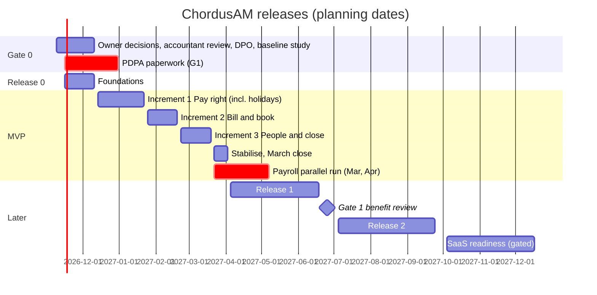

# 21: MVP scope, release roadmap and epics for ChordusAM

**Date:** 9 November 2026 · **Author:** Product Owner (discovery team) · **Status:** Draft for owner review

**Upstream read:** `docs/discovery/00-brief.md` (§5, §7), `docs/PLAN.md` (§13), `docs/phase-0.md`, `10-brd.md` (§2, §4, §5, §8, §12, §13), `11-gap-analysis.md` (B.4, top 15), `12-benchmark-usp.md` (§5, §6.2), `13-ux-design.md` (§5.1), `14-business-case.md` (§1, §3, §4, §7), `15-compliance-security.md` (§1, §7, §8), `20-solution-design.md` (§1, §10, §11), and the constraints in `23-test-strategy.md` (§1.1) and `24-devops-plan.md` (§1). `22-delivery-plan.md` did not exist yet; its estimates replace mine where they differ.

**Summary.** The BA proposed 182 of 222 requirements for the MVP. That is roughly 20 to 26 weeks of work for the lean team the CFO recommends, and it would arrive after every compliance date that matters. This roadmap cuts the MVP to **133 requirements (13 in Release 0, 120 in the MVP)**. By count that is a 27% cut. By effort it is close to half, because the 49 requirements moved out are the expensive ones: the offline POS sync engine, the in-house APIT engine, portals and client token pages, PayHere webhooks, QR gear check-out and the quote builder. The cut keeps one thin, complete slice of every flow the owner named: pay a freelancer with 5% WHT, cost a music video including AI tools, book the studio with a deposit, sell at the counter with LankaQR, invoice and collect, import the fingerprint file, approve leave, and run payroll through a local payroll provider (CFO Option E) with ChordusAM checking EPF and ETF and posting the results. Release 0 (4 weeks, from 16 November 2026) fixes the Phase 0 gaps and lays the foundations that are expensive to retrofit. The MVP then ships in three increments over **14 working weeks** (14 December 2026 to 2 April 2027), each going live to one group of AMPL staff. The whole of Release 0 and the MVP costs about **LKR 5.4m**, inside the CFO's Gate 1 cap of LKR 6.0m. Ten owner decisions are needed, the first three by 20 November 2026. Section 8 gives a default for each, so work can start now.

> **Review note (10 November 2026, `30-review-log.md` RV-04).** The effort, dates and cost in this document (14 working weeks, MVP complete 2 April 2027, about LKR 5.4m for Release 0 + MVP) are the PO's planning figures. The Tech Lead's bottom-up estimate in `22-delivery-plan.md` §1.2 and §3.10 is now the **current best estimate**: about 274 ideal engineer-days (range 200 to 390) for Release 0 + MVP, which with three engineers (Option B) ends the MVP on **2 July 2027** for **about LKR 12m** (range 10 to 15); within the LKR 6.0m cap (Option C) it buys Release 0 + Increment 1 "Pay right" only. Scope, epics, order and the cut line in this document are unchanged. Which funding option applies is an **owner decision** (§8.2 item 3 and `22` TL-1); until it is taken, read every date and cost below as the PO's case, not a commitment.

---

## 1. Summary

### 1.1 Product vision (one sentence)

ChordusAM is the one place where AMPL books, makes, bills and pays for its creative work, so every music video, shoot and studio hour shows its true margin, every person is paid right under Sri Lankan rules, and nothing is published without clearance.

### 1.2 MVP goal

Move AMPL's **money flows and approvals** out of spreadsheets and WhatsApp by the end of March 2027. Every freelancer payment carries correct WHT and a numbered voucher. Every job has a budget and a cost that includes AI tools. Every studio booking has a deposit and is billed. Every invoice uses the IRD format. Payroll inputs come from the fingerprint file and approved leave, not from retyping. The test in one sentence: **"Can Janaka close March 2027 from ChordusAM, and can Thoshan see the margin of each March music video?"**

### 1.3 MVP definition of done

The MVP is done when all of the following are true:

1. **All three increments are live** with their user groups (section 7.2), and each increment's exit criteria (section 3) have passed.
2. **Quality gates** from `23-test-strategy.md` §1.1 pass for MVP scope: QG-01 (money right to the cent, golden files), QG-03 (authorisation matrix 100%, no Restricted values in audit, notifications or logs), QG-04 (no self-approval in the database), QG-06 (gapless numbering under concurrency), QG-07 (repeatable imports), QG-08 (policy as data), QG-10 (phone use, axe clean) and QG-11 (performance). QG-05 (offline till) is out of scope until EP-24. QG-02 (two clean payroll parallel months) is a **cutover** gate for payroll, reached in May 2027, not an MVP gate.
3. `npm run check`, `npm run test:db` and `npm run test:e2e` pass on every increment branch (CLAUDE.md), and the release went through the reviewed `release` PR (`24-devops-plan.md` OPS-04).
4. **SEC gates** G0, G1 (PDPA, by 31 December 2026), G2 and G3 (`15-compliance-security.md` §8.1) are met. G4 items needed for the provider hand-off (separate compensation table, salary reveal logging) are met; PITR is on before payroll cutover.
5. **The March 2027 month end is closed in ChordusAM**, the accountant export is accepted, and the P&L matches a hand-built check for that month.
6. **Opening data is loaded** (employees, contracts, leave balances, vendors with bank details, clients, open invoices, open projects) and reconciled to the source sheets.
7. Each role has its quick card and 30-minute training (`12-benchmark-usp.md` §6.2), and the KPI baselines from the Gate 0 study (OQ-41) are recorded.

### 1.4 What is explicitly NOT in the MVP

| Not in MVP                                                                                                                                                                                                            | Where it goes                                           | Why (one line)                                                                                                                                   |
| --------------------------------------------------------------------------------------------------------------------------------------------------------------------------------------------------------------------- | ------------------------------------------------------- | ------------------------------------------------------------------------------------------------------------------------------------------------ |
| Quotes, quote PDF, acceptance and quote-to-project conversion                                                                                                                                                         | R1 (EP-22)                                              | Producers keep quoting as today; the project is opened with budget lines and a billing schedule. Margin and invoicing do not need a quote record |
| PayHere online deposit and invoice links, automated payment reminders                                                                                                                                                 | R1 (EP-22)                                              | Needs a merchant account (OQ-21), sandbox spike SPK-06 and the G6 pen test. Static LankaQR, bank transfer and card terminal cover deposits now   |
| Offline POS queue, packages, voucher redemption, discount limits by role                                                                                                                                              | R1 (EP-24, conditional)                                 | About 60 bookings a month (14 §4.1) does not justify a sync engine yet. Offline fallback: a pre-numbered manual receipt book                     |
| QR gear check-out and check-in, late fees, damage charges, full asset register                                                                                                                                        | R1 (EP-23)                                              | Lowest leakage line (LKR 90k a year base)                                                                                                        |
| Client review links, version tracking, typed client approval events, talent contract generation                                                                                                                       | R1 (EP-25)                                              | Depends on the token and OTP design (NFR-SEC-012, OQ-47), the portal answer (OQ-31) and lawyer templates (OQ-26)                                 |
| In-house APIT engine, gross-up, payslip PDFs, statutory returns (EPF Form C, ETF, T10)                                                                                                                                | Provider under Option E; R1 EP-28 only if OQ-42 = build | A local payroll SaaS already keeps these tables (14 §2.6). Building them is the highest statutory risk (RK-2, RK-13)                             |
| Overtime, carry-forward, gratuity provision, final settlement, delegation, approval timers                                                                                                                            | R1 (EP-26)                                              | No overtime data or year-end in the MVP window; three Admins can cover each other                                                                |
| Staff time logs (staff cost in project margin), AI usage logs and allowance tracker, FX gain or loss on vendor payments, revenue recognition by contract type, petty cash, stamp duty, VAT and SSCL threshold monitor | R1 (EP-27)                                              | Second-order once costs and income post. MVP margin is labelled "contribution before staff time"                                                 |
| Talent and client portals, public booking page, external principals                                                                                                                                                   | R2 (EP-29)                                              | Second identity type and its security work (NFR-SEC-011)                                                                                         |
| Accounting API sync, WhatsApp, ICS feeds, ClickUp read, Frame.io webhooks, ADMS push, GPS check-in, bank statement import, RAMIS outbox                                                                               | R2 (EP-30)                                              | Export first (OQ-18); email first; file import first (OQ-1)                                                                                      |
| Retainers, leads, quote templates, rate cards on quotes, purchase orders, budgets and forecasts, split sheets, revenue statements, call sheets, utilisation                                                           | R2 (EP-31)                                              | Valuable, not needed to replace today's tools                                                                                                    |
| Singapore entity, intercompany, Sinhala and Tamil staff UI                                                                                                                                                            | R2 (EP-32, conditional on OQ-17)                        | One entity at go-live (BRD A1). Data and documents still accept Sinhala and Tamil text from day one (A12)                                        |
| Recruitment, appraisals, AI vendor usage APIs                                                                                                                                                                         | Won't (2027)                                            | BRD Won't items                                                                                                                                  |

---

## 2. Prioritisation method and scored epics

### 2.1 Method

I used a **value/effort score with two hard overrides**, built on the CFO's benefit model (`14-business-case.md` §4) so the roadmap and the business case use the same numbers.

**Override 1, legal date (L).** Anything needed to meet a duty already in force, or in force before the MVP ends, is in Release 0 or the MVP whatever its score:

| Duty                                                                                                                       | Date                                                                  | Where it lands                                                                                                                              |
| -------------------------------------------------------------------------------------------------------------------------- | --------------------------------------------------------------------- | ------------------------------------------------------------------------------------------------------------------------------------------- |
| 5% WHT on qualifying freelancer fees above LKR 100,000 a month per payee, with certificates (R2 B.3, BRULE-041, BRULE-044) | In force since about 3 June 2026                                      | MVP increment 1 (EP-08), the first thing to go live                                                                                         |
| IRD tax invoice format (BR-SAL-003, BRULE-048) and SSCL rate data                                                          | Format since 1 October 2026; SSCL threshold LKR 36m since 1 July 2026 | MVP increment 2 (EP-17). The registration question itself is a Gate 0 accountant task (OQ-20), not software                                 |
| PDPA Parts I and III: DPO, ROPA, notices, retention, breach procedure (NFR-PRIV-001, 003, 007, 010, 011)                   | 1 January 2027                                                        | Gate 0 paperwork by 31 December 2026; DPO record, ROPA as data and versioned notices in Release 0 (EP-05); acknowledgement on first sign-in |
| EPF, ETF and APIT remittance on time (BR-PAY-017, BRULE-029)                                                               | Monthly, now                                                          | Provider computes; ChordusAM reminds, checks EPF and ETF, and posts (EP-16)                                                                 |
| AI-likeness consent and minors (BR-TAL-006, BR-TAL-008, BRULE-065)                                                         | Now (special-category data under PDPA from 1 January 2027)            | MVP increment 2 (EP-12)                                                                                                                     |

**Override 2, foundation (F) or dependency (D).** Anything that is expensive to retrofit (`20-solution-design.md` §10.2) is in Release 0. Anything other epics reference (projects, clients, the ledger, employees) goes before its consumers.

**Score for everything else:**

`Value = (hard benefit in LKR k a year ÷ 100 + 2 × compliance and risk + reach + strategic) × confidence`, then `Value ÷ Effort`.

- **Hard benefit:** the CFO's base-case run-rate (§4.2 to §4.5) mapped to the epic that captures it. For example, AR overdue (LKR 615k) is split 60% to EP-17 (ageing, deposits, invoices) and 40% to EP-22 (pay links and reminders).
- **Compliance and risk (0 to 3):** 3 = legal duty or top fraud risk (15 §1 finding 5); 2 = statutory process or legal exposure; 1 = control.
- **Reach (0 to 3):** 3 = every staff member or the most frequent transaction.
- **Strategic (0 to 3):** USP from `12-benchmark-usp.md` §5, or a dependency for other epics.
- **Confidence:** 100% when the owner's need is confirmed; 60% for booking and POS until OQ-15 confirms external rental; 50% to 80% where an open question or a new staff habit decides the benefit.
- **Effort:** person-weeks **after** the AI effect (lean scenario, 40% reduction, `14-business-case.md` §3.4), my estimate per epic for the thinned scope. The Tech Lead's `22-delivery-plan.md` replaces these.

### 2.2 Scored epics (MVP and later; Release 0 is override F and not scored)

| Epic                                                | Hard benefit, LKR k/yr (base) | Compliance/risk (0-3) | Reach (0-3) | Strategic/USP (0-3) | Confidence | Value | Effort (pw) | Value/effort | Override | Release             |
| --------------------------------------------------- | ----------------------------: | --------------------: | ----------: | ------------------: | ---------: | ----: | ----------: | -----------: | -------- | ------------------- |
| EP-09 Approvals inbox and notifications             |                           100 |                     1 |           3 |                   2 |       100% |   8.0 |         0.5 |         16.0 |          | MVP-1               |
| EP-07 Vendor and talent master, fraud controls      |                           100 |                     3 |           2 |                   2 |       100% |  11.0 |         1.0 |         11.0 | L        | MVP-1               |
| EP-16 Payroll run and provider hand-off             |                           314 |                     3 |           2 |                   1 |        80% |   9.7 |         1.0 |          9.7 | L        | MVP-3               |
| EP-08 Payment requests, vouchers and WHT            |                           425 |                     3 |           3 |                   3 |       100% |  16.2 |         1.8 |          9.0 | L        | MVP-1               |
| EP-11 AI subscriptions and allocation               |                           150 |                     0 |           1 |                   3 |       100% |   5.5 |         0.7 |          7.9 |          | MVP-1               |
| EP-17 Sales invoices, receipts, deposits, AR        |                           514 |                     3 |           2 |                   2 |       100% |  15.1 |         2.0 |          7.6 | L        | MVP-2               |
| EP-12 Deliverables, consents and publish gate       |                           216 |                     3 |           1 |                   3 |        80% |   9.7 |         1.5 |          6.5 | L        | MVP-2               |
| EP-20 Reports, role homes, month close              |                           472 |                     1 |           2 |                   2 |       100% |  10.7 |         1.8 |          6.0 |          | MVP-2/3             |
| EP-13 Core HR and contracts                         |                           149 |                     2 |           2 |                   1 |       100% |   8.5 |         1.5 |          5.7 | D        | MVP-3               |
| EP-10 Expenses and ledger core                      |                           100 |                     1 |           2 |                   3 |       100% |   8.0 |         1.5 |          5.3 | D        | MVP-1               |
| EP-06 Clients and projects spine                    |                           150 |                     0 |           2 |                   3 |       100% |   6.5 |         1.3 |          5.0 | D        | MVP-1               |
| EP-15 Leave                                         |                            50 |                     1 |           3 |                   1 |       100% |   6.5 |         1.5 |          4.3 |          | MVP-3               |
| EP-19 Front-desk checkout (POS light)               |                            60 |                     1 |           1 |                   2 |        60% |   3.4 |         1.0 |          3.4 |          | MVP-2               |
| EP-18 Studio and gear booking with deposits         |                           668 |                     1 |           2 |                   2 |        60% |   7.6 |         2.3 |          3.3 |          | MVP-2               |
| EP-14 Attendance import and manual attendance       |                           150 |                     1 |           3 |                   1 |        80% |   6.0 |         2.0 |          3.0 |          | MVP-3               |
| EP-25 Review links, versions, turnaround, contracts |                           216 |                     2 |           2 |                   3 |        60% |   6.7 |         2.5 |          2.7 |          | R1                  |
| EP-22 Quotes, PayHere links, reminders              |                           322 |                     0 |           2 |                   2 |        80% |   5.8 |         2.5 |          2.3 |          | R1                  |
| EP-27 Finance and cost depth (incl. AI allowance)   |                           550 |                     1 |           1 |                   2 |        50% |   5.2 |         2.5 |          2.1 |          | R1                  |
| EP-26 People and approvals depth                    |                            50 |                     1 |           2 |                   0 |        80% |   3.6 |         2.0 |          1.8 |          | R1                  |
| EP-28 In-house statutory payroll (conditional)      |                           300 |                     2 |           1 |                   1 |        50% |   4.5 |         3.0 |          1.5 |          | R1 if OQ-42 = build |
| EP-23 Gear check-out/in and damage                  |                            90 |                     0 |           1 |                   1 |        80% |   2.3 |         1.8 |          1.3 |          | R1                  |
| EP-31 Commercial and rights depth                   |                           250 |                     1 |           1 |                   2 |        60% |   4.5 |         3.5 |          1.3 |          | R2                  |
| EP-29 Portals and external access                   |                           100 |                     1 |           2 |                   2 |        60% |   4.2 |         3.5 |          1.2 |          | R2                  |
| EP-30 Integrations and channels                     |                           200 |                     1 |           2 |                   1 |        60% |   4.2 |         4.0 |          1.1 |          | R2                  |
| EP-32 Singapore entity and localisation             |                             0 |                     1 |           1 |                   2 |        50% |   2.5 |         3.0 |          0.8 |          | R2 (conditional)    |
| EP-24 Offline POS, packages, discount limits        |                            30 |                     0 |           1 |                   1 |        50% |   1.1 |         2.5 |          0.5 |          | R1 (conditional)    |

EP-12's benefit is half the revision-round leakage (LKR 432k), because the MVP counts rounds from staff records; the other half needs client links (EP-25). EP-21 (opening data) is an enabler and is not scored.

### 2.3 What the scores say

1. **The cut line falls cleanly at a score of 3.0.** Every MVP epic scores 3.0 or more. Every deferred epic scores 2.7 or less.
2. **Booking and POS are the weakest MVP epics** (3.3 and 3.4), because their benefit depends on OQ-15. They stay in because the owner's brief names "POS" and "studio" as the product, and because deposits and unbilled studio hours are LKR 612k a year of leakage. **They are conditional.** If OQ-15 shows that little studio or gear time is sold to outside clients, booking becomes internal scheduling (about 1 pw) and the checkout moves to R1. The time saved goes to EP-25, the next epic on the list.
3. **Approvals and payments come first.** They score highest, they close the live WHT gap, and the payment request is the hardest test of the approval engine (limit routing, segregation of duties, dual control of bank changes). Proving the engine on its hardest consumer in week 1 lowers the risk for everything after it.
4. **HR scores lower than the CFO's money items** (CFO ranking, 14 §7.1), so it goes in the last increment. That still gives two payroll parallel months (March and April 2027) before a May cutover.

---

## 3. Release plan

### 3.1 Timeline

### 3.2 Why 14 working weeks for the MVP is credible

**Superseded as the planning estimate (review RV-04).** The Tech Lead challenges this calculation (`22-delivery-plan.md` §3.10: 2.4 times the effort, MVP 2 July 2027, about LKR 12m with three engineers). The table below is kept as the PO's case; the funding option is an owner decision (§8.2 item 3).

| Input                                       | Value                                                                                                                                                  | Source               |
| ------------------------------------------- | ------------------------------------------------------------------------------------------------------------------------------------------------------ | -------------------- |
| Team                                        | Contract tech lead 1.0 FTE with AI coding agents, developer 0.6, tester 0.5 = **2.1 FTE**; Thoshan decides as product owner                            | 14 §1.1 item 3, §3.1 |
| AI effect                                   | 40% less effort (lean scenario)                                                                                                                        | 14 §3.4              |
| MVP epics (EP-06 to EP-21)                  | 22.3 pw after the AI effect                                                                                                                            | Section 2.2          |
| QA, UAT, migration rehearsal, stabilisation | 6.1 pw (QA per increment plus a 2-week stabilisation)                                                                                                  | 23 §6                |
| **MVP total**                               | **28.4 pw ÷ 2.1 FTE ≈ 13.5 weeks**, planned as 14 working weeks inside 16 calendar weeks (December holidays, Thai Pongal, Independence Day, Poya days) |                      |
| Contingency                                 | About 2 pw of slack plus the 3 pw cut-line list below                                                                                                  |                      |

The plan fails if the AI effect is only 10% (the CFO's conservative case): the same scope would take about 18 weeks. So I measure velocity after Release 0 and after increment 1. If increment 1 delivers less than 75% of its planned points, the **cut line** applies in this order: BR-BKG-010 automatic cancellation fee (manual fee line instead), BR-FIN-014 close checklist (lock only), BR-RPT-003 attendance grid (list view), BR-LV-006 team-capacity warning, BR-AST-004 revision counter, then the conditional move of EP-19 and EP-18 to R1. Each cut is a fast-follow in R1, not a loss. **Cut scope, never quality:** an increment ships only complete workflows that pass the quality gates.

**Budget check.** Release 0 (8.0 pw) plus MVP (28.4 pw) = 36.4 pw × LKR 115,000 (lean rate, 14 §3.3) = LKR 4.19m, plus 15% contingency = LKR 4.82m, plus LKR 0.6m professional sign-off = **LKR 5.42m**, under the LKR 6.0m Gate 1 cap.

### 3.3 Release 0: Foundations (16 November to 11 December 2026, 4 weeks)

| Item                      | Content                                                                                                                                                                                                                                                                                 |
| ------------------------- | --------------------------------------------------------------------------------------------------------------------------------------------------------------------------------------------------------------------------------------------------------------------------------------- |
| **Goal**                  | Make Phase 0 safe for real personal data and lay everything that is expensive to retrofit, so no MVP table is written twice                                                                                                                                                             |
| **Epics**                 | EP-01 Security and audit hardening, EP-02 Entities, brands, locations and permissions, EP-03 Approval engine, EP-04 Platform kernel, EP-05 PDPA records and privacy notices                                                                                                             |
| **BR IDs (13)**           | BR-ADM-001, BR-ADM-002, BR-ADM-004 (policy data framework), BR-ADM-005, BR-ADM-010, BR-FIN-008, BR-APR-001, BR-APR-002, BR-APR-003, BR-APR-004, BR-APR-008, BR-NOT-005, BR-INT-003                                                                                                      |
| **NFRs**                  | All G0 items: NFR-SEC-001, 002, 004, 005, 006 (module and keys), 008, 009, 010, 019, 020; NFR-AUD-001, 002, 003, 005; NFR-PRIV-001, 003, 007 (as data), 010, 013, 015; NFR-SCALE-001, 002, 003, 005; NFR-DATA-004 (money in minor units)                                                |
| **Phase 0 fixes**         | G-01 to G-08 (`15-compliance-security.md` §7.2), plus the cheap P1 items G-09 to G-12, G-14, G-16 and G-17                                                                                                                                                                              |
| **Spikes**                | SPK-01 (`withUserTx`), SPK-09 (MFA `aal2` in RLS), SPK-10 (worker loop), SPK-14 (test harness). SPK-02 (Sinhala and Tamil PDF) runs in week 1 of increment 1, before the first voucher                                                                                                  |
| **Success metrics**       | Phase 0 RLS suite passes through `withUserTx`; zero Restricted columns in `audit_log` (redaction test); self-approval rejected by the database for a test document type; one numbered test document issued 50 times concurrently with no gap (QG-06)                                    |
| **Exit criteria**         | Migrations 1 to 6 in `20-solution-design.md` §10.3, each with a rollback and RLS tests; production Supabase in Singapore in its own organisation and Vercel `sin1` (OPS-02, OPS-06); MFA on for Admin, HR and Finance; DPAs signed; restore drill done once; G0 checklist signed by SEC |
| **Dependencies**          | Owner approval of the data model (OQ-34) and access model (OQ-33) in week 1; Supabase and Vercel projects (D5); hosting region (OQ-35)                                                                                                                                                  |
| **Owner decisions first** | OQ-33, OQ-34, OQ-35, OQ-8, OQ-25, OQ-52                                                                                                                                                                                                                                                 |

### 3.4 MVP (14 December 2026 to 2 April 2027): three increments

**MVP goal:** section 1.2. **Total BR IDs:** 120 (listed in section 6.1).

#### Increment 1 "Pay right" (14 December 2026 to 22 January 2027; live 25 January)

| Item                      | Content                                                                                                                                                                                                                                                                       |
| ------------------------- | ----------------------------------------------------------------------------------------------------------------------------------------------------------------------------------------------------------------------------------------------------------------------------- |
| **Goal**                  | Every freelancer and vendor payment is raised, approved, vouchered, taxed and costed to a project in ChordusAM; AI subscriptions are costed to the month's projects                                                                                                           |
| **Epics**                 | EP-06 Clients and projects spine, EP-07 Vendor and talent master, EP-08 Payment requests, vouchers and WHT, EP-09 Approvals inbox and notifications, EP-10 Expenses and ledger core, EP-11 AI subscriptions and allocation, EP-21 (vendors, clients and open projects)        |
| **BR IDs**                | BR-CRM-001; BR-PRJ-001 to 006; BR-VP-001 to 008, 010 to 014, 016, 017; BR-TAL-001, 003; BR-APR-007; BR-NOT-001 (payment events); BR-FIN-001 to 005, 013, 016; BR-AI-001 to 003; BR-ADM-008 (part)                                                                             |
| **Success metrics**       | 100% of payouts raised in-app two weeks after cutover; WHT certificate for 100% of deductions; median request-to-paid time halved against the baseline; 90% of payment requests tagged to a project                                                                           |
| **Exit criteria**         | J-04 end to end on a phone in under 2 minutes (USP 1 demo); WHT golden file passes (QG-01), including the threshold-crossing case; requester ≠ approver ≠ payer enforced (QG-04); bank-detail change blocks "Mark paid" for the cool-off period; January AI allocation posted |
| **Dependencies**          | Release 0; SPK-02; vendor master and bank details cleaned by Finance; WHT practice confirmed by the accountant                                                                                                                                                                |
| **Owner decisions first** | OQ-10, OQ-43, OQ-11, OQ-5, OQ-14, OQ-29, OQ-12                                                                                                                                                                                                                                |

#### Increment 2 "Bill and book" (25 January to 19 February 2027; live 22 February)

| Item                      | Content                                                                                                                                                                                                                                                                                                                                                 |
| ------------------------- | ------------------------------------------------------------------------------------------------------------------------------------------------------------------------------------------------------------------------------------------------------------------------------------------------------------------------------------------------------- |
| **Goal**                  | Every studio booking has a deposit, every studio hour and milestone is billed on an IRD-format invoice, cash at the counter is counted, and nothing is published without clearance                                                                                                                                                                      |
| **Epics**                 | EP-17 Sales invoices, receipts, deposits and AR, EP-18 Studio and gear booking with deposits (with the catalogue), EP-19 Front-desk checkout, EP-12 Deliverables, consents and publish gate, EP-20 (P&L and project profitability), EP-21 (open invoices)                                                                                               |
| **BR IDs**                | BR-SAL-001 to 009, 011; BR-BKG-001, 003 to 010; BR-ADM-009; BR-POS-001 to 005, 010, 013; BR-TAL-005 to 008; BR-AST-001, 004, 005, 006, 008; BR-FIN-006, 007; BR-NOT-002 (booking and deposit events)                                                                                                                                                    |
| **Success metrics**       | Deposit coverage 90% or more of external bookings; booked versus billed studio hours 98%; unbilled days under 2; zero double bookings; 100% of shifts closed with a count                                                                                                                                                                               |
| **Exit criteria**         | J-01 (online) and J-02 pass on the counter device; double-booking attempt rejected by the database with buffers (SPK-11); tax invoice fields signed off by the accountant (SPK-08); deposit sits in the liability register until earned; publish gate blocks a deliverable with a missing or withdrawn consent; February P&L reconciles to a hand check |
| **Dependencies**          | Increment 1 (projects, ledger); catalogue and price list from the owner; receipt printer (OQ-49); the manual receipt book printed for offline fallback                                                                                                                                                                                                  |
| **Owner decisions first** | OQ-15, OQ-36, OQ-20, OQ-13, OQ-21 (bank and LankaQR acquirer), OQ-26, OQ-30, OQ-40, OQ-49                                                                                                                                                                                                                                                               |

#### Increment 3 "People and close" (22 February to 19 March 2027; live 22 March; stabilise to 2 April)

| Item                      | Content                                                                                                                                                                                                                                                                   |
| ------------------------- | ------------------------------------------------------------------------------------------------------------------------------------------------------------------------------------------------------------------------------------------------------------------------- |
| **Goal**                  | All staff request leave and fix missed punches in ChordusAM; HR imports the fingerprint file weekly; the March payroll inputs, provider results and posting run through ChordusAM; Finance closes March in ChordusAM                                                      |
| **Epics**                 | EP-13 Core HR and contracts, EP-14 Attendance import and manual attendance, EP-15 Leave, EP-16 Payroll run and provider hand-off, EP-20 (role homes, finance snapshot, month close, accountant export), EP-21 (employees, contracts, opening leave balances)              |
| **BR IDs**                | BR-HR-001 to 005, 009, 010; BR-ATT-001 to 010; BR-LV-001 to 007, 009, 010; BR-PAY-001, 002, 004, 008, 009, 011, 014, 017, 020; BR-RPT-001, 002, 003, 005, 007, 010; BR-FIN-014, 015, 018; BR-ADM-008 (rest)                                                               |
| **Success metrics**       | 95% of leave requests in-app by week 4; staff activated within 7 days 90%; attendance import under 15 minutes a week; payroll prep hours down 50% after the parallel run; month-end close in 5 working days or fewer by the April close                                   |
| **Exit criteria**         | Re-importing the same and an overlapping file creates no duplicates (QG-07); leave balances match hand-calculated cases for three contract types (PLAN §13 Phase 4); March parallel run differences all explained; March close done and the accountant accepts the export |
| **Dependencies**          | Real fingerprint sample (OQ-1) by 22 January; contract types per person (OQ-2); payroll provider chosen with sample input and journal files (SPK-13) by 5 February; accountant's import format (OQ-18, SPK-07)                                                            |
| **Owner decisions first** | OQ-42, OQ-1, OQ-2, OQ-3, OQ-4, OQ-7, OQ-9, OQ-18, OQ-37, OQ-39                                                                                                                                                                                                            |

### 3.5 Release 1 "Close the leaks" (5 April to 18 June 2027, about 10 weeks)

| Item                            | Content                                                                                                                                                                                                                                                                                                                           |
| ------------------------------- | --------------------------------------------------------------------------------------------------------------------------------------------------------------------------------------------------------------------------------------------------------------------------------------------------------------------------------- |
| **Goal**                        | Capture the leakage the MVP only records: online deposits and pay links, billable revision rounds, gear damage, AI credit waste, and staff cost in margin                                                                                                                                                                         |
| **Epics**                       | EP-22 Quotes, PayHere links and reminders; EP-25 Review links, versions, turnaround and talent contracts; EP-23 Gear check-out/in and damage; EP-27 Finance and cost depth; EP-26 People and approvals depth; EP-24 Offline POS (only if OQ-15 volume and outage data justify it); EP-28 In-house payroll (only if OQ-42 = build) |
| **BR IDs (48 + 8 conditional)** | See section 6.1 (R1 and R1\*)                                                                                                                                                                                                                                                                                                     |
| **Success metrics**             | AR over 14 days down 25% against baseline; extra revision rounds billed 80% or more; AI cost allocated 90% or more (O5) with credit utilisation 80%; gear damage recovered 60%; quote accuracy within ±10%                                                                                                                        |
| **Exit criteria**               | PayHere sandbox and production checks pass (SPK-06), pen test of payment and token pages done (OQ-51, G6); client approval via link with an append-only event; payroll cutover after two clean parallel months (QG-02)                                                                                                            |
| **Dependencies**                | Merchant account (OQ-21); lawyer templates (OQ-26); OTP decision (OQ-47)                                                                                                                                                                                                                                                          |
| **Owner decisions first**       | OQ-21, OQ-31, OQ-47, OQ-26, OQ-22, OQ-38, OQ-44, OQ-51                                                                                                                                                                                                                                                                            |
| **Funding**                     | About 15 pw (LKR 1.7m to 2.0m). Gate 1 headroom covers about 4 pw; the rest needs an early "Gate 1a" go-ahead on adoption evidence at MVP end (section 8.2, decision 3)                                                                                                                                                           |

### 3.6 Release 2 "Connect and extend" (5 July to 24 September 2027, about 12 weeks)

| Item                      | Content                                                                                                                                                                                             |
| ------------------------- | --------------------------------------------------------------------------------------------------------------------------------------------------------------------------------------------------- |
| **Goal**                  | Open ChordusAM to freelancers and clients, connect it to the accountant's package and WhatsApp, and add the commercial depth of retainers, budgets and rights                                       |
| **Epics**                 | EP-29 Portals and external access; EP-30 Integrations and channels; EP-31 Commercial and rights depth; EP-32 Singapore entity and localisation (only if OQ-17 says Media Digital SG trades)         |
| **BR IDs (30)**           | See section 6.1 (R2)                                                                                                                                                                                |
| **Success metrics**       | 70% of active freelancers use the portal for status and WHT certificates; accountant sync replaces the monthly file; WhatsApp notification opt-in 60% of staff; retainer overage billed every month |
| **Exit criteria**         | External principals pass the RLS matrix (NFR-SEC-011); G6 and (if SG) G7 met; sync is idempotent and reconciles monthly                                                                             |
| **Dependencies**          | CFO Gate 2: Gate 1 KPIs met, or 3 studios sign letters of intent (14 §7.1)                                                                                                                          |
| **Owner decisions first** | OQ-16, OQ-17, OQ-18, OQ-19, OQ-46, OQ-50, OQ-52                                                                                                                                                     |

### 3.7 SaaS readiness (from October 2027, gated)

| Item                      | Content                                                                                                                                                                                                                                                                                                                    |
| ------------------------- | -------------------------------------------------------------------------------------------------------------------------------------------------------------------------------------------------------------------------------------------------------------------------------------------------------------------------- |
| **Goal**                  | Let a second studio run on ChordusAM without code changes                                                                                                                                                                                                                                                                  |
| **Epic**                  | EP-33 SaaS readiness: tenant onboarding and admin, per-tenant branding and identity (NFR-SCALE-002), per-tenant PayHere and accounting connections, SaaS billing, tenant data export (NFR-DATA-003), per-tenant keys, warehouse for product analytics; reconsider BR-HR-012 and BR-HR-013 as table stakes for other buyers |
| **Success metrics**       | One pilot studio live within 4 weeks of signing; run cost per tenant within the CFO's 10-studio model (14 §3.7)                                                                                                                                                                                                            |
| **Exit criteria**         | Cross-tenant RLS tests, external pen test, tenant offboarding with export and erasure                                                                                                                                                                                                                                      |
| **Dependencies**          | CFO Gate 3: 10 or more committed studios, or an IRD mandate (14 §7.1). Release 0's `tenant_id` makes this possible without a rewrite                                                                                                                                                                                       |
| **Owner decisions first** | OQ-52                                                                                                                                                                                                                                                                                                                      |

### 3.8 Reconciliation with PLAN.md phases

Phase 0 work stays as built. Release 0 hardens it; it does not replace it.

| PLAN.md phase (§13)                              | New home                                                                                                                                     | Change                                                                                                    |
| ------------------------------------------------ | -------------------------------------------------------------------------------------------------------------------------------------------- | --------------------------------------------------------------------------------------------------------- |
| 0 Project setup                                  | Done; hardened in **R0** (EP-01)                                                                                                             | G-01 to G-08 fixed; roles become permission sets per entity, `profiles.role` kept for navigation (ADR-04) |
| 1 Employees, contract types, holidays            | **MVP-3** (EP-13)                                                                                                                            | Moves after money flows; `employees` gets `entity_id`, separate compensation table                        |
| 2 Attendance import                              | **MVP-3** (EP-14)                                                                                                                            | Unchanged scope; ADMS push to R2                                                                          |
| 3 Manual attendance                              | **MVP-3** (EP-14)                                                                                                                            | Built on the approval engine (R0), not a bespoke flow                                                     |
| 4 Leave                                          | **MVP-3** (EP-15)                                                                                                                            | Carry-forward to R1 (EP-26)                                                                               |
| 5 Vendor payments and invoicing                  | **MVP-1** (EP-06 to EP-09)                                                                                                                   | Moved first; projects and clients move here from Phase 5 (IS-5); WHT and bank-change control added        |
| 6 Finance module                                 | Ledger core **MVP-1** (EP-10); P&L and profitability **MVP-2**; close and export **MVP-3** (EP-20); budgets, bank import **R2**              | Journal-shaped ledger (BR-FIN-016) decided in R0                                                          |
| 7 Payroll and Finance handoff                    | **MVP-3** (EP-16) in provider mode; in-house engine **R1** only if OQ-42 = build (EP-28)                                                     | Scope shrinks to inputs, checks, approval and posting (Option E)                                          |
| 8 Dashboards                                     | Role homes, today strip, attendance calendar, finance snapshot **MVP**; payroll panel, HR insights, production dashboard **R1**              | Thin first                                                                                                |
| 9 Notifications, polish, hardening               | Spread: outbox and email **R0**; per-flow emails in each increment; audit viewer **R1**; WhatsApp **R2**; accessibility pass every increment | No big-bang polish phase                                                                                  |
| (new) Studio, POS, sales, production, rights, AI | **MVP-1** and **MVP-2** thin; depth in R1 and R2                                                                                             | Gap closed per `11-gap-analysis.md` B.4                                                                   |

**Branch rule (CLAUDE.md "one phase per branch").** I propose that PLAN.md v3.0 renumbers phases as: Phase 1 = Release 0, Phases 2 to 4 = MVP increments 1 to 3, Phase 5 = stabilisation, then one phase per R1 epic pair. Each still ends with `npm run check`, `npm run test:db` and `npm run test:e2e` and a commit. Changing PLAN.md needs the owner's approval; this file does not edit it.

---

## 4. Epic catalogue

Size: S up to 1 pw, M 1 to 2 pw, L 2 to 3 pw, XL more than 3 pw (after the AI effect).

| ID    | Title                                                                           | Modules                                         | BR IDs                                                                                                                                         | User value                                                                                 | Size | Release             |
| ----- | ------------------------------------------------------------------------------- | ----------------------------------------------- | ---------------------------------------------------------------------------------------------------------------------------------------------- | ------------------------------------------------------------------------------------------ | ---- | ------------------- |
| EP-01 | Security and audit hardening                                                    | ADM                                             | (NFR-SEC-001, 002, 008, 010, 019, 020; NFR-AUD-001, 003, 005; G-01 to G-08)                                                                    | Real staff data can go in safely; one phished inbox cannot open payroll                    | M    | R0                  |
| EP-02 | Entities, brands, locations and permissions                                     | ADM, FIN                                        | BR-ADM-001, 002, 005, BR-FIN-008                                                                                                               | Producer, front desk, salary viewer and SG staff each see only their part                  | L    | R0                  |
| EP-03 | Approval engine                                                                 | APR                                             | BR-APR-001, 002, 003, 004, 008                                                                                                                 | One set of approval rules for every request; nobody approves their own                     | M    | R0                  |
| EP-04 | Platform kernel (parties, policy data, numbering, documents, FX, outbox, email) | ADM, FIN, NOT, INT                              | BR-ADM-004, BR-NOT-005, BR-INT-003                                                                                                             | Gapless numbers, immutable PDFs, policy changes without a deploy                           | L    | R0                  |
| EP-05 | PDPA records and privacy notices                                                | ADM                                             | BR-ADM-010                                                                                                                                     | Meets the 1 January 2027 duties; staff acknowledge the notice on first sign-in             | S    | R0                  |
| EP-06 | Clients and projects spine                                                      | CRM, PRJ                                        | BR-CRM-001, BR-PRJ-001 to 006                                                                                                                  | Every job has a code, stages, a budget and live cost                                       | M    | MVP-1               |
| EP-07 | Vendor and talent master with fraud controls                                    | VP, TAL                                         | BR-VP-001, 002, 003, BR-TAL-001, 003                                                                                                           | One clean payee record per person; bank changes need two people                            | S    | MVP-1               |
| EP-08 | Payment requests, vouchers and WHT                                              | VP                                              | BR-VP-004 to 008, 010 to 014, 016, 017                                                                                                         | Pay every freelancer right, first time (USP 1)                                             | M    | MVP-1               |
| EP-09 | Approvals inbox and notifications                                               | APR, NOT                                        | BR-APR-007, BR-NOT-001, 002                                                                                                                    | Approve in one tap on a phone instead of WhatsApp                                          | S    | MVP-1               |
| EP-10 | Expenses and ledger core                                                        | FIN                                             | BR-FIN-001 to 005, 013, 016                                                                                                                    | Every rupee in and out lands once, balanced, with currency and rate                        | M    | MVP-1               |
| EP-11 | AI subscriptions and allocation                                                 | AI, FIN                                         | BR-AI-001, 002, 003                                                                                                                            | Real margin per video, AI credits included (USP 2)                                         | S    | MVP-1               |
| EP-12 | Deliverables, consents and publish gate                                         | AST, TAL                                        | BR-AST-001, 004, 005, 006, 008, BR-TAL-005 to 008                                                                                              | Approved, cleared, safe to publish (USP 3); extra revision rounds billed                   | M    | MVP-2               |
| EP-13 | Core HR and contracts                                                           | HR                                              | BR-HR-001 to 005, 009, 010                                                                                                                     | One employee record with contract history, statutory IDs and a classification check        | M    | MVP-3               |
| EP-14 | Attendance import and manual attendance                                         | ATT                                             | BR-ATT-001 to 010                                                                                                                              | The weekly fingerprint file becomes clean daily records in minutes                         | L    | MVP-3               |
| EP-15 | Leave                                                                           | LV                                              | BR-LV-001 to 007, 009, 010                                                                                                                     | Ask for leave on a phone and see the balance; HR and Admins decide in-app                  | M    | MVP-3               |
| EP-16 | Payroll run and provider hand-off                                               | PAY                                             | BR-PAY-001, 002, 004, 008, 009, 011, 014, 017, 020                                                                                             | Payroll inputs without retyping; EPF and ETF checked; payroll cost in the P&L              | S    | MVP-3               |
| EP-17 | Sales invoices, receipts, deposits and AR                                       | SAL                                             | BR-SAL-001 to 009, 011                                                                                                                         | IRD-format invoices on time; deposits held properly; know who owes what                    | L    | MVP-2               |
| EP-18 | Studio and gear booking with deposits                                           | BKG, ADM                                        | BR-BKG-001, 003 to 010, BR-ADM-009                                                                                                             | No double bookings; no confirmed booking without a deposit                                 | L    | MVP-2               |
| EP-19 | Front-desk checkout (POS light)                                                 | POS                                             | BR-POS-001 to 005, 010, 013                                                                                                                    | Sell and take cash, card or LankaQR at the desk with a numbered receipt and a counted till | S    | MVP-2               |
| EP-20 | Reports, role homes and month close                                             | FIN, RPT                                        | BR-FIN-006, 007, 014, 015, 018, BR-RPT-001, 002, 003, 005, 007, 010                                                                            | Each person sees today's work; Finance closes the month and sends the accountant one file  | M    | MVP-2, MVP-3        |
| EP-21 | Opening data and go-live                                                        | ADM                                             | BR-ADM-008                                                                                                                                     | Start with real balances, not an empty system                                              | S    | MVP-1 to 3          |
| EP-22 | Quotes, PayHere links and reminders                                             | CRM, SAL, INT, TAL                              | BR-CRM-003, 004, 006, 007, 008, BR-SAL-010, BR-INT-002, BR-TAL-002                                                                             | Quote to project in one click; clients pay deposits and invoices online                    | L    | R1                  |
| EP-23 | Gear check-out/in and damage                                                    | BKG                                             | BR-BKG-002, 012, 013, 014                                                                                                                      | Know where every camera is; charge late and damage fees                                    | M    | R1                  |
| EP-24 | Offline POS, packages and discount limits                                       | POS                                             | BR-POS-006, 007, 008, 011                                                                                                                      | Keep selling when the internet drops; sell bundles                                         | L    | R1 (conditional)    |
| EP-25 | Review links, versions, turnaround and talent contracts                         | AST, PRJ, TAL, RPT                              | BR-AST-002, 003, 007, BR-PRJ-009, BR-TAL-004, BR-RPT-008                                                                                       | Client approves a cut by link; prove the 48-hour promise                                   | L    | R1                  |
| EP-26 | People and approvals depth                                                      | HR, ATT, LV, PAY, APR, RPT, ADM                 | BR-HR-006, 007, 008, 011, BR-ATT-011, BR-LV-008, BR-PAY-007, 018, 019, BR-APR-005, 006, BR-RPT-004, 006, BR-ADM-007                            | Overtime, carry-forward, gratuity, exits, delegation and the audit viewer                  | L    | R1                  |
| EP-27 | Finance and cost depth                                                          | FIN, VP, SAL, PRJ, AI                           | BR-FIN-009, 010, 017, BR-VP-009, 015, BR-SAL-013, 014, BR-PRJ-007, 008, BR-AI-004, 005, 006                                                    | Staff time in margin, AI waste visible, petty cash, revenue recognition, tax monitors      | L    | R1                  |
| EP-28 | In-house statutory payroll (conditional)                                        | PAY                                             | BR-PAY-003, 005, 006, 010, 012, 013, 015, 016                                                                                                  | Drop the payroll SaaS after one tax year if the hand-off hurts                             | XL   | R1 if OQ-42 = build |
| EP-29 | Portals and external access                                                     | TAL, ADM, BKG                                   | BR-TAL-011, BR-ADM-003, BR-BKG-011                                                                                                             | Freelancers see payments and WHT certificates; clients book online                         | XL   | R2                  |
| EP-30 | Integrations and channels                                                       | INT, NOT, ATT, FIN, SAL                         | BR-INT-001, 004, 005, 006, BR-NOT-003, 004, BR-ATT-012, 013, BR-FIN-011, BR-SAL-015                                                            | Accountant sync, WhatsApp, calendars, device push, bank matching                           | XL   | R2                  |
| EP-31 | Commercial and rights depth                                                     | CRM, SAL, VP, FIN, TAL, AST, PRJ, BKG, POS, RPT | BR-CRM-002, 005, 009, BR-SAL-012, BR-VP-018, BR-FIN-012, BR-TAL-009, 010, BR-AST-009, 010, BR-PRJ-010, BR-BKG-015, BR-POS-009, 012, BR-RPT-009 | Retainers, budgets, POs, splits and channel revenue                                        | XL   | R2                  |
| EP-32 | Singapore entity and localisation                                               | ADM, FIN                                        | BR-ADM-006, BR-FIN-019 (NFR-I18N-003)                                                                                                          | Run Media Digital SG and Sinhala or Tamil screens in the same system                       | L    | R2 (conditional)    |
| EP-33 | SaaS readiness                                                                  | ADM, all                                        | (NFR-SCALE-002, NFR-DATA-003); BR-HR-012, 013 reconsidered                                                                                     | Sell ChordusAM to other studios                                                            | XL   | SaaS                |

---

## 5. MVP user stories

Story IDs are `US-<epic>-<n>`. Acceptance criteria (AC) in Given/When/Then are written for the critical flows. All amounts are examples; every threshold, rate and limit is policy data (CLAUDE.md).

### 5.1 Release 0 enabler stories (short)

- **US-03-1** As an Admin, I want the database to refuse any decision by the person who raised a request, so that no one approves their own money even through the API. _AC:_ Given a payment request raised by Fazlur, when Fazlur's session calls the decide command, then the database raises an error and no decision row exists (BRULE-002, QG-04).
- **US-01-1** As the DPO, I want salary, NIC and bank columns redacted in the audit log, so that the append-only log never keeps a plain copy (G-01, NFR-AUD-001).
- **US-02-1** As an Admin, I want to grant "producer" or "front desk" for one entity only, so that new roles do not need code (BR-ADM-002).
- **US-04-1** As Finance, I want each document type numbered from its own gapless series per entity and year, so that the accountant sees no gaps (BRULE-032).
- **US-05-1** As an employee, I want to read and acknowledge the current privacy notice at first sign-in, so that AMPL can prove I was informed (NFR-PRIV-003).

### 5.2 EP-06 Clients and projects spine

- **US-06-1** As a producer, I want to open a project from a client with type, brand, service line and a code like `MV-2027-0012`, so that every cost and invoice has a home.
- **US-06-2** As a producer, I want the music video pipeline template applied on creation, so that stages (brief to published) are tracked without setup.
- **US-06-3** As a producer, I want budget lines by cost type and stage and a billing schedule (for example 50% advance, 50% on final approval), so that margin and milestone invoices follow from the project.
- **US-06-4 (critical: job costing)** As Thoshan, I want each project to show budget, committed and actual cost by type, AI tools included, so that I know the real margin of every video.

| AC  | Given                                                                                                             | When                                | Then                                                                                    |
| --- | ----------------------------------------------------------------------------------------------------------------- | ----------------------------------- | --------------------------------------------------------------------------------------- |
| 1   | Project `MV-2027-0012` has budget LKR 450,000 and a paid vocalist request of LKR 120,000                          | I open the job page                 | Talent actual shows LKR 120,000 and the remaining budget is LKR 330,000                 |
| 2   | January's Higgsfield subscription cost LKR 66,600 and the driver is "equal per active project" across 12 projects | Finance runs the January allocation | The project shows an AI line of LKR 5,550 with the tool, period and driver, posted once |
| 3   | An internal booking of Studio A for 4 hours at the internal rate                                                  | The booking completes               | The studio cost appears on the project as an actual cost                                |
| 4   | Staff time is not yet logged (R1)                                                                                 | I view the margin                   | The figure is labelled "contribution before staff time"                                 |

### 5.3 EP-07 and EP-08 Vendors, talent, payment requests and WHT

- **US-07-1** As a coordinator, I want to add a vendor with NIC or BRN and bank details, and be warned of a duplicate, so that the same vocalist is not paid as two people.
- **US-07-2** As Finance, I want a bank-detail change to need two Admins and a call-back, and to block payment during the cool-off, so that a fake email cannot redirect a payment (BRULE-004, BRULE-062).
- **US-07-3** As a producer, I want to record a talent engagement (role, fee, dates) on a project, so that payments and consents link to it.
- **US-08-1 (critical: freelancer payment with WHT)** As a producer, I want to raise a payment request from my phone and see the WHT ChordusAM suggests, so that the freelancer is paid right first time.

| AC  | Given                                                                                                 | When                                              | Then                                                                                                                                                                                          |
| --- | ----------------------------------------------------------------------------------------------------- | ------------------------------------------------- | --------------------------------------------------------------------------------------------------------------------------------------------------------------------------------------------- |
| 1   | A resident vocalist in an in-scope category has been paid LKR 0 this month; spending limit LKR 15,000 | Chathurika submits LKR 120,000 for `MV-2027-0012` | WHT suggested is LKR 6,000 (5% of the full amount, BRULE-041), net LKR 114,000; the request routes to any one Admin because it is above the limit; a voucher `AMPL-PV-2027-0001` is generated |
| 2   | The same vocalist was paid LKR 60,000 earlier this month without WHT                                  | A second request of LKR 50,000 is submitted       | The monthly aggregate crosses LKR 100,000; the line shows WHT and a catch-up line for the earlier payment, with the explanation, per the policy flag the accountant confirms                  |
| 3   | A request is approved by Gurpreet                                                                     | Gurpreet tries to mark it paid                    | The database refuses (approver ≠ payer, BRULE-007)                                                                                                                                            |
| 4   | Finance marks it paid with a bank reference                                                           | The request is fully paid                         | It locks, one expense posts to the project, and a WHT certificate PDF is issued to the payee free of charge (BRULE-044)                                                                       |
| 5   | Two requests of LKR 9,000 to the same vendor and project within the policy window                     | The second is submitted                           | It is flagged as possible splitting and routed to an Admin (BRULE-061)                                                                                                                        |
| 6   | Month end                                                                                             | Finance opens tax schedules                       | The monthly WHT schedule totals equal the sum of certificates                                                                                                                                 |

- **US-08-2** As a requester, I want to see only my own requests and their status, so that I stop asking Finance on WhatsApp (BRULE-070).
- **US-08-3** As Finance, I want a payables queue (this week, overdue, paid) and to record part payments, so that advances and balances are tracked.
- **US-08-4** As Finance, I want to reverse a paid request only with a reason, so that the record of payment is never deleted.

### 5.4 EP-09 Approvals inbox and notifications

- **US-09-1 (critical: approvals inbox)** As an Admin, I want one inbox for every request waiting for me, decided in one tap on my phone, so that approvals leave WhatsApp.

| AC  | Given                                          | When                                                               | Then                                                                                                               |
| --- | ---------------------------------------------- | ------------------------------------------------------------------ | ------------------------------------------------------------------------------------------------------------------ |
| 1   | A payment request above the limit is submitted | It routes to "any one Admin"                                       | All three Admins get an email and in-app notice with a link and no amounts of salary, NIC or bank data (BRULE-071) |
| 2   | Thoshan approves first                         | Fazlur opens the same item a minute later                          | It shows "Decided by Thoshan" and Fazlur cannot decide it (BRULE-009)                                              |
| 3   | I tap approve                                  | The confirm sheet shows the amount and an undo toast for 5 seconds | The decision is stored with actor, time, step, comment and before and after state (BR-APR-008)                     |
| 4   | A leave request has waited at the HR step      | An Admin opens it                                                  | The Admin may decide directly (BRULE-006)                                                                          |
| 5   | I raised the request                           | I open my inbox                                                    | It is not in my inbox; it is in "My requests"                                                                      |

- **US-09-2** As a requester, I want a notice when my request is approved, returned or paid, so that I do not chase.
- **US-09-3** As a front-desk user, I want booking confirmed and deposit due notices, so that holds do not expire unnoticed.

### 5.5 EP-10 Expenses and ledger core

- **US-10-1** As Finance, I want to record an expense with receipt, category, project, brand, currency and rate, so that the P&L is complete.
- **US-10-2** As Finance, I want recurring templates (for example Suno monthly in USD) that create drafts I confirm, so that subscriptions are never missed.
- **US-10-3** As Finance, I want every posting stored as balanced journal lines and unique per source, so that a paid voucher never posts twice (BRULE-033, BRULE-035).
- **US-10-4** As Finance, I want the CBSL rate for the date pre-filled and an override to need a reason, so that LKR equivalents are consistent (BRULE-038).

### 5.6 EP-11 AI subscriptions and allocation

- **US-11-1** As Finance, I want a register of AI tools with plan, USD price, renewal date and allowance, so that we know what we pay for.
- **US-11-2** As Finance, I want each month's AI cost allocated to that month's projects by a driver per tool, with unused capacity shown separately, so that video margins carry their AI cost (BRULE-066). AC: see US-06-4 AC 2.

### 5.7 EP-12 Deliverables, consents and publish gate

- **US-12-1** As a producer, I want to record a talent release and an AI-likeness consent (face, voice, projects, term) with the signed scan, so that we can prove permission.
- **US-12-2** As a producer, I want to record each client revision round against the package's free rounds, so that extra rounds become invoice lines (BRULE-040).
- **US-12-3** As a producer, I want minors flagged and AI likeness blocked without guardian consent and Admin approval (BRULE-065).
- **US-12-4 (critical: consent check before publish)** As a producer, I want ChordusAM to block "published" when a consent or ownership field is missing, so that we never publish uncleared work.

| AC  | Given                                                                            | When                                           | Then                                                                                                     |
| --- | -------------------------------------------------------------------------------- | ---------------------------------------------- | -------------------------------------------------------------------------------------------------------- |
| 1   | A deliverable uses the AI likeness of a dancer whose consent ended on 31 January | I mark it published on 3 February              | The action is refused and names the missing consent and the person                                       |
| 2   | Video owner and master owner are blank                                           | I enable Content ID on the checklist           | The action is refused (BR-AST-006)                                                                       |
| 3   | The AI-disclosure decision is not recorded                                       | I mark it published                            | The action is refused until the decision is recorded (BRULE-063)                                         |
| 4   | A talent withdraws a consent                                                     | HR records the withdrawal                      | Every deliverable and open engagement relying on it is flagged and the producer is notified (BR-TAL-007) |
| 5   | All items are complete                                                           | I mark it published with platform and video ID | It is saved and the checklist is kept read-only                                                          |

### 5.8 EP-13 Core HR and contracts

- **US-13-1** As HR, I want to create an employee with statutory IDs (EPF number, TIN, encrypted NIC and bank), so that payroll inputs are complete.
- **US-13-2** As HR, I want contract types as templates and assignments with effective dates and history, so that a change from a date is exact.
- **US-13-3** As HR, I want the holiday calendar seeded and editable with a gazette reference, so that leave and attendance count days correctly.
- **US-13-4** As an Admin, I want probation and term-end alerts at 60 and 30 days, and a signed classification checklist for contractors, so that we avoid EPF arrears (BRULE-030).

### 5.9 EP-14 Attendance import and manual attendance

- **US-14-1 (critical: fingerprint import)** As HR, I want to upload the weekly device export, map it once and commit it safely, so that attendance is clean in minutes.

| AC  | Given                                                   | When                               | Then                                                                                                                                                                  |
| --- | ------------------------------------------------------- | ---------------------------------- | --------------------------------------------------------------------------------------------------------------------------------------------------------------------- |
| 1   | A saved import profile for the device's CSV             | Abilasini uploads this week's file | The preview shows row count, date range, unmatched IDs, duplicates and odd rows before anything is saved                                                              |
| 2   | Device user ID 17 is not mapped to an employee          | She tries to commit                | Commit is blocked until ID 17 is matched or ignored with a reason                                                                                                     |
| 3   | The same file was committed yesterday                   | She uploads it again               | Zero new punches are created; the batch reports all rows as duplicates (BRULE-013)                                                                                    |
| 4   | An overlapping file covers a day with an approved leave | She commits it                     | The day stays "on leave"; approved leave, manual attendance and Admin corrections are never overwritten (BRULE-012)                                                   |
| 5   | Commit completes                                        | She opens exceptions               | Missing punches, late arrivals (after start plus grace, BRULE-014) and absences without leave are listed; the hybrid shortfall is a flag, not a deduction (BRULE-015) |
| 6   | A batch was wrong                                       | An Admin rolls it back             | Its punches and derived days are removed and the rollback is audited                                                                                                  |
| 7   | The file has a template or photo column                 | It is imported                     | Those columns are dropped and never stored (NFR-PRIV-002)                                                                                                             |

- **US-14-2** As an employee, I want to request a manual attendance fix for a missed punch, so that I am not marked absent (blocked on a leave day, BRULE-011).
- **US-14-3** As an Admin, I want an Admin correction to need a reason, so that every change to a day is explained.

### 5.10 EP-15 Leave

- **US-15-1 (critical: leave)** As an employee, I want to request leave on my phone and see my balance and the day count, so that I know before I ask.

| AC  | Given                                                                                   | When                      | Then                                                                                          |
| --- | --------------------------------------------------------------------------------------- | ------------------------- | --------------------------------------------------------------------------------------------- |
| 1   | Nadeesha has 6.5 annual days and asks for Thursday to Tuesday with a Poya day on Monday | She picks the range       | The count shows 3 days (weekend and holiday excluded, BRULE-017) and the balance after is 3.5 |
| 2   | Her contract is in probation and blocks paid leave                                      | She picks annual leave    | It is blocked with the reason (BRULE-016)                                                     |
| 3   | She submits                                                                             | The request goes to HR    | HR can recommend approve, recommend reject or return; HR cannot decide (BRULE-005)            |
| 4   | HR recommends approval                                                                  | Any one Admin approves    | The ledger is debited, the attendance days become "on leave", and she is notified             |
| 5   | Two teammates are already off that day                                                  | She submits               | She and the approver see a capacity warning                                                   |
| 6   | The approved leave is cancelled by an Admin                                             | Cancellation is confirmed | The ledger entries reverse and the days are re-derived                                        |

- **US-15-2** As HR, I want leave types with document rules (for example a medical certificate after N days), so that policy is applied the same way for everyone.
- **US-15-3** As HR, I want a warning when a contract type gives less than the statutory floors, so that we stay lawful (BRULE-019).
- **US-15-4** As a producer, I want a team calendar of who is off, so that I plan shoots around it.

### 5.11 EP-16 Payroll run and provider hand-off

- **US-16-1 (critical: payroll with EPF, ETF and APIT)** As HR, I want ChordusAM to build the month's payroll inputs from attendance, leave and contracts, send them to the payroll provider, and bring the results back for approval and posting, so that nobody retypes payroll.

| AC  | Given                                                             | When                                                                                                                | Then                                                                                                                                                                       |
| --- | ----------------------------------------------------------------- | ------------------------------------------------------------------------------------------------------------------- | -------------------------------------------------------------------------------------------------------------------------------------------------------------------------- |
| 1   | March attendance is imported and all leave decided                | HR creates the March run                                                                                            | Each line shows days worked, unpaid days with how they were reached, approved adjustments with reasons, and the contract version active each day (mid-month changes split) |
| 2   | An employee has no EPF number or TIN, or no active contract       | HR tries to submit                                                                                                  | Submission is blocked until the exception is cleared or acknowledged (BR-PAY-009)                                                                                          |
| 3   | Inputs are final                                                  | HR exports                                                                                                          | The file matches the provider's import format (SPK-13) and its hash is stored                                                                                              |
| 4   | The provider's results are imported                               | ChordusAM recomputes EPF (8% employee, 12% employer) and ETF (3%) on the provider's EPF-liable earnings (BRULE-023) | Any difference over LKR 0 is listed and blocks approval; APIT is taken from the provider and shown, not recomputed                                                         |
| 5   | Headcount and gross pay differ between ChordusAM and the provider | The import runs                                                                                                     | Approval is blocked until reconciled                                                                                                                                       |
| 6   | HR submits, any one Admin approves                                | Thoshan's own line is in the run                                                                                    | His line needs a different Admin (BRULE-008); after approval all lines lock (BRULE-028)                                                                                    |
| 7   | Finance marks the run paid with a reference                       | Posting runs                                                                                                        | One Payroll expense posts with employer EPF and ETF as separate cost lines, once                                                                                           |
| 8   | 10 April approaches                                               | The deadline job runs                                                                                               | Finance and HR get the APIT-by-the-15th reminder (BRULE-029)                                                                                                               |

- **US-16-2** As HR, I want to add a manual adjustment only with a reason that is audited.
- **US-16-3** As Finance, I want the run visible to me only once approved, so that drafts stay private (state-based RLS).

### 5.12 EP-17 Sales invoices, receipts, deposits and AR

- **US-17-1** As Finance, I want a draft invoice created when a milestone triggers (for example the "final approval" stage marked done), so that nothing waits to be billed.
- **US-17-2** As Finance, I want VAT tax invoices in the IRD format with supplier and buyer TIN and tax codes from effective-dated data, so that invoices are valid (BRULE-048).
- **US-17-3** As Finance, I want receipts recorded against one or more invoices, part payments and overpayments, so that balances are right.
- **US-17-4** As Finance, I want deposits held as liabilities until earned, refunded or forfeited, so that income is not overstated.
- **US-17-5** As Finance, I want corrections only by credit note, and gapless numbers assigned at issue.
- **US-17-6** As Finance, I want AR ageing with invoices over 14 days flagged to me and the Operations Manager (BRULE-037).

### 5.13 EP-18 Studio and gear booking with deposits

- **US-18-1 (critical: booking with deposit)** As the front desk, I want to book a room, an engineer and a lighting kit in one booking and confirm it only when the deposit is paid, so that no-shows cost us nothing.

| AC  | Given                                                     | When                                                                    | Then                                                                                                                    |
| --- | --------------------------------------------------------- | ----------------------------------------------------------------------- | ----------------------------------------------------------------------------------------------------------------------- |
| 1   | Studio A is booked 10:00 to 12:00 with a 15-minute buffer | I try 12:05 to 14:00                                                    | The database rejects the overlap and suggests the next free slot (BRULE-054, BRULE-055)                                 |
| 2   | An external client books 3 hours at the agency rate       | I create the booking                                                    | Price comes from the price rules, and the booking is "tentative" with an expiry time                                    |
| 3   | The deposit policy is 50%                                 | The client pays LKR 15,000 by static LankaQR and I record the reference | The booking becomes "confirmed", a receipt is issued and the deposit sits in the liability register                     |
| 4   | The hold expires unpaid                                   | The expiry job runs                                                     | The tentative hold is released and the slot frees (BRULE-051)                                                           |
| 5   | The engineer has approved leave that day                  | I add him                                                               | I see a warning naming the leave                                                                                        |
| 6   | The client cancels 12 hours before                        | I start the cancellation                                                | The fee by notice period is shown before I confirm; on confirm the forfeited part becomes income (BRULE-052, BRULE-053) |
| 7   | The session completes                                     | Checkout or invoicing runs                                              | The balance is billed and the booking counts as billed (unbilled list clears)                                           |

- **US-18-2** As an Admin, I want rooms, gear, kits and people as bookable resources with buffers and a catalogue with prices and tax codes.
- **US-18-3** As a producer, I want an internal booking charged to my project at the internal rate.

### 5.14 EP-19 Front-desk checkout (POS light)

- **US-19-1 (critical: POS sale with LankaQR)** As a cashier, I want to sell a walk-in podcast session and take payment by LankaQR, cash or card terminal, so that every sale has a receipt and posts to the books.

| AC  | Given                                               | When                                                                    | Then                                                                                                                         |
| --- | --------------------------------------------------- | ----------------------------------------------------------------------- | ---------------------------------------------------------------------------------------------------------------------------- |
| 1   | My shift is open with a float                       | I add "Podcast room 1 h" and "Engineer 1 h"                             | The cart shows prices and tax from the catalogue                                                                             |
| 2   | The client pays LKR 6,000 by static LankaQR         | I select LankaQR and enter the reference from the merchant notification | The sale completes; a numbered receipt prints on 80 mm (browser print) and can be sent as PDF or link                        |
| 3   | The client splits LKR 4,000 cash and LKR 2,000 card | I record both, with card last 4 digits and approval code                | No card number field exists (NFR-SEC-013); totals match                                                                      |
| 4   | The internet is down                                | I try to sell                                                           | The screen says offline; I issue a receipt from the pre-numbered manual book, which is keyed in later against its own series |
| 5   | A refund is needed                                  | I request it                                                            | It needs a permitted role and a reason, the approver is not the cashier, and it posts as a reversing entry (BRULE-060)       |
| 6   | Shift end                                           | I count cash by denomination                                            | Expected versus counted variance is shown; above tolerance it needs Finance or Admin sign-off (BRULE-058)                    |
| 7   | The sale is complete                                | Posting runs                                                            | Income posts once by category, brand, location and method (BR-POS-013)                                                       |

- **US-19-2** As a cashier, I want to take a booking balance or a deposit at the desk, so that the booking shows what is left to pay.

### 5.15 EP-20 Reports, role homes and month close

- **US-20-1** As Thoshan, I want a home with the today strip and the finance snapshot, so that my morning check takes 2 minutes (J-08).
- **US-20-2** As Finance, I want the P&L by period with drill-down and project profitability by client, service line and brand.
- **US-20-3** As Finance, I want an unbilled list (completed bookings and approved milestones without an invoice), so that O3 is measurable.
- **US-20-4** As Finance, I want to soft-close a month and export the P&L, ledger, ageing and a journal batch in the accountant's format, so that close takes 5 days or fewer.
- **US-20-5** As HR, I want the attendance calendar and leave balances, so that I see the month at a glance.

### 5.16 EP-21 Opening data and go-live

- **US-21-1** As Finance and HR, I want to import vendors, clients, open projects, open invoices, employees, contracts and opening leave balances from XLSX with a validation preview, so that go-live starts from reconciled data.

---

## 6. Revised MoSCoW for the MVP

### 6.1 Proposed release per BR ID (for the BRD "MVP?" column)

Rule for the BA: set "MVP? = Y" only for R0 and MVP rows. Proposed MoSCoW within the MVP context: **Must** = R0 or MVP; **Should** = R1; **Could** = R2; **Won't** = not in 2027. "R1\*" means "provided by the payroll provider under Option E; built in R1 only if OQ-42 = build".

| Module    |   Total |  BA MVP | PO MVP (R0 + MVP) | Moved out |
| --------- | ------: | ------: | ----------------: | --------: |
| CRM       |       9 |       6 |                 1 |         5 |
| PRJ       |      10 |       7 |                 6 |         1 |
| BKG       |      15 |      13 |                 9 |         4 |
| POS       |      13 |      11 |                 7 |         4 |
| SAL       |      15 |      12 |                10 |         2 |
| VP        |      18 |      17 |                15 |         2 |
| FIN       |      19 |      16 |                13 |         3 |
| HR        |      13 |       9 |                 7 |         2 |
| ATT       |      13 |      11 |                10 |         1 |
| LV        |      10 |      10 |                 9 |         1 |
| PAY       |      20 |      20 |                 9 |        11 |
| TAL       |      11 |       8 |                 6 |         2 |
| AST       |      10 |       8 |                 5 |         3 |
| AI        |       7 |       4 |                 3 |         1 |
| APR       |       8 |       8 |                 6 |         2 |
| NOT       |       5 |       3 |                 3 |         0 |
| RPT       |      10 |       9 |                 6 |         3 |
| ADM       |      10 |       8 |                 7 |         1 |
| INT       |       6 |       2 |                 1 |         1 |
| **Total** | **222** | **182** |           **133** |    **49** |

No requirement the BA marked "N" moves into the MVP.

| Release | Count | BR IDs                                                                                                                                                                                                                                                                                                                                                                                                                                                                                                                                                                                                                                                                                                                                                                                                                                                                                                                                                                                                                                                                                                                                                                                                                                                                                                                                                                                                                                                       |
| ------- | ----: | ------------------------------------------------------------------------------------------------------------------------------------------------------------------------------------------------------------------------------------------------------------------------------------------------------------------------------------------------------------------------------------------------------------------------------------------------------------------------------------------------------------------------------------------------------------------------------------------------------------------------------------------------------------------------------------------------------------------------------------------------------------------------------------------------------------------------------------------------------------------------------------------------------------------------------------------------------------------------------------------------------------------------------------------------------------------------------------------------------------------------------------------------------------------------------------------------------------------------------------------------------------------------------------------------------------------------------------------------------------------------------------------------------------------------------------------------------------ |
| R0      |    13 | BR-FIN-008, BR-APR-001, BR-APR-002, BR-APR-003, BR-APR-004, BR-APR-008, BR-NOT-005, BR-ADM-001, BR-ADM-002, BR-ADM-004, BR-ADM-005, BR-ADM-010, BR-INT-003                                                                                                                                                                                                                                                                                                                                                                                                                                                                                                                                                                                                                                                                                                                                                                                                                                                                                                                                                                                                                                                                                                                                                                                                                                                                                                   |
| MVP     |   120 | BR-CRM-001, BR-PRJ-001, BR-PRJ-002, BR-PRJ-003, BR-PRJ-004, BR-PRJ-005, BR-PRJ-006, BR-BKG-001, BR-BKG-003, BR-BKG-004, BR-BKG-005, BR-BKG-006, BR-BKG-007, BR-BKG-008, BR-BKG-009, BR-BKG-010, BR-POS-001, BR-POS-002, BR-POS-003, BR-POS-004, BR-POS-005, BR-POS-010, BR-POS-013, BR-SAL-001, BR-SAL-002, BR-SAL-003, BR-SAL-004, BR-SAL-005, BR-SAL-006, BR-SAL-007, BR-SAL-008, BR-SAL-009, BR-SAL-011, BR-VP-001, BR-VP-002, BR-VP-003, BR-VP-004, BR-VP-005, BR-VP-006, BR-VP-007, BR-VP-008, BR-VP-010, BR-VP-011, BR-VP-012, BR-VP-013, BR-VP-014, BR-VP-016, BR-VP-017, BR-FIN-001, BR-FIN-002, BR-FIN-003, BR-FIN-004, BR-FIN-005, BR-FIN-006, BR-FIN-007, BR-FIN-013, BR-FIN-014, BR-FIN-015, BR-FIN-016, BR-FIN-018, BR-HR-001, BR-HR-002, BR-HR-003, BR-HR-004, BR-HR-005, BR-HR-009, BR-HR-010, BR-ATT-001, BR-ATT-002, BR-ATT-003, BR-ATT-004, BR-ATT-005, BR-ATT-006, BR-ATT-007, BR-ATT-008, BR-ATT-009, BR-ATT-010, BR-LV-001, BR-LV-002, BR-LV-003, BR-LV-004, BR-LV-005, BR-LV-006, BR-LV-007, BR-LV-009, BR-LV-010, BR-PAY-001, BR-PAY-002, BR-PAY-004, BR-PAY-008, BR-PAY-009, BR-PAY-011, BR-PAY-014, BR-PAY-017, BR-PAY-020, BR-TAL-001, BR-TAL-003, BR-TAL-005, BR-TAL-006, BR-TAL-007, BR-TAL-008, BR-AST-001, BR-AST-004, BR-AST-005, BR-AST-006, BR-AST-008, BR-AI-001, BR-AI-002, BR-AI-003, BR-APR-007, BR-NOT-001, BR-NOT-002, BR-RPT-001, BR-RPT-002, BR-RPT-003, BR-RPT-005, BR-RPT-007, BR-RPT-010, BR-ADM-008, BR-ADM-009 |
| R1      |    48 | BR-CRM-003, BR-CRM-004, BR-CRM-006, BR-CRM-007, BR-CRM-008, BR-PRJ-007, BR-PRJ-008, BR-PRJ-009, BR-BKG-002, BR-BKG-012, BR-BKG-013, BR-BKG-014, BR-POS-006, BR-POS-007, BR-POS-008, BR-POS-011, BR-SAL-010, BR-SAL-013, BR-SAL-014, BR-VP-009, BR-VP-015, BR-FIN-009, BR-FIN-010, BR-FIN-017, BR-HR-006, BR-HR-007, BR-HR-008, BR-HR-011, BR-ATT-011, BR-LV-008, BR-PAY-007, BR-PAY-018, BR-PAY-019, BR-TAL-002, BR-TAL-004, BR-AST-002, BR-AST-003, BR-AST-007, BR-AI-004, BR-AI-005, BR-AI-006, BR-APR-005, BR-APR-006, BR-RPT-004, BR-RPT-006, BR-RPT-008, BR-ADM-007, BR-INT-002                                                                                                                                                                                                                                                                                                                                                                                                                                                                                                                                                                                                                                                                                                                                                                                                                                                                         |
| R1\*    |     8 | BR-PAY-003, BR-PAY-005, BR-PAY-006, BR-PAY-010, BR-PAY-012, BR-PAY-013, BR-PAY-015, BR-PAY-016                                                                                                                                                                                                                                                                                                                                                                                                                                                                                                                                                                                                                                                                                                                                                                                                                                                                                                                                                                                                                                                                                                                                                                                                                                                                                                                                                               |
| R2      |    30 | BR-CRM-002, BR-CRM-005, BR-CRM-009, BR-PRJ-010, BR-BKG-011, BR-BKG-015, BR-POS-009, BR-POS-012, BR-SAL-012, BR-SAL-015, BR-VP-018, BR-FIN-011, BR-FIN-012, BR-FIN-019, BR-ATT-012, BR-ATT-013, BR-TAL-009, BR-TAL-010, BR-TAL-011, BR-AST-009, BR-AST-010, BR-NOT-003, BR-NOT-004, BR-RPT-009, BR-ADM-003, BR-ADM-006, BR-INT-001, BR-INT-004, BR-INT-005, BR-INT-006                                                                                                                                                                                                                                                                                                                                                                                                                                                                                                                                                                                                                                                                                                                                                                                                                                                                                                                                                                                                                                                                                        |
| Won't   |     3 | BR-HR-012, BR-HR-013, BR-AI-007                                                                                                                                                                                                                                                                                                                                                                                                                                                                                                                                                                                                                                                                                                                                                                                                                                                                                                                                                                                                                                                                                                                                                                                                                                                                                                                                                                                                                              |

### 6.2 Every BR ID moved out of the MVP, and why (49)

| BR IDs moved out of MVP                                                                        | BA priority  | New release | Epic  | Why                                                                                                                                                                                                                                                |
| ---------------------------------------------------------------------------------------------- | ------------ | ----------- | ----- | -------------------------------------------------------------------------------------------------------------------------------------------------------------------------------------------------------------------------------------------------- |
| BR-CRM-003, BR-CRM-004, BR-CRM-006, BR-CRM-007, BR-CRM-008                                     | Must         | R1          | EP-22 | Quotes stay in docs/WhatsApp for MVP; projects are opened directly with budget lines and a billing schedule. CFO put quotes in Phase 2                                                                                                             |
| BR-PRJ-009                                                                                     | Should       | R1          | EP-25 | Timestamps (project confirmed, stage dates) are captured from MVP; the turnaround report is built in R1 on that data                                                                                                                               |
| BR-BKG-002                                                                                     | Must         | R1          | EP-23 | Full equipment master (serial, cost, replacement value) is only needed with QR check-out; MVP books gear by name and kit                                                                                                                           |
| BR-BKG-012, BR-BKG-013, BR-BKG-014                                                             | Must, Should | R1          | EP-23 | QR check-out and check-in, late fees and damage: gear damage leakage is LKR 90k a year base (14 §4.3), lowest of the leakage lines                                                                                                                 |
| BR-POS-006, BR-POS-007                                                                         | Must         | R1          | EP-24 | Offline queue is the costliest POS item (SPK-04, encrypted IndexedDB, device number blocks). At about 60 bookings a month, MVP uses a pre-numbered manual receipt book when offline; R1 only if OQ-15 volume or outage data justify it             |
| BR-POS-008, BR-POS-011                                                                         | Should       | R1          | EP-24 | Packages and per-role discount limits wait for policy values (OQ-36); MVP allows discounts only for the POS supervisor permission, with a reason                                                                                                   |
| BR-SAL-013                                                                                     | Should       | R1          | EP-27 | Stamp duty threshold is unverified for 2026 (OQ-22); the accountant handles it manually until confirmed                                                                                                                                            |
| BR-SAL-014                                                                                     | Must         | R1          | EP-27 | At the base revenue of LKR 90m (14 A-05) AMPL is probably already above both thresholds, so the Gate 0 accountant review (OQ-20) is the control; the monitor is early warning only                                                                 |
| BR-VP-009, BR-VP-015                                                                           | Must         | R1          | EP-27 | Prepayment clearing and FX gain or loss on vendor payments: partial payments (BR-VP-008) cover advances in MVP; talent is paid in LKR, so foreign-currency requests are rare                                                                       |
| BR-FIN-009, BR-FIN-010, BR-FIN-017                                                             | Must, Should | R1          | EP-27 | Cash forecast, money accounts and petty cash, and revenue recognition by contract type are second-order once the ledger, AR and payables views exist; MVP recognises revenue on invoice and holds deposits as liabilities                          |
| BR-HR-006, BR-HR-007                                                                           | Must, Should | R1          | EP-26 | Employee documents, on/offboarding checklists, letters and self-service detail changes do not block payroll inputs; files stay in the current folders until R1                                                                                     |
| BR-ATT-011                                                                                     | Should       | R1          | EP-26 | Overtime needs the overtime-eligible contract list (OQ-2) and the holiday-rate answer (OQ-38)                                                                                                                                                      |
| BR-LV-008                                                                                      | Should       | R1          | EP-26 | First carry-forward happens at the end of the 2027 leave year; opening balances are imported at go-live (BR-ADM-008)                                                                                                                               |
| BR-PAY-003, BR-PAY-005, BR-PAY-006, BR-PAY-010, BR-PAY-012, BR-PAY-013, BR-PAY-015, BR-PAY-016 | Must, Should | R1*         | EP-28 | Under Option E (default for OQ-42) the payroll provider computes components, APIT, gross-up, minimum-wage checks, payslips, bank file and statutory returns; ChordusAM checks and posts them. Built in-house only if OQ-42 = build                 |
| BR-PAY-007, BR-PAY-018, BR-PAY-019                                                             | Must, Should | R1          | EP-26 | Overtime pay, gratuity provision and final settlement: no overtime data in MVP (ATT-011), and the provider or accountant handles the rare exit and the year-end provision until R1                                                                 |
| BR-TAL-002                                                                                     | Should       | R1          | EP-22 | Rate cards mostly pre-fill quote cost lines, so they ship with quotes                                                                                                                                                                              |
| BR-TAL-004                                                                                     | Must         | R1          | EP-25 | Lawyer-approved templates and the click-to-accept question are open (OQ-26); MVP attaches the signed contract to the engagement                                                                                                                    |
| BR-AST-002, BR-AST-003                                                                         | Must         | R1          | EP-25 | Version tracking and append-only client approval events with tokens need the action-token and OTP design (NFR-SEC-012, OQ-47) and the portal answer (OQ-31). MVP records the final approval as a project stage, which triggers the balance invoice |
| BR-AST-007                                                                                     | Must         | R1          | EP-25 | MVP stores the licence end date; the alert job ships with the review work                                                                                                                                                                          |
| BR-AI-005                                                                                      | Should       | R1          | EP-27 | The allowance tracker needs per-project usage logs from producers; build the logging habit after the allocation works                                                                                                                              |
| BR-APR-005, BR-APR-006                                                                         | Must, Should | R1          | EP-26 | Timers and delegation: with three Admins, "an Admin may decide at any step" (BRULE-006) covers MVP                                                                                                                                                 |
| BR-RPT-004, BR-RPT-006                                                                         | Must, Should | R1          | EP-26 | Payroll history panel and HR insights need months of data first                                                                                                                                                                                    |
| BR-RPT-008                                                                                     | Should       | R1          | EP-25 | Production dashboard needs versions and turnaround (R1)                                                                                                                                                                                            |
| BR-ADM-007                                                                                     | Must         | R1          | EP-26 | Audit log viewer: the log is complete and append-only from R0; Admins and the DPO get a filtered export in MVP, the viewer screen in R1                                                                                                            |
| BR-INT-002                                                                                     | Should       | R1          | EP-22 | PayHere needs a merchant account (OQ-21), sandbox spike (SPK-06) and the G6 pen test; MVP takes deposits by static LankaQR, bank transfer, card terminal or cash                                                                                   |

### 6.3 Requirements kept in the MVP in a thinner form

These stay "MVP = Y", but the BA should add the note so testers and the Tech Lead build the thin version.

| BR ID                  | MVP form                                                                                                     | Rest goes to                                               |
| ---------------------- | ------------------------------------------------------------------------------------------------------------ | ---------------------------------------------------------- |
| BR-PRJ-004             | Stage list and a simple board; no keyboard drag                                                              | R1 polish                                                  |
| BR-PRJ-006, BR-FIN-007 | Actual cost from payments, AI allocation, internal bookings and expenses; no staff time                      | R1 (BR-PRJ-008)                                            |
| BR-BKG-005             | Rules by resource, unit and client group                                                                     | Time-of-day and day-of-week rules in R1 (EP-23)            |
| BR-SAL-001             | From milestone, booking or manual lines                                                                      | "From accepted quote" in R1 (EP-22)                        |
| BR-SAL-011             | Invoice in LKR, USD or SGD with rate and LKR equivalent; FX difference on receipt posted                     | Bank revaluation not in scope                              |
| BR-POS-001, BR-POS-004 | Online only; 80 mm via browser print; English receipt with correct Sinhala and Tamil names                   | Offline queue (EP-24), raster trilingual receipts (SPK-03) |
| BR-AST-001, BR-AST-005 | Deliverable title, type, project, status, platform and video ID; video and master owner and licence end date | Versions and full rights register in R1 and R2             |
| BR-AST-004             | Revision rounds recorded by staff from email or WhatsApp                                                     | Rounds from client review links in R1 (EP-25)              |
| BR-PAY-001, BR-PAY-002 | Inputs per line (days, unpaid days with derivation, adjustments, contract versions)                          | Money lines in R1 only if OQ-42 = build                    |
| BR-PAY-004             | Recompute EPF and ETF as a check on the provider's figures                                                   | Full computation in EP-28 if built                         |
| BR-FIN-014             | Soft-close lock with a manual checklist tick                                                                 | Automated checklist checks in R1                           |
| BR-FIN-018             | Unbilled list (bookings and milestones)                                                                      | WIP valuation in R1 (EP-27)                                |
| BR-NOT-002             | Booking confirmed, 24-hour reminder, deposit due                                                             | Cut ready, client approval, equipment overdue in R1        |
| BR-RPT-001             | Home per role with the today strip and the attention list                                                    | Full role dashboards in R1                                 |
| BR-RPT-010             | XLSX export of every list; PDF for documents and the P&L                                                     | PDF of every report in R1                                  |
| BR-ADM-004             | Policy screens for values the MVP uses                                                                       | Remaining policy screens arrive with their epics           |

**NFRs deferred with their epics:** NFR-AVAIL-002 (offline POS) and NFR-SEC-014 (POS device controls) with EP-24; NFR-SEC-011, NFR-SEC-012 and NFR-PRIV-012 (portal and AI-likeness DPIAs) with EP-25 and EP-29; NFR-I18N-003 (Sinhala and Tamil staff UI) with EP-32; NFR-PRIV-008 and NFR-PRIV-009 (erasure and DSR workflow) to R1 (G5), with a manual DSR procedure from 1 January 2027.

---

## 7. Product KPIs, instrumentation and rollout

### 7.1 Product KPIs

Baselines come from the two-week time and leakage study (OQ-41, Gate 0). Targets are hypotheses until 3 months of data exist. Business KPIs (DSO, margin, benefit realisation) are the CFO's (`14-business-case.md` §7.2); these are the product KPIs that show whether people use ChordusAM and whether its data can be trusted.

| Group        | KPI                      | Definition                                                                                                                                                                    | Target                                       | Live from    |
| ------------ | ------------------------ | ----------------------------------------------------------------------------------------------------------------------------------------------------------------------------- | -------------------------------------------- | ------------ |
| Adoption     | Activation               | Users who sign in and complete one task within 7 days of their wave ÷ invited users                                                                                           | 90%                                          | Each wave    |
| Adoption     | Weekly active users      | Users with a task in the week ÷ users with a role                                                                                                                             | 80% by month 2                               | MVP-1        |
| Adoption     | In-app share             | Payment requests, leave requests, bookings and invoices created in ChordusAM ÷ all (checked against bank statements, the leave sheet and the studio diary in the first month) | 95%                                          | Each wave    |
| Adoption     | WhatsApp approvals       | Admin-reported approvals outside ChordusAM in the weekly champion check                                                                                                       | 0 after cutover                              | MVP-1        |
| Cycle time   | Payment request to paid  | Median hours from submitted to paid                                                                                                                                           | Half the baseline                            | MVP-1        |
| Cycle time   | Approval wait            | Median hours a request waits at each approval step                                                                                                                            | Under 24 hours                               | MVP-1        |
| Cycle time   | Booking to deposit       | Median hours from tentative to confirmed                                                                                                                                      | Under the hold expiry                        | MVP-2        |
| Cycle time   | Unbilled days            | Days from booking completed or milestone reached to invoice issued                                                                                                            | 2 or fewer                                   | MVP-2        |
| Cycle time   | Leave decision time      | Median hours from submitted to final decision                                                                                                                                 | Under 48 hours                               | MVP-3        |
| Cycle time   | Attendance import time   | Minutes from upload to commit, per weekly file                                                                                                                                | Under 15                                     | MVP-3        |
| Cycle time   | Payroll prep hours       | HR plus Finance hours from cut-off to approved run (time log by champions)                                                                                                    | 4 or fewer after cutover                     | MVP-3        |
| Cycle time   | Close days               | Working days from month end to soft close and accountant export                                                                                                               | 5 or fewer                                   | March close  |
| Data quality | Project tagging          | Paid costs and issued invoices with a project ÷ all client-job money records                                                                                                  | 95%                                          | MVP-1        |
| Data quality | Budget coverage          | Client projects opened after go-live with a budget (O4)                                                                                                                       | 100%                                         | MVP-1        |
| Data quality | Receipt coverage         | Expenses with a receipt file                                                                                                                                                  | 95%                                          | MVP-1        |
| Data quality | WHT coverage             | WHT deductions with a certificate                                                                                                                                             | 100%                                         | MVP-1        |
| Data quality | AI allocation coverage   | AI subscription cost allocated to projects (O5)                                                                                                                               | 90%                                          | MVP-1        |
| Data quality | Unmatched device IDs     | Unmatched IDs per import after the first month                                                                                                                                | 0                                            | MVP-3        |
| Data quality | Manual corrections       | Admin corrections and manual attendance requests ÷ employee-days                                                                                                              | Trend down                                   | MVP-3        |
| Data quality | Publish completeness     | Published deliverables with a complete checklist (O9)                                                                                                                         | 100%                                         | MVP-2        |
| Data quality | Shift variance           | Shifts with variance above tolerance and without sign-off                                                                                                                     | 0                                            | MVP-2        |
| Data quality | Parallel-run differences | Unexplained payroll differences against the provider and the old sheet                                                                                                        | 0 for 2 months                               | March, April |
| Health       | Errors and speed         | Server error rate; p75 page load on a mid-range Android over 4G (NFR-PERF)                                                                                                    | Under 0.5%; within NFR-PERF-001              | R0           |
| Health       | Run cost                 | Monthly hosting and services against plan                                                                                                                                     | About LKR 200k a month all-in (NFR-COST-001) | R0           |

### 7.2 Instrumentation

1. **Domain events are the analytics source.** The outbox (`domain_events`, ADR-06) already records each business change. Event names follow `<module>.<entity>.<past-tense verb>`, for example `vp.payment_request.submitted`, `apr.decision.recorded`, `bkg.booking.confirmed`, `att.import_batch.committed`. Each event carries `tenant_id`, `entity_id`, the actor's permission set (not the name), the channel (phone or desktop, from the user agent class) and timestamps. No personal values go into analytics payloads (NFR-PRIV-015).
2. **Cycle times come from state timestamps**, not from extra tracking: each document keeps `submitted_at`, `decided_at`, `paid_at` and so on, and SQL views compute the KPIs.
3. **No third-party product analytics** in the MVP. It avoids another processor and cross-border transfer (NFR-PRIV-013, NFR-PRIV-014). Page-load and error data come from Sentry and Vercel (`24-devops-plan.md` OPS-08).
4. **A small set of UI events** that the database cannot see: `ui.approval.undo_used`, `ui.import.preview_abandoned`, `ui.pos.offline_banner_shown`, `ui.publish.blocked_viewed`, stored in the same events table with a 13-month retention.
5. **KPI views and a monthly XLSX** in the MVP (`rpt_kpi_*` views, exported by the Admin home). An "Adoption and KPI" screen comes in R1 (EP-26).
6. **Baselines:** the Gate 0 study measures the same definitions by hand for two weeks before each wave, so before and after compare like with like.

### 7.3 Pilot and rollout with AMPL teams

Champions (`12-benchmark-usp.md` §6.2): Thoshan (sponsor), Janaka (Finance), Chathurika (producers), Abilasini (HR), Fazlur or Gurpreet (Admin), a front-desk lead (to be named). Each wave has one week of champion pilot on staging with masked real data, then go-live.

| Wave                 | Live                   | Who                                                       | Cutover rule                                                                                                                                                  | Go/no-go                                                                               | Exit                                                    |
| -------------------- | ---------------------- | --------------------------------------------------------- | ------------------------------------------------------------------------------------------------------------------------------------------------------------- | -------------------------------------------------------------------------------------- | ------------------------------------------------------- |
| Pilot A              | 18 to 22 January 2027  | Chathurika, Janaka, one Admin                             | None                                                                                                                                                          | Champions complete J-04 on their phones; WHT golden file signed by the accountant      | Go to wave A                                            |
| A Payments           | 25 January 2027        | Producers, coordinators, HR as requester, Finance, Admins | From 1 February 2027: no voucher number, no payment. WHT applies from the first request                                                                       | QG-01, QG-03, QG-04 green for EP-06 to EP-11                                           | 100% of payouts in-app by 15 February                   |
| Pilot B              | 15 to 19 February 2027 | Front-desk lead, Janaka, one producer                     | None                                                                                                                                                          | J-01 online and J-02 on the counter device; printer works; manual receipt book printed | Go to wave B                                            |
| B Studio and billing | 22 February 2027       | Front desk, producers, Finance                            | From 1 March 2027: every booking in ChordusAM; every invoice issued from ChordusAM on its new series (switch on a month boundary, agreed with the accountant) | Tax invoice fields signed off; double-booking test passes                              | Zero double bookings; 90% deposit coverage by end March |
| Pilot C              | 15 to 19 March 2027    | Abilasini, two employees, one Admin                       | None                                                                                                                                                          | February file imported and reconciled to the old sheet                                 | Go to wave C                                            |
| C People             | 22 March 2027          | All staff, HR, Admins, Finance                            | From 1 April 2027: leave is valid only if requested in ChordusAM. Payroll: provider and old sheet in parallel for March and April                             | Opening leave balances reconciled per person                                           | 95% of leave in-app by 19 April                         |
| Close                | 1 to 8 April 2027      | Finance, accountant                                       | March closed in ChordusAM                                                                                                                                     | Export accepted                                                                        | Close in 5 working days by the April close              |
| Payroll cutover      | May 2027 run           | HR, Finance, accountant                                   | Old sheet retired after two clean months (QG-02)                                                                                                              | Zero unexplained differences in March and April                                        | Sheet archived read-only                                |

**Support:** a 30-minute session per role per wave on the phone; 2-minute screen recordings; quick cards in English, Sinhala and Tamil; weekly office hour for 6 weeks per wave; a 15-minute weekly "what's stuck" with champions; an in-app "report a problem" link that files to one triage list the PO reviews weekly. Defects that stop money or payroll are fixed before new scope (`23-test-strategy.md` §7).

**Behaviour change:** the owner states, before each wave, that Admins will not approve anything sent only on WhatsApp after the cutover date. This one rule is the biggest adoption lever (RK-8).

---

## 8. Risks and owner decisions

### 8.1 Risks to the plan

| #     | Risk                                                                                         | Likelihood | Impact | Mitigation                                                                                                                                 | Owner              |
| ----- | -------------------------------------------------------------------------------------------- | ---------- | ------ | ------------------------------------------------------------------------------------------------------------------------------------------ | ------------------ |
| PR-01 | Velocity is below the lean assumption (AI effect 10%, not 40%); the MVP takes 18 weeks       | Medium     | High   | Measure after R0 and MVP-1; apply the cut line (section 3.2); move booking and POS to R1 if needed                                         | PO, Tech Lead      |
| PR-02 | Owner decisions arrive late, especially OQ-34 (data model) in R0 week 1 and OQ-42 (payroll)  | Medium     | High   | Defaults in section 8.2 are the plan unless changed by the date shown                                                                      | Thoshan            |
| PR-03 | Release 0 overruns because the foundations are generic (engine, permissions, kernel)         | Medium     | High   | Time-box R0 at 4 weeks; build only what MVP consumers need; spikes first; anything else waits for its consumer                             | Tech Lead          |
| PR-04 | The payroll provider has no usable import or export                                          | Medium     | Medium | SPK-13 by 5 February; fallback is a CSV the provider accepts plus manual keying of results; the reconciliation check still blocks approval | CFO, HR            |
| PR-05 | Thin MVP feels broken (for example no quotes, offline gaps) and staff lose trust             | Medium     | High   | Only complete workflows ship; known gaps named in training ("quotes stay in Docs until April"); fast-follow dates published                | PO                 |
| PR-06 | Statutory or tax interpretation changes mid-build (WHT catch-up, invoice fields, SSCL share) | High       | Medium | Policy flags and effective-dated data; accountant sign-off before each wave; golden files updated, not code                                | Janaka, accountant |
| PR-07 | Opening data is poor (duplicate vendors, wrong leave balances)                               | High       | Medium | Import previews; a dry run one week before each wave; owners sign the reconciliation                                                       | Finance, HR        |
| PR-08 | Key-person risk: one tech lead holds the design                                              | Medium     | High   | ADRs, CLAUDE.md rules, phase notes per increment, the part-time developer reviews every PR                                                 | Thoshan            |
| PR-09 | Scope creep: each champion pushes an R1 item into the MVP                                    | High       | Medium | Any addition must displace an item of equal size from the same increment; the PO decides weekly                                            | PO                 |
| PR-10 | Internet drops at the front desk with no offline POS                                         | Medium     | Low    | Pre-numbered manual receipt book, keyed in on reconnect; drop count tracked (`ui.pos.offline_banner_shown`) to decide EP-24                | Front desk, PO     |
| PR-11 | PDPA paperwork slips while the team builds                                                   | Medium     | High   | It is an owner and DPO task with its own date (31 December 2026), not a software task                                                      | Thoshan, DPO       |
| PR-12 | Holiday season, Sinhala and Tamil New Year and Vesak reduce UAT availability                 | High       | Low    | Increments avoid go-lives in late December and mid-April; pilots are one week                                                              | PO                 |
| PR-13 | Booking and POS turn out to be low value (OQ-15) after they are built                        | Medium     | Medium | Ask OQ-15 by 8 January, before increment 2 starts; switch to the conditional plan                                                          | Thoshan            |

### 8.2 Top 10 owner decisions, with defaults so work can start

If no answer arrives by the date, the default is the plan.

| #   | Decision (OQ IDs)                                                                                                                                                                            | Needed by                                    | Recommended default                                                                                                                                                                                                                                                                                                                                                                                                                                                                                                                                                                                                                                                                      | What it unblocks                   |
| --- | -------------------------------------------------------------------------------------------------------------------------------------------------------------------------------------------- | -------------------------------------------- | ---------------------------------------------------------------------------------------------------------------------------------------------------------------------------------------------------------------------------------------------------------------------------------------------------------------------------------------------------------------------------------------------------------------------------------------------------------------------------------------------------------------------------------------------------------------------------------------------------------------------------------------------------------------------------------------- | ---------------------------------- |
| 1   | Approve the foundation data model and the access model: tenants, entities, brands, locations, permission sets per entity, audit columns, separate compensation table, parties (OQ-34, OQ-33) | 20 November 2026                             | **Approve** as in `20-solution-design.md` §4.2 and §10.3                                                                                                                                                                                                                                                                                                                                                                                                                                                                                                                                                                                                                                 | Release 0                          |
| 2   | Hosting region, DPO and sign-in (OQ-35, OQ-25, OQ-8)                                                                                                                                         | 20 November 2026 (region); 15 December (DPO) | Supabase `ap-southeast-1` and Vercel `sin1`; an interim internal DPO (for example Abilasini) with an external DPO service reviewed in 2027; magic link plus Google sign-in if AMPL uses Google Workspace, TOTP for Admin, HR and Finance, password sign-in off in production                                                                                                                                                                                                                                                                                                                                                                                                             | G0, G1                             |
| 3   | Delivery model, budget and gates, **including the funding option** (OQ-52, OQ-41; `22` TL-1)                                                                                                 | 20 November 2026                             | **Funding option (review RV-04):** Option B (three engineers, about LKR 12m, MVP 2 July 2027) or Option C (hold the LKR 6.0m cap; it buys Release 0 + Increment 1, with Gate 1a on 22 March 2027 in the Tech Lead's plan); the Tech Lead's default is C until the owner raises the cap. Otherwise: lean model (contract tech lead with AI agents, part-time developer and tester); Gate 1 cap LKR 6.0m for R0 and MVP; add a **Gate 1a** (2 April 2027 in this plan; 22 March 2027 under `22` Option C) that releases further funding on adoption evidence (payments 90% in-app, WHT 100%), with the CFO's benefit review as Gate 1b in late June; start the two-week baseline study now | The whole plan                     |
| 4   | Payroll route (OQ-42, OQ-4)                                                                                                                                                                  | 4 December 2026                              | **Option E**: a local payroll SaaS computes EPF, ETF, APIT, payslips and returns; ChordusAM prepares inputs, checks EPF and ETF, approves, and posts. Review after one tax year                                                                                                                                                                                                                                                                                                                                                                                                                                                                                                          | EP-16; provider samples for SPK-13 |
| 5   | Who raises payment requests and the limits (OQ-10, OQ-43)                                                                                                                                    | 11 December 2026                             | Producers, coordinators, HR and Finance may request; Admin approval above LKR 15,000; a second Admin above LKR 250,000 and for every bank-detail change, with a 72-hour cool-off                                                                                                                                                                                                                                                                                                                                                                                                                                                                                                         | EP-07, EP-08                       |
| 6   | WHT practice (OQ-11, OQ-5)                                                                                                                                                                   | 11 December 2026 (accountant)                | 5% on the full amount once a resident payee in a listed category passes LKR 100,000 in the month; catch-up on the crossing request shown to Finance; voucher by default, self-billed invoice per vendor where chosen; certificate issued by Finance from ChordusAM                                                                                                                                                                                                                                                                                                                                                                                                                       | EP-08, the first wave              |
| 7   | External studio and gear rental, and the front-desk policy values (OQ-15, OQ-36, OQ-49)                                                                                                      | 8 January 2027                               | Assume external rental (BRD A2) and build thin booking and checkout; proposed starting values for the settings screen, all to be edited by the owner: 50% deposit, 24-hour hold, cancellation fee rising as notice shortens, 15-minute buffer, 2 free revision rounds, a shift tolerance agreed with Finance; 80 mm printer through browser print. **If** external studio and gear sales are small, booking becomes internal scheduling and POS moves to R1                                                                                                                                                                                                                              | EP-18, EP-19, EP-12                |
| 8   | VAT and SSCL status, and invoices generated in ChordusAM (OQ-20, OQ-13, OQ-23)                                                                                                               | 8 January 2027 (accountant)                  | Invoices are generated in ChordusAM; the IRD tax invoice format is on for the AMPL entity; SSCL treatment as data; the accountant confirms registration in Gate 0                                                                                                                                                                                                                                                                                                                                                                                                                                                                                                                        | EP-17                              |
| 9   | Fingerprint sample and contract types (OQ-1, OQ-2, OQ-3, OQ-7)                                                                                                                               | 22 January 2027                              | Build importer profiles for CSV, XLSX and `attlog.dat`; seed the PLAN.md §4.1 contract types; leave types per PLAN §4.3 with statutory floors; absence deduction stays off until the lawyer confirms OQ-7 (unpaid days are still passed to the provider)                                                                                                                                                                                                                                                                                                                                                                                                                                 | EP-13 to EP-16                     |
| 10  | Accountant's package and import format, chart of accounts (OQ-18, OQ-44)                                                                                                                     | 19 February 2027                             | Generic balanced journal CSV plus XLSX reports; map to the package when known; revenue recognised on invoice in the MVP, deposits held as liabilities                                                                                                                                                                                                                                                                                                                                                                                                                                                                                                                                    | EP-20, March close                 |

**Also needed, with defaults:** OQ-9 (salaries visible to Admins and Finance; HR sees inputs, not amounts, except where HR enters the contract base, which is logged), OQ-26 and OQ-30 (consents recorded as signed scans on the current forms until lawyer templates arrive; minors blocked from AI likeness by default), OQ-37 (classification checklist uses R2 B.10 factors until the lawyer edits it), OQ-39 (hybrid office-day flag is review-only, BRULE-015), OQ-21 (record the acquiring bank; open the PayHere account now so R1 is not blocked), OQ-14 (code pattern `MV-YYYY-NNNN` per service line; ClickUp link by URL), OQ-29 (AI plans and logins listed by Finance before the January allocation), OQ-51 (PITR before payroll cutover; pen test before PayHere in R1).
