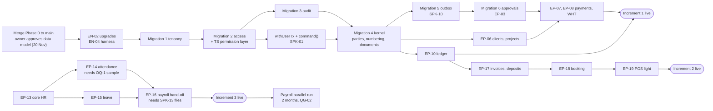
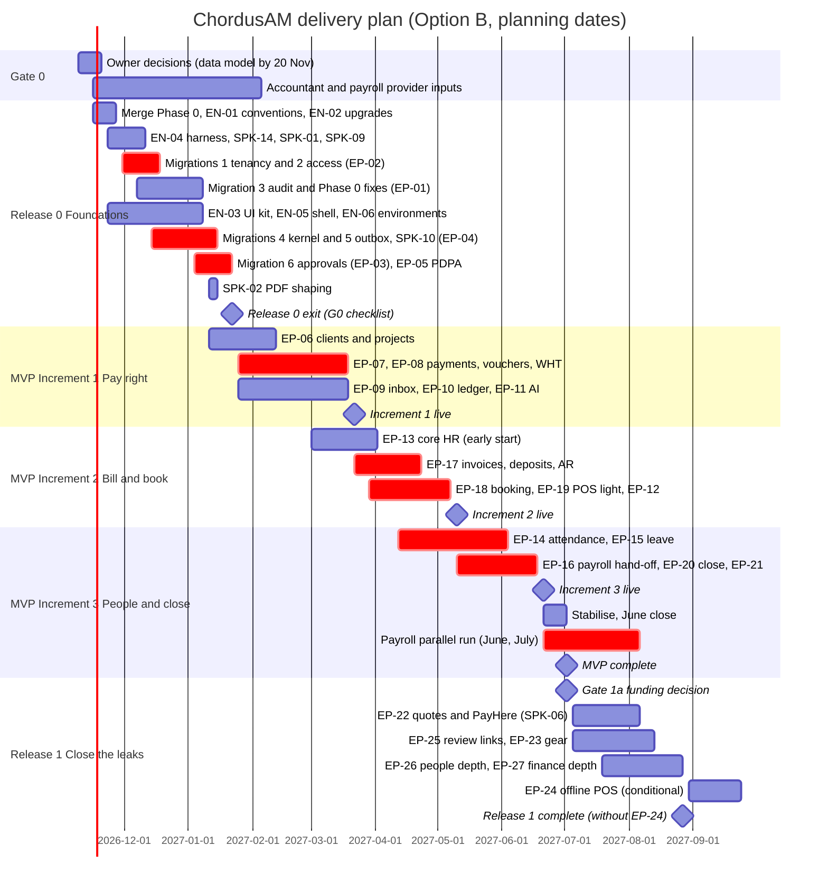

# 22: Delivery plan for ChordusAM (conventions, work breakdown, team, spikes, risks, timeline)

**Date:** 9 November 2026 (revised 10 November 2026 to align with `21-mvp-roadmap.md` and `22a-foundation-spike.md`) · **Author:** Tech Lead (discovery team) · **Status:** Draft for review

**Upstream read:** `docs/discovery/00-brief.md` (§5 rules, §7 IDs), `CLAUDE.md`, `docs/PLAN.md` §13, `docs/phase-0.md`, the Phase 0 code (`package.json`, `lib/`, `app/`, `middleware.ts`, `supabase/`, `tests/`, `.github/workflows/ci.yml`), `10-brd.md`, `13-ux-design.md` (§3.4, §5.1, §6, §7), `14-business-case.md` §3 and §7.1, `15-compliance-security.md` §7, `20-solution-design.md` (ADRs, §3.2, §4.8, §6, §7, §10.3, §11), `21-mvp-roadmap.md` (§2.2, §3, §4, §8), `22a-foundation-spike.md`, `23-test-strategy.md` (§5.3 quality gates) and `24-devops-plan.md` (§1, §3.4, §3.5).

**Summary.** We keep everything Phase 0 built and grow it in place: the same Next.js, Supabase and Vercel stack, the same guards, the same append-only audit log, the same CI. Release 0 (the PO's EP-01 to EP-05) adds the six foundation migrations, with the four changes the developer spike measured (an array-based RLS helper that is 50 times faster, numbering inside an issue trigger, approval "decision slots", and a trigger that keeps `profiles.role` in sync with the new per-entity grants), and fixes the Phase 0 security gaps G-01 to G-17. The MVP then follows the PO's three increments and epics EP-06 to EP-21 unchanged in scope and order. **I confirm the PO's scope and sequence, but not the 14 weeks or the LKR 5.4m.** Estimated bottom-up in ideal engineer-days with Claude Code doing most of the typing, Release 0 plus the MVP is **274 ideal days (range 200 to 390)**, about **73 engineer-weeks**, roughly twice the PO's 36.4 person-weeks. The gap is mostly in Release 0 (25 versus 8 weeks) and in per-table RLS and migration discipline that the CFO's AI discount does not remove. With the PO's 2.1-FTE team that scope would take about 14 months. I recommend a three-engineer team, which finishes the MVP on **2 July 2027 (13 weeks after the PO's 2 April)** for about **LKR 12m**, or, if the LKR 6.0m Gate 1 cap is firm, funding Release 0 plus Increment 1 "Pay right" only and deciding Increments 2 and 3 at a Gate 1a on evidence. The section 2 conventions (module folders, one write path, Zod everywhere, integer money, one date module, shadcn/ui on the brand tokens) are what keep AI-written code consistent across about 120 tables.

> **How to read IDs.** `BR-*`, `NFR-*`, `BRULE-*`, `OQ-*` are the BA's (`10-brd.md`). `EP-nn` are the PO's epics (`21-mvp-roadmap.md` §4). `ADR-nn`, `SPK-nn`, `TR-nn` are the architect's (`20-solution-design.md`). `G-nn` are the Phase 0 gaps (`15-compliance-security.md` §7). `QG-nn` are QA's gates (`23-test-strategy.md` §1.1, §5.3). `OPS-nn` are DevOps decisions (`24-devops-plan.md` §1). New IDs here: `EN-nn` (engineering enablers that no epic owns), `TD-nn` (technical debt), `DR-nn` (delivery risks).

> **Method and limits.** Estimates are mine and are not measurements; section 3.1 defines the unit. External facts were checked by web search on 9 November 2026 and linked inline; secondary or third-party sources are marked "(secondary)". No web research was done on 10 November.

## Contents

1. [Summary: Phase 0 to MVP and beyond without throwing anything away](#1-summary-phase-0-to-mvp-and-beyond-without-throwing-anything-away)
2. [Codebase conventions to adopt now](#2-codebase-conventions-to-adopt-now)
3. [Work breakdown, estimates and critical path](#3-work-breakdown-estimates-and-critical-path)
4. [Team and cadence](#4-team-and-cadence)
5. [Spikes plan](#5-spikes-plan)
6. [Technical debt and refactors in Phase 0 code](#6-technical-debt-and-refactors-in-phase-0-code)
7. [Risk register (technical and delivery)](#7-risk-register-technical-and-delivery)
8. [Timeline](#8-timeline)
9. [Open questions and decisions needed](#9-open-questions-and-decisions-needed)

---

## 1. Summary: Phase 0 to MVP and beyond without throwing anything away

### 1.1 The path in eight steps

1. **Merge Phase 0 and discovery to `main` first.** Today everything sits on `claude/lucid-cannon-tzya3o`. Release 0 branches from `main` (section 4.5).
2. **Upgrade before building** (EN-02): Next.js 15 is past or at the end of its maintenance window (Next.js 15.x reached two years from its October 2024 release in October 2026, per [Next.js support policy](https://nextjs.org/support-policy) and [HeroDevs](https://www.herodevs.com/blog-posts/nextjs-eol-dates-version-support-timeline), secondary) **(verify)**, Node 20 reached end of life on 30 April 2026 and Vercel deprecated it on 1 October 2026 ([Vercel changelog](https://vercel.com/changelog/node-js-20-is-being-deprecated)) **(verify the Vercel date)**, and Supabase's platform default is now Postgres 17 while CI tests on 16 ([Supabase changelog](https://supabase.com/changelog/46080-self-hosted-supabase-upgrading-from-pg-15-to-17-breaking-change); this entry is about self-hosted Supabase, so the hosted-platform default is **(verify)**). Repo facts checked in review (RV-05): `package.json` pins `next` 15.5.29 and `engines.node >=20`; CI runs Node 22 and `postgres:16`; `supabase/config.toml` has `major_version = 16`. Upgrading a 60-file app is a day; upgrading a 600-file app is a sprint.
3. **Harden Phase 0 in place** (EP-01): every G-01 to G-17 fix is an edit to an existing file or a new migration on top of `20261105000000_phase0_foundation.sql`. Nothing is rewritten.
4. **Six foundation migrations** (EP-02, EP-03, EP-04), each with a rollback and RLS tests, in the order of `20-solution-design.md` §10.3, with the spike's four corrections (section 3.3).
5. **Phase 0 stays green.** `has_role()` keeps its source; `current_app_role()` reads the user's primary grant; a trigger keeps `profiles.role` and that grant in sync. The spike ran Phase 0's 18 RLS tests unchanged on the new model and they passed (`22a-foundation-spike.md` §3a). `lib/auth/roles.ts` keeps driving navigation; `authorize()` gains a permission form beside the module form.
6. **Every module is a folder with the same shape** (section 2.1), so the 16 MVP epics are 16 copies of one pattern: Zod schema, queries, commands, events, approval adapter, posting, UI, tests.
7. **Ship by increment behind entity feature flags**, as the PO plans (EP-06 to EP-21), with QA's gates QG-01 to QG-22 on every release.
8. **Later releases add modules, not rewrites.** Release 1 (EP-22 to EP-28) and Release 2 (EP-29 to EP-32) plug into the same kernel: quotes reuse numbering and documents, offline POS reuses device number blocks (`doc_sequence_blocks`, proven in the spike), portals reuse the permission model with portal principals, Singapore is a second `entities` row.

### 1.2 Headline numbers

| Item                                   | PO plan (`21` §3.2)                         | This plan (likely)                                            | Delta                                                  |
| -------------------------------------- | ------------------------------------------- | ------------------------------------------------------------- | ------------------------------------------------------ |
| Release 0 effort                       | 8.0 pw                                      | 95 ideal days = **25.3 pw** (18 to 37)                        | +17 pw                                                 |
| MVP effort, engineering                | 22.3 pw                                     | 179 ideal days = **47.7 pw** (35 to 67)                       | +25 pw                                                 |
| QA, UAT, stabilisation                 | 6.1 pw (tester)                             | tester 0.5 FTE across the plan, about 14 pw                   | +8 pw (longer plan)                                    |
| Team                                   | TL 1.0, developer 0.6, tester 0.5 (2.1 FTE) | TL 1.0, two developers 1.0, tester 0.5, designer 0.2, OPS 0.1 | +1.4 FTE engineering                                   |
| MVP end                                | 2 April 2027                                | **2 July 2027**                                               | +13 weeks                                              |
| Cost, Release 0 + MVP (incl. sign-off) | LKR 5.42m                                   | about **LKR 12m** (range 10 to 15)                            | +LKR 6m; breaks the LKR 6.0m cap unless scope is gated |
| Release 1                              | about 15 pw, 5 April to 18 June 2027        | 68 ideal days = 18 pw, 5 July to 27 August 2027 (EP-24 +5 pw) | similar size, starts 13 weeks later                    |

---

## 2. Codebase conventions to adopt now

These go into `CLAUDE.md` in Release 0 (EN-01), because Claude Code follows what is written there. Each rule is short enough to check in review.

### 2.1 Folder structure per module (bounded context)

I adopt the architect's layout (`20-solution-design.md` §3.2, ADR-02) and make it concrete for this repo. URLs follow the UX hubs (`13-ux-design.md` §3.4); code follows the module codes from the brief §7.

```text
app/
  (staff)/                     was (app)/ in Phase 0; route group rename only, URLs unchanged
    layout.tsx                 shell: header, hubs, bottom bar, Inbox
    home/  me/  studio/  production/  money/  people/  reports/  admin/
      <section>/page.tsx       thin: guard, call module queries, render module ui
      <section>/actions.ts     "use server" wrappers that call module commands
  (portal)/portal/...          Release 2 (EP-29)
  (token)/q/[token]  r/[token]  pay/[token]   Release 1 (EP-22, EP-25)
  api/
    internal/workers/[queue]/route.ts   pg_cron / Vercel Cron worker entry
    webhooks/payhere/route.ts           Release 1
    pos/sync/route.ts                   Release 1 (EP-24)
    files/[id]/route.ts                 signed-URL issuer (writes access_log)
    exports/[report]/route.ts           XLSX/PDF streaming
modules/
  <code>/                      crm prj bkg pos sal vp fin hr att lv pay tal ast ai apr not rpt adm int
    schema.ts                  Zod input schemas and inferred types (no server-only imports)
    queries.ts                 server-only reads (supabase-js under the user's JWT)
    commands.ts                server-only writes, each wrapped in command()
    events.ts                  event names + Zod payload schemas, versioned
    consumers.ts               outbox consumers (idempotent)
    posting.ts                 journal lines this module produces (calls fin.post)
    approval-adapter.ts        snapshot(), onDecided(), isStillValid() for APR subjects
    permissions.ts             this module's permission keys (merged into the catalogue)
    ui/                        module components (client and server)
    *.test.ts                  unit tests for this module's non-pure code
lib/
  auth/                        Phase 0 guards, extended (permissions.ts is the catalogue)
  kernel/                      money, time, numbering client, documents, policy, outbox emit, tenancy
  rules/<code>/                pure business rules + tests (CLAUDE.md), e.g. rules/money, rules/apr, rules/vp
  db/                          Kysely instance, withUserTx, generated types, pg type parsers
  format/                      number, money, date display (13-ux-design.md §7.2)
  crypto/fields.ts             AES-GCM field encryption, blind index (server-only)
  errors.ts  flags.ts  env.ts  env.server.ts  i18n/
components/
  ui/                          shadcn/ui primitives (copied, owned)
  app/                         shared composites: DataTable, MoneyInput, StatusChip, ApprovalCard ...
messages/en/<module>.json      (si/, ta/ later)
supabase/migrations/ supabase/rollbacks/ supabase/seed/
tests/db/<module>.test.ts  tests/db/helpers.ts  tests/e2e/<journey>.spec.ts  tests/fixtures/
docs/adr/  docs/phase-<id>.md  docs/runbooks/
```

**Boundary rules, enforced by ESLint** ([eslint-plugin-boundaries](https://github.com/javierbrea/eslint-plugin-boundaries), version 5+ supports ESLint 9 flat config, secondary): `app/` imports `modules/*/{queries,commands,schema,ui}` and `lib/*`. A module imports another module's `commands`, `queries`, `events` and `schema` only. `lib/rules` imports nothing from `modules`, `lib/db` or Supabase. `lib/db/admin.ts` (service role) is importable only from `app/api/internal/**` and `scripts/**`.

**Table ownership is machine-readable.** Every `create table` is followed by `comment on table x is 'owner=vp; tier=restricted'`. A DB meta-test fails when a table has no owner comment, no RLS, no tenant policy, or (tier `restricted` or `confidential`) no audit trigger. This turns TR-03 and TR-04 into failing tests rather than review comments.

### 2.2 Server actions versus route handlers

| Use                                                                                           | Mechanism                                                          | Why                                                                                                                                                                                                                                                                                                                       |
| --------------------------------------------------------------------------------------------- | ------------------------------------------------------------------ | ------------------------------------------------------------------------------------------------------------------------------------------------------------------------------------------------------------------------------------------------------------------------------------------------------------------------- |
| Reads for pages                                                                               | Server components calling `modules/<code>/queries.ts`              | No client fetch layer to maintain; RLS applies through the user's JWT                                                                                                                                                                                                                                                     |
| Staff UI mutations (forms, approve, mark paid)                                                | Server actions in `app/**/actions.ts` that call one module command | Progressive enhancement, typed, no URL to version. **Every action is a public POST endpoint**, so each one re-checks permission and validates input inside `command()`; page guards do not protect actions ([OWASP Next.js cheat sheet](https://cheatsheetseries.owasp.org/cheatsheets/Nextjs_Security_Cheat_Sheet.html)) |
| Machine callers: webhooks, workers, POS sync, file downloads, exports, ICS feeds, ADMS device | Route handlers under `app/api/**` (Node runtime)                   | Stable URL, raw body for signatures, custom status codes, streaming, idempotency headers, callers that are not React                                                                                                                                                                                                      |
| Token pages for clients (`/q/`, `/r/`, `/pay/`)                                               | Server components + server actions guarded by `requireToken`       | Same pattern as staff, different principal (`20-solution-design.md` §7.5)                                                                                                                                                                                                                                                 |

Rule of thumb for Claude Code: "if a browser form calls it, it is a server action; if anything else calls it, it is a route handler; both call the same module command."

### 2.3 Data access layer: one read path, one write path

| Path                                                        | How                                                                                                                                                                                                                                                                                                                                                                                                                                                                                                                                                                                                                                                                     |
| ----------------------------------------------------------- | ----------------------------------------------------------------------------------------------------------------------------------------------------------------------------------------------------------------------------------------------------------------------------------------------------------------------------------------------------------------------------------------------------------------------------------------------------------------------------------------------------------------------------------------------------------------------------------------------------------------------------------------------------------------------- |
| **Reads**                                                   | `queries.ts` uses supabase-js with the user's session (as `lib/supabase/server.ts` does today), typed with `supabase gen types typescript`. Lists read purpose-built views (`v_payables_queue`), one query per list                                                                                                                                                                                                                                                                                                                                                                                                                                                     |
| **Writes**                                                  | **All** writes go through `command(name, schema, permission, fn)` in `lib/kernel/command.ts`. It parses input with Zod, checks the permission for the target entity and AAL, opens `withUserTx(user, fn)`, sets `request.jwt.claims` and `chordus.request_id`, `chordus.reason`, `chordus.actor_type` with `set_config(..., true)`, runs `set local role authenticated`, runs the module function, emits events, commits, and returns a `Result` (2.7). This is the architect's ADR-05 option (b), extended to simple writes too, because the audit trigger's request context must be set in the same transaction as the change, which a plain PostgREST call cannot do |
| **SQL builder** (left open in `20-solution-design.md` §1.3) | **Kysely** on `pg`, with types from the same Supabase generation via [kysely-supabase](https://github.com/kysely-org/kysely-supabase)'s `KyselifyDatabase`. Reason: our migrations are hand-written SQL with paired rollbacks (CLAUDE.md), and Kysely is a query builder only. Drizzle's strength is schema-first migrations, which would compete with that rule and duplicate the schema in TypeScript                                                                                                                                                                                                                                                                 |
| **Connection**                                              | A dedicated login role `chordus_app` (no `BYPASSRLS`, member of `authenticated`) through Supavisor transaction mode (port 6543). No named prepared statements: Supavisor transaction mode does not support them, and node-postgres only prepares when a query has a `name` ([Supabase: disabling prepared statements](https://supabase.com/docs/guides/troubleshooting/disabling-prepared-statements-qL8lEL)). This is the same claims-in-a-short-transaction shape Supabase documents for its own server middleware ([withPostgresClient](https://supabase.com/docs/reference/server/middleware-withpostgresclient)). SPK-01 proves it on Supavisor                    |
| **Type parsers**                                            | `pg` returns `int8` and `numeric` as strings ([pg-types](https://www.npmjs.com/package/pg-types); confirmed by the spike, `22a` §3c). We register: `int8` → checked safe integer (throws above 2^53); `numeric` → string (never `Number()` on rates). `sum(bigint)` returns `numeric`, so cast sums back with `::bigint`                                                                                                                                                                                                                                                                                                                                                |
| **Service role**                                            | Only in `lib/db/admin.ts`, only for workers and webhooks acting as named system actors that write `write_system_audit()` (G-06). Never in a user request                                                                                                                                                                                                                                                                                                                                                                                                                                                                                                                |
| **Grants**                                                  | Every migration grants table privileges explicitly. Since 30 October 2026 new `public` tables are not exposed to the Data API without an explicit `grant` ([Supabase changelog](https://supabase.com/changelog/45329-breaking-change-tables-not-exposed-to-data-and-graphql-api-automatically)). Phase 0 already grants explicitly; the migration template keeps it that way                                                                                                                                                                                                                                                                                            |

The spike's trap goes into the helper's tests: claims set with `is_local = false` leak to the next user of a pooled connection, and autocommit with `set_config(..., true)` silently loses them (`22a` §3a item 3, §4 TL item 2). `withUserTx` only ever uses `set_config(..., true)` inside `begin ... commit`, and a test asserts that `auth.uid()` is null on the same connection after commit.

### 2.4 Zod schemas shared by client and server

- `modules/<code>/schema.ts` holds input schemas (`PaymentRequestInput`), imported by the client form (react-hook-form with the Zod resolver) and by the server command. The server always re-parses: client validation is a convenience.
- Zod 4 is already a dependency (`package.json`, `zod ^4.6.7`). Schemas are hand-written for inputs; row types come from generated DB types. Inputs and rows differ (a form has a decimal string amount, a row has `amount_minor`).
- Shared building blocks in `lib/kernel/schemas.ts`: `zMoneyInput` (decimal text to minor units through `lib/rules/money`), `zMinor` (safe integer), `zCurrency`, `zDate` (`YYYY-MM-DD`), `zUuid`, `zEntityId`.
- Event payloads (`events.ts`), policy values (`policy_settings`, one schema per key) and environment variables (`lib/env.ts`, `lib/env.server.ts`) are Zod too, so one library validates every boundary.

### 2.5 Money type: integer minor units (and the NFR-DATA-004 conflict)

**Conflict (resolved in review, `30-review-log.md` RV-02).** ADR-15 stores every amount as `bigint` minor units; NFR-DATA-004 said "an exact **decimal** type". It now reads "exact integer minor units (`bigint`), never floating point", which the BA and CFO confirm at TL-2.

**Recommendation: `bigint` minor units in the database; reword NFR-DATA-004 to "an exact type (integer minor units or exact decimal), never floating point, with rounding rules per currency and per rule held as data".** The requirement's intent is exactness and rounding as data; `bigint` meets both. Reasons, all measured by the spike (`22a` §3c):

1. **The wire is the problem, not the column.** PostgREST sends `numeric` as a JSON number, so supabase-js turns `14969.8404` into a float and `14969.8404 * 100` becomes `1496984.0399999998`. Integers stay exact up to 2^53 (LKR 90 trillion).
2. **Lines add up.** With `numeric(18,4)` three converted USD lines showed 8,983.68 but stored a total of 8,983.69; rounded per line in minor units, lines and total agree.
3. **Smaller and faster:** 84 MB versus 99 MB per 2 million rows; `sum()` 35 ms versus 88 ms.

**Rules for code.**

| Rule                                                                                                                                                                                                             | Where                                          |
| ---------------------------------------------------------------------------------------------------------------------------------------------------------------------------------------------------------------- | ---------------------------------------------- |
| Columns `<name>_minor bigint` + `currency char(3)`; base amounts `<name>_base_minor` + `fx_rate_id` + `fx_rate numeric(20,10)`. A domain `app.money_minor` adds `check (value between -(2^53-1) and 2^53-1)`     | Migrations                                     |
| TypeScript: `type Money = { minor: number; currency: CurrencyCode }`, `minor` a checked safe integer. **Not JS `bigint`** (a deviation from `20` §3.4): `JSON.stringify(1n)` throws, and no AMPL amount needs it | `lib/kernel/money.ts`                          |
| Products with rates or fractional quantities (FX, 1.5 hours, 3% ETF) are computed exactly (`numeric` in SQL, or scaled `BigInt` inside `lib/rules/money` only), then **rounded once per line with a named mode** | `lib/rules/money` `roundMinor(x, mode)`        |
| Rounding mode is policy data per rule (`half_up` default). It matters: ETF 3% on LKR 75,001.50 is 2,250.05 half-up and 2,250.04 half-even (`22a` §3c)                                                            | `policy_settings`                              |
| Splits use largest remainder (USD 20.00 over 3 projects = 6.67 + 6.67 + 6.66), so allocations always sum                                                                                                         | `lib/rules/money` `allocateLargestRemainder()` |
| Sub-minor unit costs (AI credits at USD 0.0004) are `numeric` rate columns, never `Money`                                                                                                                        | AI module                                      |
| Display only through `lib/format` (code before amount, 3-digit grouping in every language, `13-ux-design.md` §7.2); `tsconfig.json` target moves to ES2022 so `BigInt` literals compile                          | `lib/format`, TD-17                            |

The spike's worked examples (EPF and ETF on LKR 123,456.78, the half-up/half-even case, the three-way split) become the first unit tests of `lib/rules/money`.

### 2.6 Dates and time zones

- Store `timestamptz` in UTC; calendar facts (`work_date`, leave days, invoice date) as `date` interpreted in the **entity's** timezone (`entities.timezone`, Asia/Colombo for AMPL LK, Asia/Singapore for SG later). Ranges are `tstzrange` with `[)` bounds.
- One module, `lib/kernel/time.ts`, on date-fns v4 with `@date-fns/tz` (`TZDate`, `tz()`) ([date-fns v4 blog](https://blog.date-fns.org/v40-with-time-zone-support/)): `todayIn(entityTz)`, `startOfMonthIn`, `toEntityDate(instant)`, `fiscalYearOf(date, entity)`. Components never call `new Date().toLocaleString()`; they call `lib/format`.
- Temporal is now unflagged in Node 26 ([Help Net Security](https://www.helpnetsecurity.com/2026/05/07/node-js-26-released/), secondary), but browser support is uneven, so it waits; `lib/kernel/time` keeps the swap to one file.
- Fiscal years are per entity (LK 1 April, SG 1 January), as the spike's numbering test used.
- Device punches store the raw local string, the device timezone and the parsed UTC instant.
- CI runs unit tests twice, with `TZ=Asia/Colombo` (as today) and `TZ=UTC`, to catch code that depends on the server's zone.

### 2.7 Error handling

- `lib/errors.ts`: `AppError` with a `code` (`VALIDATION`, `UNAUTHENTICATED`, `FORBIDDEN`, `NOT_FOUND`, `CONFLICT`, `RULE`, `STALE`, `EXTERNAL`, `INTERNAL`), a user message, optional field errors and a short reference.
- `command()` maps Postgres errors: `42501` → `FORBIDDEN`, `23505` → `CONFLICT`, `23P01` (exclusion, double booking) → `CONFLICT` with the clashing booking, `P0001` raised by our triggers → `RULE` with the trigger's message ("No self-approval", "Already decided", "Subject changed since submission", from `22a` §3d).
- Server actions return `Result<T> = { ok: true, data } | { ok: false, error }` and never throw raw errors to the UI. Route handlers map codes to HTTP status (401, 403, 404, 409, 422, 502, 500).
- Every error carries the request ID's short form ("Ref 7F2A", `13-ux-design.md` §7.1), logged to Sentry with PII scrubbing (OPS-08). Copy follows the UX voice: what happened, why, what to do next.
- Unauthorised pages still return 404 (Phase 0 pattern); each hub has an `error.tsx` boundary.

### 2.8 Feature flags per entity

- No third-party service. A flag is a `policy_settings` key `feature.<epic>` (boolean, effective-dated, per tenant and entity), read by `lib/flags.ts` `isEnabled(user, entityId, flag)`.
- Flags gate the hub navigation, page guards (`requireModule` returns 404 when off), server actions and route handlers. RLS does not read flags; flags hide unfinished features, permissions protect data.
- Uses: dark-launch each increment to production before go-live day, pilot with one team (`21` §7.3), turn on Singapore later, and the PO's conditional epics (EP-18, EP-19 if OQ-15 says so).
- Each flag has an owner and a removal date in `docs/flags.md`; a flag older than two releases is debt (TD list).

### 2.9 Internationalisation

- `next-intl` without locale routing: the locale comes from the user's preference, then a cookie ([next-intl: without i18n routing](https://next-intl.dev/docs/getting-started/app-router/without-i18n-routing)). ADR-13 already chose it.
- Messages in `messages/<locale>/<module>.json`, ICU syntax, English only for staff screens in the MVP (`13-ux-design.md` §7.4). Sinhala and Tamil staff screens are EP-32.
- Numbers, money and dates are **not** formatted by locale defaults (`ta-LK` uses lakh grouping); they go through `lib/format`.
- Customer-facing data (catalogue names, notification templates, legal text) is `jsonb` keyed by language with English required.
- A pseudo-locale build in CI (strings padded 40% and bracketed) catches hard-coded text and clipped layouts.
- Noto Sans Sinhala and Noto Sans Tamil self-hosted through `@fontsource`, like the Phase 0 brand fonts.
- A user language preference is a new `profiles` column: a PLAN §9 change, so it waits for the owner's data-model approval (OQ-34).

### 2.10 shadcn/ui on top of the brand tokens

- Phase 0 deferred shadcn/ui to Phase 1 (`docs/phase-0.md`, assumption 6). shadcn/ui supports Tailwind v4 and React 19 ([shadcn/ui Tailwind v4](https://ui.shadcn.com/docs/tailwind-v4)), which this repo uses.
- Initialise in EN-03, then **map shadcn's CSS variables to the brand tokens** in `app/globals.css`: `--background` = ink, `--primary` = gold with `--text-on-gold`, `--card` = the new `--surface-1`, `--border` = `--border-strong`, `--ring` = gold, status colours from the new `--ok/--warn/--danger/--info` tokens (`13-ux-design.md` §6.1).
- Phase 0 classes become component variants: `.btn-gold` → `Button variant="gold"`, `.btn-glass` → `variant="glass"`, `.field-input` → `Input`. Glass stays on the Showcase layer only; Workbench screens use solid surfaces (`13-ux-design.md` §1.2).
- Composites in `components/app/`: DataTable on TanStack Table, FilterBar, MoneyInput, MoneyDisplay, StatusChip, ApprovalCard, Sheet, Toast, EmptyState, Skeleton, DateRangePicker, MonthGrid. ResourceTimeline (booking calendar) is custom, built in EP-18.
- Forms: react-hook-form + Zod resolver + shadcn `Form`, one pattern for all forms.

### 2.11 PDF rendering

- One port, `renderDocument(kind, templateVersion, snapshot)` (ADR-09). Default **`@react-pdf/renderer` 4.x**, which supports React 19 since 4.1.0 ([react-pdf compatibility](https://react-pdf.org/compatibility)). Fallback: headless Chromium (`puppeteer-core` with `@sparticuz/chromium-min`) if SPK-02 shows react-pdf cannot shape Sinhala or Tamil. Vercel caps a Node function at 250 MB unzipped, which is why the "min" build fetched at runtime is the fallback ([Vercel guide](https://vercel.com/kb/guide/deploying-puppeteer-with-nextjs-on-vercel)).
- Templates live in `lib/documents/templates/<kind>/v<N>.tsx` and are never edited after release; a change is a new version.
- Issue flow: the command stores the snapshot and sets status `issued` (the numbering trigger assigns the number, 3.3), emits `doc.issue_requested`; the `q_documents` worker renders, stores the PDF in Storage, records SHA-256 and page count. Re-issue creates a new version (NFR-AUD-011).
- SPK-02 moves to Release 0 week 4, because the first voucher is in Increment 1 (the PO plans it for increment 1 week 1; I prefer the decision before the increment starts).

### 2.12 Background jobs

- ADR-06 and ADR-11 as designed: `internal.domain_events` written in the business transaction, fanned out to pgmq queues, drained by `pg_cron` calling `/api/internal/workers/[queue]` through `pg_net` every minute, with a Vercel Cron heartbeat every 5 minutes as fallback.
- Worker route auth: a shared secret header we generate (not a Supabase key; the new Supabase secret keys are not JWTs and are rejected where `pg_net` sends them as a bearer token, [Supabase API keys](https://supabase.com/docs/guides/api/api-keys)).
- Spike corrections (`22a` §3e): at-least-once delivery, so **every consumer writes `consumer_inbox` first**; parallel claims do not keep per-aggregate order, so the envelope gets `seq` and order-sensitive consumers (ledger export, search projection) check it; claim in short transactions and never hold a lock across an HTTP call.
- pgmq has no built-in dead-letter or retry limit ([DEV, secondary](https://dev.to/mwiginton/supabase-queues-in-production-dead-letter-queues-retries-and-poison-messages-with-pgmq-28dp)): workers move a message to `q_dead` after N reads and raise an alert.
- Batches are sized to finish in under 60 seconds, far inside Vercel Pro's 300-second default ([Vercel limits](https://vercel.com/docs/functions/limitations)).
- **No side effects in request handlers.** Email, PDF rendering and external calls are always events. Locally, `npm run worker:drain` runs the queues once.

---

## 3. Work breakdown, estimates and critical path

### 3.1 Unit and assumptions

- **Ideal engineer-day:** one engineer's focused day using Claude Code for most code, **including** writing the migration and its rollback, RLS tests, unit tests, self-review and the PR notes. **Excluding** review by others, meetings, UAT by the business and waiting for decisions.
- **Calendar conversion:** focus factor 0.75, so 1 ideal day = 1.33 person-days; **1 pw = 3.75 ideal days**. This is how I compare with the PO's and CFO's person-weeks, which already include the AI effect.
- **AI effect:** included in the ideal days. I do not apply a further 40% cut. Reason: the CFO's lean case assumes AI agents do most coding and the lead reviews (`14-business-case.md` §3.4). That is my assumption too, and these numbers are what is left after it: design decisions, reading AI output, RLS and statutory tests, rework, and the per-table discipline of CLAUDE.md, which the AI does not remove.
- **Spike credit:** the developer's spike (`22a`) wrote draft SQL for numbering, approvals, outbox and tenancy. I took 15 to 20% off EP-02 to EP-04 for it; the drafts were scratch files and need hardening, tests and the parts not tested (pgmq, Supavisor, `aal2`).
- **Payroll Option E** is the default (PO decision 4). In-house payroll (EP-28) is shown separately.

### 3.2 Release 0: Foundations (PO epics EP-01 to EP-05, plus enablers)

| ID    | Work package (technical tasks)                                                                                                                                                                                                                                                                                                                                                       | Low | Likely | High | Depends on                   |
| ----- | ------------------------------------------------------------------------------------------------------------------------------------------------------------------------------------------------------------------------------------------------------------------------------------------------------------------------------------------------------------------------------------ | --: | -----: | ---: | ---------------------------- |
| EN-01 | Conventions and guardrails: module folders, ESLint boundary rules, table-owner comments and the meta-test, PR template, CLAUDE.md update (4.3), `docs/adr/` with ADR-01 to 18 copied as stubs                                                                                                                                                                                        |   2 |      2 |    3 | Merge to `main`              |
| EN-02 | Platform upgrades: Next.js 16 (codemod, `middleware.ts` → `proxy.ts`, see TD-01), Node 24 in `engines` and CI, Postgres 17 in CI and `supabase/config.toml`, `tsconfig` target ES2022, Supabase publishable and secret keys and `getClaims()`                                                                                                                                        |   2 |      3 |    5 | EN-01                        |
| EN-03 | UI foundation: shadcn/ui init on brand tokens, semantic tokens (UX §6.1), core composites (2.10), contrast fixes (UX §1.3)                                                                                                                                                                                                                                                           |   6 |      8 |   11 | EN-02                        |
| EN-04 | DB test harness v2 (SPK-14, part of SPK-09): split per module, shared `as()` helper, all migrations up then all downs **in reverse order** (`22a` §3a item 2), reset `app`, `internal`, `pgmq`, `cron` schemas, `auth.jwt()` and `aal` in the stub, two-tenant seed, meta-tests, RLS timing smoke test (count over 200k rows under 100 ms, `22a` §4), CI image with pgmq and pg_cron |   3 |      4 |    6 | EN-02                        |
| EN-05 | Shell: Home and Inbox, hubs, phone bottom bar, legacy URL redirects (`13-ux-design.md` §3.4 steps 1 and 2), `homePathFor` → `/home`                                                                                                                                                                                                                                                  |   3 |      4 |    6 | EP-02, EN-03                 |
| EN-06 | Environments with OPS: production and staging Supabase in Singapore in separate organisations, Vercel `sin1` in `vercel.json`, preview strategy, backups (OPS-01 to OPS-07, G-04)                                                                                                                                                                                                    |   2 |      3 |    4 | EN-02                        |
| EP-01 | Security and audit hardening: migration 3 `foundation_audit` (3.3), app-level gaps G-03, G-07, G-09, G-10, G-14, G-15, G-16, G-18 (3.5), Sentry with PII scrubbing and error references (2.7), MFA (TOTP) for Admin, HR and Finance with `aal` in `SessionUser` and guards                                                                                                           |   9 |     13 |   19 | EN-04, EP-02                 |
| EP-02 | Entities, brands, locations and permissions: migrations 1 and 2 (3.3), permission catalogue and TS layer (3.4), Admin grant screen (thin S-110)                                                                                                                                                                                                                                      |   8 |     11 |   16 | EN-04                        |
| EP-03 | Approval engine: migration 6, `lib/rules/apr` pure functions, `approval_submit`/`approval_act`, adapter contract, sweep job, delegation, starter policies as seed data (3.6)                                                                                                                                                                                                         |   7 |      9 |   13 | EP-04 (outbox), withUserTx   |
| EP-04 | Platform kernel: migration 4 `foundation_kernel` and migration 5 `foundation_outbox` (3.3), `withUserTx` and `command()` (SPK-01), `lib/rules/money`, `lib/kernel/time`, `lib/format`, `lib/crypto/fields`, policy getter, document pipeline with SPK-02, email channel (Resend), feature flags, i18n setup                                                                          |  26 |     36 |   52 | EP-02, EP-01 (audit context) |
| EP-05 | PDPA records and privacy notices: ROPA, notices with acknowledgement on first sign-in, retention rules as data, DSR log (BR-ADM-010)                                                                                                                                                                                                                                                 |   2 |      3 |    4 | EP-02                        |
|       | **Release 0 total**                                                                                                                                                                                                                                                                                                                                                                  |  68 |     95 |  137 | = 18.1 / 25.3 / 36.5 pw      |

**Enablers are real work the PO's epics do not name.** EN-01 to EN-06 are 23 likely days (6 pw). I recommend the PO adds them to the backlog as an "Engineering enablers" epic so they are visible in velocity.

**What can move out of Release 0 just in time** (to start Increment 1 sooner): the document pipeline (needed in Increment 1 week 2 for the first voucher), feature flags, i18n setup and the email channel. That is about 12 likely days, and it is what section 8 assumes.

### 3.3 The six foundation migrations, concretely

All files go on top of `20261105000000_phase0_foundation.sql`, each with `supabase/rollbacks/<same name>.down.sql`, each with tests in `tests/db/`. Every down script starts with `select app.assert_destructive_rollback_allowed();` (G-08), which raises unless the session set `chordus.allow_destructive_rollback = 'on'`. Owner approval of the data model (OQ-33, OQ-34, PO decision 1, due 20 November) is part of the Definition of Ready for all six.

| #   | File (planned)                          | Contents                                                                                                                                                                                                                                                                                                                                                                                                                                                                                                                                                                                                  | Spike changes folded in (`22a` §4)                                                                                                                                                                                                                                                                                                                                                                                           | Tests that must exist                                                                                                                                                               | Epic  |
| --- | --------------------------------------- | --------------------------------------------------------------------------------------------------------------------------------------------------------------------------------------------------------------------------------------------------------------------------------------------------------------------------------------------------------------------------------------------------------------------------------------------------------------------------------------------------------------------------------------------------------------------------------------------------------- | ---------------------------------------------------------------------------------------------------------------------------------------------------------------------------------------------------------------------------------------------------------------------------------------------------------------------------------------------------------------------------------------------------------------------------- | ----------------------------------------------------------------------------------------------------------------------------------------------------------------------------------- | ----- |
| 1   | `2026111700xxxx_foundation_tenancy.sql` | `app` schema (not exposed to the Data API); `tenants`, `entities` (code, base currency, timezone, fiscal year start, tax profile), `brands`, `locations`; `unique (tenant_id, id)` on each for composite FKs; `tenant_id` + `primary_entity_id` on `profiles`, `tenant_id` on `audit_log`; immutable-`tenant_id` trigger; `app.current_tenant_id()`; seed tenant AMPL and entity AMPL LK                                                                                                                                                                                                                  | `current_tenant_id()` **does not filter on `active`** (tenant scope is not a privilege). `handle_new_user()` takes the tenant from an `internal.invitations` row or service-role-only `raw_app_meta_data`, never from user metadata (CLAUDE.md note added)                                                                                                                                                                   | Cross-tenant read and write denied; tenant immutable even for the owner; composite FK rejects another tenant's UUID (the single-column control accepts it); Phase 0 suite unchanged | EP-02 |
| 2   | `..._foundation_access.sql`             | `permissions` (generated from `lib/auth/permissions.ts`), `permission_sets` (with `legacy_role`), `permission_set_items`, `user_entity_roles` (`is_primary`, `valid_from`, `valid_to`, `granted_by`, `approved_by`), `user_permission_overrides`, `user_effective_permissions` maintained by triggers; `app.perm_entities(perm) returns uuid[]` for policies; `app.has_perm(entity, perm)` for checks inside functions; backfill one primary grant per profile; `can_request_payments` mirrored to `vp.request.create`                                                                                    | **Policies use `entity_id = any ((select app.perm_entities('p'))::uuid[])`** (7 ms versus 159 ms list, 28 ms versus 1,494 ms count). `current_app_role()` reads the primary grant; `has_role()` source unchanged. **Trigger syncs `profiles.role` and `primary_entity_id` into the primary grant**, so Phase 0 code that writes `profiles.role` keeps working. CI lint fails any policy that passes a row column to a helper | Phase 0's 18 tests pass unchanged; LK user cannot see SG rows; demotion takes effect in the same session; the `= any ((select f()))` cast trap covered by a test                    | EP-02 |
| 3   | `..._foundation_audit.sql`              | `audit_log` columns `entity_id`, `actor_type`, `actor_role`, `request_id`, `ip`, `user_agent`, `reason`, `source`, `prev_hash`, `row_hash`; `audit_row_change(variadic redact text[])` stores `{"redacted": true, "changed": true}` for listed columns (G-01); request context read from `chordus.*` settings; `write_system_audit()` (G-06); `write_audit()` action allow-list and `source = 'app'` (G-11); `access_log` (append-only); hash chain (G-13); `created_at` added to the profile guard (G-12); alert view for role changes with a null actor; `assert_destructive_rollback_allowed()` (G-08) | Redaction through trigger arguments as tested in the spike                                                                                                                                                                                                                                                                                                                                                                   | A redacted column never appears in `audit_log`; request ID recorded; chain verifies; tampering detected; Phase 0 audit tests still pass                                             | EP-01 |
| 4   | `..._foundation_kernel.sql`             | `parties`, `party_contacts`, `party_addresses`, `party_identifiers` (cipher, blind index, last 4), `party_bank_accounts` (Restricted); `policy_settings` (typed, effective-dated); `currencies` (minor units, rounding mode), `fx_rates`; domain `app.money_minor`; `doc_sequences` (per tenant, entity, doc type, fiscal year), `doc_sequence_blocks`; `documents` (template version, snapshot, SHA-256, status, supersedes); `attachments`; Storage buckets per tier with policies                                                                                                                      | **Numbering at issue time:** `app.next_number()` is called only from a generic `BEFORE INSERT OR UPDATE` trigger that numbers a row when its status becomes `issued`; `EXECUTE` revoked from `authenticated`; delete and renumber blocked; number **last** in a command; several doc types locked in alphabetical order                                                                                                      | QG-06: 50 concurrent issues, no gap, no duplicate; fiscal-year boundary for LK (1 April) and SG; `authenticated` cannot call `next_number`; Restricted tables need `aal2`           | EP-04 |
| 5   | `..._foundation_outbox.sql`             | `internal` schema; `domain_events` (monthly partitions, with `seq`), `event_subscriptions`, `consumer_inbox`, `job_runs`, `dead_letter`; pgmq queues `q_notifications`, `q_documents`, `q_projections`, `q_integrations`, `q_accounting`, `q_dead`; `pg_cron` schedules: worker poll every minute, approval sweep every 15 minutes, grant expiry nightly, partition maintenance monthly                                                                                                                                                                                                                   | Envelope `seq` for per-aggregate order; inbox mandatory for every consumer; short claim transactions                                                                                                                                                                                                                                                                                                                         | SPK-10: 10,000 events, worker killed mid-batch, no loss, no duplicate side effect; event from a rolled-back transaction never appears                                               | EP-04 |
| 6   | `..._foundation_approvals.sql`          | `approval_policies`, `approval_policy_steps`, `approval_requests`, `approval_tasks`, `approval_actions` (append-only), `delegations`; `app.approval_submit()`, `app.approval_act()` (security definer, task locked `FOR UPDATE`); guard trigger on `approval_actions` re-checks every rule                                                                                                                                                                                                                                                                                                                | **Decision slots:** approvals take slots 1 to `quorum_n`, a reject takes slot 0, `unique (task_id, decision_slot)`; `unique (task_id, coalesce(on_behalf_of, actor_id))` for one decision per person. **Submit refuses** when eligible approvers are fewer than the quorum and routes to escalation (OQ-43)                                                                                                                  | QG-04: no self-approval even by direct insert; 50/50 races give one decision; 2-of-n needs two different Admins; recommend-only cannot approve; stale snapshot hash refused         | EP-03 |

### 3.4 Permission model, concretely (EP-02)

**Catalogue in code, seeded to the database.** `lib/auth/permissions.ts` becomes the single source, as `lib/auth/roles.ts` is today:

```ts
export const PERMISSIONS = {
  "vp.request.create": { module: "vp", label: "Raise payment requests" },
  "vp.request.read_all": { module: "vp", label: "See all payment requests in the entity" },
  "vp.payment.release": { module: "vp", label: "Mark payments as paid", aal2: true },
  "party.bank.reveal": { module: "vp", label: "Reveal bank details", aal2: true },
  "hr.salary.read": { module: "hr", label: "See salaries", aal2: true },
  // ... one entry per permission; a script generates the seed SQL and a test checks they match
} as const;
export type Permission = keyof typeof PERMISSIONS;
```

**Starter permission sets** (seed data, editable later): Employee, HR, Finance, Admin (the four Phase 0 roles, with `legacy_role`), plus Producer, Front desk, POS supervisor, Accountant (read-only), DPO, and toggles `salary_viewer`, `vendor_bank_editor`, `payment_releaser` (`20-solution-design.md` §7.1, `15-compliance-security.md` §4.2).

**App layer changes.**

| File                     | Change                                                                                                                                                                                                                  |
| ------------------------ | ----------------------------------------------------------------------------------------------------------------------------------------------------------------------------------------------------------------------- |
| `lib/auth/roles.ts`      | `SessionUser` gains `tenantId`, `primaryEntityId`, `aal`, `permissions: Record<EntityId, Permission[]>`. `MODULES` becomes hub definitions with a read permission each; the "Phase N" roadmap lists are removed (TD-05) |
| `lib/auth/authorize.ts`  | `Requirement` adds `{ permission, entityId?, aal? }`. `{ module }` stays and maps to the hub's read permission. 401 / 403 semantics unchanged                                                                           |
| `lib/auth/guards.ts`     | `requireModule` also checks the feature flag; new `requirePermission(perm, entityId)`; `guardApi` accepts the new requirement                                                                                           |
| `lib/auth/session.ts`    | Loads effective permissions once per request (`cache()`), verifies the JWT with `getClaims()` (asymmetric signing keys), reads `aal` from the claims                                                                    |
| `lib/auth/demo-users.ts` | Demo users carry permission sets, so demo mode keeps working for navigation tests                                                                                                                                       |
| `tests/unit/*`           | The route × role matrix becomes route × permission set × entity, generated from the catalogue                                                                                                                           |

Grants go through the approval engine (`role_grant`, a second Admin) from Increment 1 onwards; in Release 0 an Admin grants directly, audited.

### 3.5 Phase 0 audit and security fixes (`15-compliance-security.md` §7)

| Gap  | Fix                                                                                                                            | Files                                                                        | Package     |
| ---- | ------------------------------------------------------------------------------------------------------------------------------ | ---------------------------------------------------------------------------- | ----------- |
| G-01 | Redaction through trigger arguments, test that redacted values never reach the log                                             | migration 3; `tests/db/audit.test.ts`                                        | EP-01 (R0)  |
| G-02 | TOTP for privileged sets, restrictive `aal2` policies, `aal` in session and guards                                             | migration 2 and 3; `lib/auth/*`; `tests/db/supabase-stub.sql` (`auth.jwt()`) | EP-01 (R0)  |
| G-03 | Seed script refuses unless `CHORDUS_ALLOW_DEMO_SEED=true` and the project ref is allow-listed; logs via `write_system_audit()` | `scripts/seed-demo-users.ts`                                                 | EP-01 (R0)  |
| G-04 | `vercel.json` with `regions: ["sin1"]`; Singapore projects                                                                     | new `vercel.json`; OPS-06                                                    | EN-06 (R0)  |
| G-05 | Permission model per entity                                                                                                    | migration 2; 3.4                                                             | EP-02 (R0)  |
| G-06 | `actor_type`, `write_system_audit()`, alert on null-actor role changes                                                         | migration 3                                                                  | EP-01 (R0)  |
| G-07 | CSP, HSTS, `frame-ancestors`, `Referrer-Policy` headers                                                                        | `next.config.ts`                                                             | EP-01 (R0)  |
| G-08 | Destructive-rollback guard in every down script                                                                                | `supabase/rollbacks/*.down.sql`; migration 3                                 | EP-01 (R0)  |
| G-09 | Password sign-in hidden and rejected when `CHORDUS_ALLOW_PASSWORD_LOGIN` is not set                                            | `app/login/login-forms.tsx`; `app/login/actions.ts`                          | EP-01 (R0)  |
| G-10 | Magic-link redirect from `NEXT_PUBLIC_SITE_URL`, not the `Origin` header                                                       | `app/login/actions.ts` (line 43)                                             | EP-01 (R0)  |
| G-11 | `write_audit()` action allow-list; `writeAudit()` typed action union                                                           | migration 3; `lib/audit.ts`                                                  | EP-01 (R0)  |
| G-12 | `created_at` in the profile guard                                                                                              | migration 3                                                                  | EP-01 (R0)  |
| G-13 | Hash chain and daily anchor                                                                                                    | migration 3; worker job                                                      | EP-01 (R0)  |
| G-14 | `lib/env.server.ts` with a server-only Zod schema that fails closed in production                                              | `lib/env.ts`, new `lib/env.server.ts`                                        | EP-01 (R0)  |
| G-15 | CI `permissions:` block, actions pinned by SHA, `npm audit` gate (QG-19), gitleaks licence or GitHub secret scanning           | `.github/workflows/ci.yml`                                                   | EP-01 (R0)  |
| G-16 | `secure` demo cookie outside localhost; unit tests of every `isDemoMode()` combination                                         | `app/login/actions.ts` (line 62); `lib/env.ts`                               | EP-01 (R0)  |
| G-17 | `employees.profile_id` with `on delete set null`; offboarding deactivates                                                      | EP-13 migration                                                              | EP-13 (MVP) |
| G-18 | Hosted-project security settings checklist in the runbook                                                                      | `docs/runbooks/supabase-settings.md`                                         | EN-06 (R0)  |
| G-19 | CI job against `supabase start` for Storage and real Auth claims                                                               | `.github/workflows/ci.yml`                                                   | EN-04 (R0)  |

### 3.6 Approval engine, concretely (EP-03 in R0, EP-09 in Increment 1)

| Task                                                                                                                                                                | Package | Likely days |
| ------------------------------------------------------------------------------------------------------------------------------------------------------------------- | ------- | ----------: |
| Migration 6 with decision slots, guard trigger, append-only actions, quorum check at submit                                                                         | EP-03   |           2 |
| `lib/rules/apr`: `routeApproval`, `resolveCandidates`, `canAct`, `applyAction`, `escalate`, with table-driven tests from the spike's scenarios and BRULE-001 to 010 | EP-03   |           3 |
| `approval.submit` / `approval.act` commands, subject adapter contract, one test subject                                                                             | EP-03   |         1.5 |
| SLA sweep (`pg_cron` every 15 minutes), delegation with its own approval, owner alert when nobody can act                                                           | EP-03   |         1.5 |
| Starter policies as seed data (`20-solution-design.md` §6.6) and the policy editor API                                                                              | EP-03   |           1 |
| Approvals inbox S-02 (ApprovalCard, filters, decided-by-someone-else state, undo window), notifications per step                                                    | EP-09   |           6 |

### 3.7 MVP work breakdown (PO increments and epics, `21-mvp-roadmap.md` §3.4)

| Epic  | Technical tasks (summary)                                                                                                                                                                                                                                                                                                                       | Low | Likely | High |    PO pw | Mine pw | Depends on                      |
| ----- | ----------------------------------------------------------------------------------------------------------------------------------------------------------------------------------------------------------------------------------------------------------------------------------------------------------------------------------------------- | --: | -----: | ---: | -------: | ------: | ------------------------------- |
|       | **Increment 1 "Pay right"**                                                                                                                                                                                                                                                                                                                     |     |        |      |          |         |                                 |
| EP-06 | `clients` role table on `parties`, contacts, duplicate warning; `projects` (code, brand, kind), pipeline templates and stages, budget versions and lines, ClickUp link; pipeline board S-42, job page S-43 with budget versus actual                                                                                                            |  10 |     13 |   18 |      1.3 |     3.5 | R0                              |
| EP-07 | `vendors` and `talent_profiles` role tables, skills and languages, rate cards; `party_bank_accounts` with reveal RPC and `access_log`; `bank_detail_change` subject (two people, 72-hour cool-off blocks "Mark paid")                                                                                                                           |   5 |      7 |   10 |      1.0 |     1.9 | EP-02, EP-03, EP-04             |
| EP-08 | Payment requests with lines and attachments, limit routing through APR, payables queue S-75, partial payments, mark paid with requester ≠ approver ≠ payer, voucher and self-billed invoice PDFs with versions, lock after paid; `lib/rules/vp` `computeWht` (threshold, catch-up on crossing, per-payee aggregation), WHT ledger, certificates |  10 |     14 |   20 |      1.8 |     3.7 | EP-06, EP-07, document pipeline |
| EP-09 | Approvals inbox and notifications (3.6), in-app notification centre, email per payment event                                                                                                                                                                                                                                                    |   4 |      6 |    8 |      0.5 |     1.6 | EP-03                           |
| EP-10 | Accounts, mappings per entity, fiscal periods, journals and lines, `fin.post()` (balanced, period open, mapped, `unique (source_type, source_id, posting_kind)`), tax codes and rates as data, FX rate entry; expenses, categories, recurring, receipt capture, foreign VAT                                                                     |  12 |     16 |   22 |      1.5 |     4.3 | R0                              |
| EP-11 | AI subscriptions and periods, usage log, month-end pool and allocate with largest remainder, posting, S-60                                                                                                                                                                                                                                      |   4 |      5 |    7 |      0.7 |     1.3 | EP-06, EP-10                    |
|       | **Increment 2 "Bill and book"**                                                                                                                                                                                                                                                                                                                 |     |        |      |          |         |                                 |
| EP-17 | Sales invoices in the IRD tax invoice format (SPK-08), lines, milestones, credit notes; `payments` and `payment_allocations` (in and out); deposits as liabilities; AR ageing S-72; VAT and SSCL monitor                                                                                                                                        |  10 |     13 |   18 |      2.0 |     3.5 | EP-06, EP-10                    |
| EP-18 | Resources, kits, price rules (effective-dated), booking policies; bookings with `tstzrange` exclusion constraint and buffers (SPK-11); hold expiry job; deposit link to EP-17; cancellation fee; ResourceTimeline S-20, S-21, catalogue S-22; ICS feeds                                                                                         |  10 |     14 |   20 |      2.3 |     3.7 | EP-17                           |
| EP-19 | POS light (online only): devices, shifts, cash counts and blind close, sale and lines, split tender (cash, card reference, LankaQR reference), numbered receipts (A4 PDF; thermal per SPK-03), refunds via APR, posting                                                                                                                         |   6 |      8 |   12 |      1.0 |     2.1 | EP-17, EP-18                    |
| EP-12 | Deliverables and versions (links), consents and scopes on talent, publish checklist that blocks on missing or withdrawn consent, revision counter                                                                                                                                                                                               |   6 |      8 |   12 |      1.5 |     2.1 | EP-06, EP-07                    |
|       | **Increment 3 "People and close"**                                                                                                                                                                                                                                                                                                              |     |        |      |          |         |                                 |
| EP-13 | Employees (`party_id`, `profile_id` without cascade, G-17), contract types (validated JSON editor), contracts with effective dates, compensation (Restricted, `aal2`), identifiers encrypted, holidays with LK public and Poya days, documents, classification checklist; S-80                                                                  |   8 |     11 |   15 |      1.5 |     2.9 | R0                              |
| EP-14 | Import upload, browser-side parsing in a worker, column mapper, import profiles, employee matching, preview, idempotent commit (QG-07), batch history and rollback, day derivation in `lib/rules/att`; exceptions S-82, calendar S-83, my month S-11; manual attendance through APR (S-12)                                                      |  12 |     16 |   22 |      2.0 |     4.3 | EP-13, real sample file (OQ-1)  |
| EP-15 | Leave types, accrual ledger (`accrueLeave`), balances, request with day counting, HR recommend-only and Admin decide through APR, cancellation, clash warnings; S-13, S-84                                                                                                                                                                      |   8 |     11 |   15 |      1.5 |     2.9 | EP-13, EP-03                    |
| EP-16 | Pay run inputs export (days, unpaid leave, adjustments), provider file import (journal, payslips) with headcount and gross reconciliation that blocks approval, EPF and ETF check, approval, Finance view, posting, payslip storage and "My pay" S-15 (SPK-13)                                                                                  |   6 |      8 |   12 |      1.0 |     2.1 | EP-14, EP-15, EP-10             |
|       | **Across increments**                                                                                                                                                                                                                                                                                                                           |     |        |      |          |         |                                 |
| EP-20 | Role homes S-01, P&L by period with drill-down, project profitability (materialised views behind RLS-checked wrapper views), month close checklist and period lock, accountant journal export with pre-flight (SPK-07)                                                                                                                          |   9 |     12 |   17 |      1.8 |     3.2 | EP-10, EP-17                    |
| EP-21 | Opening data imports (vendors, clients, open projects, open invoices, employees, contracts, leave balances) reusing import profiles, with dry runs                                                                                                                                                                                              |   4 |      6 |    9 |      0.9 |     1.6 | per increment                   |
| EN-07 | Engineering share of hardening per increment: fixes from QA, performance (QG-11), accessibility (QG-10), cutover rehearsal, production support in the first week after each go-live                                                                                                                                                             |   8 |     11 |   16 | (in 6.1) |     2.9 | each increment                  |
|       | **MVP total**                                                                                                                                                                                                                                                                                                                                   | 132 |    179 |  253 |     22.3 |    47.7 |                                 |

**Release 0 + MVP: 200 / 274 / 390 ideal days = 53 / 73 / 104 engineer-weeks**, plus tester time.

**Option D (in-house payroll, EP-28):** add 20 / 28 / 40 days (EPF, ETF and APIT tables as data, gross-up for net contracts, gratuity, payslip PDFs, statutory exports, golden files signed by the accountant). It is not in the totals.

### 3.8 Release 1 (PO §3.5, epics EP-22 to EP-28)

| Epic  | Technical tasks (summary)                                                                                                                                                                 | Low | Likely | High | Notes                                  |
| ----- | ----------------------------------------------------------------------------------------------------------------------------------------------------------------------------------------- | --: | -----: | ---: | -------------------------------------- |
| EP-22 | Quote builder, versions, acceptance by token page `/q/`, quote PDF, convert to project; PayHere checkout, notify webhook with signature check, reconcile job, refunds (SPK-06); reminders |  13 |     17 |   25 | Merchant account (OQ-21)               |
| EP-25 | Client review links `/r/` with action tokens, append-only approval events, revision rounds billable, turnaround report, talent contracts                                                  |  10 |     13 |   19 | Lawyer templates (OQ-26)               |
| EP-23 | Gear check-out and check-in with QR (BarcodeDetector plus fallback), condition reports with photos, late and damage fees                                                                  |   5 |      7 |   10 |                                        |
| EP-27 | Staff time in margin, AI allowance and waste, petty cash, revenue recognition and WIP, tax monitors                                                                                       |   9 |     12 |   18 |                                        |
| EP-26 | Overtime, carry-forward, gratuity accrual, exits, delegation UI, audit log viewer S-114                                                                                                   |  10 |     13 |   19 |                                        |
| EN-08 | Release 1 hardening and pen-test fixes (OQ-51)                                                                                                                                            |   4 |      6 |    9 |                                        |
|       | **Release 1 total (without conditionals)**                                                                                                                                                |  51 |     68 |  100 | 13.6 / 18.1 / 26.7 pw                  |
| EP-24 | Conditional: offline POS PWA, encrypted IndexedDB queue, device key, device number blocks, idempotent `/api/pos/sync`, packages, discount limits (SPK-03, SPK-04, SPK-12)                 |  15 |     20 |   28 | QG-05; only if OQ-15 data justifies it |
| EP-28 | Conditional: in-house statutory payroll                                                                                                                                                   |  20 |     28 |   40 | Only if OQ-42 = build                  |

Release 2 (EP-29 to EP-32) is not estimated in detail here; my rough sizes are portals 15 to 22 days, integrations 18 to 28, commercial and rights depth 18 to 26, Singapore entity and localisation 10 to 16.

### 3.9 Critical path and sequencing



**The critical path** runs through the foundation migrations 1 → 2 → 4 → 5 → 6, then EP-08 (the engine's hardest consumer, as the PO argues in `21` §2.3), then EP-17 → EP-18 → EP-19, then EP-14 → EP-16 and the two-month payroll parallel run. External items on the path: owner approval of the data model (20 November), the fingerprint sample (OQ-1), the payroll provider's sample files (SPK-13), the accountant's invoice fields (SPK-08) and import format (SPK-07).

**Parallel streams with three engineers:** the Tech Lead owns the kernel, approvals, ledger and reviews; Developer A owns the money flows (EP-06 to EP-11, EP-17); Developer B owns UI foundation then studio and people (EN-03, EN-05, EP-18, EP-19, EP-13 to EP-15). EP-13 can start in Increment 2 (it needs only R0) so that Increment 3 is not one engineer's queue.

### 3.10 Confirming or challenging the PO's 14 weeks and LKR 5.4m

**Scope and order: confirmed.** The epics, their order and the cut line (`21` §3.2) are sound, and the spike de-risks the engine on its hardest consumer first.

**Effort: challenged.** Per epic, my figures are 1.4 to 3.2 times the PO's; overall 2.4 times on engineering (2.0 times the PO's 36.4 pw, which includes QA):

| Group                                 | PO (pw, after AI) | Mine (pw, likely) | Main reason for the difference                                                                                                                                                                                                                             |
| ------------------------------------- | ----------------: | ----------------: | ---------------------------------------------------------------------------------------------------------------------------------------------------------------------------------------------------------------------------------------------------------- |
| Release 0 (EP-01 to EP-05 + enablers) |               8.0 |              25.3 | Six migrations with rollbacks and RLS tests, permission layer in TS, `withUserTx`, outbox on real pgmq, documents, UI kit, platform upgrades, test harness. The PO's 4 weeks hold only if Release 0 builds stubs, which means MVP tables are written twice |
| Increment 1 (EP-06 to EP-11)          |               6.8 |              16.3 | Ledger and payment flows each carry RLS matrices, SoD tests, PDFs and the WHT golden file                                                                                                                                                                  |
| Increment 2 (EP-12, EP-17 to EP-19)   |               6.8 |              11.5 | Booking calendar UI and exclusion constraints; IRD invoice format                                                                                                                                                                                          |
| Increment 3 (EP-13 to EP-16)          |               6.0 |              12.3 | Importer and derivation rules; leave accrual with statutory floors                                                                                                                                                                                         |
| EP-20, EP-21, hardening               |               2.7 |               7.7 | Reporting views behind RLS; opening data dry runs; fixes after each go-live                                                                                                                                                                                |
| **Total R0 + MVP (engineering)**      |          **30.3** |          **73.1** |                                                                                                                                                                                                                                                            |

(The PO's 36.4 pw also includes 6.1 pw of QA; I add tester time separately below.)

**Duration and cost under three team options** (rates from `14-business-case.md` §3.1: TL LKR 550,000 a month, developer 300,000 to 325,000, tester 215,000 FTE, designer 300,000, OPS 450,000; AI tools about USD 150 per engineer a month; plus LKR 0.6m sign-off):

| Option                                                                            | Engineering capacity (ideal days a week) | MVP ends                            | R0 + MVP cost (LKR)      | Comment                                                                                                                                             |
| --------------------------------------------------------------------------------- | ---------------------------------------: | ----------------------------------- | ------------------------ | --------------------------------------------------------------------------------------------------------------------------------------------------- |
| A. PO team: TL 1.0, developer 0.6, tester 0.5                                     |                 about 4.5 (TL codes 60%) | early 2028 (about 61 working weeks) | about 14.5m              | Costs more than B because the TL is paid for longer; one-person bus factor (PR-08)                                                                  |
| **B. Recommended: TL 1.0, two developers 1.0, tester 0.5, designer 0.2, OPS 0.1** |                               about 9.75 | **2 July 2027**                     | **about 12m** (10 to 15) | Burn about LKR 1.5m a month for 7.5 months; cost driven by effort, not team shape                                                                   |
| C. Hold the LKR 6.0m cap                                                          |                                as A or B | Increment 1 only                    | 6.0m                     | The cap buys Release 0 plus Increment 1 "Pay right" (about 160 ideal days). Fund Increments 2 and 3 at a Gate 1a on Increment 1's adoption evidence |

**My recommendation:** Option B with the PO's velocity check made formal: if Release 0 week 3 and Increment 1 show my estimates are high (the AI effect is better than I assume), the plan pulls in and the PO's April date comes back into reach; if they show the PO's estimates were right, we have lost nothing but spare capacity, which goes to Release 1. Option C is the safe choice if the owner will not raise the cap before seeing results. **In all options, do not compress Release 0** by building stubs: retrofitting tenancy, permissions or money types later is the expensive mistake the whole discovery set warns about.

**Delta against the CFO's ranges (`14-business-case.md` §3.2, §3.5).** For both phases the CFO estimated 75 to 118 pw before AI and 57.9 pw after the lean 40% effect (recommended, LKR 7.7m). My R0 + MVP + Release 1 (without conditionals) is 251 / 342 / 490 ideal days = **67 / 91 / 131 pw after the AI effect**, about **+33 pw (+58%)** on the CFO's recommended figure and inside the CFO's **before-AI** range of 75 to 118 pw. Per CFO row, my module figures are at or below the CFO's before-AI numbers; the foundation row (CFO 6 to 10 pw before AI; mine 21 to 41 pw including enablers, admin and notification wiring) explains about half of the delta, and dropping the extra 40% AI cut explains the rest.

---

## 4. Team and cadence

### 4.1 Recommended team for the MVP (Option B)

| Role (brief §6)     | Who                                     |                                    Load | Main duties                                                                 |
| ------------------- | --------------------------------------- | --------------------------------------: | --------------------------------------------------------------------------- |
| Product Owner       | Thoshan                                 |                                 0.3 FTE | Weekly priorities, decisions by the dates in `21` §8.2, acceptance per epic |
| Tech Lead (TL)      | Senior contract engineer                |              1.0 FTE (about 60% coding) | Kernel, migrations, approvals, ledger, all reviews, CLAUDE.md, ADRs         |
| Developer A         | Mid-senior full-stack, AI-assisted      |                                 1.0 FTE | Money flows: EP-06 to EP-11, EP-17, EP-20                                   |
| Developer B         | Mid full-stack with front-end strength  |                1.0 FTE (from R0 week 2) | UI kit, shell, booking, POS light, people epics                             |
| QA                  | Tester (automation and statutory cases) |                                 0.5 FTE | `23-test-strategy.md`: golden files, e2e journeys, release readiness        |
| Product Designer    | Contract                                | 0.3 FTE in R0 and Increment 1, then 0.1 | Workbench layouts, ResourceTimeline, POS screen, copy                       |
| DevOps              | Fractional                              |                         0.1 to 0.15 FTE | `24-devops-plan.md`: environments, release job, backups, monitoring         |
| SEC                 | Reviewer                                |               About 1 day per increment | G0 checklist, review of Restricted tables and auth changes                  |
| Finance and HR SMEs | Janaka, Abilasini                       |        2 to 4 hours a week, more in UAT | Golden spreadsheets, UAT, parallel run                                      |
| Accountant, lawyer  | External                                |                                 One-off | Sign-off of WHT, invoice fields, CoA mapping, payroll checks, templates     |

### 4.2 Sprint cadence

- **Two-week sprints**, aligned to the PO's increments (Release 0 = 2 to 3 sprints; each increment = 3 to 5 sprints). Planning on Monday, a demo to the PO and SMEs on the second Friday, a short retro.
- **Daily**: a 15-minute written standup in the team channel (what merged, what is blocked, which decision is waiting).
- **Weekly**: a 30-minute decision review with the PO against `21` §8.2 dates; a risk review every second week.
- **Velocity check**: actual ideal days per epic against this plan after Release 0 week 3 and after Increment 1 (PR-01), reported to the PO and CFO as the forecast-accuracy metric the CFO asked for (`14-business-case.md` §3.4).

### 4.3 AI-assisted development practices (Claude Code)

| Practice                                                                                                                                                                                                                                          | Why                                                            |
| ------------------------------------------------------------------------------------------------------------------------------------------------------------------------------------------------------------------------------------------------- | -------------------------------------------------------------- |
| **One epic per branch** (`ep-08-payment-requests`), which is how I read CLAUDE.md's "one phase per branch" for the new plan. Each epic gets `docs/phase-ep-08.md` with what was built, decisions and assumptions, as `docs/phase-0.md` does today | Keeps CLAUDE.md's rule and the phase-notes habit               |
| **Plan, then code.** Each epic starts with Claude Code writing a short plan (tables, commands, screens, tests) into the phase note; the TL approves it before code                                                                                | Cheap to fix a plan; expensive to fix 2,000 generated lines    |
| **Tests first for rules.** For `lib/rules/**`, the human writes or approves the test cases (from the golden files and the BRULE catalogue in `23` §3.3), then the agent writes the function                                                       | AI-written payroll and tax code needs human-owned expectations |
| **Small PRs inside the epic branch.** Aim for under about 400 changed lines excluding generated files; one migration per PR                                                                                                                       | Reviewable; migration conflicts stay small                     |
| **The agent reads before it writes.** Prompts name the documents to read (`20` section, epic stories in `21` §5, test IDs in `23`)                                                                                                                | Traceability without a tool                                    |
| **A second agent reviews.** Before human review, a separate review pass (for example the `code-review` skill) checks the diff against CLAUDE.md and the epic's stories                                                                            | Catches rule breaks cheaply                                    |
| **Never let the agent edit a merged migration**; a change is a new migration                                                                                                                                                                      | Migrations are history                                         |
| **No secrets in prompts or code**; local `.env.local` only; the agent never sees production keys                                                                                                                                                  | CLAUDE.md, OPS-02                                              |

**CLAUDE.md additions in Release 0** (short rules, so the agent follows them):

1. Module layout and import rules (2.1); "reads through `queries.ts`, writes through `command()`" (2.3).
2. Money: `_minor bigint` + currency; `Money` with safe integers; round once per line with a named mode; largest remainder for splits (2.5).
3. Dates through `lib/kernel/time` and `lib/format` only (2.6).
4. RLS policies use `entity_id = any ((select app.perm_entities('p'))::uuid[])`, never a helper with a row column (3.3).
5. Every table: owner comment, RLS, tenant policy, explicit grants, composite FKs across aggregates, audit trigger with redaction list when tier is Restricted or Confidential.
6. Numbers are assigned only by the issue trigger; never call `next_number()` from app code.
7. Side effects only through `emit()`; every consumer is idempotent through `consumer_inbox`.
8. Every down script starts with the destructive-rollback guard.
9. "Phase" means epic for branches and phase notes; end of epic runs `npm run check`, `npm run test:db`, `npm run test:e2e`.
10. `npm run test:e2e` runs against local Supabase with seed data, not only demo mode (TD-20).

### 4.4 PR template and review gates

`.github/pull_request_template.md`:

```md
## What and why

Epic: EP-nn · Stories: · BR IDs: · Test IDs (23):

## Checklist

- [ ] Migration has a rollback with the destructive guard; round trip passes (QG-16)
- [ ] New tables: owner comment, RLS, tenant policy, grants, RLS tests (allow and deny, cross-entity, cross-tenant)
- [ ] Restricted data: separate table, `aal2`, audit redaction list, no values in events or logs
- [ ] Permissions checked in `command()` and in RLS; no service role in user paths
- [ ] Money in minor units; rounding mode from policy; dates via `lib/kernel/time`
- [ ] Policy values are data, not constants
- [ ] Strings in messages; mobile layout checked at 360 px; axe clean (QG-18)
- [ ] Phase note updated; CLAUDE.md updated if a rule changed
```

| Gate | What                                                                                                                                                           | Who                                     | Blocks merge        |
| ---- | -------------------------------------------------------------------------------------------------------------------------------------------------------------- | --------------------------------------- | ------------------- |
| R1   | CI: lint, boundaries, typecheck, format, unit, DB (with meta-tests and timing smoke), build, e2e, `npm audit`, secret scan, traceability (QG-13, QG-14, QG-16) | Automated                               | Yes                 |
| R2   | Code review against the checklist                                                                                                                              | TL (TL's own PRs: Developer A)          | Yes                 |
| R3   | Security review for auth, permissions, Restricted tables, token pages, webhooks                                                                                | SEC (or TL with the SEC checklist)      | Yes, for those PRs  |
| R4   | Rule sign-off: golden file results for WHT, payroll checks, invoice fields, posting rules                                                                      | Janaka or the accountant (QG-01, QG-17) | Yes, before release |
| R5   | Release readiness (`23` §7.3)                                                                                                                                  | QA and PO                               | Yes, for release    |

### 4.5 Definition of Ready and Definition of Done

**Definition of Ready (an epic or story can start when):**

- Stories and acceptance criteria exist in `21` §5 and are linked to BR IDs and test IDs in `23`.
- Data-model changes have the owner's approval (CLAUDE.md, OQ-34), and any new PLAN §9 table is listed in the phase note.
- Policy values have a default (even if the owner will change it in the settings screen).
- External inputs are in hand or have a dated default: sample files, accountant answers, templates.
- Spikes the epic depends on are closed with a decision note (section 5).
- The designer's screen sketch exists for new Workbench screens.

**Definition of Done (a story or epic is done when):**

- Code merged to `main` through gates R1 to R3; R4 for rule changes.
- Unit, DB and e2e tests for the story pass; coverage thresholds of QG-14 met for touched `lib/rules` and `lib/kernel` code.
- Migration and rollback round trip pass; RLS tests for every new table.
- Deployed to staging behind its flag; demoed to the PO; accepted.
- Audit events, notifications and copy in place; axe clean; works at 360 px.
- Phase note updated; runbook entry if it adds a job, webhook or alert.
- No open S1 or S2 defects (QG-22).

### 4.6 Branching and release strategy

- **Trunk-based on `main`** with short-lived epic branches (rebased daily) and small PRs. First step: merge `claude/lucid-cannon-tzya3o` to `main` after Phase 0 review.
- **Environments and release** as DevOps proposes (OPS-01 to OPS-05): `main` deploys to staging automatically; production release is a reviewed PR into `release`, whose job checks the backup, runs `supabase db push`, then `vercel deploy --prod`, and tags `vYYYY.MM.DD.N` (`24-devops-plan.md` §3.5).
- **Increments go live behind entity flags** (2.8): code reaches production days before go-live, the flag flips on go-live day.
- **Rollback**: Vercel instant rollback of the app; forward-fix migrations in production; down scripts in CI and non-production only (OPS-05, G-08).

### 4.7 Migration discipline

1. One migration per PR, named `YYYYMMDDHHMMSS_<module>_<change>.sql`, with `supabase/rollbacks/<same name>.down.sql` (CLAUDE.md). Before merge, rebase and re-timestamp if `main` gained a later migration, so the order on disk is the order applied.
2. **Expand, deploy, contract** (`24-devops-plan.md` §3.4): add first, remove in a later release.
3. Each file is one transaction; `create index concurrently` gets its own file.
4. The DB suite applies all migrations, runs every test, then applies every down script **in reverse order** and re-applies all ups (QG-16, `22a` §3a item 2).
5. Every new table has RLS tests in `tests/db/<module>.test.ts` using the per-table template: allow and deny per permission set and operation, cross-entity, cross-tenant, composite-FK control, revocation in the same session, `aal1` versus `aal2` for Restricted tables (`22a` §4 TL item 3).
6. Meta-tests (section 2.1) fail the build for a table without owner comment, RLS, tenant policy or (where required) the audit trigger, and for any policy that calls a helper with a row column.
7. Seed data (`supabase/seed/`) is synthetic only; the seed script refuses production (G-03).

---

## 5. Spikes plan

Each spike ends with a one-page decision note in `docs/spikes/SPK-nn.md`. Status reflects `22a-foundation-spike.md`.

| Order | ID     | Question (short)                                               | Owner                      | Time-box | When                                              | Success criteria                                                                                                                                                                   | Status after 22a                                                          |
| ----: | ------ | -------------------------------------------------------------- | -------------------------- | -------- | ------------------------------------------------- | ---------------------------------------------------------------------------------------------------------------------------------------------------------------------------------- | ------------------------------------------------------------------------- |
|     1 | SPK-14 | DB test harness with `internal`, `pgmq`, `pg_cron`             | TL                         | 0.5 day  | R0 week 1                                         | Reset drops all our schemas; CI image has pgmq and pg_cron on Postgres 17; full up/down/up passes                                                                                  | Open (spike used a plain-table stand-in)                                  |
|     2 | SPK-01 | `withUserTx` on Supavisor transaction mode                     | TL                         | 2 days   | R0 weeks 1 to 2                                   | Phase 0 RLS suite passes through the helper on a Supabase staging project; two users interleaved on one pool never see each other's rows; `auth.uid()` null after commit (no leak) | Shape proven on local Postgres; Supavisor open                            |
|     3 | SPK-09 | MFA `aal2` in RLS and the test stub                            | Developer A                | 1 day    | R0 week 2                                         | Restrictive `aal2` policy denies `aal1` reads of a Restricted table; TOTP enrolment works in staging                                                                               | Open                                                                      |
|     4 | SPK-10 | Worker loop: pgmq, `pg_cron`, `pg_net` to Vercel               | TL                         | 2 days   | R0 weeks 2 to 3                                   | 10,000 events with the worker killed mid-batch: no loss, no double side effect; dead-letter after N reads; oldest-message alert fires; heartbeat drains if `pg_net` stops          | Semantics proven with a stand-in; real stack open                         |
|     5 | SPK-02 | Sinhala and Tamil shaping in `@react-pdf/renderer`             | Developer B                | 2 days   | R0 week 4                                         | Payslip and voucher with mixed-script names render correctly, confirmed by two native speakers; else Chromium fallback fits the function size limit                                | Open                                                                      |
|     6 | SPK-07 | Accountant's import format and chart of accounts               | Janaka with Developer A    | 1 day    | By 19 February 2027                               | A sample import file loads into the package; CoA mapping agreed                                                                                                                    | Open (OQ-18)                                                              |
|     7 | SPK-08 | IRD tax invoice field list (and RAMIS later)                   | Accountant with TL         | 1 day    | By 8 January 2027                                 | Field list signed by the accountant and mapped to `sales_invoices`                                                                                                                 | Open                                                                      |
|     8 | SPK-11 | Booking constraint with buffers, kits, crew leave blocks       | Developer B                | 1 day    | Increment 1 last sprint                           | Property tests show no overlap accepted; kit expansion in one transaction; leave overlay blocks crew                                                                               | Open                                                                      |
|     9 | SPK-03 | Receipt printing from the counter tablet                       | Developer B with OPS       | 2 days   | Before Increment 2                                | 80 mm or 58 mm receipt prints from the PWA on the chosen printer (OQ-49), raster for Sinhala and Tamil                                                                             | Open                                                                      |
|    10 | SPK-12 | Gapless numbering under concurrency; device series for offline | TL with the accountant     | 1 day    | Technical part done; accountant part before EP-24 | No gap or duplicate under concurrency; accountant accepts device series and voids                                                                                                  | **Technical part done** (20 connections, 0 gaps); accountant opinion open |
|    11 | SPK-13 | Payroll provider input and journal formats                     | Abilasini with Developer B | 1 day    | By 5 February 2027                                | Sample files from the chosen provider parse; reconciliation check designed                                                                                                         | Open (OQ-42)                                                              |
|    12 | SPK-06 | PayHere sandbox end to end                                     | Developer A                | 2 days   | Release 1 week 1 (EP-22)                          | Notify signature verified, statuses mapped, refund works, settlement report parsed, on a public preview URL                                                                        | Open                                                                      |
|    13 | SPK-04 | Offline queue on the counter tablet                            | Developer B                | 3 days   | Release 1, only if EP-24 goes ahead               | 500 sales offline sync exactly once (QG-05); non-extractable device key; storage eviction checked                                                                                  | Open                                                                      |
|    14 | SPK-05 | ADMS push to a Vercel route                                    | Developer B with OPS       | 1 day    | Release 2 (EP-30)                                 | Device handshake and ATTLOG received on a preview URL, or relay designed                                                                                                           | Open (OQ-1)                                                               |

The spike also asked for two checks that are not SPK items; I add them to EN-04: the session-level claim leak test, and the RLS timing smoke test.

---

## 6. Technical debt and refactors in Phase 0 code

| ID    | Item                                                                                                                                                                                                                                               | File                                                                                      | Fix                                                                                                           | When             |
| ----- | -------------------------------------------------------------------------------------------------------------------------------------------------------------------------------------------------------------------------------------------------- | ----------------------------------------------------------------------------------------- | ------------------------------------------------------------------------------------------------------------- | ---------------- |
| TD-01 | Next.js 15.5.29 is at or past the end of its maintenance window **(verify)**; Next.js 16 renames `middleware.ts` to `proxy.ts` (deprecated, still supported) ([secondary](https://johnkavanagh.co.uk/articles/next-js-proxy-replaces-middleware/)) | `package.json` (`next`, `eslint-config-next`), `middleware.ts`, `next.config.ts`          | Upgrade with the codemod; re-test the session refresh with `@supabase/ssr`                                    | R0, EN-02        |
| TD-02 | `engines.node >=20` (Node 20 end of life 30 April 2026); CI uses Node 22                                                                                                                                                                           | `package.json`, `.github/workflows/ci.yml` (`node-version: 22`)                           | Node 24 LTS in both                                                                                           | R0, EN-02        |
| TD-03 | Postgres 16 in CI and local config, while the Supabase platform default is 17 **(verify)**                                                                                                                                                         | `.github/workflows/ci.yml` (`postgres:16`), `supabase/config.toml` (`major_version = 16`) | Match the production project's version; an image with pgmq and pg_cron                                        | R0, EN-04        |
| TD-04 | **`npm run check` runs the destructive DB tests** when `DATABASE_URL_TEST` is set, because `npm test` includes `tests/db/**`                                                                                                                       | `vitest.config.ts` (`include`), `package.json` (`check`, `test`)                          | Two Vitest projects: `unit` (default) and `db` (only `npm run test:db`); CI calls both                        | R0, EN-04        |
| TD-05 | Module roadmap ("Phase N" features) hard-coded in the access matrix; special case for `can_request_payments`; `homePathFor` switch per role                                                                                                        | `lib/auth/roles.ts` (lines 37 to 121, 127 to 129, 139 to 150)                             | Hubs with read permissions; remove roadmap lists; home is `/home`                                             | R0, EP-02, EN-05 |
| TD-06 | `Requirement` has no permission, entity or AAL                                                                                                                                                                                                     | `lib/auth/authorize.ts` (line 6)                                                          | Section 3.4                                                                                                   | R0, EP-02        |
| TD-07 | Profile read cast field by field (`as string`); `getUser()` network call per request                                                                                                                                                               | `lib/auth/session.ts` (lines 23 to 41)                                                    | Generated types; `getClaims()` with asymmetric keys; permissions loaded once                                  | R0, EP-02        |
| TD-08 | `writeAudit()` runs in its own PostgREST request, so the audit row and the change are not in one transaction; free-text action; silently skips in demo mode                                                                                        | `lib/audit.ts`                                                                            | Move into `command()` as `ctx.audit(action, ...)` in the same transaction; typed actions (G-11)               | R0, EP-01        |
| TD-09 | Middleware reads `process.env` directly and repeats the demo cookie name                                                                                                                                                                           | `middleware.ts` (lines 16, 17, 41)                                                        | Use `lib/env.ts` and `DEMO_COOKIE`                                                                            | R0, EN-02        |
| TD-10 | Login actions trust the `Origin` header; password sign-in always available; demo cookie not `secure`                                                                                                                                               | `app/login/actions.ts` (lines 22 to 32, 43, 62)                                           | G-09, G-10, G-16                                                                                              | R0, EP-01        |
| TD-11 | Seed script has no production guard; lists up to 1,000 users                                                                                                                                                                                       | `scripts/seed-demo-users.ts`                                                              | G-03                                                                                                          | R0, EP-01        |
| TD-12 | `profiles_select` calls `has_role()` without `(select ...)`; per-row evaluation                                                                                                                                                                    | `supabase/migrations/20261105000000_phase0_foundation.sql` (line 117)                     | Re-create the policy in migration 2 with the wrapped helper (no row column, so `(select ...)` is enough here) | R0, EP-02        |
| TD-13 | Phase 0 migration gaps: cascade on `profiles` (G-17), guard misses `created_at` (G-12), whole-row audit (G-01), any-action `write_audit` (G-11), destructive rollback (G-08)                                                                       | same migration, lines 29, 97 to 101, 216 to 240, 185 to 211; rollback line 6              | New migrations on top (never edit the Phase 0 file)                                                           | R0               |
| TD-14 | The rollback test hard-codes one migration name; reset drops only `public` and `auth`; one 235-line test file                                                                                                                                      | `tests/db/rls.test.ts` (lines 45 to 49, 226 to 234)                                       | Generic up/down loop, schema reset list, helpers file, one file per module                                    | R0, EN-04        |
| TD-15 | Test stub has no `auth.jwt()` and no `aal` claim                                                                                                                                                                                                   | `tests/db/supabase-stub.sql`                                                              | Add `auth.jwt()` reading `request.jwt.claims`                                                                 | R0, EN-04        |
| TD-16 | Landing pages and pill navigation built for five modules                                                                                                                                                                                           | `components/module-landing.tsx`, `components/module-nav.tsx`, `app/(app)/*/page.tsx`      | Hubs, bottom bar, real pages; rename `(app)` to `(staff)`                                                     | R0, EN-05        |
| TD-17 | `tsconfig.json` target ES2017 (no `BigInt` literals)                                                                                                                                                                                               | `tsconfig.json` (line 3)                                                                  | ES2022                                                                                                        | R0, EN-02        |
| TD-18 | 309 lines of custom CSS classes (`.btn`, `.field-input`, `.glass`) with no semantic tokens                                                                                                                                                         | `app/globals.css`                                                                         | Tokens (UX §6.1) and shadcn variants (2.10); keep glass for Showcase                                          | R0, EN-03        |
| TD-19 | Five placeholder `status` routes and their tests                                                                                                                                                                                                   | `app/api/*/status/route.ts`, `tests/unit/api-routes.test.ts`                              | Keep one as a health and auth probe; replace the matrix with a generated route × permission test              | Increment 1      |
| TD-20 | E2E runs only in demo mode, where there is no database; business flows cannot be tested end to end                                                                                                                                                 | `playwright.config.ts` (lines 23 to 33), CLAUDE.md "Commands"                             | E2E against `supabase start` with seed data in CI; demo mode kept for sign-in and navigation only             | R0, EN-04        |
| TD-21 | Empty `next.config.ts`                                                                                                                                                                                                                             | `next.config.ts`                                                                          | Security headers (G-07), legacy redirects, `serverExternalPackages` for the PDF fallback                      | R0               |
| TD-22 | CI is one serial job without a `permissions:` block, tags not pinned, no dependency audit                                                                                                                                                          | `.github/workflows/ci.yml`                                                                | G-15; split jobs as `24-devops-plan.md` §3.3 proposes                                                         | R0, EP-01        |
| TD-23 | Coverage only on `lib/**`, no thresholds                                                                                                                                                                                                           | `vitest.config.ts` (line 17)                                                              | Add `modules/**`; thresholds per QG-14                                                                        | R0, EN-04        |

**Not debt, keep as is:** the guard pattern (`requireModule`, `guardApi`, 404 for no access), `getUser()`-or-`getClaims()` rather than `getSession()`, the append-only audit triggers, `set search_path = ''` on every `security definer` function, self-hosted fonts, and the RLS test style of rolled-back transactions per role.

---

## 7. Risk register (technical and delivery)

Likelihood (L) and impact (I): High, Medium, Low. PO risks (`21` §8.1) are referenced, not repeated.

| ID    | Risk                                                                                                          | L   | I   | Mitigation                                                                                                                                                          | Owner       | Related      |
| ----- | ------------------------------------------------------------------------------------------------------------- | --- | --- | ------------------------------------------------------------------------------------------------------------------------------------------------------------------- | ----------- | ------------ |
| DR-01 | Plan and budget assume twice the throughput this plan estimates; the MVP date or the cap breaks mid-way       | H   | H   | Decide team and funding option (3.10) before Release 0; measure velocity at R0 week 3 and after Increment 1; cut line in `21` §3.2                                  | PO, TL, CFO | PR-01        |
| DR-02 | Release 0 is squeezed and builds stubs; MVP tables are written twice                                          | M   | H   | Release 0 exit criteria are the six migrations with tests, not a date; only the 12 days of just-in-time items may slip into Increment 1                             | TL          | PR-03, TR-10 |
| DR-03 | Owner approval of the data model (OQ-33, OQ-34) arrives after 20 November                                     | M   | H   | Start with EN-01 to EN-04, which need no approval; show the spike results at the decision meeting                                                                   | Thoshan     | PR-02        |
| DR-04 | AI-generated code erodes module boundaries or copies a slow RLS pattern                                       | H   | M   | ESLint boundaries, meta-tests, RLS timing smoke test, CLAUDE.md rules, second-agent review before human review                                                      | TL          | TR-03, TR-04 |
| DR-05 | `withUserTx` misbehaves on Supavisor (claims leak, pooled role)                                               | L   | H   | SPK-01 in R0 weeks 1 to 2; leak test; fallback to `plpgsql` RPC commands                                                                                            | TL          | TR-01        |
| DR-06 | Next.js 16 upgrade breaks `@supabase/ssr` session refresh or Playwright runs                                  | M   | M   | Upgrade first, on a 60-file app, behind the existing e2e suite; pin and roll back if needed                                                                         | TL          | TD-01        |
| DR-07 | Supabase platform changes land mid-build (legacy keys retired by end of 2026, explicit grants, Postgres 17)   | M   | M   | Move to publishable and secret keys in R0 ([Supabase API keys](https://supabase.com/docs/guides/api/api-keys)); explicit grants in the migration template; CI on 17 | TL, OPS     | TR-11        |
| DR-08 | Key-person risk: the TL holds the kernel and reviews everything                                               | M   | H   | Two developers (Option B); Developer A reviews TL's PRs; ADRs and phase notes; pair on migrations 2 and 6                                                           | PO          | PR-08        |
| DR-09 | Field-encryption key lost or leaked                                                                           | L   | H   | Keys only in Vercel environment variables per environment plus an offline escrow copy held by two owners; rotation job tested in staging                            | TL, OPS     | NFR-SEC-006  |
| DR-10 | External inputs late: fingerprint sample (OQ-1), provider files (SPK-13), accountant answers (SPK-07, SPK-08) | H   | M   | Dated defaults in `21` §8.2; build importers for three formats; generic journal CSV; reorder within the increment                                                   | PO          | PR-04, PR-06 |
| DR-11 | Parallel branches create migration order conflicts                                                            | M   | M   | One migration per PR, rebase and re-timestamp before merge, round-trip test on `main` after each merge                                                              | TL          | 4.7          |
| DR-12 | Payroll parallel run shows unexplained differences                                                            | M   | H   | Reconciliation blocks approval; two clean months before cutover (QG-02); provider stays the source of statutory figures                                             | HR, Finance | PR-04        |
| DR-13 | Booking calendar UI takes longer than planned (custom ResourceTimeline)                                       | M   | M   | Designer sketch before EP-18; list view first, timeline second; consider a licensed calendar if the custom one overruns by 50%                                      | Developer B | 13 §5.4      |
| DR-14 | Sinhala and Tamil break PDFs or receipts                                                                      | M   | M   | SPK-02 and SPK-03 before the first document of each kind; Chromium and raster fallbacks                                                                             | Developer B | TR-02        |
| DR-15 | The DB test suite becomes slow as tables grow, and people skip it                                             | M   | M   | One file per module, parallel databases per worker in CI, timing budget per file, nightly full run with the 200k-row seed                                           | QA, TL      | QG-16        |
| DR-16 | Demo mode diverges from real behaviour and hides bugs                                                         | M   | L   | Demo mode limited to sign-in and navigation; e2e on local Supabase (TD-20)                                                                                          | TL          | TD-20        |

---

## 8. Timeline

Option B (three engineers), starting with the PO's Release 0 date. Dates are planning dates; holidays (Christmas to New Year, Thai Pongal, Independence Day, Sinhala and Tamil New Year on 13 and 14 April, Vesak in May) are inside the bars. Release 0's just-in-time items (document pipeline, flags, i18n, email) finish in Increment 1's first sprint.



**Against the PO's dates:** Release 0 ends 22 January (PO: 11 December, with Increment 1 overlapping from 11 January in this plan); Increment 1 goes live 22 March (PO: 25 January); Increment 2 on 10 May (PO: 22 February); Increment 3 on 21 June (PO: 22 March); MVP complete 2 July (PO: 2 April); Release 1 ends 27 August (PO: 18 June). Under Option C, the plan stops at the Increment 1 milestone (22 March 2027) for the Gate 1a decision.

---

## 9. Open questions and decisions needed

| #    | Question                                                                                                                                                    | For              | Default if no answer                   |
| ---- | ----------------------------------------------------------------------------------------------------------------------------------------------------------- | ---------------- | -------------------------------------- |
| TL-1 | Which funding option: B (three engineers, about LKR 12m, MVP 2 July 2027) or C (cap LKR 6.0m, R0 plus Increment 1, Gate 1a on 22 March)?                    | Thoshan, CFO, PO | C until the owner raises the cap       |
| TL-2 | Accept the reworded NFR-DATA-004 (now "exact integer minor units (`bigint`), never floating point" in 10-brd.md, review RV-02) so ADR-15 and the BRD agree? | BA, CFO          | Yes; `bigint` minor units              |
| TL-3 | Add an "Engineering enablers" epic (EN-01 to EN-08) to the PO's backlog so the 6 pw in Release 0 are visible?                                               | PO               | Yes                                    |
| TL-4 | Accept "phase = epic" for CLAUDE.md's branch rule and phase notes (`docs/phase-ep-nn.md`), pending the PO's PLAN.md v3.0 renumbering?                       | Thoshan, PO      | Yes                                    |
| TL-5 | Move e2e from demo mode to local Supabase in CI (changes the CLAUDE.md "Commands" line)?                                                                    | Thoshan          | Yes                                    |
| TL-6 | Approve the `profiles` additions this plan needs (language preference; `tenant_id` and `primary_entity_id` from migration 1) as part of OQ-34?              | Thoshan          | Included in the R0 data-model approval |
