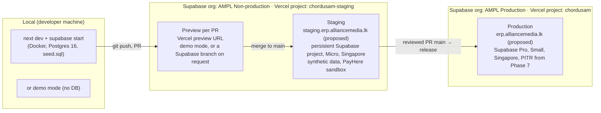
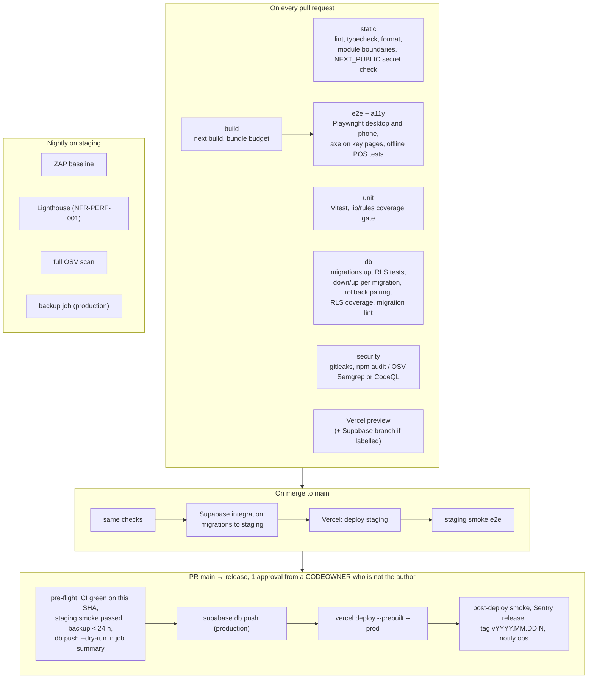

# 24: DevOps plan for ChordusAM (environments, CI/CD, hosting, operations and cost)

**Date:** 9 November 2026 · **Author:** OPS, DevOps lead (discovery team) · **Status:** Draft for review

**Upstream read:** `docs/discovery/00-brief.md` (sections 5 and 7), `CLAUDE.md`, `.github/workflows/ci.yml`, `package.json`, `playwright.config.ts`, `vitest.config.ts`, `supabase/config.toml`, `.env.example`, `lib/env.ts`, `tests/db/rls.test.ts`, `docs/phase-0.md`, `docs/discovery/20-solution-design.md` (ADR-01 to ADR-18, sections 3, 5.1, 7.7, 8, 9, 10, 11), `15-compliance-security.md` (sections 2, 4, 6, 7, 8), `14-business-case.md` (sections 3.3, 3.6, 3.7, 7.2, A-14), `10-brd.md` (section 9), `13-ux-design.md` (section 6.3), research R3 and R4.

**Summary.** ChordusAM can run cheaply and safely on the stack it already has, but only if four things are set up before Phase 1 holds real personal data. First, **production must be a separate, locked-down Supabase organisation in Singapore**, with Vercel functions pinned to `sin1`, while developers work in a second, non-production organisation that holds staging and the per-PR preview branches. Second, **production deploys go through a two-person release step**: merge to `main` deploys to staging, and a reviewed pull request from `main` into a `release` branch deploys migrations (`supabase db push`) and then the app. GitHub's "required reviewers" on deployment environments do not work for private repositories on the Free or Team plans, so the approval has to live in branch protection instead. Third, **backups must not depend on Supabase alone**: daily Supabase backups now, point-in-time recovery (PITR) from Phase 7, and a nightly encrypted `pg_dump` plus a Storage copy to a second provider, with a monthly copy kept in Sri Lanka and a restore drill every quarter. Supabase's own backups do not include Storage files. Fourth, **monitoring that someone actually reads**: Sentry for errors, a log drain to Axiom, Better Stack uptime checks and heartbeat ("dead man's switch") monitors on every scheduled job, and a database health view that checks queue age, POS sync lag and the audit hash chain, with alerts sent by email to named people. At AMPL's size this costs about **USD 157 a month before payroll and POS go live, and about USD 312 a month after** (PITR adds USD 100). With the CFO's AI-tools line that is USD 412 (about LKR 137,000), which puts **NFR-COST-001 (LKR 200,000 a month all-in) at risk by about LKR 37,000 a month** once maintenance is added. The cost levers are listed in section 8. A 10-studio SaaS would cost about USD 673 a month in infrastructure, or about USD 67 per studio.

> **Method and limits.** Searches were run on 9 November 2026. This session could not fetch `supabase.com` or `vercel.com` directly (network allow-list), so their prices come from search-result summaries of those pages and from secondary sources. Prices that rest only on a secondary source, or that conflict, are marked **(unverified)**. All prices are list prices in USD, at **LKR 333 per USD** (`14-business-case.md` A-01).

---

## Contents

1. [Summary of decisions](#1-summary-of-decisions)
2. [Environments](#2-environments)
3. [CI/CD pipeline](#3-cicd-pipeline)
4. [Hosting, region, CDN and runtimes](#4-hosting-region-cdn-and-runtimes)
5. [Observability](#5-observability)
6. [Backup, restore and disaster recovery](#6-backup-restore-and-disaster-recovery)
7. [Offline POS and PWA operations](#7-offline-pos-and-pwa-operations)
8. [Cost model and guardrails](#8-cost-model-and-guardrails)
9. [Runbooks, on-call and access management](#9-runbooks-on-call-and-access-management)
10. [Risks and open questions](#10-risks-and-open-questions)

---

## 1. Summary of decisions

| #      | Decision                                                                                                                                                                                                                            | Why                                                                                                                                                                                                               | Traces to                         |
| ------ | ----------------------------------------------------------------------------------------------------------------------------------------------------------------------------------------------------------------------------------- | ----------------------------------------------------------------------------------------------------------------------------------------------------------------------------------------------------------------- | --------------------------------- |
| OPS-01 | **Four environments:** local (Supabase CLI), preview per PR (Vercel preview; Supabase branch only when a PR needs a real database), staging (persistent), production                                                                | Matches the "one phase per branch" rule in `CLAUDE.md`: few long-lived PRs, so per-PR database branches are rarely needed                                                                                         | NFR-SEC-020                       |
| OPS-02 | **Two Supabase organisations:** `AMPL Production` (two owners, no developers) and `AMPL Non-production` (staging plus preview branches, developers as members)                                                                      | On the Pro plan, member roles apply to the whole organisation, so a second organisation is the cheap way to keep developers out of production (about USD 15 a month more)                                         | NFR-SEC-019, 15 §4.10             |
| OPS-03 | **Supabase branching is attached to the staging project, not to production.** Production gets migrations only from CI                                                                                                               | The GitHub integration applies migrations automatically to the project it is linked to. That is right for staging and wrong for production                                                                        | ADR-14, NFR-SEC-020               |
| OPS-04 | **Release by reviewed PR into `release`**, which triggers a GitHub Actions job: backup check, `supabase db push`, then `vercel deploy --prod`. Tags are written by the job                                                          | Environment "required reviewers" are not available to private repositories on Free or Team                                                                                                                        | NFR-SEC-018                       |
| OPS-05 | **Expand and contract migrations** only. The app currently in production must work with the new schema. Rollback is "redeploy the previous app" plus a forward fix; down scripts stay for CI and for non-production                 | Makes Vercel's instant rollback safe; avoids the destructive-rollback risk (G-08)                                                                                                                                 | CLAUDE.md, G-08                   |
| OPS-06 | **Singapore** for Supabase (`ap-southeast-1`), Vercel functions (`sin1`), the off-site backup bucket (APAC hint) and the WhatsApp BSP's local storage. Node runtime for every route                                                 | Agrees with ADR-14 and 15 §4.11. Function and database in the same region matters far more than Colombo to Singapore versus Mumbai                                                                                | ADR-14, NFR-PRIV-013              |
| OPS-07 | **Backups in three layers:** Supabase daily (now) then PITR (from Phase 7); nightly encrypted dump plus Storage sync to Cloudflare R2; monthly encrypted copy on AMPL-owned media in Colombo                                        | Supabase backups exclude Storage files; IRD "records in Sri Lanka" (15 L9); a provider account loss must not mean data loss                                                                                       | NFR-SEC-016, NFR-AVAIL-003        |
| OPS-08 | **Observability on free or cheap tiers:** Sentry, Vercel and Supabase log drains to Axiom, Better Stack uptime and heartbeat monitors, a SQL health view, email alerts to named roles. One paid Better Stack responder from Phase 7 | Small team: alerts must go to a person, not a dashboard                                                                                                                                                           | NFR-AVAIL-001, NFR-AUD-009, TR-07 |
| OPS-09 | **POS service worker updates only at a safe point** (no open sale, queue drained or compatible), with a server-side minimum client version and a fleet view of every device                                                         | A forced update mid-shift could strand queued sales                                                                                                                                                               | NFR-AVAIL-002, NFR-SEC-014        |
| OPS-10 | **Move the repository into an AMPL GitHub organisation** on GitHub Team (USD 4 a user a month, unverified)                                                                                                                          | The repo sits under a personal account today (`origin` is `github.com/Thosay97/ChordusAM`). Company systems should be owned by the company, and Team gives branch protection and rulesets on private repositories | NFR-SEC-018, NFR-AUD-010          |

---

## 2. Environments

### 2.1 The four environments

| Environment    | App                                                                                                                   | Database                                                                                                                                                                                                                                                                                                                 | Data                                                                                                                                                        | Who can reach it                                 | Used for                                                                                                                  |
| -------------- | --------------------------------------------------------------------------------------------------------------------- | ------------------------------------------------------------------------------------------------------------------------------------------------------------------------------------------------------------------------------------------------------------------------------------------------------------------------ | ----------------------------------------------------------------------------------------------------------------------------------------------------------- | ------------------------------------------------ | ------------------------------------------------------------------------------------------------------------------------- |
| **Local**      | `npm run dev` on port 3000                                                                                            | `supabase start` (Docker) using `supabase/config.toml` and `supabase/migrations/`; or demo mode; or a throwaway Postgres for `npm run test:db`                                                                                                                                                                           | `supabase/seed.sql` (synthetic)                                                                                                                             | The developer                                    | Building, unit and RLS tests, quick e2e                                                                                   |
| **CI**         | `next start` in demo mode (as today)                                                                                  | Postgres service container in GitHub Actions. Move from `postgres:16` to an image with `pg_cron` and `pgmq` (for example `supabase/postgres`, to be confirmed in SPK-14)                                                                                                                                                 | Test fixtures only                                                                                                                                          | GitHub Actions                                   | Required checks (section 3)                                                                                               |
| **Preview**    | Vercel preview deployment per PR (built by the `chordusam-staging` Vercel project)                                    | **Default: none (demo mode)**. On request (PR label `db-preview`), a Supabase preview branch of the **staging** project, created by the Supabase GitHub integration, with migrations run and `seed.sql` loaded ([Supabase GitHub integration](https://supabase.com/docs/guides/deployment/branching/github-integration)) | Seed only. A new branch is reseeded; manual data is lost ([Supabase branches](https://supabase.com/docs/guides/deployment/branching/working-with-branches)) | The team (Vercel Authentication on previews)     | UI review by Thoshan and module owners, migration review                                                                  |
| **Staging**    | Vercel project `chordusam-staging`, production branch `main`, custom domain (proposed `staging.erp.alliancemedia.lk`) | Persistent Supabase project in the non-production organisation, Micro compute, `ap-southeast-1`. Branching enabled here, with `main` as its production branch                                                                                                                                                            | Synthetic generator at NFR-SCALE-004 volume; never production copies                                                                                        | Team and UAT users (Abilasini, Janaka) with MFA  | UAT, performance tests, PayHere sandbox (SPK-06), ADMS device test (SPK-05), ZAP scans, restore drills, release candidate |
| **Production** | Vercel project `chordusam`, production branch `release`, `regions: ["sin1"]`                                          | Supabase Pro in the production organisation, Small compute (needed for PITR, unverified), `ap-southeast-1`; **not** linked to the GitHub integration                                                                                                                                                                     | Real data                                                                                                                                                   | Staff, portals, token links; two Supabase owners | Live use                                                                                                                  |

**Why two Vercel projects, not Vercel custom environments.** A separate project for staging keeps staging on a "production" deployment of its own project, so it has a stable custom domain without deployment protection getting in the way of PayHere's server-to-server `notify_url` (PayHere needs a public URL and cannot call localhost, [PayHere Checkout API](https://support.payhere.lk/api-&-mobile-sdk/checkout-api), [PayHere sandbox](https://support.payhere.lk/sandbox-and-testing)). Community guides say the PayHere merchant secret is issued per domain (unverified), which also argues for one stable staging domain rather than changing preview URLs. Use Vercel's "Ignored Build Step" so the production project builds only the `release` branch and the staging project builds `main` and PRs, so nothing is built twice. Projects cost nothing extra on Pro; seats do.

### 2.2 Preview databases: branching versus a shared staging database

| Option                                                                                                                 | Cost a month (AMPL)                                                                                                                                                                                                                                | Good                                                                                   | Bad                                                                                                                                      |
| ---------------------------------------------------------------------------------------------------------------------- | -------------------------------------------------------------------------------------------------------------------------------------------------------------------------------------------------------------------------------------------------- | -------------------------------------------------------------------------------------- | ---------------------------------------------------------------------------------------------------------------------------------------- |
| (a) Supabase branch for **every** PR                                                                                   | USD 0.01344 per branch-hour, about USD 0.32 a day for a Micro branch, not covered by the compute credit ([Supabase branching usage](https://supabase.com/docs/guides/platform/manage-your-usage/branching)). 20 PRs open 3 days each: about USD 19 | Each PR has its own real database, migrations proven on Supabase itself                | Most PRs do not need it; phase PRs stay open for weeks (a branch open 30 days is about USD 10); outside the spend cap (secondary source) |
| (b) One shared staging database for all previews                                                                       | USD 0 extra                                                                                                                                                                                                                                        | Cheapest                                                                               | Unmerged migrations from two PRs collide; one bad PR breaks staging for UAT                                                              |
| **(c) Recommended: demo-mode previews by default, a branch on request (label `db-preview`), staging only from `main`** | About **USD 7** (about 20 branch-days a month)                                                                                                                                                                                                     | Pays only when a PR changes the schema or needs real auth; staging stays clean for UAT | The developer has to add the label; branch data is seed only                                                                             |

Every PR still gets a real database in CI (the Postgres service container), so schema and RLS correctness never depend on the preview choice. Delete branches when the PR closes (the integration's default; check in SPK-OPS-01).

### 2.3 Configuration per environment, entity and tenant

| Layer                                                                     | Where it lives                                                                                                                                | Examples                                                                                                                                                | Changed by                                         |
| ------------------------------------------------------------------------- | --------------------------------------------------------------------------------------------------------------------------------------------- | ------------------------------------------------------------------------------------------------------------------------------------------------------- | -------------------------------------------------- |
| Infrastructure and secrets per **environment**                            | Vercel environment variables (Production, Preview, Development scopes; branch-specific Preview values for `main`), GitHub environment secrets | Supabase URL and keys, field-encryption keys (`CHORDUS_FIELD_KEY_V1`, different per environment, 15 §4.3), worker shared secret, Resend key, Sentry DSN | Owner or Tech Lead, logged in the secrets register |
| Business settings per **entity** (AMPL Sri Lanka, Media Digital SG later) | Database: `entities`, `policy_settings`, `doc_sequences`, `integration_connections` (20 §3.4, §8.1)                                           | Timezone, base currency, numbering prefixes, tax profile, PayHere merchant ID, sender email domain, WhatsApp sender                                     | Admins in the UI (CLAUDE.md: policy is data)       |
| Per **tenant** (SaaS later)                                               | Database, tenant-scoped, secrets encrypted with the field-encryption module (20 §8.1)                                                         | Branding, OAuth tokens for the tenant's accounting package, the tenant's PayHere merchant secret                                                        | Tenant admin                                       |
| **Feature switches** (dark launch, staged rollout per location)           | `policy_settings` keys, read through one helper; no third-party flag service                                                                  | `pos.enabled` for one location, `notifications.whatsapp.enabled`                                                                                        | Admins                                             |

In the single-tenant MVP, integration secrets stay in environment variables (CLAUDE.md, 20 §8.1). In non-production, every integration points at a sandbox: PayHere sandbox (`sandbox.payhere.lk`, payments are simulated, [PayHere sandbox](https://support.payhere.lk/sandbox-and-testing)), a Resend test domain that only delivers to team addresses, and a WhatsApp test number.

### 2.4 Seed data strategy

| Data                                                                                                                                                                                                                                                 | How it gets there                                                                                                                                                       | Environments       |
| ---------------------------------------------------------------------------------------------------------------------------------------------------------------------------------------------------------------------------------------------------- | ----------------------------------------------------------------------------------------------------------------------------------------------------------------------- | ------------------ |
| Schema, RLS, functions, `pg_cron` schedules                                                                                                                                                                                                          | Migrations in `supabase/migrations/` with rollbacks in `supabase/rollbacks/` (CLAUDE.md)                                                                                | All                |
| **Reference data needed in production** (currencies, starter EPF/ETF/APIT and WHT tables, starter approval policies, tax codes)                                                                                                                      | Inserted by migrations as the first effective-dated version, then edited as data in the UI (NFR-COST-003). Never seeded only in `seed.sql`, or production would lack it | All                |
| Synthetic demo set (`supabase/seed.sql`): one tenant, two entities, brands (The Studio LK, Varnam TV and others), rooms, a catalogue, a few employees with fake NICs that pass NFR-DATA-002 validation, mixed-script names (Sinhala, Tamil, English) | `supabase start`, preview branches, CI fixtures                                                                                                                         | Local, CI, preview |
| Volume set at NFR-SCALE-004 (50 employees, 500 talent, 20,000 POS sales a year, 5 years)                                                                                                                                                             | `scripts/seed-staging.ts` (to be written), deterministic random seed                                                                                                    | Staging only       |
| Demo users with a known password                                                                                                                                                                                                                     | `npm run seed:users`, **guarded**: refuses unless the Supabase project ref is on a non-production allow-list (G-03)                                                     | Local, staging     |
| Production bootstrap: tenant, entity, first two Admins                                                                                                                                                                                               | One-off `scripts/bootstrap-production.ts`, run by an owner, two people present, audited through `write_system_audit()`                                                  | Production only    |
| Opening data (employees, balances, vendors)                                                                                                                                                                                                          | Import profiles (BR-ADM-008), rehearsed end to end on staging first                                                                                                     | Production         |

**Never** copy production data into staging or previews (NFR-SEC-020). If a bug needs production-shaped data, write a reviewed extract that drops or replaces every Restricted field.

### 2.5 Secrets management

| Secret                                                                                   | Lives in                                                                                                         | Never in                         | Rotation                                    |
| ---------------------------------------------------------------------------------------- | ---------------------------------------------------------------------------------------------------------------- | -------------------------------- | ------------------------------------------- |
| Supabase publishable key (`sb_publishable_…`), project URL                               | Vercel env (public is fine)                                                                                      | n/a                              | On key migration (TR-11)                    |
| Supabase secret key (`sb_secret_…`, replaces `service_role`)                             | Vercel env, Production and Preview separately, marked sensitive; only server jobs and webhooks use it            | Browser, `NEXT_PUBLIC_*`, logs   | Yearly and on leaver (15 §4.5)              |
| Field-encryption and blind-index keys                                                    | Vercel env, production only, sensitive; escrow copy in the password manager held by two Admins                   | Database, GitHub, staging        | Yearly with re-encryption job (NFR-SEC-007) |
| Supabase access token and production database password (for `supabase db push` in CI)    | GitHub **environment** secrets on the `production` environment, which only the `release` branch can use          | Repository-level secrets, Vercel | Every 90 days and on leaver                 |
| Worker shared secret (pg_cron calling `/api/internal/workers/*` through `pg_net`)        | Supabase Vault (read by the cron job) and Vercel env                                                             | Migration files                  | Yearly                                      |
| PayHere merchant secret, Resend key, BSP token, Sentry auth token, R2 keys, Vercel token | Vercel env or GitHub environment secrets, per environment                                                        | Code, `.env.example` values      | Yearly and on leaver                        |
| Backup encryption key (`age` key pair)                                                   | Public key in the repo (not secret); private key offline in the password manager and on paper in the office safe | GitHub, R2, Supabase             | Only if compromised; re-encrypt archive     |

Controls already in place or planned: gitleaks in CI (today), `.env*` ignored, `lib/env.server.ts` that fails closed in production (G-14), a CI check that no variable named `*KEY*`, `*SECRET*` or `*TOKEN*` has the `NEXT_PUBLIC_` prefix (15 §4.5), and a secrets register in `docs/runbooks/secrets-register.md` (names, owner, location, last rotated; never values). Two notes: the `gitleaks/gitleaks-action` needs a free licence key for organisation accounts (`docs/phase-0.md` item 4), so after the move to an organisation, run the gitleaks CLI directly instead, which needs no licence. GitHub push protection on a private repository needs GitHub Secret Protection at USD 19 per active committer a month ([GitHub changelog](https://github.blog/changelog/2025-03-04-introducing-github-secret-protection-and-github-code-security/)); a free alternative is a gitleaks pre-commit hook on each developer machine.

---

## 3. CI/CD pipeline

### 3.1 Where we start

Today `.github/workflows/ci.yml` has two jobs. `check` runs in sequence: `npm ci`, lint, typecheck, format check, Vitest (unit tests and RLS tests against a `postgres:16` service, including the Phase 0 rollback round-trip in `tests/db/rls.test.ts`), `next build` in demo mode, Playwright install, and e2e on desktop and Pixel 7. `secret-scan` runs gitleaks. There is no `permissions:` block, actions are pinned by tag and not by SHA, there is no dependency check, and nothing deploys (G-15).

### 3.2 Target pipeline

### 3.3 Jobs and required checks

Jobs run in parallel where they can. Each has `timeout-minutes` and `permissions: contents: read` by default. All third-party actions are pinned by commit SHA and kept current by Dependabot.

| Job                   | Runs                                                                                                                                                                                                                                                                                                                                                                                                                                                                                                                                             | Required to merge | Controls                             |
| --------------------- | ------------------------------------------------------------------------------------------------------------------------------------------------------------------------------------------------------------------------------------------------------------------------------------------------------------------------------------------------------------------------------------------------------------------------------------------------------------------------------------------------------------------------------------------------ | ----------------- | ------------------------------------ |
| `static`              | `lint`, `typecheck`, `format:check`; ESLint import-boundary rules (20 ADR-02, TR-03); script that fails if any `NEXT_PUBLIC_` variable name contains KEY, SECRET or TOKEN                                                                                                                                                                                                                                                                                                                                                                        | Yes               | NFR-SEC-008, TR-03                   |
| `unit`                | Vitest unit tests; coverage gate on `lib/rules/**` (CLAUDE.md: every rule function has tests). Threshold set by QA in `23-test-strategy.md`                                                                                                                                                                                                                                                                                                                                                                                                      | Yes               | CLAUDE.md                            |
| `db`                  | (1) Every file in `supabase/migrations/` has a matching `supabase/rollbacks/<name>.down.sql`. (2) Apply all migrations on an empty database. (3) RLS tests (`npm run test:db`). (4) For each migration, newest first: down, then up again, then the RLS suite once more. (5) Every table in `public` has RLS on and the restrictive tenant policy (TR-04). (6) Migration lint for locking operations, for example Squawk (open source, not evaluated this session). (7) Reset `pgmq`, `cron` and `internal` schemas between runs (TR-12, SPK-14) | Yes               | CLAUDE.md, NFR-SEC-005, TR-04, TR-12 |
| `build`               | `next build` in demo mode; upload `.next` as an artifact so e2e does not rebuild; fail if the first-load JavaScript of the POS and Me hubs grows past a budget (NFR-PERF-001)                                                                                                                                                                                                                                                                                                                                                                    | Yes               | NFR-PERF-001                         |
| `e2e`                 | Playwright, desktop and Pixel 7 projects, 2 shards; `@axe-core/playwright` on each MVP screen, fail on any critical or serious issue (NFR-A11Y-001); POS offline tests with `context.setOffline(true)` and a service-worker update test (section 7)                                                                                                                                                                                                                                                                                              | Yes               | NFR-A11Y-001, NFR-AVAIL-002          |
| `security`            | gitleaks CLI on the full history; `npm audit --omit=dev --audit-level=high` or OSV-Scanner; SAST: CodeQL if the repo is public or GitHub Code Security is bought (USD 30 per active committer, [GitHub changelog](https://github.blog/changelog/2025-03-04-introducing-github-secret-protection-and-github-code-security/)), otherwise Semgrep Community Edition (free, not evaluated this session)                                                                                                                                              | Yes               | NFR-SEC-018                          |
| Vercel preview        | Status check posted by Vercel                                                                                                                                                                                                                                                                                                                                                                                                                                                                                                                    | Yes               |                                      |
| Supabase branch       | Status check posted by the Supabase integration when a branch exists (migration errors show on the commit's check run, [Supabase GitHub integration](https://supabase.com/docs/guides/deployment/branching/github-integration))                                                                                                                                                                                                                                                                                                                  | Only if labelled  |                                      |
| `nightly` (scheduled) | OWASP ZAP baseline (passive scan, [zaproxy/action-baseline](https://github.com/zaproxy/action-baseline)) against staging; Lighthouse CI on staging with a mobile profile; full OSV scan; opens an issue on new findings                                                                                                                                                                                                                                                                                                                          | No (alerts)       | NFR-SEC-010, NFR-PERF-001            |

**Dependency updates.** Use **Dependabot** (built into GitHub, free) for `npm` and `github-actions`, weekly, with minor and patch updates grouped into one PR and security updates raised at once. Renovate is the alternative if grouping or scheduling needs grow; it is not needed now. Nothing auto-merges: a person reads the changelog of Next.js, Supabase and anything in the POS bundle.

**Branch protection on `main` and `release`.** Require the checks above, one approving review, CODEOWNERS review for `supabase/migrations/**`, `supabase/rollbacks/**`, `lib/auth/**`, `lib/rules/pay/**`, `lib/crypto/**` and `.github/**`, linear history, no force pushes, and no bypass for admins except the break-glass procedure (section 9.4). On a private repository these need GitHub Team (or Pro for a personal account). With AI-assisted development, the human review of migrations and RLS is the most important gate (TR-03, TR-04).

**CI cost.** At about 12 minutes per PR run across parallel jobs and roughly 150 runs a month, CI uses about 1,800 Linux minutes, inside the 3,000 included in GitHub Team; overage is about USD 0.006 a minute since 1 January 2026 ([cicdcalculator](https://cicdcalculator.com/github-actions-pricing-changes-2026), secondary, unverified). The existing `concurrency: cancel-in-progress` setting stays. Cache the npm store and the Playwright browser.

### 3.4 Database migration deploy strategy

| Rule                                                                                                                                                                                                                          | Why                                                                                     |
| ----------------------------------------------------------------------------------------------------------------------------------------------------------------------------------------------------------------------------- | --------------------------------------------------------------------------------------- |
| **Expand, deploy, contract.** A release may add tables, nullable columns, new functions and policies. Renames, drops and `not null` on existing columns happen in a later release, after the app no longer uses the old shape | The running app and the previous app (rollback target) must both work with the schema   |
| Migrations run **before** the app deploy in the release job. If the migration step fails, the app is not deployed                                                                                                             | The new app may need the new schema; the old app tolerates it                           |
| Each migration file is one transaction (`begin; … commit;`), except `create index concurrently`, which goes in its own file                                                                                                   | A failed file leaves nothing half-applied (check how the CLI wraps files in SPK-OPS-01) |
| `supabase db push --dry-run` output is written to the release job summary and read by the approver before merge                                                                                                               | The approver sees exactly what will run                                                 |
| Locking changes on large tables (`audit_log`, `journal_lines`) run outside 07:00 to 22:00 Colombo, announced 24 hours ahead (NFR-AVAIL-001 window)                                                                            | Availability target                                                                     |
| **Change freeze** for anything touching payroll from the payroll cut-off to payslip release (dates as policy data), and for POS on studio peak days the owner names                                                           | Payroll week and POS are the riskiest times                                             |
| The release job connects through the Supavisor pooler, not the direct host, because GitHub-hosted runners have no IPv6 (Supabase direct connections are IPv6 unless the IPv4 add-on is bought; not re-verified this session)  | Avoids a paid add-on                                                                    |
| Down scripts never run on production unless `chordus.allow_destructive_rollback = 'on'` is set in that session, a fresh backup exists, and two people agree (G-08)                                                            | An append-only audit log cannot be rebuilt                                              |

### 3.5 Release tagging and rollback

- **Versioning.** Calendar versions, `vYYYY.MM.DD.N`, created by the release job after a successful deploy, with release notes generated from merged PR titles. The Sentry release name is the git SHA; the version shows in the app footer and in the POS device record.
- **App rollback.** Vercel instant rollback to the previous production deployment (one click, no rebuild). Allowed at any time, because of expand and contract. Environment variables are captured per deployment, so a rolled-back deployment keeps its own values.
- **Database rollback.** Forward fix by default: a new migration that corrects the problem. If data was damaged, restore with PITR into a **new** project and copy back the affected rows (RB-04), rather than rewinding production in place.
- **POS clients** need their own rollback path (section 7.1): the server keeps accepting the previous queue format for at least two releases.

---

## 4. Hosting, region, CDN and runtimes

### 4.1 Region

| Option                                                  | Latency from Colombo                                                                                                                                                                                        | Residency and law                                                                                                     | Verdict                  |
| ------------------------------------------------------- | ----------------------------------------------------------------------------------------------------------------------------------------------------------------------------------------------------------- | --------------------------------------------------------------------------------------------------------------------- | ------------------------ |
| **Singapore**: Supabase `ap-southeast-1`, Vercel `sin1` | About 65 ms from a Sri Lanka Telecom line in one user-reported test ([lankawebsites.com speed test](https://lankawebsites.com/speed-test), unverified)                                                      | One region serves the LK entity and a future SG entity; Singapore's mature law helps a transfer assessment (15 §4.11) | **Recommended** (ADR-14) |
| Mumbai: Supabase `ap-south-1`, Vercel `bom1`            | Likely lower. No Colombo measurement found; from Indian cities Mumbai is 50 to 90 ms faster than Singapore ([Techplained](https://www.techplained.com/india-cloud-latency), secondary), Colombo will differ | SG entity data would leave Singapore; India's regime not researched (15 §4.11)                                        | Fallback only            |
| No choice (Vercel default `iad1`, Washington DC)        | Very high: every database call from a function would cross the world                                                                                                                                        | Worst transfer story                                                                                                  | Must not happen (G-04)   |

Both Supabase regions exist ([Supabase regions](https://supabase.com/docs/guides/platform/regions)), and Vercel lists `sin1` as AWS `ap-southeast-1` and `bom1` as `ap-south-1` ([Vercel regions](https://vercel.com/docs/regions)). The Supabase region is fixed per project; moving means a new project and a migration (same source, unverified wording), so create production in Singapore from the start.

**What matters more than the region choice:** the function and the database must sit in the same region. A server component that makes five database calls pays the function-to-database round trip five times, but the user-to-function round trip once. Pin functions with `"regions": ["sin1"]` in `vercel.json`; Pro allows up to 5 function regions, but multi-region failover is Enterprise only ([Vercel function regions](https://vercel.com/docs/functions/configuring-functions/region)), so one region is the plan. The 2.5 s p75 budget (NFR-PERF-001) is dominated by JavaScript size and phone CPU, not by a 30 ms latency difference. **SPK-OPS-02** measures from AMPL's office line and a Dialog 4G phone to both regions before the production project is created.

**PDPA cross-border notes (from 15).** Sri Lankan personal data leaves Sri Lanka whichever region is chosen, because neither Supabase nor Vercel has a Sri Lankan region. The transfer file (NFR-PRIV-013) must list every sub-processor this plan adds, not only Supabase and Vercel:

| Sub-processor added by this plan | Data it receives                            | Region (to confirm)                                     | Mitigation                                                                                       |
| -------------------------------- | ------------------------------------------- | ------------------------------------------------------- | ------------------------------------------------------------------------------------------------ |
| Sentry                           | Error events and stack traces               | US or EU data region (no Asia region known, unverified) | `sendDefaultPii: false`, scrubber, no request bodies on HR, payroll and payment routes (15 §4.9) |
| Axiom                            | Application and platform logs               | US or EU (unverified)                                   | Logger redaction of NIC, bank, salary and tokens; 30-day retention                               |
| Better Stack                     | URLs, response codes, heartbeat pings       | EU or US (unverified)                                   | No personal data in monitored URLs                                                               |
| Cloudflare R2                    | Encrypted database dumps and Storage copies | APAC location hint (unverified)                         | Encrypted with an `age` key R2 never holds, so R2 sees only ciphertext                           |
| Resend                           | Email addresses and notification text       | Sending region selectable (unverified)                  | Notifications carry links, never Restricted values (NFR-PRIV-015)                                |

Add the **monthly encrypted copy kept in Colombo** (section 6) to answer the IRD "records in Sri Lanka" question (15 L9) at almost no cost. It is a legal review item, not a settled requirement.

### 4.2 CDN, edge and Node runtimes

| Concern                  | Plan                                                                                                                                                                                                                                                                                                      |
| ------------------------ | --------------------------------------------------------------------------------------------------------------------------------------------------------------------------------------------------------------------------------------------------------------------------------------------------------- |
| Static assets            | Vercel's CDN serves hashed JS, CSS, fonts (already self-hosted through `@fontsource`) and icons with long cache lifetimes. No separate CDN                                                                                                                                                                |
| Pages with personal data | `Cache-Control: private, no-store` on every authenticated page and API response; never cache staff HTML in the service worker (NFR-SEC-015)                                                                                                                                                               |
| Runtime                  | **Node.js** for all route handlers, server actions and workers, in `sin1`. No Edge runtime routes: business rules, `node:crypto` field encryption and `pg` need Node (ADR-11)                                                                                                                             |
| Middleware               | Keep it to the Phase 0 cookie refresh. It runs at Vercel's edge near the user, so it must not read or write business data (20 §9.5). Next.js 15.5 offers Node middleware (not re-verified); not needed now                                                                                                |
| Images                   | Avoid Next.js image optimisation for uploads (it is metered); receipts and condition photos are re-encoded once on upload (20 §9.5)                                                                                                                                                                       |
| Domain and DNS           | A subdomain of alliancemedia.lk (proposed `erp.`), DNS at AMPL's current DNS host; SPF, DKIM and DMARC for the sending subdomain (proposed `notify.alliancemedia.lk`). Optional Supabase custom domain so magic links show an AMPL address rather than `*.supabase.co` (about USD 10 a month, unverified) |
| Plans                    | Vercel **Pro** is required: Hobby is for non-commercial personal use only ([Vercel fair use](https://vercel.com/docs/limits/fair-use-guidelines)). Supabase **Pro** for daily backups, PITR, branching and log drains                                                                                     |

---

## 5. Observability

### 5.1 What we collect

| Signal                      | Tool and setup                                                                                                                                                                                                                                                                                                                                                                                                                                                                        | Retention                                         | Cost (section 8)                                        |
| --------------------------- | ------------------------------------------------------------------------------------------------------------------------------------------------------------------------------------------------------------------------------------------------------------------------------------------------------------------------------------------------------------------------------------------------------------------------------------------------------------------------------------- | ------------------------------------------------- | ------------------------------------------------------- |
| **Application logs**        | One JSON logger (`lib/log.ts`) with `request_id`, `tenant_id`, `entity_id`, `actor_type`, route, duration and outcome on every line, and a redaction list (NIC, bank, salary, tokens, OTPs, signed URLs). Vercel runtime logs are kept only 1 day on Pro ([Vercel observability limits](https://vercel.com/docs/observability/limits-and-pricing)), so send them to Axiom with a Vercel drain at USD 0.50 per GB ([Vercel Drains](https://vercel.com/blog/introducing-vercel-drains)) | 30 days in Axiom free tier                        | About USD 1                                             |
| **Database and auth logs**  | Supabase log drain to Axiom, available on Pro since March 2026 and billed per drain-hour and event ([Supabase blog](https://supabase.com/blog/log-drains-now-available-on-pro); rate not found). Turn on from Phase 7 if the rate is small; until then use the Supabase log explorer and the monthly Auth log review (15 §4.9)                                                                                                                                                        | Supabase short (plan-dependent); 30 days in Axiom | Unknown (unverified)                                    |
| **Errors**                  | Sentry Next.js SDK on server and browser, POS PWA included (offline transport so errors queue while offline). Source maps uploaded in the release job. PII scrubbing on, no request bodies on HR, payroll and payment routes (15 §4.9)                                                                                                                                                                                                                                                | Plan default                                      | USD 0 to 26                                             |
| **Traces**                  | Sentry tracing, 10% sample in general, 100% for `/api/pos/sync`, payroll commands and worker runs                                                                                                                                                                                                                                                                                                                                                                                     | Plan default                                      | Inside Sentry plan                                      |
| **Web performance**         | Sentry browser Web Vitals for real users (p75 LCP and INP on phones, NFR-PERF-001); Lighthouse nightly on staging                                                                                                                                                                                                                                                                                                                                                                     |                                                   | Inside Sentry                                           |
| **Business health metrics** | A SQL view `ops.health` read by `/api/internal/health` (protected): oldest message age and depth per pgmq queue, dead-letter count, last success per `pg_cron` job (`job_runs`), POS devices last seen and oldest unsynced sale, failed webhooks in 24 h, payroll run state, latest backup time, audit hash chain status (NFR-AUD-004)                                                                                                                                                | In the database                                   | USD 0                                                   |
| **Uptime**                  | Better Stack: HTTP check on `/login` and on `/api/health` (shallow, public) every 3 minutes; keyword check on the protected deep health endpoint; **heartbeat monitors** that expect a ping from each scheduled job (worker loop, nightly backup, daily hash anchor, PayHere reconciliation, SLA escalation) and alert if one is missed. Free tier: 10 monitors and heartbeats, 1 status page, email alerts ([Better Stack pricing](https://betterstack.com/pricing))                 |                                                   | USD 0, then USD 29 for one responder with phone and SMS |
| **Audit log monitoring**    | `pg_cron` every 5 minutes runs alert rules over `audit_log` and `access_log` and writes `ops_alerts`, which the outbox turns into email (WhatsApp in v1): role or permission granted; MFA factor removed; bank details changed; payroll edited after approval; more than N reveals by one user in a day; bulk export; PayHere bad signature or amount mismatch; POS sequence gap or large cash variance; failed sign-in spike; hash chain mismatch (15 §4.9, NFR-AUD-009)             | In the database                                   | USD 0                                                   |

Two rules keep this small. Every alert names a person who acts on it; if nobody would act, it is a report, not an alert. And alerts about ChordusAM being **down** must not travel through ChordusAM: uptime and heartbeat alerts go out through Better Stack, while business and security alerts go through ChordusAM's own outbox.

### 5.2 Alert routing

| Severity                      | Examples                                                                                                                                       | Goes to                                                                                      | How                                                                                      | Response target (07:00 to 22:00 Colombo)            |
| ----------------------------- | ---------------------------------------------------------------------------------------------------------------------------------------------- | -------------------------------------------------------------------------------------------- | ---------------------------------------------------------------------------------------- | --------------------------------------------------- |
| **P1: down or money at risk** | App or sync endpoint down; worker loop heartbeat missed for 15 minutes; PayHere amount mismatch; audit hash chain mismatch; suspected breach   | On-call developer, then Thoshan                                                              | Better Stack email to `ops@` group; from Phase 7 phone or SMS through one responder seat | Acknowledge 30 minutes; breach clock starts (RB-19) |
| **P2: degraded**              | Queue oldest message over its SLA; dead letters; POS device with sales unsynced over 4 hours; sequence gap; nightly backup missed; error spike | On-call developer; POS items also to the studio supervisor; backup items also to Thoshan     | Email                                                                                    | Same business day                                   |
| **P3: security event**        | Role grant, MFA reset, bank-detail change, bulk export, reveal threshold                                                                       | Admins (Thoshan, Fazlur, Gurpreet) and the DPO                                               | ChordusAM email, WhatsApp utility template in v1                                         | Review within 1 working day                         |
| **P3: business operations**   | Attendance import failed; payroll provider file mismatch (ADR-17); reconciliation items older than N days; integration sync failures           | Abilasini (attendance, payroll inputs), Janaka (payments, reconciliation, accounting export) | ChordusAM in-app and email                                                               | Within 1 working day                                |
| **Weekly digest**             | Error trends, slowest pages, cost to date, dependency alerts, access review due                                                                | Tech Lead and Thoshan                                                                        | Email                                                                                    | Read on Monday                                      |

### 5.3 Service level objectives

SLOs are internal targets that tell the team when to stop shipping features and fix reliability. Measured monthly in the 07:00 to 22:00 Colombo window unless stated.

| Service            | SLI (what is measured)                                                              | SLO                                                                  | Error budget a month                      | Source                      |
| ------------------ | ----------------------------------------------------------------------------------- | -------------------------------------------------------------------- | ----------------------------------------- | --------------------------- |
| **Core app**       | Share of 3-minute uptime checks on `/login` and `/api/health` that succeed          | 99.5%                                                                | About 2.3 hours (450 window hours × 0.5%) | NFR-AVAIL-001               |
| Core app speed     | p75 time to interactive on phones (Web Vitals)                                      | 2.5 s or less                                                        | n/a                                       | NFR-PERF-001                |
| **POS: selling**   | Sales that can be completed on a registered device, online or offline               | 99.9% of opening hours (the device keeps selling without the server) | About 20 minutes on 12-hour days          | NFR-AVAIL-002, NFR-PERF-002 |
| POS: sync          | Queued sales accepted by the server within 5 minutes of the device being online     | 99%                                                                  | 1% may take longer, none may be lost      | NFR-AVAIL-002               |
| POS: exactly once  | Duplicate or lost sales after sync (sequence gaps not explained by voids)           | **Zero** (any occurrence is a P2 incident)                           | None                                      | NFR-AVAIL-002, BRULE-022    |
| POS: sync endpoint | `/api/pos/sync` requests without a 5xx; p95 latency                                 | 99.5%; p95 under 2 s                                                 | 0.5%                                      | 20 §5.1                     |
| **Payroll**        | Availability during the payroll window (cut-off to payslip release)                 | 99.9% inside the window                                              | About 6 minutes (7 days × 15 hours)       | NFR-AVAIL-003               |
| Payroll            | Time from Admin approval to all payslips available in self-service                  | 30 minutes or less                                                   | n/a                                       | 20 §5.5                     |
| Payroll            | Payroll runs recomputed with identical results from stored inputs and rule versions | 100%                                                                 | None                                      | NFR-AUD-011                 |
| **Approvals**      | Time from submission to the approver's notification (email or in-app)               | p95 5 minutes or less (normally about 1 minute, SA-6)                | 5% may be slower                          | ADR-06, ADR-11, 20 §6.5     |
| Approvals          | SLA escalation job runs on schedule (heartbeat)                                     | 99% of runs                                                          | A missed run alerts at once               | 20 §6.5                     |
| Queues             | Oldest message age, notifications queue                                             | Under 5 minutes, 99% of the time; integrations under 15 minutes      | 1%                                        | TR-07                       |

If the core app budget is spent in a month, the next release contains only reliability fixes. For POS and payroll, one breach triggers a short written review (RB-19 template, without the breach-notification steps).

---

## 6. Backup, restore and disaster recovery

### 6.1 Targets

| Period                                     | RPO (data you can lose)                                                                                             | RTO (time to be working again)                                                                                                                    | Source                       |
| ------------------------------------------ | ------------------------------------------------------------------------------------------------------------------- | ------------------------------------------------------------------------------------------------------------------------------------------------- | ---------------------------- |
| Phases 1 to 6                              | 24 hours (Supabase daily backup); in practice under 24 hours because of the nightly off-site dump                   | 1 business day                                                                                                                                    | 15 §4.8, NFR-AVAIL-003       |
| **From Phase 7 (payroll) and POS go-live** | About 2 minutes with PITR (Supabase documentation, via 15 §4.8); POS sales also survive on the devices until synced | **8 business hours** for core; POS keeps selling offline for at least 8 hours or 500 sales, up to the policy maximum (72 hours proposed, 15 §4.7) | NFR-AVAIL-002, NFR-AVAIL-003 |

The 8-hour RTO and the 8-hour offline minimum are the same number, so a full-day outage would hit the POS limit. Set the POS offline maximum (policy data) to at least 24 hours so the RTO has room.

### 6.2 Backup layers

| Layer                                        | What                                                                                                                                                                                                                                                                                                                    | Schedule and retention                                                                                                                                                                                                                                                                       | Notes                                                                                                                                                                                                                                                                                          |
| -------------------------------------------- | ----------------------------------------------------------------------------------------------------------------------------------------------------------------------------------------------------------------------------------------------------------------------------------------------------------------------- | -------------------------------------------------------------------------------------------------------------------------------------------------------------------------------------------------------------------------------------------------------------------------------------------- | ---------------------------------------------------------------------------------------------------------------------------------------------------------------------------------------------------------------------------------------------------------------------------------------------- |
| 1. Supabase daily backups                    | Physical backup of the database                                                                                                                                                                                                                                                                                         | Daily, 7 days on Pro ([Supabase backups](https://supabase.com/docs/guides/platform/backups))                                                                                                                                                                                                 | **Do not include Storage objects**, only their metadata (same source). Daily backups stop when PITR is on                                                                                                                                                                                      |
| 2. PITR (from Phase 7)                       | Continuous WAL archive                                                                                                                                                                                                                                                                                                  | 7 days, USD 100 a month, billed hourly ([Supabase PITR usage](https://supabase.com/docs/guides/platform/manage-your-usage/point-in-time-recovery), [changelog](https://supabase.com/changelog/28438-moving-to-hourly-usage-based-billing-for-ipv4-custom-domain-and-point-in-time-recovery)) | A secondary source says PITR needs at least Small compute ([Axonbuild](https://axonbuild.com/blog/supabase-backup/), unverified); Supabase's own example bills a Small project with PITR. Not covered by the spend cap                                                                         |
| 3. Nightly logical dump to a second provider | `pg_dump --format=custom` of all schemas (including `auth`, `storage` metadata, `internal`, `cron`) plus roles, from a scheduled GitHub Actions workflow in the production environment, through the pooler; compressed, encrypted with `age` to AMPL's public key, uploaded to **Cloudflare R2** with object versioning | Nightly at 23:30 Colombo; keep 35 daily, 12 monthly, 7 yearly (tax records, 15 §8.3)                                                                                                                                                                                                         | Weekly in Phases 1 to 6 is the 15 §4.8 minimum; nightly costs the same. R2 Standard is USD 0.015 per GB-month with free egress ([Infratally](https://infratally.com/articles/cloudflare-r2-vs-aws-s3-vs-backblaze-b2-2026/), secondary, unverified). Pings a Better Stack heartbeat on success |
| 4. Storage objects                           | `rclone sync` from Supabase Storage (S3-compatible endpoint) to R2 through `rclone crypt`                                                                                                                                                                                                                               | Nightly; deleted files kept 90 days by versioning                                                                                                                                                                                                                                            | Restoring a database backup alone can leave metadata pointing at missing files                                                                                                                                                                                                                 |
| 5. Local copy in Sri Lanka                   | The latest monthly dump and the month's tax-record export (invoices, vouchers, receipts, WHT, payroll summaries), still encrypted, copied to an AMPL-owned encrypted drive kept in the office and a second one kept off-site by an Admin                                                                                | Monthly, on the first working day                                                                                                                                                                                                                                                            | Answers 15 L9 if the accountant confirms it is needed; also the "third copy" if every cloud account is lost                                                                                                                                                                                    |
| 6. Keys and configuration                    | Field-encryption keys, `age` private key, secrets register, hosted settings checklist (G-18)                                                                                                                                                                                                                            | On every change                                                                                                                                                                                                                                                                              | In the password manager, held by two Admins, plus a sealed paper copy. A backup without keys cannot be decrypted; a key without the backup is useless                                                                                                                                          |
| 7. Code                                      | GitHub repository; monthly `git bundle` in the local copy                                                                                                                                                                                                                                                               | Monthly                                                                                                                                                                                                                                                                                      | Protects against losing the GitHub account                                                                                                                                                                                                                                                     |

The dump is taken with a dedicated read-only backup role, so a leaked backup credential cannot change data.

### 6.3 Disaster scenarios

| Scenario                                               | Likelihood | Recovery                                                                                                                                                            | Runbook      |
| ------------------------------------------------------ | ---------- | ------------------------------------------------------------------------------------------------------------------------------------------------------------------- | ------------ |
| Bad deploy (app bug)                                   | High       | Vercel instant rollback, minutes                                                                                                                                    | RB-02        |
| Bad migration (wrong data change)                      | Medium     | Forward-fix migration; if data was damaged, PITR restore into a new project and copy back affected rows                                                             | RB-03, RB-04 |
| Accidental delete by a user or a job                   | Medium     | Audit log shows the before image (redacted columns excepted); PITR or nightly dump for the rest                                                                     | RB-04, RB-05 |
| Supabase regional outage                               | Low        | Wait (POS sells offline; staff phones show read-only cache, NFR-AVAIL-004); if beyond RTO, restore the nightly dump into a new project in Mumbai and repoint Vercel | RB-07, RB-05 |
| Vercel outage                                          | Low        | Wait; POS offline. No second host is kept warm (cost)                                                                                                               | RB-08        |
| Supabase or Vercel account taken over, project deleted | Low        | Restore from R2 (second provider, separate credentials) or from the local copy                                                                                      | RB-05, RB-19 |
| Encryption key lost                                    | Low        | Escrow copy; without it, Restricted fields are gone by design                                                                                                       | RB-17        |
| Vendor exit (price or policy change)                   | Low        | Data is plain Postgres; dump restores to any Postgres host. Auth and Storage need replacing (ADR-01)                                                                | n/a          |

### 6.4 Restore drills

| Drill                                                                                                                                                                                                                    | When                                                 | Pass criteria                                                                                                                                                                                                                  |
| ------------------------------------------------------------------------------------------------------------------------------------------------------------------------------------------------------------------------ | ---------------------------------------------------- | ------------------------------------------------------------------------------------------------------------------------------------------------------------------------------------------------------------------------------ |
| **Full restore from R2**: download the latest dump, decrypt with the escrowed key, restore into a scratch Supabase project in the non-production organisation, restore Storage objects, point a preview deployment at it | Once before Phase 1 go-live (G0), then **quarterly** | Row counts match the production snapshot report; RLS test suite passes against it; audit hash chain verifies; one encrypted field decrypts with the escrowed key; a payslip PDF opens; elapsed time recorded and under the RTO |
| PITR restore to a chosen minute, into a new project                                                                                                                                                                      | Twice a year from Phase 7                            | Restored to within 2 minutes of the target time                                                                                                                                                                                |
| Local-copy restore (from the Colombo drive)                                                                                                                                                                              | Yearly                                               | Same as the full restore                                                                                                                                                                                                       |
| POS offline drill: tablet in airplane mode for a shift with real sales on staging                                                                                                                                        | Before POS go-live, then twice a year                | Every sale synced once, receipts numbered without unexplained gaps (NFR-AVAIL-002)                                                                                                                                             |

Each drill is recorded in `docs/runbooks/drills/YYYY-QN.md` (who, when, how long, what broke) as evidence for NFR-AVAIL-003 and the PDPA accountability duty.

---

## 7. Offline POS and PWA operations

### 7.1 Service worker update strategy

| Rule                                                                                                                                                                                                                                                                                                                 | Why                                                                 |
| -------------------------------------------------------------------------------------------------------------------------------------------------------------------------------------------------------------------------------------------------------------------------------------------------------------------- | ------------------------------------------------------------------- |
| One service worker per release, built in CI (for example with Serwist, not evaluated this session), precaching the POS app shell and the catalogue snapshot. Version = release tag                                                                                                                                   | Every device can report exactly what it runs                        |
| The POS **never** calls `skipWaiting()` on its own. A new worker installs in the background and the POS shows "Update ready". It activates only at a safe point: no open sale **and** the queue is empty, or the queue's format version is one the new code reads. Shift open and shift close are the natural points | A forced reload mid-sale could lose the cart or strand queued sales |
| The offline queue carries `queue_schema_version`. The sync endpoint accepts the current and the previous version for at least two releases and at least the policy maximum offline time                                                                                                                              | A device offline over a release must still sync                     |
| Each sync response carries `min_client_version`. Below it, the POS stops starting new sales once its queue has drained, and asks for the update                                                                                                                                                                      | Emergency fix path without stranding data                           |
| A kill switch: a versioned `/sw-reset` page that unregisters the worker after confirming the queue is empty (or exporting it to an encrypted file first)                                                                                                                                                             | A broken worker can otherwise brick a device                        |
| Staff (non-POS) pages use network-first and never cache authenticated HTML or Restricted data; sign-out sends `Clear-Site-Data` (NFR-SEC-015)                                                                                                                                                                        | Shared phones                                                       |
| e2e covers: offline sale, reconnect sync, update while the queue is not empty (must wait), and update after drain                                                                                                                                                                                                    | NFR-AVAIL-002                                                       |

### 7.2 Device fleet registration

AMPL will have one or two counter tablets at first. The fleet process must still be written down, because a lost tablet holds a device key and a queue.

| Step                       | What happens                                                                                                                                                                                                                                             |
| -------------------------- | -------------------------------------------------------------------------------------------------------------------------------------------------------------------------------------------------------------------------------------------------------- |
| Prepare the device         | Android tablet with screen lock, automatic OS and Chrome updates, a dedicated Chrome profile used only for POS, no shared personal Google account, screen pinning on (15 §4.7). Install the PWA from the production URL                                  |
| Register                   | A `pos_supervisor` signs in on the device and registers it with a name ("Colombo 05 counter 1") and location. The browser creates a non-extractable WebCrypto key; the server stores the public key and issues receipt-number blocks (BRULE-022, ADR-15) |
| Ask for persistent storage | The POS calls `navigator.storage.persist()` and refuses to open a shift if storage is not persistent or free quota is below what 500 sales need (SPK-04)                                                                                                 |
| Heartbeat                  | Every 5 minutes online: app version, service worker version, queue length, oldest unsynced sale time, storage estimate, printer status, last sync                                                                                                        |
| Fleet view (Admin)         | One table of devices with those fields and a "revoke" button. Revoking rejects the device key at the next sync and alerts the supervisor                                                                                                                 |
| Lost or stolen             | RB-12: revoke, rotate the key, reconcile its last synced sequence against receipts issued, void the unused block                                                                                                                                         |
| Spares                     | One spare tablet registered but switched off, and a spare printer. Cheaper than any outage                                                                                                                                                               |
| More than about 5 devices  | Consider an Android management tool (cost not researched)                                                                                                                                                                                                |

### 7.3 Printer setup

The printer model is still open (OQ-49) and SPK-03 decides the connection. Receipts are rendered as a 1-bit raster so Sinhala and Tamil print correctly (`13-ux-design.md` §6.3).

| Connection                                           | Ops notes                                                                                                                                                                      |
| ---------------------------------------------------- | ------------------------------------------------------------------------------------------------------------------------------------------------------------------------------ |
| Android system print (vendor print-service plug-in)  | Simplest to support; one more app to keep updated                                                                                                                              |
| Web Bluetooth or WebUSB from Chrome (ESC/POS raster) | No extra app; pairing has to be redone after some updates; write the pairing steps with photos                                                                                 |
| Fallback                                             | E-receipt by WhatsApp or email from the server copy. The receipt is stored server-side anyway, which also keeps the duplicate the Consumer Affairs direction asks for (15 L11) |

The printer profile (paper width 58 or 80 mm, dots, connection) is part of the device record. A "test print" button is on the fleet page. Paper rolls are on the studio's consumables checklist.

### 7.4 Sync failure monitoring

| Signal                                                               | Threshold                                 | Alert                                           |
| -------------------------------------------------------------------- | ----------------------------------------- | ----------------------------------------------- |
| Oldest unsynced sale on a device that has been online                | Over 15 minutes                           | P2 to on-call (sync is broken, not the network) |
| Oldest unsynced sale, device offline, during opening hours           | Over 4 hours (half of the 8-hour minimum) | P2 to studio supervisor                         |
| Queue length                                                         | Over 300 (60% of 500)                     | P2 to supervisor and on-call                    |
| Sequence gap not explained by a void                                 | Any                                       | P2 to supervisor and Admin (20 §5.1)            |
| Server rejects a queued sale (unknown catalogue version, validation) | Any                                       | Finance review queue; P3                        |
| Duplicate resend accepted as a no-op                                 | Counted only                              | Weekly digest                                   |
| Shift close blocked by unsynced sales (BRULE-058)                    | Any                                       | Shown on the POS; supervisor                    |
| Storage not persistent or quota low                                  | Any                                       | Blocks shift open                               |

**Network at the studio.** Put a 4G router (Dialog or Mobitel SIM) behind the studio Wi-Fi as automatic failover, and the router and printer on a small UPS. That costs less than one lost Saturday of walk-in sales and keeps the POS online most of the time, so the offline queue is the second line, not the first.

---

## 8. Cost model and guardrails

### 8.1 Prices used

| Item               | Price                                                                                                                                                                              | Source                                                                                                                                                                                                                   |
| ------------------ | ---------------------------------------------------------------------------------------------------------------------------------------------------------------------------------- | ------------------------------------------------------------------------------------------------------------------------------------------------------------------------------------------------------------------------ |
| Supabase Pro       | USD 25 an organisation a month; USD 10 compute credit (covers one Micro); 8 GB disk and 250 GB egress included                                                                     | [Supabase pricing](https://supabase.com/pricing) (via search summary)                                                                                                                                                    |
| Supabase compute   | Micro USD 10, Small USD 15, Medium USD 60 a month                                                                                                                                  | [Supabase pricing](https://supabase.com/pricing) (via search summary)                                                                                                                                                    |
| Supabase PITR      | USD 100 a month for 7 days, USD 200 for 14 days                                                                                                                                    | [Supabase PITR usage](https://supabase.com/docs/guides/platform/manage-your-usage/point-in-time-recovery)                                                                                                                |
| Supabase branching | USD 0.01344 per branch-hour; no compute credit                                                                                                                                     | [Supabase branching usage](https://supabase.com/docs/guides/platform/manage-your-usage/branching)                                                                                                                        |
| Vercel Pro         | USD 20 per deploying seat a month including USD 20 usage credit per seat; viewers free; drains USD 0.50 per GB                                                                     | [Vercel Pro plan](https://vercel.com/docs/plans/pro-plan), [Vercel Drains](https://vercel.com/blog/introducing-vercel-drains)                                                                                            |
| GitHub Team        | USD 4 per user a month; 3,000 Actions minutes; Code Security USD 30 and Secret Protection USD 19 per active committer                                                              | [Costbench](https://costbench.com/software/developer-tools/github/) (secondary, unverified), [GitHub changelog](https://github.blog/changelog/2025-03-04-introducing-github-secret-protection-and-github-code-security/) |
| Sentry             | Developer free (1 user, 5,000 errors); Team about USD 26 (annual) or 29 (monthly); Business about USD 80 to 89                                                                     | [Last9](https://last9.io/blog/sentry-pricing/) (secondary, unverified)                                                                                                                                                   |
| Better Stack       | Free: 10 monitors and heartbeats, 1 status page, email; responder about USD 29 a month (annual); extra status page about USD 12 to 15                                              | [Better Stack pricing](https://betterstack.com/pricing) (via search summary; responder price secondary)                                                                                                                  |
| Axiom              | Free plan: 500 GB ingest a month, 30-day retention; paid from USD 25                                                                                                               | [Axiom pricing](https://axiom.co/pricing) (via search summary)                                                                                                                                                           |
| Resend             | Free 3,000 emails a month (100 a day); Pro USD 20 for 50,000                                                                                                                       | [Resend pricing](https://resend.com/pricing) (via search summary; one source says the free tier changed in July 2026, unverified)                                                                                        |
| WhatsApp           | Meta utility about USD 0.002 a message in Sri Lanka (R4 §5.1, unverified); BSP: flat about EUR 49 to USD 59 per number a month (360dialog) or about USD 0.005 per message (Twilio) | [Whapi](https://whapi.cloud/blog/whatsapp-bsp-pricing-hidden-costs-2026), [EzContact](https://ezcontact.ai/en/blog/whatsapp-api-pricing-comparison-meta-twilio-360dialog-ezcontact/) (secondary, unverified)             |
| Cloudflare R2      | USD 0.015 per GB-month, free egress, 10 GB free                                                                                                                                    | [Infratally](https://infratally.com/articles/cloudflare-r2-vs-aws-s3-vs-backblaze-b2-2026/) (secondary, unverified)                                                                                                      |

### 8.2 AMPL scale (USD a month)

| Item                                                                   | Phases 1 to 6 (base) | From Phase 7 and POS (base) | From Phase 7 (conservative) | Notes                                                                            |
| ---------------------------------------------------------------------- | -------------------: | --------------------------: | --------------------------: | -------------------------------------------------------------------------------- |
| Supabase production org: Pro                                           |                   25 |                          25 |                          25 |                                                                                  |
| Production compute (Micro, then Small for PITR)                        |                   10 |                          15 |                          15 | Small requirement for PITR unverified                                            |
| Compute credit (production org)                                        |                  −10 |                         −10 |                         −10 |                                                                                  |
| PITR, 7 days                                                           |                    0 |                         100 |                         100 | NFR-AVAIL-003                                                                    |
| Supabase custom domain (optional)                                      |                    0 |                           0 |                          10 | Unverified                                                                       |
| Supabase non-production org: Pro + staging Micro − credit              |                   25 |                          25 |                          25 | The separation costs about USD 15 more than one organisation (OPS-02)            |
| Preview branches on request (about 20 branch-days)                     |                    7 |                           7 |                          15 |                                                                                  |
| **Supabase subtotal**                                                  |               **57** |                     **162** |                     **180** |                                                                                  |
| Vercel Pro, 2 deploying seats (usage inside the USD 40 credit)         |                   40 |                          40 |                          60 | Conservative: 3 seats                                                            |
| Vercel drains to Axiom (about 2 GB)                                    |                    1 |                           1 |                          20 | Conservative: some usage over credit                                             |
| GitHub Team, 3 users; Actions inside 3,000 minutes                     |                   12 |                          12 |                          20 | GitHub Code Security not included (section 3.3)                                  |
| Sentry Team                                                            |                   26 |                          26 |                          29 | Free if only one developer needs access                                          |
| Better Stack (free, then 1 responder; conservative adds a status page) |                    0 |                          29 |                          44 | Free plan is labelled for personal projects; confirm commercial use (unverified) |
| Axiom (free plan)                                                      |                    0 |                           0 |                          25 | Free plan terms for commercial use to confirm                                    |
| Resend Pro                                                             |                   20 |                          20 |                          20 | Free tier's 100 a day would bite on payroll and month-end days                   |
| WhatsApp v1: 3,000 utility messages + BSP                              |                    0 |                          21 |                          65 | Base: per-message BSP (USD 6 Meta + USD 15); conservative: flat licence          |
| Off-site backups (R2, about 30 GB) and backup job minutes              |                    1 |                           1 |                           5 |                                                                                  |
| **Infrastructure total**                                               |              **157** |                     **312** |                     **468** |                                                                                  |
| In LKR at 333                                                          |           **52,300** |                 **103,900** |                 **155,800** |                                                                                  |
| AI coding tools for maintenance (CFO line, 14 §3.6)                    |                  100 |                         100 |                         200 |                                                                                  |
| **Total comparable to 14 §3.6 (USD 262 base)**                         |              **257** |                     **412** |                     **668** |                                                                                  |
| In LKR at 333                                                          |           **85,600** |                 **137,200** |                 **222,400** |                                                                                  |

**One-off costs, not monthly:** counter tablet, spare tablet, thermal printer and spare, 4G failover router and UPS, two encrypted drives for the local copy (prices not researched), and the light pen test before POS go-live (OQ-51; the CFO uses about LKR 1m a year, unverified).

**Check against NFR-COST-001.** The CFO's "about LKR 200,000 a month all-in" (14 §7.2) covers hosting plus maintenance. Maintenance at 8 person-weeks a year and LKR 150,000 a person-week (14 §3.3) is about LKR 100,000 a month. Before Phase 7: LKR 85,600 + 100,000 = **about LKR 186,000, within plan**. From Phase 7: LKR 137,200 + 100,000 = **about LKR 237,000, about LKR 37,000 over**. The gap is almost all PITR (USD 100) and the alerting seat (USD 29). The CFO should re-base assumption A-14 in `14-business-case.md` from USD 262 to about USD 412 from Phase 7.

**Levers if the owner wants to stay under LKR 200,000** (in order of preference):

| Lever                                                                                                                                                    | Saving a month       | Trade-off                                                                                                                                                                                                                   |
| -------------------------------------------------------------------------------------------------------------------------------------------------------- | -------------------- | --------------------------------------------------------------------------------------------------------------------------------------------------------------------------------------------------------------------------- |
| Treat AI coding tools as part of maintenance, not hosting                                                                                                | USD 100 (accounting) | None operationally; it is a presentation change for the CFO                                                                                                                                                                 |
| Use the Sentry free plan (one developer holds the login and forwards issues)                                                                             | USD 26               | One person sees errors                                                                                                                                                                                                      |
| Skip the Better Stack responder; rely on email to the `ops@` group and phones with mail notifications                                                    | USD 29               | Slower P1 response outside office hours                                                                                                                                                                                     |
| Replace PITR with **hourly** encrypted dumps to R2                                                                                                       | About USD 100        | RPO 1 hour instead of about 2 minutes, slower restore. POS sales are also on the devices and payroll can be recomputed, so the real loss is under an hour of back-office edits. **Needs the owner to change NFR-AVAIL-003** |
| Keep one Supabase organisation and use project access controls if they reach Pro (project-scoped roles appear to be Team or Enterprise only, unverified) | USD 15               | Developers could reach production                                                                                                                                                                                           |

### 8.3 10-studio SaaS scale (USD a month)

Same assumptions as `14-business-case.md` §3.7: 10 small studios, about 300 users, one pooled database (ADR-03), each studio with its own PayHere merchant.

| Item                                                                             |      Base | Conservative | Notes                                                                                                                                      |
| -------------------------------------------------------------------------------- | --------: | -----------: | ------------------------------------------------------------------------------------------------------------------------------------------ |
| Supabase production: Pro 25 + Medium 60 + PITR 7 days 100 − credit 10            |       175 |          275 | Conservative: PITR 14 days. A SaaS buyer may ask for Supabase's SOC 2 report and SSO, which push towards the Team plan (price not checked) |
| Supabase non-production: Pro 25 + staging Small 15 − credit 10, plus branches 15 |        45 |           60 |                                                                                                                                            |
| Vercel Pro: 3 seats 60 + usage over credit 30 + drains 5                         |        95 |          140 |                                                                                                                                            |
| GitHub Team 5 users + extra minutes                                              |        30 |          177 | Conservative adds Code Security and Secret Protection for 3 committers (USD 147)                                                           |
| Sentry Business                                                                  |        80 |           89 |                                                                                                                                            |
| Better Stack: 2 responders + public status page                                  |        73 |          100 |                                                                                                                                            |
| Axiom paid                                                                       |        25 |           50 |                                                                                                                                            |
| Resend Pro (about 30,000 emails)                                                 |        20 |           35 |                                                                                                                                            |
| WhatsApp: 30,000 utility messages, one shared ChordusAM sender                   |       119 |          210 | Meta about 60 + flat BSP about 59. **A sender number per studio adds about USD 59 each**, so per-studio numbers must be a paid add-on      |
| Off-site backups                                                                 |         5 |           10 |                                                                                                                                            |
| Product domain                                                                   |         6 |            6 |                                                                                                                                            |
| **Infrastructure total**                                                         |   **673** |    **1,152** | About LKR 224,000 (base)                                                                                                                   |
| Pen test amortised (14 §3.7, unverified)                                         |       250 |          250 |                                                                                                                                            |
| AI coding tools                                                                  |       200 |          200 |                                                                                                                                            |
| **Total comparable to 14 §3.7 (USD 981)**                                        | **1,123** |    **1,602** | About LKR 374,000 (base)                                                                                                                   |
| **Infrastructure per studio**                                                    |    **67** |      **115** | The marginal studio costs about USD 15 to 30 (messages, storage, email), in line with 14 §3.7                                              |

### 8.4 Cost guardrails

| Guardrail                                                                                                                                                       | Owner         |
| --------------------------------------------------------------------------------------------------------------------------------------------------------------- | ------------- |
| Supabase spend cap on in both organisations. It does **not** cover PITR, compute add-ons or branches (secondary sources), so those are reviewed monthly by hand | Tech Lead     |
| Vercel spend management: notification at USD 60 and a hard pause at USD 150 on the production project (Vercel's default notification is USD 200 a cycle)        | Tech Lead     |
| Preview branches only on the `db-preview` label; a weekly job lists any branch older than 7 days                                                                | Tech Lead     |
| Worker back-pressure: at most N messages per invocation, dead-letter after N attempts (20 §8.1), so a failing provider cannot loop and burn function time       | Developers    |
| Sentry: rate limits per project and spike protection on; drop health-check transactions                                                                         | Tech Lead     |
| Axiom and drains: drop debug logs in production, sample high-volume routes, alert at 80% of the free ingest                                                     | Tech Lead     |
| WhatsApp: a monthly message budget as policy data, with a circuit breaker that falls back to email when it is spent; utility templates only (20 §9.5)           | Ops Manager   |
| Upload limits (10 MB, images re-encoded) and render-once PDFs (20 §9.5)                                                                                         | Developers    |
| A monthly cost line in Janaka's close checklist: each provider's invoice against this table, variance over 20% explained                                        | Janaka        |
| SaaS: per-tenant usage report (rows, storage, messages, function time) from `job_runs` and provider usage (20 §9.5)                                             | Product owner |

---

## 9. Runbooks, on-call and access management

### 9.1 Runbook list

All runbooks live in `docs/runbooks/` (to be created in the foundation stage), each with a trigger, steps, a "how to know it worked" check, and who to tell. They are written so that a non-developer Admin can follow the first steps.

| ID    | Runbook                                                                                                                   | Needed by         |
| ----- | ------------------------------------------------------------------------------------------------------------------------- | ----------------- |
| RB-01 | Release to production (PR into `release`, what the approver checks, post-deploy smoke)                                    | Foundation        |
| RB-02 | Roll back the app (Vercel instant rollback)                                                                               | Foundation        |
| RB-03 | Fix a bad migration (forward fix; guarded down script; when to escalate to RB-04)                                         | Foundation        |
| RB-04 | Restore with PITR into a new project and copy back rows                                                                   | Phase 7           |
| RB-05 | Restore from the off-site dump (R2) or the local copy                                                                     | Foundation (G0)   |
| RB-06 | Restore Storage objects                                                                                                   | Phase 1           |
| RB-07 | Supabase outage: what still works, staff message, POS guidance                                                            | Phase 1           |
| RB-08 | Vercel outage                                                                                                             | Phase 1           |
| RB-09 | Queue backlog or worker loop stalled (pg_cron, pg_net, heartbeat fallback)                                                | Foundation        |
| RB-10 | Dead-letter messages: inspect, fix, replay                                                                                | Foundation        |
| RB-11 | PayHere notify missing, bad signature or amount mismatch; settlement reconciliation                                       | Deposits / POS    |
| RB-12 | POS device lost or stolen                                                                                                 | POS               |
| RB-13 | POS sequence gap or suspected duplicate                                                                                   | POS               |
| RB-14 | Receipt printer failure and e-receipt fallback                                                                            | POS               |
| RB-15 | POS service worker stuck or broken update                                                                                 | POS               |
| RB-16 | Rotate a secret (and the leaver checklist)                                                                                | Foundation        |
| RB-17 | Rotate field-encryption keys; recover a key from escrow                                                                   | Phase 1           |
| RB-18 | Break-glass access to production                                                                                          | Foundation        |
| RB-19 | Security incident and breach assessment (72-hour DPA clock where feasible, 3 days for SG PDPC; NFR-SEC-024, NFR-PRIV-011) | Before 1 Jan 2027 |
| RB-20 | Attendance import failure or unmatched device IDs                                                                         | Phase 2           |
| RB-21 | Payroll week checklist (freeze, backup check, provider file reconciliation, payslip release)                              | Phase 7           |
| RB-22 | Email deliverability (bounces, DNS records, Resend status)                                                                | Phase 1           |
| RB-23 | WhatsApp template rejected or BSP outage                                                                                  | v1                |
| RB-24 | Cost spike                                                                                                                | Foundation        |
| RB-25 | Add an entity (Media Digital SG) or a tenant                                                                              | v1 / SaaS         |
| RB-26 | Onboard or offboard an engineer (accounts, MFA, secrets rotation)                                                         | Foundation        |
| RB-27 | Quarterly access review (NFR-AUD-010)                                                                                     | Phase 1           |
| RB-28 | Restore drill (section 6.4)                                                                                               | Foundation (G0)   |
| RB-29 | Hosted project settings checklist: OTP expiry, sessions, MFA, leaked-password check, new API keys (G-18, TR-11)           | Foundation        |
| RB-30 | Urgent dependency security update outside the normal release                                                              | Foundation        |

### 9.2 On-call for a small team

AMPL will not have a 24-hour operations team, and does not need one: NFR-AVAIL-001 covers 07:00 to 22:00 Colombo, and the POS keeps selling offline.

| Role                         | Who (proposal)                                                                                         | Duty                                                                                                                              |
| ---------------------------- | ------------------------------------------------------------------------------------------------------ | --------------------------------------------------------------------------------------------------------------------------------- |
| Primary on-call              | The contract developer or Tech Lead under the maintenance agreement                                    | Acknowledges P1 within 30 minutes and P2 the same day, inside 07:00 to 22:00 Colombo. Weekly rotation if there are two developers |
| Secondary and decision maker | Thoshan                                                                                                | Takes P1 if primary does not acknowledge in 30 minutes; decides on staff messages, freezes and vendor contact                     |
| Business duty                | Fazlur or Gurpreet (Admins)                                                                            | Security alerts (P3), approves break-glass, posts the staff WhatsApp message during an outage                                     |
| Domain owners                | Abilasini (HR, attendance, payroll inputs), Janaka (payments, reconciliation), studio supervisor (POS) | Act on their P3 alerts; run the manual fallback in their runbook                                                                  |
| DPO (to be named, 15 §8.4)   |                                                                                                        | Joins every suspected breach from the first hour                                                                                  |

**Make on-call part of the maintenance contract**, with the response times above, because the CFO's 8 person-weeks a year (14 §3.6) assume fixes, not standby. Payroll week has heightened cover: the developer is reachable from cut-off to payslip release. After every P1, a short review (what happened, impact, fix, one change to prevent it) goes in `docs/runbooks/incidents/`.

**Manual fallbacks** (in the relevant runbooks): POS keeps selling offline; leave requests go to Abilasini by WhatsApp and are entered afterwards; vendor payments wait unless urgent, in which case Janaka pays and records afterwards with a reason. A WhatsApp message template for the staff group says what is down, what to do, and when the next update will come.

### 9.3 Access management (least privilege)

| System                                   | Owners (MFA required)                                         | Developers                                                                 | Others                                                       |
| ---------------------------------------- | ------------------------------------------------------------- | -------------------------------------------------------------------------- | ------------------------------------------------------------ |
| GitHub (AMPL organisation)               | Thoshan and one other Admin                                   | Write; CODEOWNERS for sensitive paths; no admin bypass                     | Read for reviewers as needed                                 |
| Vercel team                              | Thoshan                                                       | Member on both projects; production env vars marked sensitive (write-only) | Viewer seats are free: Admins, Janaka                        |
| Supabase **production** org              | Two owners at most: Thoshan and one other Admin (NFR-SEC-019) | **None by default**; temporary access only through break-glass             | None. The dashboard and SQL editor bypass RLS (15 finding 6) |
| Supabase **non-production** org          | Thoshan, Tech Lead                                            | Developer role                                                             | UAT users sign in to the app, not the dashboard              |
| Cloudflare R2 (backups)                  | Thoshan and one other Admin                                   | None; the backup job has a write-only token for one bucket                 | None                                                         |
| Sentry, Axiom, Better Stack              | Tech Lead                                                     | Member                                                                     | Thoshan as viewer                                            |
| Resend, WhatsApp BSP, PayHere dashboards | Thoshan; Janaka for PayHere                                   | Developer access to sandbox accounts only                                  | None                                                         |
| Domain and DNS                           | Thoshan                                                       | None                                                                       | None                                                         |
| Password manager vault "ChordusAM keys"  | Two Admins                                                    | None (developers never need production keys)                               | None                                                         |

Every account is a named person with MFA; no shared logins. Accounts are reviewed quarterly with the app's own role grants (RB-27, NFR-AUD-010), and removed the day someone leaves (RB-26), followed by rotation of any secret they could see.

### 9.4 Break-glass

Used only when production is broken and the normal release path cannot fix it in time.

1. The on-call developer asks in the incident thread, stating what they need and why.
2. Thoshan or the second owner approves in writing (a WhatsApp or email message is enough) and adds the developer to the production Supabase organisation as Developer, for at most 24 hours. Vercel production env var access is not granted.
3. Any SQL run in production starts with `set chordus.reason = '<incident id>'` so the audit trigger records it (NFR-AUD-003), and is pasted into the incident record.
4. Access is removed when the incident closes; the database password is rotated if it was revealed; the next quarterly access review checks it was removed.
5. Branch protection bypass (an emergency merge without review) follows the same approval and gets a review PR within one working day.

---

## 10. Risks and open questions

### 10.1 Risks

| ID       | Risk                                                                                                                                          | Likelihood | Impact | Mitigation                                                                                                                                        |
| -------- | --------------------------------------------------------------------------------------------------------------------------------------------- | ---------- | ------ | ------------------------------------------------------------------------------------------------------------------------------------------------- |
| OPS-R-01 | Production Supabase project created in the wrong region, or Vercel left on `iad1`                                                             | Medium     | High   | Region in the hosted settings checklist (RB-29); CI check that `vercel.json` has `regions: ["sin1"]`; owner approval before creation (15 §8.4 Q3) |
| OPS-R-02 | A developer with dashboard access reads salaries or changes data outside the app                                                              | Medium     | High   | Separate production organisation with no developers (OPS-02); break-glass logged                                                                  |
| OPS-R-03 | Backups exist but cannot be restored (missing key, Storage files missing, wrong role dump)                                                    | Medium     | High   | Quarterly drills with pass criteria (section 6.4); key escrow with two Admins                                                                     |
| OPS-R-04 | A migration locks a table or breaks the running app                                                                                           | Medium     | Medium | Expand and contract, migration lint, dry-run in the release summary, change freeze in payroll week                                                |
| OPS-R-05 | POS update strands queued sales                                                                                                               | Low        | High   | Safe-point updates, versioned queue, `min_client_version`, e2e tests (section 7.1)                                                                |
| OPS-R-06 | Alerts are ignored (alert fatigue) or go to someone who has left                                                                              | High       | Medium | Every alert names a role; weekly digest; quarterly review of alert recipients                                                                     |
| OPS-R-07 | Run cost exceeds NFR-COST-001 from Phase 7                                                                                                    | High       | Low    | Levers in section 8.2; monthly cost review by Janaka                                                                                              |
| OPS-R-08 | Free tiers (Better Stack, Axiom, Resend) change terms or are not allowed for commercial use                                                   | Medium     | Low    | Conservative column budgets the paid tiers; each tool is replaceable                                                                              |
| OPS-R-09 | Key person dependency: one developer knows how to deploy and restore                                                                          | High       | High   | Runbooks a non-developer Admin can start; Thoshan runs one restore drill a year himself                                                           |
| OPS-R-10 | PayHere sandbox cannot reach previews (deployment protection, per-domain merchant secret)                                                     | High       | Low    | PayHere tests only on the stable staging domain or a local tunnel (SPK-06)                                                                        |
| OPS-R-11 | Supabase CLI and GitHub integration behaviour (transactions per file, pooler connection, branch clean-up) differs from what this plan assumes | Medium     | Medium | SPK-OPS-01 before the foundation migrations                                                                                                       |

### 10.2 Spikes for DevOps

| ID         | Question                                                                                                                                                                                                         | Time-box | Needed before          |
| ---------- | ---------------------------------------------------------------------------------------------------------------------------------------------------------------------------------------------------------------- | -------- | ---------------------- |
| SPK-OPS-01 | Release pipeline end to end on staging: `supabase db push` through the pooler from GitHub Actions, per-file transactions, branch creation and deletion on label, Vercel two-project setup and Ignored Build Step | 2 days   | Foundation             |
| SPK-OPS-02 | Latency from AMPL's office line and a Dialog 4G phone to Singapore and Mumbai test endpoints (median over a week)                                                                                                | 0.5 day  | Production project     |
| SPK-OPS-03 | Backup and restore drill: dump with a read-only role, `age` encryption, R2 upload, Storage sync, restore into a scratch project, timing                                                                          | 1 day    | G0                     |
| SPK-OPS-04 | Confirm PITR compute requirement and price, Supabase log drain rate, and spend-cap coverage with Supabase support or the dashboard                                                                               | 0.5 day  | Phase 7 budget (OQ-51) |

These join the solution design's spikes (SPK-01, SPK-03, SPK-04, SPK-06, SPK-10 and SPK-14 all touch operations).

### 10.3 Open questions

| #        | Question                                                                                                                                                                                                            | For              |
| -------- | ------------------------------------------------------------------------------------------------------------------------------------------------------------------------------------------------------------------- | ---------------- |
| OPS-Q-01 | Move the repository from the personal account to an AMPL GitHub organisation on Team? Is the repository public or private? (This decides branch protection, required reviewers, CodeQL and push protection costs)   | Thoshan          |
| OPS-Q-02 | Accept two Supabase organisations (about USD 15 a month more) so developers have no production access?                                                                                                              | Thoshan          |
| OPS-Q-03 | Accept the Phase 7 run cost of about USD 412 a month (about LKR 137,000) and re-base A-14 and NFR-COST-001, or take a lever in section 8.2 (for example hourly dumps instead of PITR, which changes NFR-AVAIL-003)? | Thoshan, CFO, BA |
| OPS-Q-04 | Who is on call, and will the maintenance contract include 07:00 to 22:00 response times and payroll-week cover?                                                                                                     | Thoshan          |
| OPS-Q-05 | Raise the POS offline maximum (policy data) to at least 24 hours so it covers the 8-business-hour RTO?                                                                                                              | Thoshan, SEC     |
| OPS-Q-06 | Which domain: a subdomain such as `erp.alliancemedia.lk`, and who controls DNS today?                                                                                                                               | Thoshan          |
| OPS-Q-07 | Is a monthly encrypted copy on an AMPL-owned drive in Colombo acceptable to the accountant as the "records in Sri Lanka" answer (15 L9)?                                                                            | Accountant, DPO  |
| OPS-Q-08 | Does AMPL use Google Workspace (an `ops@` group for alerts, and Google sign-in, 15 §8.4 Q6)?                                                                                                                        | Thoshan          |
| OPS-Q-09 | Budget for one-off hardware: spare tablet, spare printer, 4G failover router, UPS, two encrypted drives?                                                                                                            | Thoshan, CFO     |
| OPS-Q-10 | For the SaaS option: one shared WhatsApp sender for all studios, or a number per studio sold as an add-on (about USD 59 a month each)?                                                                              | Product owner    |
